<!-- ABOUTME: Comprehensive reference and visual guide to ISLAMU Event's Agentic Context Engineering system. -->
<!-- ABOUTME: Visualizes cold start, multi-harness rules, dev-doc state, self-sufficient phase packets, verification, and improvement priorities. -->

# Agentic Context Engineering & AI Workflow Architecture

> **Audience:** Contributors | AI Agents | Platform Architects | Maintainers  
> **Status:** Authored policy. The multi-PR programme lifecycle (Sections 2 and 5) is documented here and in its owning skill resources; it hasn't yet been exercised end to end as an operational pilot, so treat runtime behavior as unproven until a pilot records evidence.
> **Last Updated:** 2026-11-14 Europe/Brussels<br>
> **Source Anchors:** [`AGENTS.md`](../../AGENTS.md), [`pr-scope-contract`](../../.agents/skills/implementation-plan/resources/pr-scope-contract.md), [`pr-execution-lifecycle`](../../.agents/skills/implement-tasks/resources/pr-execution-lifecycle.md), [`.agents/CONTEXT_ENGINEERING.md`](../../.agents/CONTEXT_ENGINEERING.md), [`.agents/contract/intents.yaml`](../../.agents/contract/intents.yaml), [`implementation-plan`](../../.agents/skills/implementation-plan/SKILL.md), [`senior-cto-feedback`](../../.agents/skills/senior-cto-feedback/SKILL.md), [`implement-tasks`](../../.agents/skills/implement-tasks/SKILL.md), [`conventional-commit`](../../.agents/skills/conventional-commit/SKILL.md), [`plan-tracking`](../../.agents/skills/plane-compose/resources/plan-tracking.md), [`i-vsd`](../../.agents/skills/i-vsd/SKILL.md), [`docs/QUICK_REFERENCE.md`](QUICK_REFERENCE.md)

---

## 1. Executive Overview & Design Philosophy

The **ISLAMU Event Agentic Context Engineering System** provides a deterministic, token-efficient, and multi-harness governance framework for autonomous and human-in-the-loop AI software engineering.

In modern agentic development, AI agents fail not from a lack of programming syntax knowledge, but from **context drift, assumption hallucination, test tautology ("The Ugly Mirror"), token budget exhaustion, and execution sprawl**. 

This system enforces six core design tenets:

1. **Smallest Decision-Complete Working Set**: Context is retrieved once, summarized once, and reused via an in-session context ledger (`path + symbol + revision`). Agents never reread unchanged files or inject entire registries.
2. **Zero-Turn Structural Injection**: When graph tooling is available, pre-flight blast-radius slices reduce manual traversal by injecting callers, callees, impacted flows, and tests on Turn 1.
3. **Behavior-Bound Test-First Invariants**: Requirements are written as observable system behavior (RFC 2119 + `WHEN`/`THEN` Scenarios) and mapped directly to failing Red tests at pre-agreed public seams *before* production code is touched.
4. **Portable Root Contract With A Scoped Twin Pair**: `AGENTS.md` is the portable authority. Reciprocal path-rule twins currently cover only `.agents/rules` and `.omo/rules`; Claude, Cursor, Copilot, Gemini, and other harness adapters remain separate drift-prone integration surfaces.
5. **Phase-Atomic Declarative Git Delivery**: Planning pre-authors a self-sufficient phase packet containing exact commit metadata, wholly owned paths, inspection/staging/path-limited commit commands, and post-commit verification. A programme is split into independently mergeable PR scopes; each selected scope runs on its own branch (`feat/EVENT-<item>-<programme>-<scope>`) in an isolated worktree (`.worktrees/<programme>--<scope>`) or, on explicit user mandate, in the current checkout. Every verified phase closes atomically with literal commit paths without recording commit hashes in markdown (the Git commit log is the single source of truth).
6. **Self-Contained Human Interaction & Zero Plan-Opening UX**: Prompts, feedback requests, milestone reports, and approval inquiries must be completely self-contained. The active implementation plan (`dev/active/<task>/`) is internal machine working memory, not the developer console. Agents must never force developers to open plan files to understand bare IDs (e.g. *"P04/P06 with P03 gates open"*); all decisions must be presented as inline, actionable Decision Briefs.

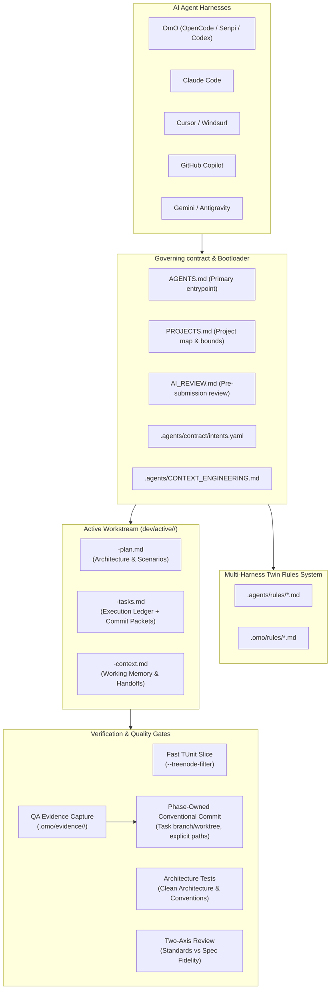

## 2. The Three-Tier Architecture: Orchestration, Phase Closure, And Domain Guardrails

The repository's agentic system divides its 40+ skills into three distinct tiers:

1. **User-Invoked Orchestration Tier (Human-in-the-Loop Governance & Execution)**: High-level governance, ethical design, planning, critique, and autonomous execution skills that the developer explicitly invokes. During execution, the developer combines the `/goal` harness command with the `implement-tasks` skill, instructing the agent to utilize Tavily MCP for external research, Context7 MCP for framework documentation, and Code-Review-Graph MCP for structural discovery, upholding Clean Architecture, enterprise-grade engineering, and pre-release greenfield breaking-change freedom (zero backward compatibility baggage).
2. **Plan-Authoring Phase Closure Tier (Commit Contract Dependency & Standalone Human Tool)**: The `conventional-commit` skill is a dependency of `implementation-plan` and `senior-cto-feedback`, used during planning and review to pre-author and validate declarative commit contracts in `tasks.md`. The active execution loop does NOT load `conventional-commit` (saving context tokens); it directly executes the pre-authored contract. Human developers also invoke `conventional-commit` standalone when making changes directly or for ad-hoc commits.
3. **Indirectly-Invoked Domain Execution Tier (Autonomous Machine Guardrails)**: Technical domain patterns, Clean Architecture rules, and tool wrappers that the AI activates autonomously in the background based on edited file paths, matched intents, and domain patterns.

### The Authoritative 5-Stage Human-in-the-Loop Lifecycle

This is the standard, end-to-end path for implementing substantial features and architectural changes:

```mermaid
flowchart TD
    subgraph Stage1["Stage 1: Ethical & Value Framing (User-Invoked)"]
        UserTrigger1["User Prompt:\n'Run i-vsd on <feature>'"] --> IVSD["i-vsd Skill\n• Evaluates Provider Responsibility\n• Sunni Islamic Moral Boundaries\n• Mitigation & Uncertainty Traceability"]
        IVSD --> IVSDDoc["Persists Deliverable in islamic-value-sensitive-design/:\n• workstreams/i-vsd-<task>.md (Tasks)\n• governance/ (Constitutional Policies)\n• consultations/ (Domain Deep Dives)"]
    end

    subgraph Stage2["Stage 2: Implementation Planning & Interrogation (User-Invoked)"]
        IVSDDoc --> PlanTrigger["User Prompt:\n'Create implementation plan for <feature>'"]
        PlanTrigger --> PlanSkill["implementation-plan Skill\n• Ingests i-vsd Deliverable\n• Runs /grill-me Technical Socratic Interrogation\n• Plane Tracking Plan: 1 item per merged PR\n• Reuse search: event/work/ + MCP PQL\n• Authors event/work/active-<task>.yaml locally (Backlog, Epic parent)\n• Dependencies: conventional-commit for commit contracts\n• (If Major Fork: robin-neutral Steelmanning)"]
        PlanSkill --> DevDocTriadInit["Initializes dev/active/<task>/\n• <task>-plan.md (Scenarios & Architecture)\n• <task>-tasks.md (Tests + Declarative Commit Contracts)\n• <task>-context.md (Ephemeral Working Memory)\n• Plane Tracking Plan in plan.md §0\n• Plane action checkboxes in tasks.md"]
    end

    subgraph Stage3["Stage 3: Adversarial CTO Audit & Socratic Stress-Test (User-Invoked)"]
        DevDocTriadInit --> CTOTrigger["User Prompt:\n'Run senior-cto-feedback'"]
        CTOTrigger --> CTOSkill["senior-cto-feedback Skill\n• Audits & Directly Refines Triad In-Place (Zero Review Files)\n• Audits Plane Tracking Plan (no flooding, no under-tracking)\n• Sets active-<task>.yaml state to Ready on approval (local)\n• 3D Scorecard (Completeness, Correctness, Coherence)\n• 4-Point Right-Sizing Check (Split PR Heuristic)\n• 'Worst Break' Catastrophic Invariant Check\n• Validates Declarative Per-Phase Commit Contracts\n• High-Signal Chat Summary"]
    end

    subgraph Stage4["Stage 4: Implementation Execution & Autonomous Domain Guardrails"]
        CTOSkill --> ExecTrigger["User Combines /goal + implement-tasks:\n• Research: Tavily MCP & Context7 MCP\n• Structure: Code-Review-Graph MCP\n• Execution-start push mints EVENT-XXX (+ M-plan Sub-items, Version Module)\n• Select active or Ready PR scope (merged, reconciled predecessors)\n• Branch feat/EVENT-<item>-<programme>-<scope> + event/ symlink\n• Plane state per pull request, never per phase\n• Conventions: Clean Architecture & Enterprise Patterns\n• Pre-Release Freedom: Zero backward compatibility baggage"]
        ExecTrigger --> AutoExecution["Autonomous Domain Execution Loop\n• Scoped extraction, or canonical section in-tree on explicit mandate\n• clean-architecture-rules\n• cqrs-guidelines\n• dotnet-efcore-guidelines\n• auth-patterns & outbox-pattern\n• debug-issue & refactor-safely\n• Fast TUnit Slicing (--treenode-filter)"]
        AutoExecution --> PhaseVerification["Phase Verification\n• One Release build\n• At most one selected project test\n• Three-Tier Failure Triage (Class A/B/C)"]
        PhaseVerification --> PhaseCommit["Immediate Phase Commit\n• Execute pre-authored declarative tasks.md contract\n• Refs: EVENT-XXX of the PR's item\n• No conventional-commit skill reload\n• Commit owned paths directly (no hash logging)"]
        PhaseCommit --> MorePhases{"More phases in this PR scope?"}
        MorePhases -->|"Yes"| AutoExecution
    end

    subgraph Stage5["Stage 5: PR Scope Exit, Reconciliation & Finalization"]
        MorePhases -->|"No"| FinalReview["PR Scope Review & Teaching Summary\n• Pre-review reconciliation against original intent\n• Comprehensive technical explanation\n• No unrelated shared-tree files committed\n• Dual-documentation parity (public vs internal)"]
        FinalReview --> KnowledgeGraduation["Knowledge Graduation & Ring 3 Gate\n• dev/backlog/, ADRs, dev/_journal/\n• Plane preflight (validate --offline, push --work-only --dry-run)\n• PR item to Review Needed (PR [EVENT-XXX] links Development panel)\n• Mandatory acceptance gate: checks affected by this PR\n• Update branch against target (no force-push)"]
        KnowledgeGraduation --> PRSubmission["PR Creation & Worktree Parking\n• Pre-flight ## Release Impact checklist + ## Issues [EVENT-XXX]\n• Park .worktrees/<programme>--<scope> for review\n• Halt & Partitioned Status Brief"]
        PRSubmission --> MergeRecon["On merge direction: post-merge reconciliation\n• Final reviewed evidence, squash/rebase aware\n• Retain unmet obligations, refresh future contracts\n• Cleanup only with current user authorization"]
        MergeRecon --> MoreScopes{"Retained programme scopes?"}
        MoreScopes -->|"Yes: next readiness evaluation"| ExecTrigger
        MoreScopes -->|"No"| Retire["Final programme acceptance\n• Fold active YAML into workitems.yaml\n• Graduate knowledge, retire canonical triad"]
    end
```

### Skill Tier Taxonomy

| Tier | Invocation Model | Key Skills | Role & Primary Responsibility |
|---|---|---|---|
| **Orchestration Tier** | **User-Invoked** (Direct developer prompt or slash command) | `i-vsd`, `implementation-plan`, `senior-cto-feedback`, `implement-tasks`, `/grill-me`, `/goal`, `robin-neutral` | Sets ethical boundaries, interrogates requirements, authors workstream triads (`dev/active/<task>/`), audits architecture, directly refines triads before implementation, and executes phases autonomously via `implement-tasks` and `/goal`. |
| **Phase Closure Tier** | **Planning/Review-Invoked Dependency; Standalone Human Tool** | `conventional-commit` | Dependency of `implementation-plan` and `senior-cto-feedback` for authoring declarative commit contracts in `tasks.md`. Normal execution does not reload the skill (conserving context); only material divergence reloads it to author recorded replacements before committing owned paths. Also used standalone by humans for manual or ad-hoc commits. |
| **Domain Execution Tier** | **Indirectly-Invoked** (Autonomously activated via matched intent, rule path, or graph trigger) | `clean-architecture-rules`, `cqrs-guidelines`, `dotnet-efcore-guidelines`, `blazor-ui-conventions`, `auth-patterns`, `outbox-pattern`, `debug-issue`, `refactor-safely`, `review-changes`, `review-pr`, `accessibility` | Enforces layer boundaries, immutable record contracts, zero-internal-mocking, fail-closed auth, transactional outbox dispatch, and two-axis review during active coding. |

### Multi-Session Cognitive Lifecycle & Session Isolation Architecture

To achieve maximum reliability, eliminate AI cognitive bias, and prevent context saturation, substantial feature work is partitioned across **three independent agent sessions**. Rather than forcing planning, adversarial critique, and implementation into a single long conversation window, each stage runs in an isolated session:

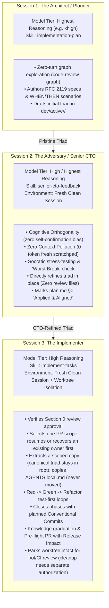

#### Why Multi-Session Isolation Is Structurally Superior

1. **Immunity to Self-Confirmation Bias (Ego-Preservation)**: When the same LLM session authors an architecture and is subsequently asked to review it, the model experiences an algorithmic attractor to defend its own previous tokens, downplay its own blind spots, and offer superficial praise. Starting Session 2 in a fresh conversation wipes the autoregressive token history. The reviewing agent evaluates the triad purely as cold, external source material with zero emotional or conversational attachment to authoring choices.
2. **Elimination of Context Pollution & Attention Degradation**: Intensive planning sessions accumulate 40,000–100,000+ tokens of raw AST searches, grep outputs, and discarded design alternatives. Forcing implementation inside that degraded context window leads to "needle-in-a-haystack" instruction loss and recency bias. Starting Session 3 fresh allows the implementing agent to dedicate 100% of its attention budget to compilation diagnostics, unit test results, and active source files.
3. **Model Tier Matching Strategy**:
   - **Planning (Session 1)**: Use the highest available reasoning model (`xhigh` / high reasoning effort) to maximize cross-module foresight, architectural synthesis, and contract precision.
   - **Review (Session 2)**: Use equal or higher reasoning effort (`xhigh` for Tiers 0–1 Sovereign/Security; `high` for Tiers 2–4). A reviewer must match or exceed the author's reasoning power to spot subtle concurrency races, transaction boundary leaks, and tenant isolation gaps.
   - **Implementation (Session 3)**: Use high reasoning models (`high`) optimized for fast, accurate code generation, precision typing, and test-first execution loops.
4. **Hermetic Worktree Environment & Local Overrides Mirroring (`AGENTS.local.md`)**: When the implementing agent initializes an isolated worktree (`.worktrees/<task-name>`), it leaves the canonical programme triad in the main checkout, writes a scoped execution copy holding only the selected PR's tasks and the shared contracts that govern them, marks the canonical section a delegated snapshot, and inspects for uncommitted local developer overrides (`AGENTS.local.md`). If present, `AGENTS.local.md` is **copied (never moved)** into the worktree root. This ensures gitignored machine settings (such as dedicated scratch mounts, environment flags, and local paths) remain active during execution without polluting git or stripping the root repository of its developer configuration. Furthermore, the worktree remains **parked and intact** upon PR creation so any subsequent bot review comments or CI check failures can be resolved in-place with zero setup friction, Cleanup is a separate operation that needs the user's current authorization after post-merge reconciliation.

---

## 3. Zero-Knowledge Cold-Start & Classification Lifecycle

When an AI agent starts work in this repository, it follows a deterministic cold-start sequence.

```mermaid
flowchart TD
    Start(["New User Request"]) --> Classify["1. CLASSIFY\nMatch intent in .agents/contract/intents.yaml\nResolve Criticality Tier (0–4)"]
    
    Classify --> CheckTier{"Criticality Tier"}
    
    CheckTier -->|"Tier 0: Sovereign\nTier 1: Security\nTier 2: Privacy"| HighCritIntake["2A. HIGH-CRITICALITY INTAKE\n• Load i-vsd and author i-vsd report\n• Proactive Socratic /grill-me session\n• Identify 'Worst Break' catastrophic scenario"]
    CheckTier -->|"Tier 3: Domain State"| StandardIntake["2B. STANDARD INTAKE\n• Bounded caller/callee tracing\n• Resolve open questions if ambiguous"]
    CheckTier -->|"Tier 4: UI / Docs"| AutonomousIntake["2C. AUTONOMOUS INTAKE\n• Local file reading only\n• Zero unnecessary interruptions"]
    
    HighCritIntake --> BlastRadius["3. ZERO-TURN BLAST RADIUS\nRun code-review-graph MCP\n(get_impact_radius_tool, get_affected_flows_tool)\nInject ~1KB Structural Context Slice"]
    StandardIntake --> BlastRadius
    AutonomousIntake --> DevDocsInit
    
    BlastRadius --> DevDocsInit["4. DEV-DOC INITIALIZATION\nCreate dev/active/<programme>/\n• plan.md: RFC 2119 + WHEN/THEN Scenarios + PR scopes\n• tasks.md: PR registry, TDD Tasks + Commit Contracts\n• context.md: Ephemeral session pause memory"]
    
    DevDocsInit --> TDDExecution["5. BEHAVIOR-BOUND TDD EXECUTION\n(Driven by implement-tasks + /goal)\n• PR scope selection & topology\n• Task N.1 (Red): Failing Invariant Tests + Compilable Stubs\n• Task N.2 (Green): Minimal Production Logic\n• Task N.3 (Refactor): Clean Architecture & DI Slicing"]
    
    TDDExecution --> LayerVerification["6. 3-RING PROGRESSIVE VERIFICATION\n• Ring 1 (Inner Loop, <2s): dotnet run -- --treenode-filter\n• Ring 2 (Phase Exit, <15s): 1 Release Build + 1 Project Test\n• Tier 0–2: Capture QA Evidence to .omo/evidence/"]
    
    LayerVerification --> FailureOwnership{"7. THREE-TIER FAILURE TRIAGE\nClass A / B / C?"}
    FailureOwnership -->|"Class A: Direct feature regression"| TDDExecution
    FailureOwnership -->|"No failure"| PhaseCommit["8. PHASE COMMIT\n• Stage owned paths\n• Commit via declarative tasks.md contract\n• No skill reload, no hash logging"]
    FailureOwnership -->|"Class B: Caller ripple (<15m align / Decision Brief)"| PhaseCommit
    FailureOwnership -->|"Class C: Pre-existing baseline rot (quarantine in context.md)"| PhaseCommit
    PhaseCommit --> MorePhases{"More phases in the selected PR?"}
    MorePhases -->|"Yes"| TDDExecution
    MorePhases -->|"No"| ReviewTeaching["9. PR SCOPE EXIT & TEACHING SUMMARY\n• Graduate durable decisions/lessons (ADRs, dev/_journal/)\n• PR acceptance gate: checks affected by this PR\n• Pre-review reconciliation\n• Pre-flight ## Release Impact PR\n• Park scope worktree for review\n• Comprehensive Teaching Summary"]
    
    ReviewTeaching --> Done(["PR Scope Submitted & Parked"])
```

### Criticality Tier Matrix

| Criticality Tier | Target Domain & Scope | Intake & Inquiry Protocol | Exploration Budget | Test & Verification Strategy | Multi-Agent Review Protocol |
|---|---|---|---|---|---|
| **Tier 0: Sovereign** | Money, payments, checkout, RSVPs, capacity holds, refund authority | Mandatory `/grill-me` on concurrency, hold expiration, rollback | Exhaustive Knowledge Graph (callers, callees, outbox, DB locks, ADRs) | Invariant-Breaker concurrency tests + real PostgreSQL evidence | Anonymized Epistemic MAD (Weighted Voting) |
| **Tier 1: Security** | Auth, Cerbos policies, tenant boundaries, migrations, tokens | Mandatory `/grill-me` on threat models, fail-closed auth, tenant spoofing | Exhaustive Graph + Policy filters + Global query filters | Invariant-Breakers + multi-provider DB and fail-closed authorization tests | Anonymized Epistemic MAD (Weighted Voting) |
| **Tier 2: Privacy** | PII fields, erasure, AI context gateway, export, audit redaction | Mandatory `/grill-me` on erasure authority, anti-resurrection, receipt tokens | Exhaustive Data Flow tracing (`*Pii`, log sinks, vector DBs) | Invariant-Breakers + log sink PII scans + purge verification | Anonymized Epistemic MAD (Weighted Voting) |
| **Tier 3: Domain State** | Aggregate root domain logic, native CQS command/query handlers | Standard Q&A (only if requirements are ambiguous) | Bounded caller/callee tracing of target aggregate/handler | Behavioral CQRS unit and integration tests | Peer Review (`backend-engineer-agent`) |
| **Tier 4: Standard UI / Docs** | Blazor client components, CSS isolation, Markdown docs, agent context | Autonomous defaults (zero unnecessary interruptions) | Local surface reading (target razor/css/doc file only) | Affordance & component render tests; Markdown schema checks | Lightweight Self-Check (`presentation-engineer-agent`) |

---

## 4. Multi-Harness Bootloaders And Actual Twin Scope

The portable authority is root `AGENTS.md` plus the intent/skill/rule system. Harness adapters are currently heterogeneous; only `.agents/rules` and `.omo/rules` are maintained as reciprocal twins.

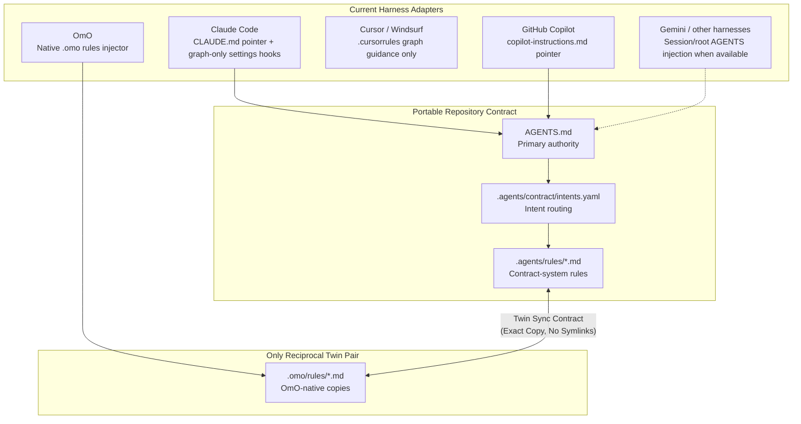

Current adapter facts:

- OmO auto-loads `.omo/rules`; the contract system routes `.agents/rules`.
- Root [`CLAUDE.md`](../../CLAUDE.md), [Copilot instructions](../../.github/copilot-instructions.md), and [`.cursorrules`](../../.cursorrules) are **pure pointers** to `AGENTS.md` with zero divergent or complementary implementations.
- GitHub Copilot auto-injects path-scoped testing conventions via [`.github/instructions/tests.instructions.md`](../../.github/instructions/tests.instructions.md) using the `applyTo` glob pattern.
- No additional Claude/Cursor/Copilot/Gemini twin directories are asserted or needed.

Harness injection order does not change repository authority. Root [`AGENTS.md`](../../AGENTS.md) remains controlling: Critical Rules → `docs/QUICK_REFERENCE.md` → `docs/GOVERNANCE.md` → matching path-scoped rules.

### The Twin Rules Synchronization Contract

- **Zero Divergence**: Every rule in `.agents/rules/<name>.md` has an exact twin at `.omo/rules/<name>.md`.
- **Reciprocal Headers**: Line 2 of every rule documents its counterpart relative path.
- **No Symlinks**: Symlinks are strictly prohibited because harness file-scanners (such as OmO's `realpathSync`) collapse symlinks into single candidates, defeating distance-weighted path matching.
- **Twin Editing Rule**: When editing any rule file, agents MUST apply the identical change to its twin in the same commit.

---

## 5. The Dev-Doc Triad & Active Workstream State Machine

Substantial or multi-session development tasks are governed by the **Dev-Doc Triad** in `dev/active/<task>/`. This structure enforces strict separation of concerns between architecture, execution, and ephemeral session memory.

> [!NOTE]
> **Local Working Memory & Gitignore Isolation**: Active workstreams in `dev/active/*` are gitignored to eliminate commit churn, task-checkbox noise, and branch merge conflicts. Agents and developers access, create, and update these files directly using native harness file tools by deterministic path. Only durable architectural decisions graduate to `docs/internal/adr/`, durable findings to `dev/_journal/`, and only explicitly optional follow-ups to `dev/backlog/`. Required work stays in the programme until it's delivered or the user removes it.

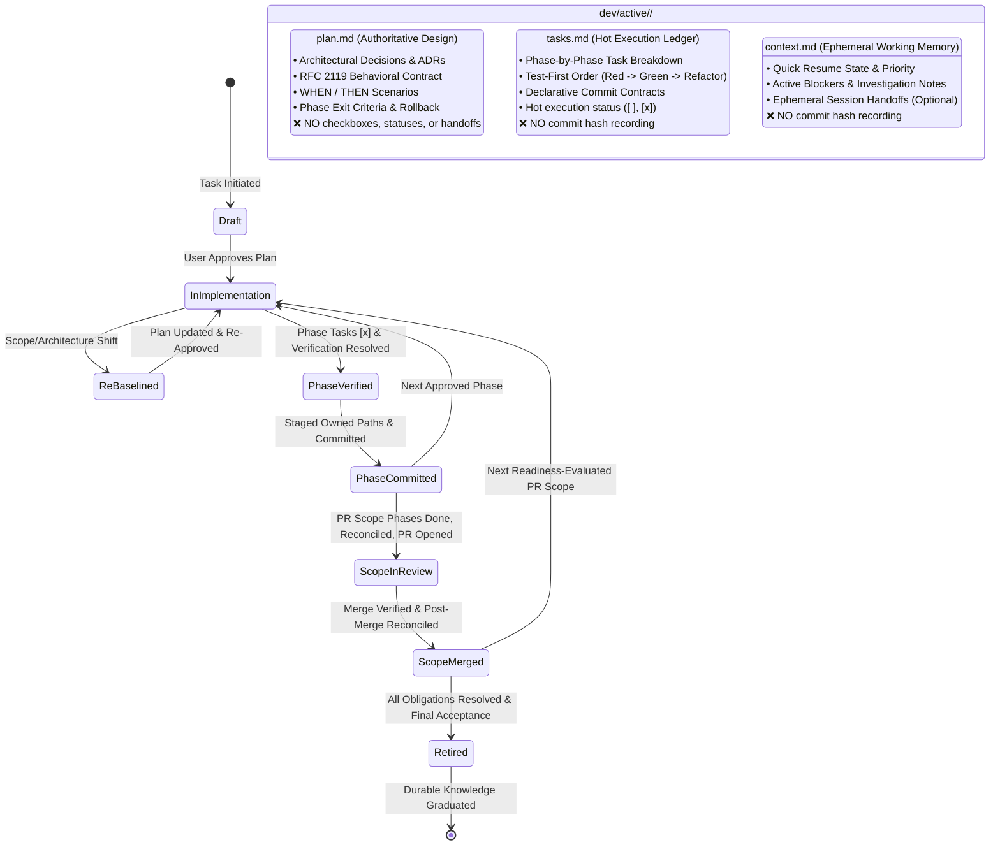

### Programme, PR Scope, Phase And Task Hierarchy

The canonical unit is the **root programme** in `dev/active/<programme>/`. It contains **independently mergeable PR scopes** with stable IDs such as `PR-FOUNDATION`; each scope contains **phases**; each phase contains **tasks** and its verified commit packets. A phase, session or commit is never a PR. The [PR scope contract](../../.agents/skills/implementation-plan/resources/pr-scope-contract.md) owns the registry fields and readiness rules, and the [PR execution lifecycle](../../.agents/skills/implement-tasks/resources/pr-execution-lifecycle.md) owns execution, reconciliation, cleanup and recovery. This section only summarizes them.

- **One live ledger per delegated scope.** The scoped execution copy is the live detailed ledger. The canonical selected checklist becomes a marked **delegated snapshot** naming its owner and location. On an explicit in-tree user mandate, the canonical section stays live and no copy is made.
- **Selection.** Resume an existing Implementing or In review scope, or its pending finalization, first. Otherwise evaluate the earliest Planned candidate whose required predecessors are merged and reconciled, and mark it Ready only when its readiness conditions hold. A missing worktree triggers recovery, never recreation. Old checked tasks never choose topology or prove delivery.
- **Extraction.** The scoped copy carries the selected tasks plus original intent, shared invariants, architecture decisions, I-VSD mitigations, merged predecessor contracts, downstream interfaces, verification, release/docs needs and explicit user overrides.
- **Two reconciliation checkpoints.** Before review and after merge, compare original intent with actual delivery. Post-merge reconciliation uses final reviewed evidence and native merge metadata, so squash and rebase merges count without original-tip ancestry. Patch only the selected canonical section and justified shared decisions, preserve independent future-section edits, and keep unmet required acceptance as a retained obligation.
- **Retention.** Intermediate merges keep the canonical triad and the shared `active-*.yaml`. Retirement happens only after every retained obligation is resolved or explicitly removed by the user, final reconciliation is current, and durable knowledge has graduated.
- **Larger programmes** keep the same single triad; more than 6 new Plane items still needs explicit approval.

### Triad Single Responsibility Matrix

| Artifact | Authoritative Responsibility | Strictly Forbidden Content | Update Frequency |
|---|---|---|---|
| `*-plan.md` | High-level architecture, design decisions, RFC 2119 contracts, `WHEN`/`THEN` scenarios, phase exit criteria, rollback handling. | Granular task checklists, `- [ ]` checkboxes, dynamic statuses (`IN PROGRESS`), ephemeral session progress. | Only when architectural direction or scope shifts. |
| `*-tasks.md` | PR scope registry (delivery, reconciliation, cleanup, delegation, PR identity, retained obligations), hot execution ledger for undelegated scopes or delegated snapshots, granular Red/Green/Refactor tasks, exact phase-owned paths, verification commands, declarative planned commit contracts, and task statuses (`[ ]`, `[x]`). | Long architectural narratives, trade-off debates, session handoff logs, commit hash recording. | During planning, after each subtask, and after each phase commit. |
| `*-context.md` | Programme resume pointer and ephemeral working memory for session pauses/handoffs, quick resume state, active blockers, loaded evidence ledger, validation baseline results. | Duplicate task checklists, full source code copies, redundant documentation paste, commit hash recording. | At start of session, on blockers, and before handoff/pause. |
### The Triad As The Sole Inter-Session Serialization Protocol

Because implementation workflows span distinct sessions (Planner $\rightarrow$ Adversarial Review $\rightarrow$ Implementer), **the Dev-Doc Triad (`plan.md`, `context.md`, `tasks.md`) serves as the stateless serialization wire between agents**.

No conversational memory, hidden assumptions, or chat dialogue survives session boundaries. If an architectural constraint, edge-case mitigation, or test requirement is not explicitly recorded in the triad, **it does not exist**.

### Zero-Loss Information Preservation Architecture

The repository strictly prohibits writing standalone `*-cto-review.md` or `*-research.md` sidecar files in `dev/active/<task>/`. In practice, separate review markdown files became **orphaned sidecars**—implementing agents rarely opened them, causing the review's stress-tests and mitigations to drift out of sync with code execution.

Instead, **100% of the CTO review's analytical depth and research findings are absorbed directly into authoritative locations across the triad**:

| Review Dimension / Element | Destination in the Triad | How & Why It Is Preserved |
|---|---|---|
| **3D Evaluation Scorecard**<br>*(Completeness, Correctness, Coherence)* | `plan.md` §0 Planning Metadata & `context.md` Review State | Records the baseline audit scores, gate status, and alignment date permanently in metadata so future sessions inherit the verified review baseline. |
| **Source-Free Research & Seams Evidence** | `plan.md` §2 Source-Grounded Current State (§2.1–§2.9) | Verified codebase reality, AST types, callers/callees, extension seams, and AST evidence live directly in the plan's current state report. |
| **Socratic Stress-Testing Challenges**<br>*(Scenarios, Questions, Edge Cases)* | `plan.md` §3 Proposed Future State & §5 Architecture Decisions | Translates Socratic challenges into explicit RFC 2119 requirements (`WHEN`/`THEN` behavioral contracts) and concrete architectural invariants. |
| **"The Worst Break" Catastrophic Failure Mode** | `plan.md` §7.1 Testing Strategy / §9 Security & `tasks.md` Phase Red Tasks | Documents the catastrophic production failure mode in the testing strategy, and immediately translates it into failing Invariant-Breaker specification tests in Phase Red before implementation. |
| **Ranked Top Risks & Minimum Acceptable Fixes**<br>*(Blocker, Critical, Major)* | `plan.md` §13/§14.2 Risk Register & `context.md` Known Risks | Preserves ranked risks with concrete mitigations, severity tiers, and verification triggers in the active risk register. |
| **Breaking Deletions & Legacy Elimination** | `plan.md` §12 Migration & Compatibility Plan & `context.md` Key Decisions | Explicitly records obsolete code, endpoints, tables, and adapter shims marked for outright deletion under greenfield development principles. |
| **Test-First Sequences & Atomic Commits** | `tasks.md` Phase Checklist & Planned Commit Contracts | Turns architectural advice into an executable, verifiable sequence of Red -> Green -> Refactor tasks with path-limited Conventional Commits. |

### The Dual-Plane Cognitive Model (Dev-Doc Triad vs Project-as-Code)

To achieve enterprise-grade maintainability, cross-agent coordination, and developer transparency without polluting git history or swamping context windows, ISLAMU Event implements the **Dual-Plane Cognitive Model**:

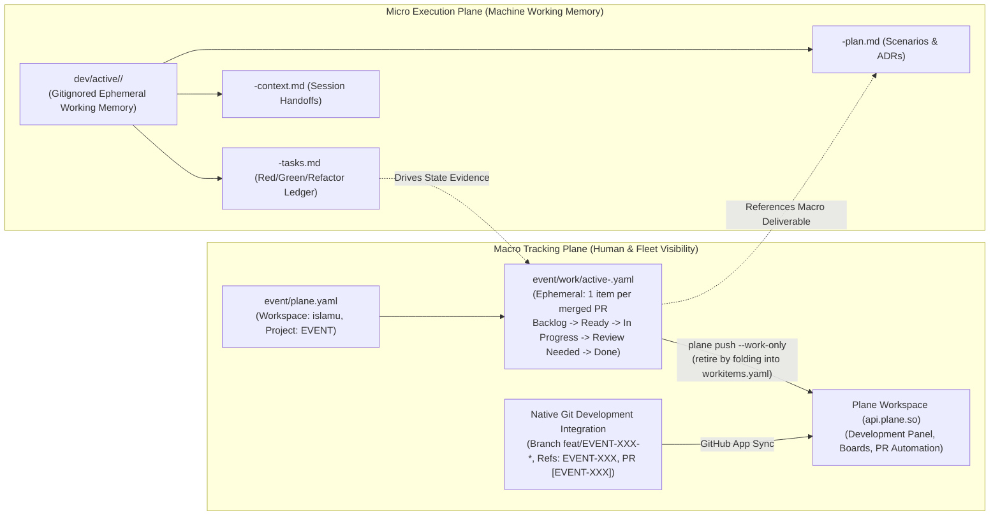

| Dimension | Dev-Doc Triad (`dev/active/<task>/`) | Project-as-Code (`event/work/active-<task>.yaml`) |
|---|---|---|
| **Audience** | Autonomous executing AI agents (inner loop machine memory). | Platform stewards, developers, cross-agent fleets, PM boards. |
| **Granularity** | Micro-execution: phases, subtasks, test assertions, compiler diagnostics, class refactors. | Macro deliverable: one item per separately merged pull request (a single-PR plan owns 1 Work Item; a multi-PR plan owns 1 parent plus 1 Sub-item per PR). Phases, tests and docs never become items. |
| **Lifecycle States** | `[ ]` unchecked $\rightarrow$ `[x]` checked, per subtask. | `Backlog` $\rightarrow$ `Ready` $\rightarrow$ `In Progress` $\rightarrow$ `Review Needed` $\rightarrow$ `Done`, moved per pull request, never per phase. |
| **Git Boundary** | Gitignored (`dev/active/*`) to eliminate commit churn and branch merge conflicts. | Gitignored (`event/`, `event-backup-*/`) for operational privacy; synchronized to remote Plane workspace. |
| **Tooling** | Native agent file tools (`read_file`, `write_file`, `edit_file`). | Plane Compose CLI for YAML fields and ID minting (`plane schema validate`, `plane validate --offline`, `plane push --work-only`); Plane MCP for Version Module membership, comments and links. |

### The Active Task Partitioning Pattern & Ephemeral Retirement (v0.5.2 One-Way Multi-File Reality)

Because `plane-compose v0.5.2` parses all `event/work/*.yaml` files on `push`/`validate`, while `plane pull` unconditionally writes **all** remote items back into `event/work/workitems.yaml` (and ignores `--merge` inside project `_pull()`):

1. **The Historical Baseline Monolith (`event/work/workitems.yaml`)**:
   - Holds the project's tracked work items (about 1,355 after the 2026-11 backlog standardization), including the 17 capability Epics.
   - **Anti-Shattering Invariant**: Moving historical items out of `workitems.yaml` into permanent domain shards causes fatal `Duplicate ID` validation errors on the very next `plane pull`. `workitems.yaml` remains intact as the historical baseline until upstream Plane Compose adds source-aware round-trip pulls.
2. **Ephemeral Active Task Files (`event/work/active-<task-slug>.yaml`)**:
   - For new in-flight workstreams, agents author a temporary, focused (< 15 KB) task file from `event/templates/active-workitem.yaml` (templates live outside `work/*.yaml` so Plane never ingests placeholder templates as live tickets). It holds only the items the plan's **Plane Tracking Plan** creates, each with `parent:` set to its capability Epic UUID.
   - **Canonical ID Minting (`id_writer.py`)**: Omit `id:` initially on brand-new active items and push once via `plane push --work-only` at execution start, before cutting the Git branch (`v0.5.2` only writes canonical `EVENT-XXX` back into YAML when `id:` was omitted; custom user slugs skip writeback).
   - **Retirement by Folding**: Intermediate PR merges keep the active file. Only after the programme's final scope merges, every retained obligation is reconciled and its items are `Done`, move the file's blocks (with their `id:`) into `work/workitems.yaml` and delete the active file. The next dry run shows no change, because `.plane/state.json` tracks items by ID, not by file. No `plane pull` is needed: on `EVENT` a full pull takes about `items ÷ 50` minutes and needs repairs before the next push, so it is a maintainer-scheduled resync only.

### Plan-Driven Plane Tracking (Right-Sized, One Item per Merged Pull Request)

Plane is useful only when its board matches how work actually merges. Flooding it with an item per phase, test or commit buries the real deliverables; folding several pull requests into one item hides progress and breaks Plane's per-PR Development panel. Plane links a branch, its commits and its pull request to exactly one `EVENT-XXX`, so the unit of tracking is the **separately merged pull request**. The full rules live in [taxonomy §4.1](project-management/work-item-taxonomy-and-granularity-report.md#41-tracking-budget-per-implementation-plan-plan--plane-mapping); the command-level protocol lives in [plan-tracking](../../.agents/skills/plane-compose/resources/plan-tracking.md).

| Plan shape | Pull requests | Plane items the plan owns |
|---|---|---|
| Trivial (typo, link fix, one-line config) | 1 | `0` (the commit uses `Changelog: skip`; no item) |
| **S** — one capability | 1 | `1` Work Item under the capability Epic |
| **M** — one capability, several PRs | 2–5 | `1` parent Work Item (no branch of its own) + `1` Sub-item per PR |
| **L** — a program of capabilities | many | one S or M Work Item per capability under an **existing** Epic; still one canonical programme triad |

- **Budget**: more than `6` new items, or a new Epic, needs the user's approval in the plan's Decision Brief.
- **Floor**: every merged pull request links to an item; substantial work is never untracked.
- **Reuse before create**: search `event/work/*.yaml` and MCP PQL first; bind an existing item when one fits (for example, the .NET 11 upgrade binds to `EVENT-6834`).
- **Never items**: phases, tests, docs, reviews, verification gates, commits, knowledge graduation. Ideas outside the plan go to `dev/backlog/`.
- **Ownership**: an agent touches only the items its plan creates or binds. Existing items, including Backlog items a maintainer assigned to themselves, stay as they are.

Each skill owns one stage of the lifecycle:

| Stage | Skill | Plane action |
|---|---|---|
| Planning | `implementation-plan` | Writes the §0 **Plane Tracking Plan** table and `active-<task>.yaml` locally (`state: Backlog`, `id:` omitted, `parent:` = Epic UUID, no assignees). M-plan Sub-items are listed in the plan only. Nothing is pushed. |
| Review | `senior-cto-feedback` | Audits the Tracking Plan for flooding and under-tracking, rewrites it in place, and sets `state: Ready` locally on approval. |
| Execution start | `implement-tasks` | Validates, dry-runs and pushes to mint `EVENT-XXX`; creates M-plan Sub-items as `Todo` under the parent UUID; moves the S item or the parent to `In Progress` with the driving developer as assignee; adds Version Module membership through MCP. |
| Each pull request | `implement-tasks` | M: Sub-item `In Progress` at PR start. PR opened after review reconciliation: `Review Needed`. Changes requested: `Changes Requested`. Verified merge plus reconciled acceptance: `Done`; the parent completes after every Sub-item and retained obligation. Blocked: `Waiting Dependency` + `blocked_by` + one MCP comment. |
| Close | `implement-tasks` | After the final scope's reconciled acceptance only, folds `active-<task>.yaml` into `workitems.yaml` and deletes it. Intermediate merges never retire it. |

The plan's `tasks.md` carries a **Plane Tracking** checklist with exactly these moments, so state changes happen at pull-request boundaries and never per phase.

### Single-Project (`EVENT`) Taxonomy, Granularity & Importance Policy

Authoritative sources: the [work-item taxonomy and granularity standard](project-management/work-item-taxonomy-and-granularity-report.md) and the [Plane project management ADR](adr/ADR-plane-project-management-standardization.md). The bullets below summarize them for agents.

- **Multi-Product Workspace vs. Single-Project `EVENT`**: `islamu` is the workspace boundary separating distinct ISLAMU products (`ISLAMU Event`, `ISLAMU Configurator`, `ISLAMU I-VSD`, `ISLAMU Identity`). **ISLAMU Event stays strictly 1 Plane project (`EVENT`)**—never create Event workspace-level rules or separate Plane projects per client surface. Internal codebase sub-projects and surfaces (`API`, `Web App`, `KMP (mobile, watch & TV)`, `Desktop (Avalonia)`, `TUI`, `CLI`, `Database`, `Payments`, `Finance`) are modeled with orthogonal **Surface/Domain Labels** and finite **`Epics`** (`type: Epic`), while **Version Modules** (`v0.1.0`, `v1.0.0`) track release scope.
- **Completable Vertical Outcomes & 3-Tier Test/DoD Rule**: Each work item must represent one finishable capability or **1 provider** (never perpetual goals like `"Make app secure"` or 8 horizontal layer tickets per entity). Standard feature tests (Domain/App/API/bUnit), EF migrations, and docs live in Acceptance Criteria + `tasks.md` (`0` Plane tickets); `parent: <uuid>` sub-work items (one level below their Work Item, so the longest chain is `Sub-item → Work Item → Epic`; `2–5` max) apply only to genuinely separate PRs or heavy standalone test campaigns.
- **Importance (`priority`) vs. Time Urgency (`Module` + `due_date`)**: `priority` (`urgent`/`high`/`medium`/`low`) encodes **functional criticality / must-have requirement level** (regulatory/legal mandates and foundational blockers = `urgent`, core killer features = `high`, optional polish = `low`, regardless of target year). Time urgency is expressed via target **Version `Module`** (`v0.1.0` = active next release) and **`due_date`**.
- **Assignees**: items an agent creates in `Candidate`, `Backlog`, `Waiting Dependency` or `Todo` carry no `assignees:`; the driving developer is assigned when the item moves to `Ready` or `In Progress`. The project has no default assignee (cleared 2026-11-13). Never strip assignments a maintainer made.
- **Right-sized tracking**: one item per separately merged pull request; see [Plan-Driven Plane Tracking](#plan-driven-plane-tracking-right-sized-one-item-per-merged-pull-request).

### Native Git Development Panel, PR State Automation & `v0.5.2` Boundaries

To benefit from Plane's native **Development** panel and **PR State Automation** without compromising YAML hygiene:
- **Never stuff commit logs or PR URLs into YAML `description:`**: Plane's GitHub integration automatically populates branches, commits, PR review status, diff stats, and CI checks when **uppercase** canonical work item IDs (`EVENT-XXX`) are present (lowercase `event-xxx` does not link):
  - **Branches:** `feat/EVENT-XXX-<task-slug>` (or `fix/EVENT-XXX-<task-slug>`) while keeping the local worktree folder predictable at `.worktrees/<task-slug>`.
  - **Commits:** `Refs: EVENT-XXX` / `Fixes: EVENT-XXX` trailers cleanly above terminal `Changelog: skip` footers (never put `[EVENT-XXX]` before `type(scope):`, which breaks `ISLAMU.ReleaseEngineering`).
  - **Pull Requests:** Place `- Plane: [EVENT-XXX]` under `## Issues` in `.github/PULL_REQUEST_TEMPLATE.md` (with brackets for Development link + PR state automation on Pro+, or unbracketed `EVENT-XXX` for reference-only linking).
- **Use Native Structural Fields in `v0.5.2`:** Always use `dependencies:` (`blocked_by`, `blocking`, schedule edges), `relations:`, `labels:`, and `work/milestones.yaml` (`work_items:`). Keep verified `v0.5.2` limitations in mind: `parent:` expects a raw parent UUID, `cycles.yaml`/`modules.yaml` do not push `work_items:` membership in `v0.5.2`, and external `links:`, `comments`, `worklogs`, `linked pages`, and late-2026 Enterprise features (`cascading` properties, work-item `audiences`, page `databases`) live outside `plane-compose` YAML (managed via Plane UI, REST API v1/v2, or MCP when enabled).

### The Worktree Symlink Protocol

Because `event/` and `event-backup-*/` are gitignored to preserve developer credentials and internal operational privacy, isolated git worktrees (`.worktrees/<task>`) do not automatically inherit the `event/` folder.

To prevent duplicated state, token drift, or conflicting cache directories:
- **Topology Discovery**: When initializing or resuming an isolated worktree in `.worktrees/<task>`, the agent discovers if `event/` exists.
- **Symlink Creation**: If absent, the agent creates a relative symbolic link pointing back to the repository root:
  ```bash
  ln -s ../../event event
  ```
- **Single Source of Truth**: This links `plane.yaml`, `.plane/state.json`, credentials, and work-item definitions directly to the root checkout, ensuring seamless offline validation and synchronized remote status across all active worktrees.

### Preflight Validation Pipeline & Sync Boundaries

Before any Plane Compose synchronization or state transition:
1. **Local Schema & Integrity Validation**:
   ```bash
   cd event && plane schema validate && plane validate --offline
   ```
2. **Dry-Run Preview**:
   ```bash
   plane push --work-only --dry-run
   ```
   Inspect the dry-run output to verify that exactly this plan's items are created or updated, with zero unexpected changes. `plane push` has no per-file filter: if another task's `active-*.yaml` shows up, move that file out of `work/` for this push and restore it right after. Do not run `plane diff` or `plane pull` as preflight: both fetch every tracked item one by one and take over an hour on `EVENT`.
3. **Safe Additive Synchronization**:
   ```bash
   printf 'y\n' | plane push --work-only
   ```
   Additive work updates must use `--work-only` and keep the conflict check on (it fetches only the items being updated). `v0.5.2` has no `--yes` flag, hence the piped confirmation. Destructive operations (`--force`, `schema sync`, `--prune`) are strictly forbidden without explicit maintainer approval.
4. **Native Git Development Linking & Commit Trailer Traceability**:
   Plane's GitHub/GitLab **Development** panel discovers branches, commits, and pull requests automatically from canonical uppercase work item identifiers (`EVENT-XXX` — never lowercase `event-xxx`, custom slugs, or fabricated IDs, and never duplicated into YAML `description:` fields):
   - **Execution-start ID minting**: At execution start, before creating the feature branch and in every topology (in-tree or worktree), push with `id:` omitted so `id_writer.py` writes the canonical `EVENT-XXX` back into `work/active-<task>.yaml`, then name the branch after the item of the pull request it carries: `feat/EVENT-XXX-<task>` (an M plan's branches use Sub-item IDs; the parent has no branch).
   - **Commit trailers**: Commits that progress or resolve pushed Plane work items use Conventional Commit trailers at the bottom of the message:
     - Progressing / Referencing: `Refs: EVENT-XXX`
     - Closing / Resolving: `Fixes: EVENT-XXX`
     Never prepend `[EVENT-XXX]` before `type(scope):` in commit subject headers (`ISLAMU.ReleaseEngineering` `CommitPolicy.HeaderPattern` enforces standard `<type>(<scope>): <description>`).
   - **Pull Request linking**: Populate `## Issues` with `- Plane: [EVENT-XXX]` so Plane links the PR to the **Development** panel and triggers native PR state automation (or `EVENT-XXX` without brackets for link-only without automated state transitions).

### The Human Interaction Boundary & Zero Plan-Opening UX (The Developer Console Principle)

While the Dev-Doc Triad (`plan.md`, `tasks.md`, `context.md` in `dev/active/<task>/`) guarantees deterministic **inter-session machine working memory**, it must **never** become an obstacle to human-agent collaboration.

A recurring breakdown in AI-assisted development is the **"curse of knowledge"**: an agent holding the entire triad in context sends cryptic, shorthand prompts to the developer:

> ❌ *“Do you approve proceeding with P04/P06 while keeping both P03 gates explicitly open?”*

This breaks flow by forcing the developer to context-switch, open `dev/active/<task>/`, and grep through markdown checklists just to understand what "P04" or "P03 gates" mean.

#### The Golden Invariant
> **The developer should never need to open the implementation plan (`dev/active/<task>/...`) just to understand an agent's question, status update, or approval request.**

- The triad in `dev/active/<task>/` is **internal working memory and an execution ledger**.
- The chat conversation is the **developer console**.
- Forcing a developer to open internal plan files to decode an agent's prompt is a severe UX defect.

#### The Mandatory Decision Brief Protocol
Whenever an agent pauses for user approval, flags an architectural choice, reports a milestone, or requests direction on blockers, the response MUST be formatted as an inline, self-contained **Decision Brief**:

1. **Context & Current Position**: 1–2 sentences on what was just completed or where the workstream currently stands.
2. **Plain-English Substance**: Always use descriptive feature/component names alongside any phase numbers (e.g., *"Phase 4 (PostgreSQL Outbox Worker & Dead-Letter Dispatch)"* instead of bare *"P04"*).
3. **The Exact Decision & Why It Matters**: Explain in plain English what decision is needed, why it arose, and what the real-world trade-off is (e.g., why gates are open, what dependencies exist).
4. **Structured Actionable Options**: Provide explicit, numbered choices with a clear recommendation (e.g., `Option A (Recommended): ...`, `Option B: ...`) and the pros/cons of each, allowing the developer to guide in seconds.
5. **Immediate Next Action**: State what the agent will execute the moment the developer replies.

#### Self-Contained Executive Plan Brief
When presenting a newly authored or re-baselined implementation plan (Stage 2 exit), agents must not merely provide file paths and ask the user to read them. The agent must deliver an inline **Executive Plan Brief**:
- **Executive Summary & Architectural Approach**: Core design pattern and business outcome.
- **Phase Roadmap**: Human-readable list of phases with descriptive names, touched layers, and invariant verification targets.
- **Key Architectural Decisions & Trade-offs**: Bulleted log of primary choices made during intake.
- **Potential Risks & "Worst Break" Catastrophic Failure Mode**: Concrete failure mode tested before production code.
- **Immediate Next Step & Approval Request**: Direct call for approval to begin Phase 1.

### The Autonomous Implementation Execution Protocol (`implement-tasks`)

When the developer executes or resumes an approved task plan using `/goal` combined with `implement-tasks`, the agent orchestrates execution through a strict, multi-stage protocol:

#### 1. PR Scope Selection & Execution Topology

The agent reads canonical `dev/active/<programme>/*-context.md` first, resolves the active scope in `*-tasks.md`, and verifies actual user approval. Selection and readiness follow the [PR scope contract](../../.agents/skills/implementation-plan/resources/pr-scope-contract.md#selection-and-readiness); the commands and setup follow the [PR execution lifecycle](../../.agents/skills/implement-tasks/resources/pr-execution-lifecycle.md#selection-and-topology). Existing ownership always wins over default setup:

| Situation | Working Context (`Cwd`) | Live Ledger | Action Protocol |
|---|---|---|---|
| **Recorded execution worktree exists** | `.worktrees/<programme>--<scope>` | Scoped copy in that worktree | **Resume in place** on its recorded branch. Don't recreate it or move the canonical triad. Copy root `AGENTS.local.md` only if missing; link `event/` if absent. |
| **Recorded owner but missing worktree, branch or source revision** | None until recovered | Unresolved | **Recover, don't duplicate**: inventory recoverable work and reconcile ownership before any setup. |
| **User explicitly selects the current checkout** | Repository root (`.`) on its current branch | Canonical selected section | **In-tree mandate**: execute the canonical section directly. No second live copy. Old `[x]` tasks alone never imply this topology. |
| **Ready scope, no previous delegation** | `.worktrees/<programme>--<scope>` | New scoped copy | **Fresh isolation**: run the scope's execution-start Plane steps, verify prerequisite merge evidence, add the worktree from the updated merged target on `feat/EVENT-<item>-<programme>-<scope>`, write the scoped copy, mark the canonical section a delegated snapshot, copy overrides and link `event/`. |
| **Legacy plan without a scope registry** | Unchanged until normalized | To be determined | Inventory actual delivery, dirty work, remaining requirements, PRs and location; normalize one selected scope before execution. No bulk migration. |
| **Hub-and-spoke inside the selected PR** | Lead plus `.worktrees/<programme>--<scope>--<cohort>` | Lead's ledger | Bounded to the selected PR: disjoint literal ownership packets, at most 3 to 5 active worktrees, projects verified one at a time. Only selected-scope changes integrate into the lead; future PRs start from the merged target. Spokes that ride the lead PR get no Plane items. Removing an integrated spoke needs current authorization and preservation checks; resource pressure doesn't authorize deletion. |

> [!IMPORTANT]
> **Canonical Programme Stays Put**: The complete triad remains under `dev/active/<programme>/` in the main checkout and is never moved into a worktree or replaced wholesale by an execution copy. One selected PR has exactly one live detailed ledger.
>
> **Local Secrets**: In an isolated directory, root `.env` may be copied only if missing, with `install -m 600`, without printing it, and only where local overrides permit. Missing secrets come from the selected approved authority. `.env`, keys and tokens are never logged or staged.
>
> **Local Overrides Mirroring (`AGENTS.local.md`)**: `AGENTS.local.md` is **copied, never moved**. Because it contains machine-specific paths and flags, copying preserves developer overrides inside the isolated worktree while keeping the repository root intact for concurrent sessions.
>
> **Concurrent Multi-Agent Task Isolation & Boundary Blindness**: When multiple independent agents work on different tasks concurrently (e.g. Agent 1 on `mapping-and-cqs-migration`, Agent 2 on `ticket-transfers`), each agent is **strictly confined to its own programme namespace** (`.worktrees/<programme>*`). When listing or checking worktrees, agents must filter by that exact namespace (`git worktree list | grep "/<programme>--"`). Agents are **strictly forbidden** from inspecting, reading, modifying, or pruning any worktree belonging to another task.

#### 2. Resume Protocol & Working Memory Discipline

When cold-starting or resuming an in-flight workstream:
1. **Scoped Orientation**: On session start, read `*-context.md` (resume pointer, blockers), resolve the selected scope in `*-tasks.md`, then load only that scope's named design headings, shared invariants and downstream contracts. In the execution location, inspect `git log -n 5 --oneline`, dirty files and the index. Agents never implement blind to the dependency contracts the selected scope affects.
2. **Execution Economy**: Don't reread the whole programme every session. Load the active phase plus the design and contracts it references.
3. **Re-Orientation Triggers**: Expand retrieval when a concrete contradiction, changed dependency, blocker or developer redirect needs it.
4. **Baseline Sanity**: Establish upstream freshness and the required baseline once before a product edit. Never pull into a dirty shared checkout or switch it for a comparison. Documentation-only scopes use document checks instead of a sliced test.

#### 3. Anti-Sprawl Task Ledger & Rolling Context Compaction Guardrails

- The live ledger is the scoped copy in the execution worktree, or the canonical selected section for an explicit in-tree mandate. Never edit both.
- **Permitted Mutations**: Check off completed tasks, append atomic verification sub-bullets, and keep implemented tasks, verification disposition and successful commits distinct.
- **Necessary Discovered Work**: Track work the selected outcome genuinely needs under that outcome, with acceptance, dependencies and owned paths, before verification. Material scope or trust changes need a Decision Brief first.
- **No Sprawl**: Don't inflate the ledger with unrelated findings. Optional unrelated ideas may graduate to `dev/backlog/`; required scope stays visible in the programme unless the user removes it.
- **Rolling Context Compaction Invariant (< 200–300 lines / < 15KB)**:
  `*-context.md` is strictly **ephemeral working memory**, NOT a permanent historical log. In multi-phase or multi-cohort migrations, agents must NEVER accumulate dozens of pages of detailed commit logs, compiler traces, or test output digests in `context.md` (which exhausts token budgets upon cold resume). Once a phase or cohort is integrated and committed to Git:
  1. Summarize the completed milestone into a concise 1-line checkpoint under `## Quick Resume`.
  2. Archive detailed findings or lessons to `dev/_journal/` or the PR description.
  3. Prune old ephemeral session logs from `context.md`. The Git commit history (`git log`) is the sole durable source of truth for commits, never markdown text dumps.

#### 4. Phase-by-Phase Execution Cadence & Three-Tier Failure Triage

Each phase follows a rigorous Red $\rightarrow$ Green $\rightarrow$ Refactor cycle in the target execution context:
1. **Red**: Author failing invariant/specification tests first for core domain, concurrency, state machines, and security boundaries. Shift pure domain invariants to `Event.Domain.UnitTests`. Scaffold compilable stub types/interfaces so the project builds cleanly while the test fails with an assertion failure at runtime.
2. **Green**: Implement minimal production code to satisfy invariants.
3. **Progressive Verification**: Run Ring 1 sliced test (< 2s) $\rightarrow$ Ring 2 phase build & designated provider test (< 15s).
4. **Three-Tier Failure Triage**:
   - **Class A (Direct Feature Regressions)**: Failing assertions in code touched by this feature. Must resolve in-phase before commit.
   - **Class B (Feature-Induced Integration Ripple)**: Unmodified callers/fixtures broken by changed contracts. If minor (< 15m), align immediately. If structural/cross-domain, pause with a Decision Brief before absorbing.
   - **Class C (Pre-Existing Baseline Rot)**: Environment quirks, unmigrated table assumptions, or failures reproducing on clean `origin/develop`. Run the same real `dotnet test --project ...` in a clean authorized comparison location (`git test` isn't a command). If it reproduces on the clean base, log under `## Quarantined Baseline Failures` in `*-context.md` and quarantine immediately. Never derail the task to fix pre-existing baseline rot.
5. **Declarative Phase Commit**: Stage owned files (`git add -- <paths>`) and commit using the planned Conventional Commit contract from `tasks.md` without loading `conventional-commit` or logging commit hashes in markdown.
6. **Reconcile Ledger**: Batch task checkbox updates in `tasks.md`.

Representative `tasks.md` declarative commit contract:

```markdown
#### Planned Commit Contract
- **Title:** `fix(registration): reject expired holds before confirmation`
- **Description:** Keep registration and capacity state unchanged when confirmation references an expired inventory hold.
- **Changelog:** Public fix
- **Files:** `src/Registration/HoldConfirmation.cs`, `tests/Registration/HoldConfirmationTests.cs`
```

#### 5. PR Scope Boundaries & Mid-Flight Re-Scoping

- **Planned Boundaries**: Planning splits the programme into independently mergeable PR scopes (for example *PR-FOUNDATION*, *PR-CORE-DOMAIN*, *PR-CONSUMERS* for a large migration). A large PR renamed as a scope fails readiness when smaller independently mergeable outcomes exist.
- **Mid-Flight Re-Scoping**: If execution shows the selected scope is too large, propose a split via a Decision Brief. Verified phases can ship as the current PR; the remaining required work becomes a retained obligation or a new scope in the **same** canonical programme, never a separate plan or a backlog move to meet a size threshold.

#### 6. Knowledge Graduation Gate (Mandatory Before PR)

Before declaring work complete or pushing, the agent promotes durable knowledge within the execution context:
- **Optional Follow-Ups**: Only explicitly optional work goes to `dev/backlog/<topic-slug>.md`. Unmet requested work stays in the programme as a retained obligation.
- **Architectural Decisions**: Create an ADR in `docs/internal/adr/ADR-<topic-slug>.md`. New ADRs use descriptive slugs (for example, `ADR-plane-project-management-standardization.md`); the numbered `ADR-0NN-*` files are historical and keep their names.
- **Lessons & Quirks**: Append to `dev/_journal/domains/<domain>.md` or `dev/_journal/journal.md`.
- Stage and commit graduation files on the task branch so they merge into `develop`.

#### 7. PR Acceptance Gate, Mass-Failure Circuit Breaker & Branch Update

1. **Mandatory PR Acceptance Gate**: Every selected PR runs the architecture, affected provider matrix, migration, public-contract, security, UI/runtime and documentation checks its actual changes require, before merge. The first validation of merged behavior is never deferred just because later scopes remain. **Final programme acceptance** then verifies cross-capability promises once their prerequisites exist. Tier 4 Markdown scopes use metadata, link, format and scenario checks only. An explicit user verification override is recorded with its boundaries, unrun checks and limits, never generalized beyond what the user said. Projects still run sequentially under the selected execution profile.
2. **Mass-Failure Circuit Breaker (> 10 Failures)**: If Ring 3 execution yields > 10 failures, the agent MUST NOT generate dozens of individual subtasks or start fixing them one-by-one. Cluster failures by root cause (shared fixture, missing test migration, secret binding, or base divergence). If failures stem from pre-existing baseline rot (Class C), quarantine them. If caused by widespread architectural mismatch, pause and deliver a Decision Brief.
3. **Branch Update**: Fetch and update the isolated branch against the current target with native Git inside the execution context. Don't rewrite published history, force-push or rebase published commits without current explicit authority. If integration changes code, rerun only invalidated checks.
4. **Pre-Review Reconciliation**: Compare original intent with delivered scope, record changed contracts, checks, limits and incomplete criteria, and patch only the selected canonical section.

#### 8. Pull Request Creation & Parked Worktree Lifecycle Protocol

1. **Push Branch**: `git push -u origin <branch>`. A rejected push needs diagnosis, never an automatic `--force-with-lease`. An in-tree mandate on `develop` doesn't authorize publishing unrelated commits or inventing a branch.
2. **Pre-Flight PR Release Impact Generation (Zero CI Failures)**:
   Never use a bare `gh pr create --fill` that omits metadata. PR descriptions MUST contain the `## Release Impact` checklist mandated by `.ci/scripts/validate-release-impact-pr.cs`. Inspect changed files against category rules:
   - `security` (auth, cerbos, keycloak, cla, secrets): `- [x] Security/auth impact documented`
   - `migration` (migrations, seed data): `- [x] Migration/data/rollback impact documented`
   - `configuration` (config, secrets, appsettings, compose, Dockerfile): `- [x] Configuration/secrets/deployment impact documented`
   - `openapi` (openapi schemas, api changelog, api controllers): `- [x] OpenAPI/client contract impact documented`
   - `operator` (self-hosting, operations, deployment, release checklist): `- [x] Operator/self-hosting/release-note impact documented`
   - If none apply: `- [x] Not applicable`
   Always provide a non-empty `Details:` section explaining the impact, release-note location, or why no release note is needed.
   Submit the PR using:
   ```bash
   gh pr create --base <target> --title "<type>(<scope>): <title>" --body "<body-with-release-impact>"
   ```
3. **Park the Worktree (NEVER Delete Upon PR Creation)**:
   Never delete `.worktrees/<programme>--<scope>` upon PR creation. The worktree must remain parked and intact so that any subsequent bot reviews (Copilot, CodeQL) or CI check failures can be resolved immediately in-place with zero setup overhead.
4. **Halt and Deliver Partitioned Status Brief**:
   Immediately after PR creation, the agent must halt its execution and deliver a self-contained status brief:
   - PR URL and branch name.
   - Confirmation of worktree status (e.g. parked at `.worktrees/<programme>--<scope>`), retained obligations and the next scope. The agent doesn't start the next PR in the same invocation.
   - **Partitioned Workstream Summary**:
     - *Delivered Features*: Capabilities and behaviors added by the approved plan.
     - *Integration Repairs*: Necessary mechanical adjustments to fixtures/callers matching new contracts.
     - *Quarantined Baseline Issues*: Pre-existing repo rot or flaky suites logged in `context.md` / `dev/backlog/` and excluded from this PR.
   - Observed CI and automated reviewer status; label unavailable or unstarted checks honestly.
   - Clear instruction to user: report review comments or CI failures, or give merge/finalization direction.
5. **Post-Merge Reconciliation**: On merge direction, verify the actual merged state with native evidence (`gh pr view <number> --json state,mergedAt,mergeCommit,baseRefName,headRefName,url` plus refreshed target history). Approval or Closed unmerged is not delivery; squash and rebase merges are proven by merge metadata and target content, not original-tip ancestry. Reconcile final reviewed changes, keep unmet acceptance as retained obligations, and correct affected future contracts.
6. **Authorized Cleanup (Separate Operation)**: Cleanup needs the user's current authorization naming the worktree and/or branches. First account for owned tracked and untracked work, ignored discoveries and context (a clean `git status` doesn't cover ignored files), and local overrides and credentials. Then, from outside the worktree, `git worktree remove .worktrees/<programme>--<scope>`. Local and remote branch deletion are separately authorized; a `git branch -d` refusal after a squash merge isn't permission to force-delete. Interrupted cleanup resumes only the remaining operations. Removing a worktree never retires the canonical programme.

---

## 6. Test-Driven Development & Behavior-Bound Seam Architecture

The repository enforces strict **Test-First Invariant Task Sequencing** to eliminate **Post-Hoc Test Tautology ("The Ugly Mirror")**—the failure mode where tests are written after code and merely mirror implementation bugs.

```mermaid
flowchart TD
    subgraph PlanContract["1. Behavioral Contract (in plan.md)"]
        SpecDoc["Requirement: System SHALL enforce capacity limits\n\n#### Scenario: Overbooking Hold Expired\n- GIVEN a reserved ticket hold expired 10s ago\n- WHEN user submits payment confirmation\n- THEN return ProblemDetails 409 Conflict with ExpiredHold code\n\n#### Scenario: The Worst Break (Double Capture Race)\n- GIVEN 2 concurrent requests for the final available seat\n- WHEN both process simultaneously\n- THEN exactly 1 succeeds and 1 fails closed with atomic rollback"]
    end

    subgraph SeamDefinitions["2. Pre-Agreed Public Seams"]
        AppSeam["Application Seam:\nIRequest<T> -> BaseCommandResponse<T> / ProblemDetails"]
        ApiSeam["API Seam:\nHTTP Route -> RFC 7807 Payload / HAL _links / Status"]
        PersistSeam["Persistence Seam:\nIQuerySpecification<T> -> Domain Aggregate Entity"]
    end

    subgraph RedGreenRefactor["3. Execution Sequence (in tasks.md)"]
        RedPhase["Task N.1 (Red Phase)\nAuthor failing Invariant Tests for Scenarios\n• Test against Public Seams only\n• Include compilable stubs (build succeeds, test fails)\n• Include 'Worst Break' Adversarial tests\n• Verify test fails with expected assertion error"]
        GreenPhase["Task N.2 (Green Phase)\nImplement Handlers, Aggregates & Domain Logic\n• Minimal production code to satisfy test\n• Verify test turns GREEN via --treenode-filter"]
        RefactorPhase["Task N.3 (Refactor & Registration)\nClean Architecture Slicing & DI\n• The Deletion Test (Deep Modules)\n• StarRedactor / HmacRedactor Zero-PII logging\n• Wire DI Service Registrations"]
        VerificationPhase["Phase Verification\n• One Release build\n• One selected project test"]
        CommitPhase["Phase Commit on Task Branch\n• Stage owned paths (git add -- <paths>)\n• Commit declarative tasks.md contract directly\n• No skill reload, no hash recording"]
    end

    PlanContract --> SeamDefinitions
    SeamDefinitions --> RedPhase
    RedPhase --> GreenPhase
    GreenPhase --> RefactorPhase
    RefactorPhase --> VerificationPhase
    VerificationPhase --> CommitPhase
```

### The 3-Ring Progressive Verification Model

To eliminate the severe 50% test diagnosis and 15% container troubleshooting bottleneck, the repository strictly stratifies test execution into three progressive rings:

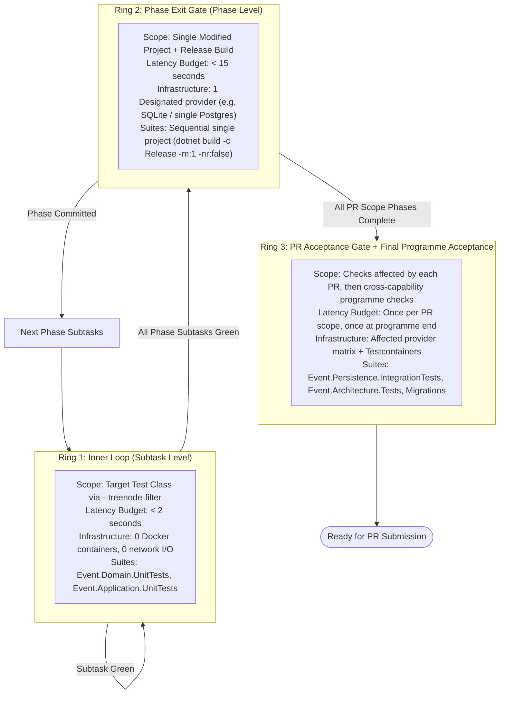

### The Yak-Shaving Quarantine Protocol

When an agent encounters a broken test outside the phase-owned path, it MUST follow the quarantine protocol rather than attempting to fix the failure:

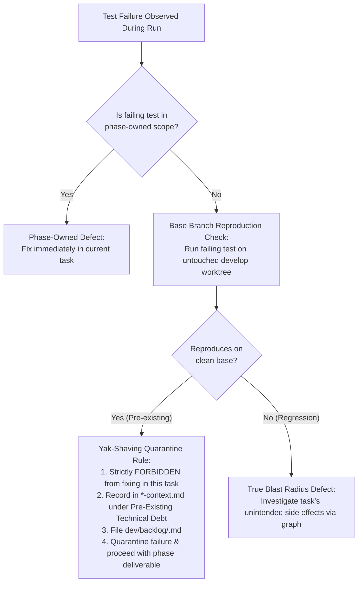

### Core Testing Invariants

1. **Pre-Agreed Public Seams**: Tests verify behavior strictly through public interfaces (native CQS operations, HTTP routes, aggregate root methods), never by inspecting private internal state or mocking internal collaborators.
2. **Compilable Stubs in Red Phase**: In strongly-typed C#/.NET, invariant tests must compile to execute. Agents must author minimal compilable stub types/method signatures (returning default or throwing `NotImplementedException`) alongside the test so that the solution compiles and the test suite executes to produce a genuine behavioral RED failure, never a compile break.
3. **No Tautological Assertions**: Expected values must originate from an independent known-good literal or specification. Assertions that recompute expected values using the same formula as production code (`Assert.Equal(items.Sum(x => x.Price), result.Total)`) are strictly forbidden.
4. **No Interface Bypassing**: Tests must verify state transitions through the public interface. A test must not bypass the domain aggregate to assert directly against raw database tables.
5. **Mock Boundary Rule**: Mock **ONLY** external third-party infrastructure (payment gateways, external email delivery, system clock, random generators). **NEVER mock internal domain entities, aggregate roots, repositories, or native CQS handlers.** Use real domain entities and in-memory or Testcontainers-backed databases.
6. **The 3-Ring Progressive Verification Hierarchy**: Subtasks run fast in-memory sliced tests (< 2s). Phase exits run single-project Release builds + single designated provider tests (< 15s). Each PR runs the affected provider matrix, migration and architecture checks at its acceptance gate before merge, and final programme acceptance covers cross-capability promises. Tier 4 docs scopes skip .NET suites; explicit user overrides apply only within their stated boundaries.
7. **The Yak-Shaving Quarantine Rule**: Unrelated pre-existing test suite rot or container flakiness is quarantined and logged under `*-context.md` / `dev/backlog/`, never repaired during unrelated feature work.
8. **Pure Domain Invariants over Persistence Queries**: 90%+ of algorithmic, normalization, validation, and state-machine checks live in `Event.Domain.UnitTests` without Docker dependencies.

---

## 7. Disciplined Bug Diagnosis Protocol

Bug diagnosis follows a disciplined 6-phase falsifiable loop from `debug-issue`. Speculative debugging and premature code editing are strictly forbidden.

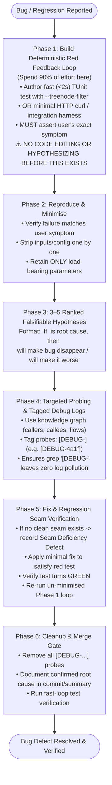

---

## 8. Two-Axis Review & Quality Gate Pipeline

Code review in ISLAMU Event evaluates pull requests along **two independent, non-polluting axes**, ensuring that clean code formatting does not mask missed functional requirements.

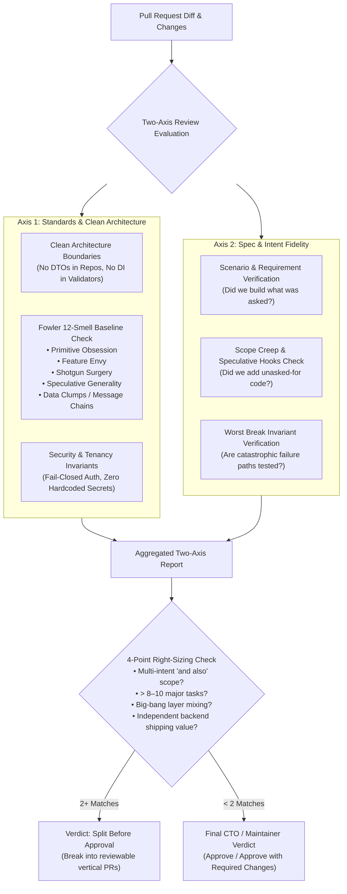

### The Fowler 12-Smell Baseline Checklist

| # | Code Smell | Diagnostic Tell in Diff | Required Refactoring Action |
|---|---|---|---|
| 1 | **Mysterious Name** | Vague identifiers (`data`, `temp`, `res`, `process()`) that obscure intent. | Rename using authoritative domain glossary terms. |
| 2 | **Duplicated Code** | Similar logic shapes recurring across multiple handlers/controllers. | Extract to shared domain aggregate or application service. |
| 3 | **Feature Envy** | Method repeatedly reaching into another object's fields to perform calculations. | Move the method onto the object that owns the data. |
| 4 | **Primitive Obsession** | Raw `string`, `int`, or `Guid` representing domain concepts (e.g. email, money). | Encapsulate into a strongly-typed Value Object or Enum. |
| 5 | **Data Clumps** | The same 3+ parameters traveling together across multiple signatures. | Bundle parameters into a cohesive Record contract. |
| 6 | **Shotgun Surgery** | A single logical change forcing small edits across dozens of scattered files. | Consolidate related responsibilities into a single deep module. |
| 7 | **Divergent Change** | One class or file edited for multiple completely unrelated reasons. | Split class by single responsibility (CQRS command vs query). |
| 8 | **Speculative Generality** | Unused hooks, generic type parameters, or abstractions added "for the future". | Delete unused abstractions; keep implementation minimal (YAGNI). |
| 9 | **Message Chains** | Long property traversals (`a.B.C.D.GetState()`) violating the Law of Demeter. | Hide the walk behind a single method on the root object. |
| 10 | **Middle Man** | A class or service that merely delegates calls without enforcing invariants. | Cut the middle man; apply **The Deletion Test**. |
| 11 | **Repeated Switches** | Identical `switch`/`if` cascades on the same enum recurring across the codebase. | Replace with polymorphism or strategy dictionary. |
| 12 | **Refused Bequest** | A subclass or implementer that overrides and throws on inherited methods. | Replace inheritance with composition. |

---

## 9. Contributor & Agent Quick Command Reference

### Fast-Loop Development Commands

```bash
# 0. Optional constrained workstation environment (low-RAM / multi-tasking):
export ISLAMU_EXECUTION_PROFILE=constrained
export DOTNET_CLI_DO_NOT_USE_MSBUILD_SERVER=1 MSBUILDDISABLENODEREUSE=1 DOTNET_GCConserveMemory=5

# 1. Fast TUnit Slicing during active subtask coding (~1.5s):
dotnet build tests/Event.Application.UnitTests/Event.Application.UnitTests.csproj --configuration Release -m:1 -nr:false --verbosity quiet
dotnet run --project tests/Event.Application.UnitTests/Event.Application.UnitTests.csproj --configuration Release --no-build -- --treenode-filter "/*/*/*<TargetTestClassName>/*"

# 2. Phase-End Verification (Run sequentially one project at a time after phase tasks are complete):
dotnet build tests/<TargetProject>/<TargetProject>.csproj --configuration Release -m:1 -nr:false --verbosity quiet
dotnet test --project tests/<TargetProject>/<TargetProject>.csproj --configuration Release --no-build --verbosity quiet

# 3. Architecture & Convention Integrity Check:
dotnet build tests/Event.Architecture.Tests/Event.Architecture.Tests.csproj --configuration Release -m:1 -nr:false --verbosity quiet
dotnet test --project tests/Event.Architecture.Tests/Event.Architecture.Tests.csproj --configuration Release --no-build --verbosity quiet

# 4. Immediate phase close on the PR scope branch (feat/EVENT-<item>-<programme>-<scope>):
git status --short
# Stage exact files owned by this phase
git add -- <phase-owned-path-1> <phase-owned-path-2>
# Commit directly using the declarative tasks.md contract:
git commit -m "<type>(<scope>): <benefit-led phase outcome>" \
  -m "<phase-owned motivation, data flow, and required trailers>"
git status --short
# Git log is the single source of truth; no commit hashes recorded in markdown.

# 5. Markdown & Diff Integrity Check (Tier 4 / Documentation tasks):
git diff --check -- .agents/ docs/ dev/

# 6. Fresh PR scope worktree (Ready scope, no previous delegation; canonical triad stays in root):
git fetch origin develop
git worktree add -b feat/EVENT-<item>-<programme>-<scope> .worktrees/<programme>--<scope> origin/develop
[ ! -f .worktrees/<programme>--<scope>/AGENTS.local.md ] && [ -f AGENTS.local.md ] && cp AGENTS.local.md .worktrees/<programme>--<scope>/
# Write the scoped plan/tasks/context copy with native edit tools; mark the canonical section a delegated snapshot.

# 7. Branch update (inside execution context; no published-history rewrite or force-push without authority):
git fetch origin develop

# 8. PR Creation with Pre-Flight Release Impact (inside execution context):
gh pr create --base <target> --title "<type>(<scope>): <title>" --body "<body-with-release-impact>"

# 9. Cleanup (from root, only after post-merge reconciliation and current user authorization):
git worktree remove .worktrees/<programme>--<scope>
```

### Critical Negative Constraints (What is FORBIDDEN)

> [!CAUTION]
> **Enforced Repository Invariants:**
> - ❌ **NO Ad-hoc Python/Node.js Scripts**: Agents must never generate or run `python`, `python3`, `node`, `npm` scratch scripts. Use native agent tools and POSIX Bash. Persistent dev tools belong in `eng/scripts/` or `eng/tools/` as C# scripts (`dotnet run eng/.../*.cs`).
> - ❌ **NO Hard-Coded Secrets**: Never put passwords, connection strings, or tokens in source code, `AppHost.cs`, or test fixtures. Secrets originate strictly from **Infisical** or **`.env`**.
> - ❌ **NO Repositories Returning DTOs**: Repositories return Domain Entities only. DTO mapping belongs strictly in Application CQS handlers.
> - ❌ **NO DI for Validators**: FluentValidation validators must be manually instantiated in handlers.
> - ❌ **NO Hand-Editing EF Migrations**: Migrations are generated artifacts (`dotnet ef migrations add`). Never manually edit migration files or model snapshots.
> - ❌ **NO UI Authorization Inspection**: Blazor client affordances must be gated strictly by inspecting HAL `_links` presence, never by local role/claim checking.
> - ❌ **NO Cryptic Shorthand or Plan-Opening Overhead**: Agents must never prompt the developer with bare phase/task IDs or gates (e.g., *"Proceed with P04/P06 while keeping P03 gates open?"*). All prompts and reports must be self-contained Decision Briefs so the developer never has to open `dev/active/<task>/...` to understand a question or decision.
> - ❌ **NO Moving of `AGENTS.local.md`**: When establishing an isolated worktree, `AGENTS.local.md` must be copied, never moved. The root machine configuration must remain intact across multiple worktrees and tasks.
> - ❌ **NO Deleting Worktrees Upon PR Creation**: The worktree `.worktrees/<programme>--<scope>` must remain parked and intact so bot reviews (Copilot, CodeQL) or CI check failures can be resolved in place. Cleanup is a separate operation that needs post-merge reconciliation and the user's current authorization.
> - ❌ **NO Unbounded Worktree Accumulation**: Hub-and-spoke work stays inside the selected PR with at most 3 to 5 active worktrees. Integrated spokes are removed only with current authorization and preservation checks.
> - ❌ **NO Force As A Shortcut**: Never force-push, force-delete a branch or prune siblings to unblock work. A rejected push or `git branch -d` refusal needs diagnosis.
> - ❌ **NO Moving Or Wholesale Replacing The Canonical Triad**: `dev/active/<programme>/` stays in the main checkout; reconciliation patches only the selected section.
> - ❌ **NO Cross-Programme Worktree Tampering**: Agents must never inspect, modify, or delete worktrees or branches outside their `<programme>` namespace. `git worktree list` output must be filtered to that namespace.
> - ❌ **NO Context Ledger Inflation**: Agents must never allow `*-context.md` to balloon into a multi-megabyte or hundreds-of-lines log of every commit. Use rolling checkpoints (< 200–300 lines) and delegate durable records to `dev/_journal/` or the Git commit graph.
> - ❌ **NO Dynamic Scope Creep in `tasks.md`**: Only work the selected outcome genuinely needs is tracked under it, with acceptance and owned paths; material scope changes need a Decision Brief. Unrelated optional ideas go to `dev/backlog/`, and required work is never moved there to shrink a PR.
> - ❌ **NO Yak-Shaving Unrelated Test Rot**: Never derail feature tasks to fix pre-existing failures in unrelated test suites. Isolate on clean base, log under `*-context.md` / `dev/backlog/`, and quarantine.

---

## 10. Lightweight Workflow Guard

The repository intentionally does not implement an “Agent OS.” There are no
workstream manifests, concatenated plan/task/context digests, approval receipt
chains, file claims, heartbeats, lock daemons, persistent goal state machines,
custom context packet compilers, or harness-wide orchestration authority. Git
commits provide provenance; branches and worktrees provide concurrency.

`eng/agent-workflow` is a small, read-only guard with two commands:

```bash
dotnet run --project eng/agent-workflow/src/ISLAMU.AgentWorkflow/ISLAMU.AgentWorkflow.csproj -- validate-intents .agents/contract/intents.yaml
dotnet run --project eng/agent-workflow/src/ISLAMU.AgentWorkflow/ISLAMU.AgentWorkflow.csproj -- validate-commit -- git commit --only -m "message" -- src/ExactFile.cs docs/ExactFile.md
```

The first command checks that the authoritative intents catalog is one bounded,
valid UTF-8 YAML document. The second checks only that a described `git commit`
uses distinct literal file pathspecs after `--`; it rejects `.`, directories,
globs, traversal, rooted paths, Git pathspec magic, controls, and duplicates.
The guard never executes Git or mutates repository state.

## 11. Related Documentation & Authoritative Anchors

- [`AGENTS.md`](../../AGENTS.md) — Authoritative agent contract and entrypoint.
- [`PROJECTS.md`](../../PROJECTS.md) — Solution project boundaries, roles, protected paths, and targeted verification commands.
- [`AI_REVIEW.md`](../../AI_REVIEW.md) — Fast 30-second pre-submission self-review checklist.
- [`.agents/CONTEXT_ENGINEERING.md`](../../.agents/CONTEXT_ENGINEERING.md) — Context budget policy and retrieval limits.
- [`.agents/contract/intents.yaml`](../../.agents/contract/intents.yaml) — Machine-readable task and intent registry.
- [`docs/QUICK_REFERENCE.md`](QUICK_REFERENCE.md) — Global invariant quick reference.
- [`docs/GOVERNANCE.md`](GOVERNANCE.md) — Architectural governance, coding patterns, and conventions.
- [`docs/DOCUMENTATION_ARCHITECTURE.md`](DOCUMENTATION_ARCHITECTURE.md) — Documentation structure, layout, and maintenance rules.
