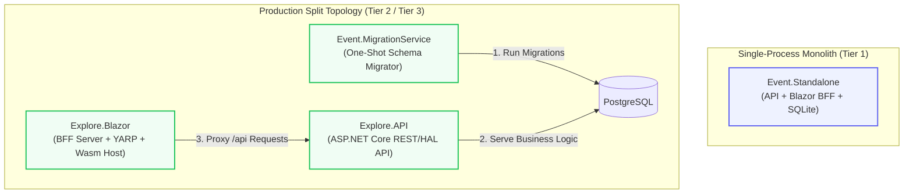

<!-- ABOUTME: Architectural specification of C# composition roots, hosting topologies, and startup lifecycle phases. -->
<!-- ABOUTME: Defines the runtime boundary between Explore.API, Explore.Blazor, Event.Standalone, and Event.MigrationService. -->

# Hosting Architecture & Composition Roots

Last Updated: 2026-09-03 Europe/Brussels

---

## 1. Composition Roots & Assembly Responsibilities

### Early request admission and fleet acceptance

`EarlyRequestAdmission` is a process-owned singleton shared by HTTP and native
in-process dispatch. It permits at most 32 requests in flight with no queue.
Internal dispatch occupies that same total, with an additional 8-request subgroup
ceiling. A private typed context feature is created by `MarkRequest`; neither
loopback addresses nor copied headers create that identity. Named post-auth
policies remain in place, without their former unlimited-loopback branch.

Dedicated API and Combined execute forwarding once, then acquire admission before
effective-host reservation reads, HSTS, routing and authentication. Dedicated BFF
acquires after its forwarding and before path/host resolution or cookie work.
Combined does not reacquire inside its Blazor branch. Native dispatch applies the
same singleton directly because its bound pipeline skips the outer listener.
A private active-lease marker prevents double acquisition within one context.
Completion, cancellation and exceptions release capacity; that release is not
business rollback proof and never releases a durable idempotency identity.
Long-lived responses occupy capacity until their pipeline completes.

Effective peers use finite 600-request windows, IPv4 /24 or IPv6 /64 networks
use 6,000-request windows, and internal dispatch uses 1,200-request windows.
Windows last one minute from bucket initialization/reset and use monotonic time.
The 4,096 peer/1,024 network shard tables have fixed size. Hash collisions share
conservative budgets; unknown peers share finite capacity. Shards are neither
tenant nor account authority, and no peer identities become metric labels.
Rejection is an empty private/no-store 429 with Retry-After. Only explicit
`EarlyAdmission:DisableInTesting=true` may disable this gate, selected before
service registration; production rejects that input. Security regressions assert
the enabled state and actual rejection before native cookie/domain work rather
than inheriting the legacy post-auth Testing NoLimiter path.

**Fleet acceptance is separate and mandatory before public deployment sign-off.**
No local counter proves a shared fleet budget or bounds TLS work before HTTP.
The selected ingress must supply recorded replica count, aggregate in-flight
ceiling/zero-queue behavior, shared peer/network window inputs, effective-client
forwarding sanitation, finite connection limits, TLS-handshake/header/request
timeouts, and listener/backend ACL configuration. Record their actual rendered
configuration and deployment revision, not just proposed values. Backends and
private operational listeners must not be publicly reachable or reachable by a
path that bypasses the governed ingress.

The final programme gate must exercise at least two real backend processes
through that ingress, subscribe to admitted/rejected work signals, and show the
aggregate ceiling, preserved valid controls, and failed direct-backend/forged
forwarding bypasses. Node-only TestServer fixtures are not that receipt. Fleet
sign-off requires both enforcement inputs and the two-process evidence; missing
or untestable perimeter enforcement leaves the fleet deployment unsupported.
Do not substitute per-replica counters, a Testing disable flag, or a pretend
Redis limiter for this prerequisite.

### Effective transport, domain authority and operational listeners

`UseEffectiveHostAuthority` is the outer HTTP boundary in both dedicated API and
Combined hosting. Trusted forwarding runs once before HSTS, redirects, routing,
authentication bridges or admission. `ForwardedHeadersTrustOptions` bounds hop
count and proxy/network lists and requires matching proto/host/peer chains.
Unconsumed, malformed, over-limit or untrusted forwarding is rejected with an
empty, non-cacheable 400 rather than being reused by downstream consumers.
The Combined in-process dispatcher is bound after this outer listener boundary;
its server-created transport is not an externally trusted proxy.

`EffectiveHostAuthorityOptions` is deployment-owned. Its canonical authority
comes from `PublicBaseUrl`/`PUBLIC_BASE_URL`, unless the structured
`EffectiveHostAuthority:CanonicalOrigin` is explicitly selected. The local
default is `https://localhost`; public deployments must configure their real
origin and any exact API/admin host aliases. `AllowedHosts=*` does not authorize
an effective host. `EventTicketingController` gives route generation the
configured canonical scheme and authority for both onboarding callbacks.

Custom domains require a manual operator ownership attestation with exact host,
tenant UUID, proof receipt reference and verified/expiry timestamps. Validity is
at most 24 hours. Only the deployment operator can install or revoke these
attestations; tenant settings cannot issue one. Each request also queries
`ITenantLookupSource.GetCurrentDomainTenantAsync` for one unambiguous current
active reservation. PostgreSQL uses its existing constrained public-directory
function, not a new Global privilege; other providers retain the named tenant
filter bypass. No database schema or migration is introduced.
`TenantSlugCache` no longer grants domain authority from positive cache hits.
Expiry is checked per request; configuration reload revokes installed receipts,
and environment deployments require a coordinated restart of every replica.
This is not an automatic DNS proof service. External proof collection, receipt
custody and renewal belong to the operator.

Instance subdomains use exactly one label beneath an explicitly approved
instance base, with the existing resolver enabled and a fresh active subdomain
reservation. Custom domains and subdomains still follow trusted slug-header
precedence; the host gate itself runs even for tenant-exempt routes. Existing
root-slug browser routing remains available.

`OperationalEndpointAccess` confines `/health`, its webhook readiness siblings,
and `/metrics` to the configured private local IP and local port. It reads
connection features, never forwarded IP, `Host`, or an ordinary user role.
Absent configuration denies access. Deployment must bind that separate listener
and prevent ingress from routing public traffic to it; the authorization settings
do not bind Kestrel. `/alive` still evaluates only live checks and returns status
200/503 with an empty non-cacheable body. Positive readiness fixtures model that
private socket explicitly, without a product `Testing` exemption.

Reserved-root assurance consumes `Routes.CreateRouteCatalog()` from the shipped
compiled client, mapped API/operational endpoints, and the referenced Standalone
build's static-asset endpoint manifest. The same client factory feeds the UI.
Unknown parameter/catch-all roots and missing reservations emit deterministic
machine-field failures. Dotted static filenames, including changing build
fingerprints, are ineligible tenant roots without generating production
constants from tests. Existing reservations are retained.

Phase 19 source/tests are authored; executable acceptance is deferred by the
programme-wide execution freeze. Operator instructions are in
[custom domains](../public/documentation/readme/administration-and-branding/custom-domains-and-seo.md)
and [environment variables](../public/documentation/readme/configuration-and-operations/environment-variables.md).

ISLAMU Event divides its runtime hosting across four distinct composition roots:



### 1. `Explore.API` (REST / HAL API Server)
* **Assembly**: `src/Explore.API/`
* **Entrypoint**: `Program.cs`
* **Role**: Primary domain and persistence authority. Hosts all native CQS request handlers, Cerbos/Local authorization evaluation, EF Core DbContexts (`ExploreDbContext`, `PrivacyErasureDbContext`), OpenAPI/Scalar endpoints, and webhook ingest/dispatch engines.
* **Network Exposure**: In production split topologies, `Explore.API` is internal to the container network (`islamu-network`) and communicates with `Explore.Blazor` over private HTTP/gRPC.

### 2. `Explore.Blazor` (Backend-for-Frontend & UI Host)
* **Assembly**: `src/Explore.Blazor/` (Server) & `src/Explore.Blazor.Client/` (WebAssembly Client)
* **Entrypoint**: `src/Explore.Blazor/Program.cs`
* **Role**: BFF host managing OAuth2/OIDC sessions, HTTP-only anti-forgery session cookies, YARP reverse-proxy routes forwarding `/api/*` requests to `Explore.API`, and serving static MudBlazor WebAssembly assets.
* **Network Exposure**: Publicly exposed via reverse proxy (Traefik/Caddy/Nginx) on port 80/443.

### 3. `Event.Standalone` (Monolithic Lightweight Host)
* **Assembly**: `src/Event.Standalone/`
* **Entrypoint**: `Program.cs`
* **Role**: Unifies `Explore.API` endpoints and `Explore.Blazor` BFF server into a **single .NET process**. Uses SQLite (`Data Source=/app/data/islamu.db`) and embedded migrations, enabling single-container deployments on resource-constrained servers (1 vCPU, 2 GB RAM).

### 4. `Event.MigrationService` (One-Shot Database Migrator)
* **Assembly**: `src/Event.MigrationService/`
* **Entrypoint**: `Program.cs`
* **Role**: Ephemeral container executed during deployment before `Explore.API` accepts traffic. Applies EF Core migrations atomically to PostgreSQL, seeds baseline lookup tables, and exits with code `0`.

---

## 2. Startup Lifecycle & Phase Ordering

Application startup in `Explore.API` and `Event.Standalone` executes in deterministic, sequential phases:

```
[Phase 0: Config & Secrets] ──► [Phase 1: DB Readiness] ──► [Phase 2: Migrations]
                                                                    │
[Phase 5: HTTP Pipeline]    ◄── [Phase 4: Caching/Outbox] ◄── [Phase 3: AuthN Discovery]
```

1. **Phase 0 (Configuration & Options Binding)**:
   * Select and acquire the declared authority through `Explore.ServiceDefaults/Secrets` before projecting startup configuration. Environment, Infisical, and Development/Testing-only User Secrets are explicit selections, not a fallback chain.
   * The selected owner bounds borrowed operations and their disposal. Serving hosts may explicitly start its session-local Infisical token-maintenance helper; this renews authentication only, with no secret polling, relogin, or operation replay.
   * `Explore.Persistence/Database` owns database binding/bootstrap and migration acquisition. `Explore.ServiceDefaults/DataProtection` asynchronously prepares the exact two-value ring/admission group before synchronous provider resolution; readiness reacquires fresh authority rather than trusting prepared memory.
   * Bind strongly typed options classes (`IOptions<TOptions>`) and execute `ValidateDataAnnotations()` and `ValidateOnStart()`.
2. **Phase 1 (Storage & Infrastructure Readiness)**:
   * Perform TCP connection test to PostgreSQL or test file write permissions for SQLite.
3. **Phase 2 (Schema Migrations)**:
   * Execute `DbContext.Database.MigrateAsync()` for main application and privacy-erasure contexts.
4. **Phase 3 (Identity & OIDC Handshake)**:
   * Fetch OpenID Connect discovery document from Keycloak (`/.well-known/openid-configuration`) and cache public signing keys (JWKS).
5. **Phase 4 (Cache & Asynchronous Workers)**:
   * Initialize Redis multiplexer connection pool (or in-memory cache fallback).
   * Start `EmailDispatchWorker` and `WebhookOutboxWorker` background services.
6. **Phase 5 (Middleware Pipeline Registration)**:
   * The outer listener resolves trusted effective forwarding and host authority first. HSTS/redirects and the ordinary API exception/security pipeline follow; routing selects endpoint metadata before tenant/authentication/authorization consumers.

---

## 3. BFF Data Protection Key Ring & Stateless Checkout Tickets

In Split topology, `Explore.Blazor` protects short-lived browser payloads, including the registration
payment checkout ticket, with its own Data Protection key ring. That ring is
configured in `src/Explore.Blazor/Extensions/BffDataProtectionExtensions.cs`:

* The application name is always pinned to `islamu-event`.
* When `ConnectionStrings:cache` is absent, keys stay in the local native key store
  (filesystem or platform default for the host).
* When a cache connection string is present, keys persist to Redis under
  `islamu-event:data-protection-keys`.

Two consequences matter for topology decisions:

1. **Database-backed keys in `Explore.API` do not extend to a separate Split BFF.** The API's
   `DataProtectionKeyContext` covers API-issued payloads. A Split BFF still resolves
   its ring from the rules above, so operators must decide separately how BFF keys
   are shared.
2. **Multi-replica BFF requires a shared ring and the same application name.** A
   ticket protected by replica A is unreadable on replica B unless both read the same
   keys. Sharing a mounted key directory satisfies this; so does the Redis ring. If
   the Redis ring is chosen, Redis availability becomes part of the BFF's critical
   path even though checkout itself stores nothing there.

Combined `Event.Standalone` uses a single service container, not separate rings:
`Program.cs` calls `AddApiHostServices` before `AddBlazorHostServices`. Without
cache, the API's `PersistKeysToDbContext<DataProtectionKeyContext>()` registration
remains effective for the entire process, including the BFF. With cache configured,
the later BFF Redis repository registration replaces that selection process-wide.
These existing registration rules are unchanged by stateless checkout tickets.

Checkout tickets themselves are stateless. The BFF keeps no nonce, no Redis entry,
and no in-memory ticket dictionary: the target URL, audience, session digest, and
expiry all live inside the protected cookie value. Redis stays optional for checkout
storage. It is not optional as a shared-key mechanism once you pick it as the ring.
Contract details live in [PAYMENTS.md](PAYMENTS.md).

---

## 4. Multi-Platform Container Packaging & Runtime Model

All ISLAMU Event container images (`Explore.API`, `Explore.Blazor`, `Event.MigrationService`, and `Event.Standalone`) are packaged as **multi-architecture OCI manifest lists (Image Indexes)** targeting `linux/amd64` and `linux/arm64`:

```text
                  ghcr.io/islamu-ngo/islamu-event-api:latest
                                      │
                  ┌───────────────────┴───────────────────┐
                  ▼                                       ▼
          [linux/amd64 Layer]                     [linux/arm64 Layer]
         (Intel / AMD x86_64)                    (ARM64 / aarch64)
```

### 1. Single-Tag Registry Distribution
Adopters reference a single, authoritative image tag (e.g. `:latest`, `:develop`, or semantic release tags). The Docker daemon / container runtime inspects the host CPU architecture and transparently pulls only the matching architecture slice without operator intervention or architecture-specific tag suffixes.

### 2. Native Cross-Compilation Build Pipeline
To avoid the significant 5×–10× performance penalties of running the full .NET SDK under QEMU emulation on x64 CI runners, the build stage uses native cross-compilation:
* **Host SDK Stage**: `FROM --platform=$BUILDPLATFORM mcr.microsoft.com/dotnet/sdk:10.0@sha256:...` executes Roslyn, MSBuild, and CLI tools natively on the runner's architecture.
* **Target Architecture Argument**: Buildx injects `ARG TARGETARCH` (`amd64` or `arm64`).
* **DotNet Cross-Publish**: `-a $TARGETARCH` instructs the native .NET SDK to restore and publish IL assemblies targeting the target runtime.
* **Runtime Layer**: The final stage binds the native target architecture runtime (`aspnet:10.0` or `runtime-deps:10.0-noble-chiseled-extra` chiseled Ubuntu).

### 3. JIT Dynamic PGO Preserved (No ReadyToRun Overhead)
Images distribute pure Intermediate Language (IL) assemblies rather than Ahead-Of-Time (AOT) or ReadyToRun (R2R) pre-compiled binaries. This preserves:
* Unrestricted reflection compatibility with EF Core query generation, Blazor WebAssembly component parameters, and dynamic FluentValidation rules.
* Modern .NET 10 Tiered Compilation and **Dynamic PGO (Profile-Guided Optimization)**, enabling the JIT compiler to devirtualize and inline frequently called CQS command/query handlers and authorization decorators based on actual production traffic patterns.

### 4. Host OS Compatibility Matrix
* **Linux (AMD64 & ARM64)**: Native bare-metal / VPS container execution (standard cloud nodes, Hetzner CAX/CPX, AWS Graviton).
* **macOS (Apple Silicon & Intel)**: Native container execution inside the macOS lightweight Linux hypervisor (Docker Desktop, OrbStack, Colima). Apple Silicon Macs execute the `linux/arm64` slice natively on M-series cores with zero Rosetta translation overhead.
* **Windows (WSL2 / Hyper-V)**: Fully supported through the WSL2 Linux kernel backend.
* **Windows Server (Native Windows Containers)**: Deliberately unsupported. The application uses Linux base images (`aspnet:10.0`, `runtime-deps`). Native Windows Server container mode (`Windows Server Core` / `NanoServer`) is not utilized, following cloud-native industry standards. Operators running on bare Windows Server should deploy as a Windows Service or via IIS.

---

## 5. Operational Deployment Runbooks (Public Source of Truth)

For step-by-step container configuration, Docker Compose YAML manifests, environment variables, reverse proxies, and backup/restore procedures, **refer exclusively to the authoritative public documentation**:

* 📖 **[Deployment Tiers & Hardware Sizing](https://islamu.gitbook.io/islamu-event/documentation/readme/self-hosting/deployment-tiers)**
* 📖 **[Docker Standalone Runbook](https://islamu.gitbook.io/islamu-event/documentation/readme/self-hosting/docker-standalone)**
* 📖 **[Docker Compose Production Runbook](https://islamu.gitbook.io/islamu-event/documentation/readme/self-hosting/docker-compose)**
* 📖 **[Coolify with Cerbos & Traefik](https://islamu.gitbook.io/islamu-event/documentation/readme/self-hosting/coolify-cerbos-traefik)**
* 📖 **[Environment Variables Reference](https://islamu.gitbook.io/islamu-event/documentation/readme/configuration-and-operations/environment-variables)**
* 📖 **[Secrets Management Guide](https://islamu.gitbook.io/islamu-event/documentation/readme/configuration-and-operations/secrets)**
