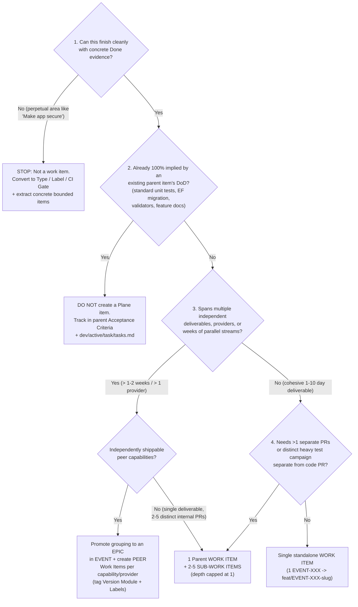

# ISLAMU Event — Plane Work-Item Granularity & Project-as-Code Taxonomy Standard

> **Audience:** Contributors | Maintainers | AI agents
> **Status:** Implemented
> **Owner:** Contributor Experience | Agent Context
> **Last Verified:** 2026-11-12
> **Source Anchors:** `docs/internal/adr/ADR-plane-project-management-standardization.md`, `.agents/skills/plane-compose/SKILL.md`, `.agents/skills/plane-mcp/SKILL.md`, `.agents/rules/plane-tracking.md`, `AGENTS.md` (Critical Rule 20)
>
> **Binding decision record:** [ADR — Plane Project Management Standardization](../adr/ADR-plane-project-management-standardization.md). Paths under `event/` are the gitignored local Plane Compose project; they are named in backticks rather than linked because they never exist in a clean clone.

> **Scope:** Authoritative research report and convention for managing Plane work items inside the single **`EVENT` (`ISLAMU Event`) Plane Project** across multi-year development (API, Blazor BFF/WASM, future Avalonia Desktop, TUI, CLI, expanding database providers, payment providers, auth providers, and integrations).
> **Workspace Boundary Rule:** **`ISLAMU` is the multi-product Plane Workspace** containing distinct solution projects (`ISLAMU Event`, `ISLAMU Configurator`, `ISLAMU I-VSD`, `ISLAMU Identity`, etc.). **ISLAMU Event is permanently 1 Plane Project (`EVENT`)**—never expanded into workspace-level configuration and never fragmented into multiple Plane projects per client.
> **Evidence Base:** Empirical audit of `event/work/workitems.yaml` (2,616 items), `event/schema/*.yaml`, `event/workspace.yaml`, `event/work/modules.yaml`, and `PROJECTS.md`, synthesized with Plane official documentation, the Linear Method, Basecamp Shape Up, Bill Wake's INVEST, Mike Cohn / Richard Lawrence's SPIDR, and Microsoft Azure Boards / Definition-of-Done standards.

---

## Executive Diagnosis: Where Both Failure Modes Meet Today

An empirical audit of `event/work/workitems.yaml` (`2,616` items) and `event/schema/` reveals that ISLAMU Event's backlog simultaneously suffers from **all four classic work-item scaling pathologies**:

| Metric Observed in `event/` | Observed Value | Diagnostic Meaning |
|---|---|---|
| Total items / unstarted queue | `2,616` total (`1,206` `Backlog` + `243` `Candidate` = **`1,449` open unstarted** vs `982` `Done`) | **Backlog bloat & triage collapse:** unstarted work outweighs shipped work nearly `1.5:1`, burying high-leverage active work in search/board clutter. |
| Configured `Epic` type vs usage | `Epic` defined in `types.yaml` (`is_epic: true`, `level: 1.0`) · **`0` items** use it | **Flat backlog (missing middle tier):** strategic multi-week programs have no container separating them from individual PR-sized deliverables. |
| Sub-work items (`parent:`) | **`2`** out of `2,616` (`0.08%`) | Either large multi-pillar items are flat mega-blobs or internal layers are exploded into sibling top-level tickets. |
| Type sprawl across horizontal layers | `1,674` `Feature`, `322` `Docs`, `257` `Test`, `151` `Security`, `75` `CI/CD`, `53` `Chore`, `40` `Config`, `37` `Bug`, `7` `Refactor` | **`619+` standalone `Test` + `Docs` + `Config` tickets** competing at top level with real user/platform deliverables. |
| 8-ticket-per-entity pattern (`EVENT-5020..5090`) | Every domain noun (`Tenant`, `Organizer`, `Organizer Team Member`, `Event`, `Event Draft`, `Session`, `Track`, `Venue`, `Speaker`, …) split into 8 identical horizontal tickets | **Classic Horizontal Micro-Slicing:** *"Model X data structure"*, *"Create X API contract"*, *"Prototype X list screen"*, *"Prototype X detail screen"*, *"Add X validation rules"*, *"Add X audit events"*, *"Create X acceptance tests"*, *"Document X behavior"* — none ships end-to-end value independently. |
| Perpetual & Mega-Blob titles | `EVENT-453` (`Payment Integration (Stripe/PayPal)`), `EVENT-1161` (`Keycloak Security`), `EVENT-478` (`Security Audit`), `EVENT-430` (`Testing Coverage Improvement`) | **Non-atomic bundles** and **unfinishable continuous areas** that can never cleanly transition to `Done`. |
| Dependency/Relation/Property/Module hygiene | `0` `dependencies:`, `1` `relations:`, `0` `properties:`, `2,614/2,616` pre-assigned; `modules.yaml` uses `v0.1.0` and `v1.0.0` | `Modules` are intentionally acting as **Version / Release buckets** (valid in Plane without needing higher-tier Releases), but missing `Epics` (`0`) leaves no capability layer below versions; pre-assigning `2,614` items turns active queues into noise. |

> [!IMPORTANT]
> **Core Thesis:** Our goal is **zero backlog theater**. Every Plane ticket carries recurring human + AI context cost (triage, `workitems.yaml` diffing, validation, state transitions). A Plane work item must represent a **completable, independently verifiable outcome**, while routine engineering mechanics (`unit tests`, `EF migrations`, `validators`, `docs parity`, inner-loop subtasks) live in the **Definition of Done** and our **Micro-Execution Plane (`dev/active/<task>/tasks.md`)**—never as standalone Plane tickets.

---

## 1. Industry Synthesis: Why Micro-Tickets & Mega-Blobs Both Fail

Across high-performing engineering organizations using **Plane**, **Linear**, **Shape Up**, and **Azure Boards**, five non-negotiable principles govern work-item granularity:

1. **Vertical Slicing over Horizontal Slicing (INVEST + SPIDR):**
   - A **Vertical Slice** cuts through the slices needed to make one coherent capability work and verify end-to-end (Domain + Application + API/Persistence + Client UI/Tests). It satisfies Bill Wake's **INVEST** rule: **I**ndependent, **N**egotiable, **V**aluable, **E**stimable, **S**mall (fits inside one cycle / ~1–5 days of focused execution), **T**estable.
   - **Horizontal Slicing** splits along architectural layers (*"Data model ticket"*, *"API DTO ticket"*, *"Unit test ticket"*, *"Docs ticket"*). Neither ticket works on its own, delaying integration until the last layer lands.
   - When a feature is genuinely too big, **SPIDR** splits it **vertically**, not by code layer:
     - **S — Spike:** Time-boxed discovery/ADR when unknowns block estimation (produces a decision/ADR, then closes).
     - **P — Paths:** Happy path / core flow first; edge recovery, bulk actions, or failover paths in a follow-up item.
     - **I — Interfaces:** Surface-by-surface (*API + Blazor Web* first; *Avalonia Desktop*, *TUI*, *CLI* in dedicated items/sub-items).
     - **D — Data / Providers:** *PostgreSQL / SQLite* baseline first, or *Stripe* first and *PayPal* in a separate provider item (never `"Stripe/PayPal"` combined).
     - **R — Rules:** Base booking/auth flow first; complex coupon stacking, Cerbos tenant override policy, or TOTP 2FA rules in subsequent completable items.

2. **Shape Up's "Imagined Tasks vs. Discovered Scopes" Rule:**
   - Pre-generating 8 horizontal child tickets per entity before coding (`EVENT-5020..5090`) creates **imagined tasks**—speculative ceremony that breaks as soon as implementation uncovers real constraints.
   - Only track **meaningful deliverable boundaries** in Plane; detailed discovery/refactoring steps emerge naturally inside [`dev/active/<task>/<task>-tasks.md`](../AGENTIC_CONTEXT_ENGINEERING.md#the-dual-plane-cognitive-model-dev-doc-triad-vs-project-as-code) during execution and retire when the branch merges.

3. **The Linear Method: "Don't Create Issues for Everything" & Triage Gates:**
   - Routine sub-hour edits, incidental cleanups, or work **100% implied by finishing a parent deliverable** do **not** get tickets.
   - *"If deleting the issue wouldn't block a dependency, obscure a release milestone, or hide cross-surface ownership, it should not exist as a Plane item."*
   - Never assign humans to unstarted `Backlog`/`Candidate` items (`2,614/2,616` items in `workitems.yaml` currently have `assignees`); reserve assignment for `Ready` / `In Progress` work so active queues remain trustworthy.

4. **Definition of Done (DoD) vs. Sub-Work Items:**
   - Unit tests, routine EF Core migrations, code comments, and feature docs are **quality gates (Definition of Done)** on the work item—not independent feature scope.
   - Creating a `"Write unit tests for X"` sub-item for every feature inflates issue counts `2x–4x`, leaves stale `"In Progress"` child tickets after PRs merge, and invites merging untested code under the excuse *"the test sub-ticket is for next sprint."*

5. **Completable Work Items vs. Perpetual Domains ("No Forever-Open Areas"):**
   - An ongoing engineering property (*Security*, *Performance*, *Accessibility*, *Test Coverage*) is a **Domain / Type / Label / CI Quality Gate**, **never** a completable work item.
   - Every work item must pass the **Completion Test**: *"Can a reviewer point to a specific merged PR + test run / ADR / release on a concrete date and close this permanently as `Done`?"* If the answer is *"it keeps going as dependencies and threats evolve,"* it is **not** a work item.

---

## 2. Single-Project (`EVENT`) Hierarchy & Intentional Version Modules

Plane sits inside a **multi-product `islamu` Workspace** (where each top-level ISLAMU product—`ISLAMU Event`, `ISLAMU Configurator`, `ISLAMU I-VSD`, `ISLAMU Identity`, etc.—is **1 Plane Project**). All tactical and multi-year architecture tracking for **ISLAMU Event** stays strictly **inside the single `EVENT` project**, never pushed up to workspace level (`plane ws`) and never fractured into separate projects per client surface.

Because `EVENT` deliberately uses **Modules** (`v0.1.0`, `v1.0.0`, …) for **version / release target tracking**—a valid, Plan-friendly pattern explicitly documented by Plane (*"Feature module and Release module"*) that avoids tier-gated / workspace-only **Releases** (`workflows` already returns `402` on this workspace, `release_picker` is blocked in `plane-compose v0.5.2`, and Plane Releases did not exist when `EVENT` was designed)—every construct inside `EVENT` maps to **one clean, non-overlapping role**:

| Layer | Scope & Construct | Horizon / Lifespan | Exact Job Inside `EVENT` | Concrete ISLAMU Event Example |
|---|---|---|---|---|
| **Workspace Context** *(Outside `EVENT`)* | **`islamu` Workspace Project Boundary** | Multi-year · Multi-solution | Separates completely distinct ISLAMU products (`Event`, `Configurator`, `I-VSD`, `Identity`). Never used to split `API` vs `Blazor` vs `Avalonia` inside Event. | Sibling projects: `ISLAMU Event`, `ISLAMU Configurator`, `ISLAMU Identity` |
| **Tier 1 (Versions)** | **`Module`** (`modules.yaml`: `v0.1.0`, `v1.0.0`, …) & **`Milestone`** (`milestones.yaml`) | Target release (`Module`) · Fixed gate date (`Milestone`) | **Modules = Version / Release Containers:** `v0.1.0` (`in-progress`) holds all work for the first release (`0` releases shipped so far, so shipped foundation + remaining pre-alpha deliverables roll up here); `v1.0.0` (`backlog`) holds GA scope. **Milestones = Hard-dated Checkpoints:** freeze gates (`MVP`, `v0.1.0 Security Gate`). | Modules: `v0.1.0`, `v0.2.0`, `v1.0.0` · Milestones: `MVP` (`2025-12-05`) |
| **Tier 2 (Programs)** | **`Epic`** (`type: Epic`, bounded capability program) | Weeks to 1–2 Quarters · **Must finish & close** | Replaces missing capability grouping inside `EVENT`: coordinates `3–12` peer Work Items toward a finite program goal across modules/surfaces. | `Authentication Provider Matrix v1`, `Avalonia Desktop Client v1`, `Multi-DB Parity (SQL Server & MySQL)` |
| **Tier 3 (Deliverables)** | **Work Item** (`Feature`, `Bug`, `Security`, `Refactor`, `Test`, `Docs`, `Chore`, `CI/CD`, `Config`) | Days (`~1–10 days`) · Single cycle or small batch | **The atomic unit of completable value & Git traceability (`EVENT-XXX`).** Tagged with **Surface/Domain Labels** (`API`, `Web App`, `Desktop (Avalonia)`, `TUI`, `CLI`, `Database`). | `Local DB Authentication`, `ATProto OAuth Authentication`, `Add TOTP 2FA in Local Auth`, `Stripe Connect Split Payouts`, `PayPal Checkout Provider` |
| **Tier 4 (Splits)** | **Sub-Work Item** (`parent: <uuid>`) · **Max 1 level below its Work Item** | Days (`~1–4 days`) · Strictly optional (`0` for most items) | **Exception-only splits** inside one Work Item for `2–5` independent PR/review streams or heavy non-standard test campaigns (Section 4). | Inside `Local DB Authentication`: `Domain modeling & credential lifecycle for local auth`; `Blazor BFF cookie & InteractiveAuto hydration continuity` |
| **Tier 5 (Execution)** | **Implicit DoD & `tasks.md`** (**NOT in Plane**) | Hours / Inner loop · Retired with branch | Micro-steps, EF migration generation, FluentValidators, HAL checks, standard unit/API/bUnit tests, dual-documentation parity. | [`dev/active/<task>/<task>-tasks.md`](../AGENTIC_CONTEXT_ENGINEERING.md#the-dual-plane-cognitive-model-dev-doc-triad-vs-project-as-code) steps + PR Acceptance Criteria checkboxes |

> [!WARNING]
> **Critical Rule on Depth (`Tier 4`):** Never nest sub-work items 2+ levels deep (`Work Item → Sub-item → Sub-sub-item`). If a sub-item itself needs sub-items, promote the top level to an **`Epic`** (`Tier 2`) and make its children standard **`Work Items`** (`Tier 3`).
>
> **Exact hierarchy invariant (what audits check):** `Epic` (`type: Epic`, `parent:` always empty) `→` Work Item (`parent:` = Epic UUID, or empty when standalone) `→` optional Sub-item (`parent:` = Work Item UUID). The longest legal `parent:` chain is therefore **2** (`Sub-item → Work Item → Epic`), and **non-Epic nesting is at most 1** (a Sub-item never has children). A compliance audit fails only when an `Epic` has a `parent:`, a Sub-item has children, or a cycle exists — never merely because a Sub-item sits under a Work Item that itself sits under an Epic.

---

## 3. Code Sub-Projects as Labels & Orthogonal Classification Inside `EVENT`

**Yes — inside the single `EVENT` project, sub-projects (`Explore.API`, `Explore.Blazor`, future `Avalonia Desktop`, `TUI`, `CLI`, `Persistence/DB`) are best modeled as orthogonal Surface `Labels` (complemented by `Epics` for major client builds), NOT separate Plane Projects and NOT horizontal layer tickets.**

Why **Labels** fit code sub-projects inside a `.NET` monorepo (`Explore.slnx`) better than Plane Projects or Modules:
1. **Multi-select cross-cutting reality:** A vertical feature frequently touches `Explore.API` + `Explore.Blazor.Client` + `Explore.Persistence` in one PR (`labels: [API, Web App]`). Labels allow multi-tagging on one deliverable without cloning tickets across boards.
2. **`Modules` remain 100% pure for Version Tracking:** Keeping `modules.yaml` focused on releases (`v0.1.0`, `v1.0.0`, …) lets Plane natively answer *"How complete is `v0.1.0`?"* while Labels + Views answer *"What remains for `Desktop (Avalonia)` or `API` inside `v0.1.0`?"*
3. **Zero `plane-compose v0.5.2` friction:** Labels (`schema/labels.yaml`) and Epics (`type: Epic`) are natively validated, pushed, and pulled in `EVENT` YAML today (`labels:` already exists on `2,167/2,616` items).

| Question Answered | Plane Mechanism (`EVENT`) | Exact Values / Recommendation | Anti-Pattern to Ban |
|---|---|---|---|
| **What kind of outcome is it?** | **`type:`** (`types.yaml`) | `Epic`, `Feature`, `Bug`, `Security`, `Refactor`, `Test`, `Docs`, `CI/CD`, `Config`, `Chore` | Using `"Security"` as a perpetual ticket title instead of `type: Security` on a finishable item |
| **Which codebase project(s) / runtime surface(s) or domain does it touch?** | **`labels:`** (`labels.yaml`) | **Surface Labels:** Keep `API`, `Web App`, `Database`; refine `KMP (mobile & desktop...)` → **`KMP (mobile, watch & TV)`**; add **`Desktop (Avalonia)`** (planned later), **`TUI`**, **`CLI`**, **`Payments`** **Domain Labels:** `Finance`, `Federation`, `Decentralization`, `Accessibility`, `Legal`, `Compliance`, `AI`, `Integration`, `Automation`, `Research`, `Prototype` **Cleanup candidate:** Retire `Docs` label (redundant with `type: Docs`) during backlog triage | Creating separate horizontal tickets per code project (`API ticket` + `Blazor ticket` + `Test ticket`) for one small vertical change, or encoding Priority/State in labels |
| **How critical / mandatory is this requirement?** | **`priority:`** (`urgent`, `high`, `medium`, `low`, `none`) | **Functional Must-Have Level (NOT Time Urgency):** • `urgent` = legally/regulatorily mandatory, critical compliance/security non-negotiable, or foundational blocker (even if targeted for `v1.0.0`) • `high` = core / killer capability essential to the product's promise • `medium` = standard valuable requirement • `low` = completely optional nice-to-have / polish • `none` = untriaged | Treating `priority` as "deadline soonest" or marking every new ticket `high`/`urgent` |
| **Which major capability program coordinates it?** | **`parent:` → `Epic`** (`type: Epic`) | Bounded programs (`Authentication Provider Matrix v1`, `Avalonia Desktop Client v1`, `SQL Server & MySQL Migration Parity`) | Leaving `0` Epics across `2,600+` flat tickets, or creating forever-open area Epics |
| **How time-urgent is it & which release ships it?** | **Version `Module`** (`modules.yaml`) + **`due_date`** + **`Milestone`** | **Time Urgency Axis:** • **Version Modules:** `v0.1.0` (`in-progress`, urgent because it blocks the first release), `v1.0.0` (`backlog`, GA horizon) • **`due_date`:** explicit calendar deadlines • **Milestones:** hard-dated freeze gates (`MVP`) | Conflating far-future mandatory features (`priority: urgent` in `v1.0.0`) with immediate schedule rush, or scheduling unstarted `Backlog` fluff into `Cycles` |
| **Which provider / target variant (optional structured filter)?** | **Custom `properties:` on `Feature`/`Security`/`Bug`** | Optional dropdown when provider matrices grow (`Provider`: `Postgres`, `SQLite`, `MySQL`, `SqlServer`, `Stripe`, `PayPal`, `Local`, `Keycloak`, `ATProto`, `FedCM`) | Lumping multiple providers (`Stripe/PayPal`) into one ticket title |

> [!NOTE]
> **`plane-compose v0.5.2` Sync Reality:** Remember our verified `v0.5.2` boundaries from `plane.py` / `models.py`:
> - `milestones.yaml` **pushes** `work_items:` memberships, whereas `cycles.yaml` and `modules.yaml` push **metadata only** (assign version module `v0.1.0` / `v1.0.0` and cycle memberships via Plane UI, MCP, or REST API).
> - `parent:` in YAML requires the **parent's remote UUID** (`v0.5.2` does not look up `EVENT-XXX` for `parent:`, unlike `dependencies:` and `relations:` which do resolve `EVENT-XXX`). Push the parent `Epic` or `Work Item` first (or inspect its UUID via `plane pull` / `plane state show --json` / Plane MCP) when linking children in YAML.
> - `plane push` tracks items by `id:` in `event/.plane/state.json` and has no per-file filter: every pending `event/work/*.yaml` change goes out together. Never create a work item through Plane MCP and then hand-write its `id:` into YAML — the next `plane push` sees an untracked key and creates a duplicate.

### Native Tooling Boundary: `plane-compose` + `plane-mcp`

`EVENT` is operated with exactly two native tools and **no custom Plane REST client, sync daemon, or helper script** in `eng/`:

| Tool | Owns | Typical operations |
|---|---|---|
| **`plane-compose` CLI (`v0.5.2`)** | Declarative YAML truth in `event/` — schema (types, states, labels), work-item fields, `id:` minting via write-back, offline validation | `plane schema validate`, `plane validate --offline`, `plane push --dry-run`, `plane push --work-only`, `plane pull` |
| **Plane MCP server** | Remote-only operations YAML cannot express — Version Module membership, comments, links, attachments, activity reads, Intake triage, PQL queries, and deletions | `workitem` (`list` with `pql`, `retrieve_by_identifier`, `delete`), `module` (`manage_workitems`, `list_workitems`), `workitem_comment`, `workitem_link`, `workitem_attachment`, `intake` |

Ordering rule: finish YAML pushes first, then MCP mutations, then refresh YAML from remote with `plane pull` so local files reflect what MCP changed. The full sync sequence lives in [`.agents/skills/plane-compose/resources/sync-protocol.md`](../../../.agents/skills/plane-compose/resources/sync-protocol.md).

### GitHub Issues & Discussions → Plane Intake Gate

`EVENT` has Plane **Intake** enabled (`intakes: true` in `event/schema/features.yaml`). Community input and Plane tickets are deliberately different things:

1. **GitHub Discussions** hold open-ended ideas and questions. They never become Plane items automatically.
2. **GitHub Issues** (bug report and documentation templates) collect reproducible evidence: steps, expected vs actual behavior, affected source anchors. Reporters are never asked to create, mint, or reference `EVENT-XXX` IDs, and never asked to split work by code layer.
3. **Maintainer triage** decides promotion. Only a confirmed, reproducible bug or an approved capability is entered into `EVENT` — first through Intake, then accepted into `Backlog`/`Candidate` as **one vertical deliverable** following this standard.
4. Once promoted, the Plane item links back to the GitHub issue, and implementation traceability follows the normal `feat/EVENT-XXX-<slug>` / `Refs: EVENT-XXX` / PR `- Plane: [EVENT-XXX]` chain.

---

## 4. The Decision Engine: What Should Exist in Plane vs. Sub-Work Item vs. `tasks.md`?

Use this decision tree before creating **any** ticket:

### Concrete Rules for Tests, Docs, Refactors, and Hygiene ("Zero Bloat Rule")

Look directly at how **testing** and **cross-cutting engineering** map onto the 3 tiers—resolving the ambiguity between tracking important test efforts and avoiding `EVENT-5026`-style micro-noise:

1. **Tier A — Implicit in Feature Definition of Done (`0` Plane items, `0` sub-work items):**
   - Domain/Application unit tests (`Event.Domain.UnitTests`, `Event.Application.UnitTests`), standard handler integration tests (`Event.API.IntegrationTests`), bUnit checks for Blazor components (`Explore.Blazor.Client.Tests`), generated EF migrations, FluentValidation rules, HAL link affordances, XML docs, and dual-documentation updates directly caused by the feature.
   - **Why:** If CI and [`AI_REVIEW.md`](../../../AI_REVIEW.md) require tests and doc parity to merge the PR, tracking *"Write unit tests for Local Auth"* as a Plane item—or even as a mandatory sub-work item on every ticket—just creates duplicate ceremony. It belongs in the feature's **Acceptance Criteria** and [`tasks.md`](../AGENTIC_CONTEXT_ENGINEERING.md#the-dual-plane-cognitive-model-dev-doc-triad-vs-project-as-code).
2. **Tier B — Test / Component as a Sub-Work Item (`type: Test` or `Feature`, `parent: <feature-uuid>`):**
   - Use a **sub-work item inside the parent feature** ONLY when that internal pillar is a **substantial, separately scheduled/reviewed PR** whose failure or progress needs independent visibility under the parent feature:
     - *Domain & core contract heavy-lifting:* e.g., under `Local DB Authentication`, `"Domain modeling, credential lifecycle & recovery state machine"` when that domain aggregate + migration + unit suite forms its own distinct PR milestone ahead of BFF cookie UI integration.
     - *Heavy dedicated verification suite attached to one feature:* e.g., under `Local DB Authentication`, `"E2E Playwright & multi-mode hydration browser test harness"` or `"Adversarial lockout, session-fixation & CSRF Invariant-Breaker suite"` when it is built/verified as a dedicated test deliverable separate from the core auth PR.
     - **Cap:** At most **2–5 sub-work items** per parent, **never** deeper than 1 level, and **never** for small features that fit in 1–2 PRs.
3. **Tier C — Standalone `Test` / `Refactor` / `Docs` / `Security` / `CI/CD` Work Item (top-level):**
   - Only when the work spans **multiple features or platform infrastructure** rather than sitting inside one feature:
     - `"Migrate test infrastructure to TUnit"` (`type: Test`, matches real historical `EVENT-400`!)
     - `"Harden multi-DB RLS isolation tests across PostgreSQL, SQLite, MySQL, SQL Server"` (`type: Test`)
     - `"Consolidate generated OpenAPI client test fixtures"` (`type: Refactor`)
     - `"Author Operator Self-Hosting & Infisical Secret Rotation Runbook"` (`type: Docs`)
     - `"Add TOTP 2FA enrollment & recovery codes to Local Authentication"` (`type: Security`)

---

## 5. Applying the Standard to Real ISLAMU Event Examples

### Case Study 1: Authentication (Gold Standard vs. Both Anti-Patterns)

Look at the exact scenario raised for Authentication (`Local Auth`, `Keycloak`, `ATProto`, `DB schema`, `Blazor BFF cookies`, `InteractiveAuto` hydration continuity):

| Approach | Structure | Verdict |
|---|---|---|
| **Mega-Blob (Too Coarse)** | 1 Work Item: `"Implement Auth"` containing Local DB, Keycloak, ATProto, DB schema, Blazor BFF, `InteractiveAuto` hydration | **REJECT.** Mixes 3 independent identity providers + cross-rendering infrastructure; impossible to review, prioritize, or release incrementally (`ATProto` (`EVENT-4958`) shipped independently of `FedCM` (`EVENT-4959`)!). |
| **Micro-Explosion (Too Fine)** | Separate top-level items: `"Create UserPasswordHash VO"`, `"Add Auth SQLite migration"`, `"Write LocalAuth domain unit tests"`, `"Add Login button Razor CSS"`, `"Document Login API"`, `"Test BFF cookie refresh"` | **REJECT.** Reproduces the `EVENT-5020..5090` explosion; destroys board signal with unshippable horizontal fragments. |
| **Recommended Standard** | **Version Module:** `v0.1.0` · **Surface/Domain Labels:** `API`, `Web App`, `Integration` **Epic (`type: Epic`):** `Authentication Provider Matrix v1` *(closes when core v1 providers land)* **Standalone Work Items:** 1. **`Local DB Authentication`** (`Feature`, labels: `API`, `Web App`, `Database`) &nbsp;&nbsp;↳ *Sub-work item 1 (optional if split PR):* `Domain modeling, credential lifecycle & password recovery for local auth` &nbsp;&nbsp;↳ *Sub-work item 2 (optional if split PR):* `Blazor BFF cookie login, lockout & antiforgery integration` &nbsp;&nbsp;*(Routine unit tests, EF migrations & docs = DoD inside `tasks.md`!)* 2. **`Keycloak OIDC Authentication & Claims Provisioning`** (`Feature`, labels: `API`, `Web App`, `Integration`) 3. **`ATProto OAuth Authentication & Session Trust Bridge`** (`Feature`, labels: `Integration`, `Decentralization` — matches `EVENT-4958`) 4. **`Blazor InteractiveAuto Auth Hydration Continuity (Server -> WASM)`** (`Feature`/`Refactor`, label: `Web App` — shared BFF cross-provider auth infrastructure; unblocks client modes across *all* providers) 5. **`FedCM Browser Identity Federation`** (`Feature`, Version Module: `v1.0.0` if post-first-release — matches `EVENT-4959`) | **ADOPT.** Every provider (`Local`, `Keycloak`, `ATProto`, `FedCM`) and shared platform capability (`InteractiveAuto` auth continuity) has clear ownership, independent release/PR cadence (`feat/EVENT-XXX-local-auth`), and zero `Tests`/`Docs` top-level clutter. |

Notice two subtle architectural wins in that breakdown:
- **Shared infra gets its own work item only when shared across multiple providers:** `InteractiveAuto` BFF cookie-to-WASM auth state continuity impacts *every* auth provider cleanly as one shared horizontal platform enabler (`blocked_by` or linked via `relations:` to the auth features), rather than being silently duplicated inside three tickets!
- **Follow-on security enhancements never re-open `"Local DB Authentication"`:** Later adding `"Add TOTP 2FA enrollment & recovery codes to Local Authentication"` (`type: Security`, labels: `API`, `Web App`) is its own crisp, completable work item linked to `Local DB Authentication` via `relations:` and assigned to target Version Module `v0.1.0` or `v1.0.0`.

### Case Study 2: Security & Quality ("Unfinishable Area" Anti-Pattern)

| Bad Work Item | Why It Fails | Corrected Structure |
|---|---|---|
| `"Make webapp secure"` | Infinite scope; dependencies & threats never end → stays `In Progress` / `Backlog` forever | **Never create as a work item.** Model as: • **Type:** `Security` + **Labels:** `Web App` / `API` + **Version Module:** `v0.1.0` or `v1.0.0` • **Bounded Work Items:** `"Enforce TOTP 2FA in Local Auth"`, `"Implement Cerbos tenant-scoped policy overrides"` (`EVENT-4942`), `"Enforce CSP nonces on Blazor SSR responses"`, `"Execute v0.1.0 pre-release threat-model & pen-test remediation"` |
| `"Testing Coverage Improvement"` (`EVENT-430`) | No exit threshold or target boundary | Split only into concrete platform initiatives (`"Reach Ring-3 multi-DB RLS test parity for Event & Registration"`, `type: Test`, label: `Database`) or retire into CI coverage targets (`Directory.Build.props` / Coverlet thresholds). |

### Case Study 3: Reframing the `EVENT-5020..5090` Entity Sweep

Right now, 9+ entities each have **8 identical horizontal tickets** (`72+` backlog tickets). When normalizing those:
- Collapse each entity's 8 tickets (`Model data structure`, `API contract`, `List screen`, `Detail screen`, `Validation rules`, `Audit events`, `Acceptance tests`, `Docs`) into **1 cohesive Feature (or 2 vertical slices if the admin UI ships separately from public CRUD)**:
  - Example: **`Tenant Management Lifecycle`** (`Feature`, Labels: `API`, `Web App`, `Database`, Version Module: `v0.1.0`) — Acceptance Criteria explicitly cover Domain + API contract + Blazor admin CRUD screens + Validation + Audit trail + Unit/API/bUnit tests + docs parity (`tasks.md` tracks the internal steps).
  - *Outcome:* Cuts `72+` backlog items down to **`9–18`** real shippable deliverables with **zero lost requirements**.

---

## 6. Multi-Year Scaling Playbook Inside Single-Project `EVENT`

Because **ISLAMU Event always stays 1 Plane Project (`EVENT`)**, multi-year expansion across **codebase sub-projects**, **databases**, and **payment/external providers** relies on **Labels + bounded Epics + Version Modules + Reusable Acceptance Checklists** rather than splitting `EVENT` across multiple projects:

### Axis A — Client Surface Expansion (`API` → `Blazor Web` → `KMP (Mobile/Watch/TV)` / `Avalonia Desktop` → `TUI` → `CLI`)

| Client Scenario Inside `Explore.slnx` / `EVENT` | Plane Modeling Pattern (`EVENT` Single Project) | How Features Are Tracked |
|---|---|---|
| **Backend API + Web App** *(current core)* | Use Surface Labels **`API`** and **`Web App`** inside `EVENT`, rolled up into **`v0.1.0`** / **`v1.0.0`** Version Modules. | **Backend-only change:** `1` item (`API` label). **Simultaneous API + Blazor vertical feature:** `1` item (`API` + `Web App` labels) unless Domain/API and complex BFF UI warrant `2` max depth-1 sub-work items. |
| **Adding Future Clients (`KMP (mobile, watch & TV)`, `Desktop (Avalonia)`, `TUI`, `CLI`)** | Keep **strictly inside `EVENT`** using Surface Labels (**`KMP (mobile, watch & TV)`** for Mobile/Watch/TV; **`Desktop (Avalonia)`** for later desktop; **`TUI`**, **`CLI`**) and finite client **Epics** (e.g., `KMP Mobile Companion v1`, `Avalonia Desktop Client v1` in `v1.0.0`, `Event Admin CLI & TUI v1`). | **Critical Cross-Client Rule:** If `Event Check-In` already shipped for `API` + `Web App` (`Done` in `v0.1.0`), **never re-open the shipped Web ticket** when Mobile (`KMP`), Desktop (`Avalonia`), or CLI adds check-in later! Create a dedicated vertical item `"Event Check-In Scanner (Avalonia Desktop)"` (`Desktop (Avalonia)` label, under the `Avalonia Desktop Client v1` Epic, `relations: implements` pointing to the original API/Web feature, Version Module `v1.0.0`). |

### Axis B — Database Provider Expansion (`PostgreSQL`, `SQLite`, `MySQL`, `SQL Server`, …)

Looking at [`PROJECTS.md`](../../../PROJECTS.md#ef-core-migration-assemblies), adding a DB provider involves dedicated EF Core migration assemblies (`Explore.Persistence.Migrations.*`, `DataProtection.Migrations.*`, `PrivacyErasureAuthority.Migrations.*`) + Ring-3 multi-DB tests.
- **Wrong:** Splitting `"Postgres RLS"`, `"SQLite migrations"`, `"SQL Server unit tests"`, `"MySQL docs"` into 15 scattered tickets per feature, OR adding separate DB tickets to every normal `Feature` PR.
- **Right:**
  1. **Day-to-day Features:** Standard EF Core & migration parity across **already-supported** DB providers is part of the feature's **Definition of Done** (`0` extra tickets!).
  2. **Onboarding a *brand-new* DB provider (`<ProviderX>`):** **1 Work Item** (or **1 Epic** only if the provider requires multi-week custom capabilities like PostGIS spatial translation or RLS emulation): e.g. `"Support <ProviderX> Primary, DataProtection & Privacy Erasure Persistence"` (`type: Feature`, label: `Database`, Version Module: `v0.1.0`/`v1.0.0`). Internal migration assemblies, provider quirks, and Ring-3 test-matrix wiring live inside its Acceptance Criteria checklist and `tasks.md`.

### Axis C — Payment Provider Expansion (`Stripe Connect`, `PayPal`, future Islamic / local gateways)

Look at `EVENT-453` (`Payment Integration (Stripe/PayPal)`) — combining multiple gateways into one item fails whenever one gateway ships first or stalls on KYC/compliance rules.
- **Wrong:** Bundling `Stripe + PayPal + Bank Transfer` in 1 item (`EVENT-453`), OR creating 8 horizontal layer tickets per gateway.
- **Right:**
  1. **Shared Commerce Core = standalone architectural work items:** e.g., `"Order, Checkout & Idempotent Webhook Outbox Core"` (`Feature`, labels: `API`, `Finance`, `Database`; optionally grouped under Epic `Event Commerce & Payouts v1`), reused by every provider.
  2. **1 Payment Provider Integration = 1 Work Item** (or 1 bounded **Epic** only when splitting distinct capabilities like *Checkout* vs *Marketplace Split Payouts / KYC*):
     - e.g., `"Stripe Connect Checkout & Payouts"` (`Feature`, labels: `API`, `Web App`, `Finance`, `Integration`, Version Module: `v0.1.0`)
     - `"PayPal Order Checkout Provider"` (`Feature`, labels: `API`, `Web App`, `Finance`, `Integration`, Version Module: `v1.0.0`)
     - `"Manual Bank Transfer / Offline Verification Provider"` (`Feature`, labels: `API`, `Web App`, `Finance`, Version Module: `v1.0.0`)
  3. **Reusable Provider Onboarding Checklist (in `workitem_templates.yaml` / `active-workitem.yaml`):** Every new provider work item embeds standard non-negotiable Acceptance Criteria (SecretKit/Infisical credential isolation, webhook signature verification + idempotency, Ring-2/3 sandbox tests, GDPR/financial audit trail, public + internal docs parity) **without creating 6 extra tickets per provider**.

---

## 7. Governance Rules & Backlog Hygiene Plan (Concrete Next Actions)

### The 8 Golden Rules for Every AI Agent & Contributor

1. **The "Completable PR Outcome" Rule:** Every Plane work item must have a concrete binary finish line (verifiable PR/CI evidence or published ADR). Perpetual goals (`"Make app secure"`, `"Improve performance"`, `"Increase test coverage"`) are **forbidden** as work item titles; express them via **Type + Labels + bounded completable deliverables** assigned to a **Version Module** (`v0.1.0`, `v1.0.0`, …).
2. **One Project (`EVENT`) & Surface Labels over Sub-Project Proliferation:** Keep all `Explore.*` projects and future clients (`KMP` Mobile/Watch/TV, `Avalonia Desktop`, `TUI`, `CLI`) inside the single `EVENT` Plane project tagged with orthogonal **Surface Labels** + finite client **Epics** (`islamu` Workspace stays reserved for genuinely separate ISLAMU solutions like Configurator / I-VSD / Identity).
3. **Separate Importance (`priority`) from Time Urgency (`Module` + `due_date`):** Set `priority` (`urgent`/`high`/`medium`/`low`) strictly by **functional criticality / must-have requirement level** (legal/regulatory mandates and foundational blockers = `urgent`, core killer features = `high`, optional polish = `low`, regardless of target year). Express **schedule urgency** via target **Version `Module`** (`v0.1.0` = active next release) and explicit **`due_date`**.
4. **One Provider / One Vertical Capability per Work Item:** Never lump independent providers into one item (`Stripe/PayPal`), and never split one small entity/feature across code layers (`Model`, `API`, `Validator`, `UI`, `Test`, `Docs`).
5. **3-Tier Test & Docs Placement Rule:**
   - Standard feature unit/integration/bUnit tests, migrations, and doc updates → **Definition of Done + `dev/active/<task>/tasks.md`** (`0` Plane items).
   - Independent heavy test harness or separate parallel build stream within one feature → **Sub-work item (`parent: <uuid>`)**, capped at **one level below its Work Item** (total chain `Sub-item → Work Item → Epic` ≤ 2) and **2–5 max**.
   - Cross-cutting test architecture/infra upgrades (`TUnit`, multi-DB RLS harness) → **Standalone `Test` / `Refactor` item**.
6. **No Pre-Assigned Backlog Graveyards:** Never set `assignees:` on `Candidate`, `Backlog`, or `Waiting Dependency` items (`assign` only when moving to `Ready` or `In Progress`).
7. **Intake First, Stale Backlog Pruning SLA:** Rough multi-client ideas enter **Intake** or un-assigned `Candidate`. Any `Candidate`/`Backlog` item untouched for **> 6 months** without an active **Version Module** or **Epic** is reviewed quarterly and moved to `Won't Do` or `Replaced`.
8. **Dual-Plane Discipline:** `event/` tracks **macro truth** (`EVENT-XXX`, `Epic` → `Work Item` → optional `Sub-item`, canonical Git Development panel branches/commits/PRs, Version `Module`); `dev/active/<task>/tasks.md` tracks **micro Red/Green/Refactor execution**.

### Recommended Concrete Improvements & Status

| Priority | Action | Where | Status / Impact |
|---|---|---|---|
| **P1 (Immediate)** | Keep `modules.yaml` strictly for **Version / Release Tracking** (`v0.1.0`, `v1.0.0`, future `v0.2.0`), adopt **`Epic`** (`type: Epic`) for finite capability programs, and keep `milestones.yaml` (`MVP`, etc.) for concrete dated freeze gates. | `modules.yaml`, `milestones.yaml`, Plane UI | Preserves your tier-safe Release tracking convention while giving `EVENT` its missing capability-grouping layer. |
| **P1 (Immediate)** | Update `labels.yaml`: refine `KMP (mobile & desktop...)` → `KMP (mobile, watch & TV)`, add Surface/Domain labels (`Desktop (Avalonia)`, `TUI`, `CLI`, `Payments`), and retire redundant `Docs` label during backlog cleanup. | `event/schema/labels.yaml` | Cleanly partitions all internal `.sln` projects and multi-year client/provider growth (`KMP` vs `Avalonia Desktop` vs `TUI`/`CLI`) inside the single `EVENT` project. |
| **P2 (Workflow Sync)** | Codify the **Granularity Gate, Importance-vs-Urgency `priority`, Single-Project Label/Version-Module Convention & 3-Tier Test/Sub-Item Rule** into `.agents/skills/` and `active-workitem.yaml`. | `.agents/skills/` & `event/templates/` | Prevents future AI agents or contributors from recreating 8-ticket horizontal explosions or misusing `priority`. |
| **P2 (Optional Triage Pass)** | When ready to declutter `EVENT`, review the `1,449` unstarted items in `workitems.yaml`: clear stale auto-assignments on unstarted items, merge the 8-ticket horizontal entity groups (`EVENT-5020..5090`) into 1–2 vertical features each (marking fragments `Replaced`), and convert perpetual titles (`EVENT-430`, `EVENT-1161`, `EVENT-453`) into bounded items or `Won't Do`/`Replaced`. | Plane Triage / `workitems.yaml` via guarded pull/push | Cuts backlog clutter dramatically and restores instant signal per release version (`v0.1.0` vs `v1.0.0`). |
| **P3 (Governance)** | Enforce Plane **Saved Views** (`views: true` is already enabled): *"v0.1.0 Ready & Active"*, *"v1.0.0 Scope"*, *"By Client Surface"*, *"Must-Have / Urgent Requirements (`priority: urgent`)"*, and *"Stale Candidate Review"*. | Plane UI / Views | Keeps day-to-day triage under 5 minutes despite multi-year growth inside one `EVENT` project. |
