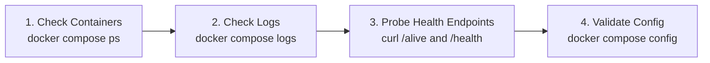

<!-- ABOUTME: Operator troubleshooting and recovery guidance for deployment and runtime failures. -->
<!-- ABOUTME: Explains readiness responses and optional email without exposing private diagnostics. -->

# Troubleshooting & Operational Health

If startup fails and cleanup also reports an error, both failures are retained. Diagnose the startup error as well as the cleanup error; a cleanup failure does not replace the original startup failure. No configuration change or data reset is required for this behavior.

Cross-tenant membership discovery requires the enrolled Global database login,
not Runtime inheritance of a discovery executor. Reconcile unexpected role grants
through the approved database process before reinstalling. This does not change
ordinary tenant-filtered membership access or grant additional tenant authority.

Native scanner credential discovery requires the enrolled Global database login.
Runtime must not inherit its executor role or the Global login. If readiness
rejects enrollment or role drift, reconcile unauthorized grants through the
approved database process before reinstalling; do not broaden Runtime privileges.

Native API-key authentication requires the enrolled Global database login.
Runtime must not inherit its executor role or the Global login, including through
intermediate roles. Reconcile unauthorized grants through the approved database
process before reinstalling; do not broaden Runtime credential-table privileges.
Reinstallation rejects unexpected authority instead of silently repairing it.

Tenant navigation reads the authenticated user's saved preference without loading
their personal profile. A saved target is used only while it remains in that
user's active tenant memberships. If it no longer qualifies, navigation chooses
the latest active membership; users without active memberships receive no target.
Navigation does not write preferences or bypass tenant access checks.
If native navigation readiness rejects deployment enrollment or routine drift,
restore the approved read contract through the database preparation process;
do not grant Runtime direct access to user records.

Changing the current user's active tenant requires the original authenticated
session and a current active membership in the selected target tenant through
transaction settlement. Revoked or foreign memberships do not change the saved
preference. Support forwarding cannot substitute another user's self authority.
An inactive tenant can remain a preference; lifecycle guards still control access.
If original-human preference authorization fails, inspect credential validity and
membership state. The C# workflow uses fixed Global database storage permissions;
Runtime must not receive direct user-table access. A storage-permission or final
image mismatch requires investigating the declared grants and original transaction,
not restoring obsolete preference routines or widening database rights.

## AppHost Package Audit Failures

If building or launching Aspire fails with `NU1902` for MessagePack 3.1.8, use
the centrally patched 3.1.9 dependency and its regenerated AppHost lockfile.
This addresses an upstream deserialization denial-of-service advisory and
restores the package-audit gate. No database migration is required.

## Human mutation admission contracts

Localization governance updates require a currently valid authenticated session
and committed administrator membership through transaction settlement. An omitted
configuration section leaves its settings unchanged; supplied sections settle
together. Diagnose a rejected update through credential lifetime and native
source readiness rather than granting direct settings or identity-table access.

Reference catalogue initialization uses a separate Runtime lease, not the
request tenant scope or the Global account. If startup caches remain empty,
check native catalogue readiness and factory registration without expanding
table privileges.

Administrator checks require committed membership and the native administrative
authority contract on the independent Global account. A role claim alone does
not grant access. Revoked instance membership is reflected by subsequent reads;
do not grant Runtime direct membership-table access to repair denied requests.

Startup reference lookup caches require the native catalogue contract for the
Runtime account. An empty role cache can make valid administrator checks fail
closed. Verify catalogue readiness rather than granting direct role-table
access or assigning the Global account. The projection excludes tenant-owned
event types and does not grant user roles.

Localization configuration reports only whether a TMS API-key binding exists,
not whether the external secret is valid or reachable. A tenant binding or
instance fallback can configure this status; another tenant's binding and
qualified bindings do not. Install the native localization status contract
instead of granting direct secret-binding table access.

Settings reads require the installed ordinary-settings custody contract and its
discovery-disclosure dependency. Retain the configured Runtime or Global scope;
do not grant direct settings-table access to repair a failed native read.
Native control anchors must survive integration-fixture resets and deployment
maintenance. Missing or altered custody objects require operator diagnosis,
not automatic privilege expansion during a request.

Public tenant routing requires the independent Global account and installed
public-directory function. Suspended tenants and their domain reservations are
excluded. Do not resolve Runtime permission failures by granting direct tenant
table access; verify the selected Global account and directory execution group.

Startup setup and deployment-mode reads require the independent Global database
capability and installed native provider-configuration contract. A Runtime
permission-denied error on bootstrap state is not a reason to grant that account
direct table access. Check the selected Global credentials and native readiness
evidence; admission does not repair missing or altered contract objects.

Provider and storage configuration contracts must coexist in the selected
database. Their native source guards protect configuration observations against
concurrent changes; they do not grant permission to change configuration.

Apply the generated programme model migrations before starting updated services.
They add recovery evidence fields and widen custom-property regex storage.
Back up the database first. Historical rows do not gain trustworthy recovery
evidence from generated empty defaults. Do not downgrade after writing new recovery
records: the Down migration removes those fields and narrows regex storage.
Use a coordinated application/database backup restoration if rollback is required.

Localization bundle import requests have a 4 MiB bundle budget with 1 KiB of
HTTP envelope allowance. Oversized requests can return 413; malformed translation
JSON returns 400 without replacing the existing bundle. Check for duplicate keys,
nested values, unknown fields, unsupported key families or excessive value length.

Static bundle imports reject oversized or invalid flat text even when invoked
directly by an application command. Provider export and file-write failures
return fixed messages without provider details or filesystem exception text;
use their stable failure categories for troubleshooting.

Tolgee and Weblate responses larger than 4 MiB are rejected before their bodies
reach translation parsing or retry metadata processing. The limit also applies
to error bodies and chunked responses. Reduce the provider response size when
this boundary is reached; publication authorization remains a separate check.

Localization failures retain useful operational categories while omitting raw
provider exceptions, caller language input and translation contents. Metrics keep
counts and timings with bounded labels. Cache fallback behavior remains active;
confidential diagnostics do not replace TMS transport limits or publication
authorization.

Invalid localization override files are rejected as a whole, leaving embedded
defaults in place. Invalid write candidates do not create output directories or
replace existing bundles; valid flat text is safely JSON-escaped and atomically
published. File diagnostics omit translation contents, filesystem paths and raw
exception details. TMS transport and publication authorization remain separate
boundaries.

Localization imports accept bounded flat translation text under ui., lookup.
and payment. key families. Duplicate names, unknown contract fields and nested
values are rejected rather than silently discarded. Limits are 4 MiB input,
16,384 entries, 512 characters per key, 16,384 per value and 524,288 aggregate
characters. Input capture is immutable; publication authorization and provider
file/TMS boundaries remain separate checks.

Local quarantine work can retain physical ownership after tenant metadata is
removed. A reclaimed worker cannot complete or retry a newer claim, and object
keys must remain below the retained local root. Domain path normalization alone
does not authorize a filesystem move; database exclusion and provider path checks
remain required. Verification here runs on Linux and does not claim a Windows
filesystem execution result.

Registration creation evidence can outlive account, order or HTTP-response
cleanup without retaining request or credential payloads. Replay identity stays
bound to the original tenant, account, principal scope and operation key; a new
account or scope cannot reuse that identity. This domain receipt alone does not
enable replay handling; persistence retention and creation admission integration
remain required.

The dedicated Keycloak lifecycle client uses a minimal service-account grant:
realm-management/manage-users, without extra management/client or realm roles
and with interactive grants disabled. The profile is pinned to 26.1.2. Checks on
a fresh authenticated token response are not general bearer-token validation.
Provider bootstrap and lifecycle-send integration must complete before this
domain profile can govern a production lifecycle action.

Set AUTHENTICATION_LOCAL_PASSWORD_BLOCKLIST_PATH to a mounted, read-only
operator-owned JSON file and AUTHENTICATION_LOCAL_PASSWORD_BLOCKLIST_SHA256
to its SHA-256 digest. The file contains FormatVersion (1), Revision, Source,
License and a Passwords array; supply licensed data rather than copying a corpus
into application source. AUTHENTICATION_LOCAL_PASSWORD_HASH_ITERATIONS defaults
to 210000, accepts 100000..2000000 and should be calibrated on deployment
hardware. Explicit Authentication:Local settings take precedence over flat keys.
Restart after replacing the snapshot or configuration; invalid capture denies
local credential mutation and fails readiness for local/unselected primary auth.

Production Identity composition now captures the configured local password
blocklist and selects the normalized native hasher. A missing or invalid snapshot
blocks local credential mutation. Readiness also fails when local authentication
is primary or no provider has been selected; external-provider deployments do
not fail readiness solely for an absent local snapshot. Configure the hierarchical
Authentication:Local options or the flat deployment keys described above.

Local credential requests apply consistent Unicode-aware length rules. Login
and current-password fields permit shorter existing credentials; new passwords
use the 15..128 normalized-character policy. Supplementary characters count
once rather than twice. Request validation does not replace backend blocklist
enforcement or credential-lifecycle checks.

The local-password backend expects a deployment-owned, digest-pinned blocklist
with version, revision, source, license and password entries. Missing or invalid
snapshots deny new credentials and make required readiness unhealthy. Hashing
uses native IdentityV3 with NFC normalization and configurable bounded cost.
No blocklist corpus is bundled; choose appropriately licensed data. Production
startup and deployment wiring are described above; lifecycle-store integration
remains required.

The local credential policy counts normalized Unicode characters rather than
UTF-16 code units. It preserves spaces and case and rejects malformed text.
New credentials require 15 to 128 normalized characters; shorter existing
credentials remain eligible for verification. HTTP/manual request validation
and production native hashing now use these rules.

Custom-property patterns now require supported non-backtracking syntax and
are limited to 2,048 characters. Backreferences, lookarounds and malformed
patterns are rejected; defaults must satisfy configured bounds and patterns.
Null option collections/items are rejected rather than coerced. Existing
definitions using unsupported syntax need correction. All definition mappings
use the same ceiling; generated migrations remain required before deployment.

Refund recovery distinguishes a committed provider handoff from positive
evidence that no handoff occurred. Buyer and application-fee recovery cannot
restart each other, and recovery does not extend the original provider mutation
window. This domain state machine requires persistence and dispatcher integration
before deployment; no provider retry is enabled by this slice alone.

Location correction receipts can retain their original audit or committed
erasure authority even after disposable source data is removed. A different
message cannot replace the original correction, and mismatched audit pairs are
rejected. These domain receipts do not activate correction delivery until
persistence and dispatcher integration are complete.

Location governance tightening preserves organizer disclosure selections while
advancing the policy review version and audit. Its retained snapshot contains
policy facts rather than the physical address. Detached event locations cannot
be tightened; provider read and correction-publication integration remain
separate from these domain operations.

Report submission receipts can retain the original case version and payload
digest even after moderation advances the case. Mismatched, already changed or
previously bound submissions are rejected without replacing their receipt.
These domain guards do not enable provider synchronization until persistence and
publication integration are complete.

Paid-event evaluation can retain the persisted policy identity and version
when reconstructing policy values, so evaluations do not silently receive a new
policy identity. Existing policy normalization remains in force. This domain
factory does not activate a policy or change payment configuration; persistence
read integration remains required.

Configuration effect receipts can retain an immutable publication identity or
payload digest after successful application. Failed operations cannot claim such
a receipt, and existing bindings cannot be replaced. These domain prerequisites
do not change deployment or enable publication until persistence and publication
integration are complete.

Current human policy inputs require the original signed account and a current
credential lifetime. Signed-out, deleted or mismatched humans cannot supply those
inputs, and an already-open transaction is rejected for idle observation. Reading
inputs alone does not retain authority for a later write.

Human policy inputs can be projected from persisted source facts without
changing policy attribute names. Retained principal snapshots are independent of
later SDK object changes. This projection is not a grant of authority; original
credential checks, source retention and final request admission remain required.

Cross-tenant moderation proposal discovery is limited to one exact live event
and requires current persisted instance administration. The conversation tenant
stays selected, and ordinary event reads remain isolated. This source capability
does not itself authorize a proposal; the request preparation and final admission
checks remain required.

Webhook resource checks bind persisted ownership and delivery lineage to the
original request and transaction. Missing or changed parents cannot be replaced by
tracked objects, audit identifiers or portal session values. These source
primitives do not by themselves enable portal access or provider delivery; final
request admission and provider release checks remain required.

Native capability enrollment includes the existing email-policy instance and
tenant mutation login identities as well as Migrator, Global and Runtime. Keep all
five identities distinct; reusing one database login across those authorities is
rejected. Existing role configuration and approved secret authorities remain the
source of their usernames and credentials; enrollment introduces no new secret.

Managed event-assignment checks now retain the original selected database owner
and return fresh persisted facts after source-set exclusion. Ordinary assignment
roles and time boundaries remain unchanged; organizer control is evaluated
separately from persisted membership and placement state. Unflushed local edits do
not become authorization evidence. Production registration and verified final
parent admission remain required before the full mutation flow is active.

Managed support checks now read persisted session and governance facts on the
original selected owner, so a cached positive context cannot override revocation,
disabled write mode or tenant mismatch. Boundary projection preserves support
lifetimes, read-only compatibility and original defaults; it is a denial check,
not an operation grant. Native allowed-value metadata remains intact. Production
registration and verified parent final admission are still required. SQLite
session lookups preserve UTC offsets and the exact exclusive expiry boundary.

Managed principal observation and leases retain the original database owner and
canonical human subject through transaction revalidation. Save operations validate
tracked tenant references before persistence, and human-owned audit records use
the canonical account identifier. Disposing the context clears attempt ownership
and retained subject state. These primitives still need verified production scope
registration and mutation-consumer composition before the full flow is active.

AI execution domain reservations now bind confirmed action identity to one
primary event and immutable image custody. Recovery may reuse a linked effect but
cannot substitute another event or reopen a settled failure. Preview comparison
versions bind source and owner inputs; they do not authorize execution. These
domain primitives still require persistence mappings, generated migrations and
verified production tool wiring before the full recovery flow is deployable.

The native storage-probe prerequisite excludes changes to settings, secret
bindings and bootstrap state through a private generation sentinel. It includes
new, renamed and absent source ranges rather than only known storage keys.
Acquisition retains the original enrolled Serializable session and does not grant
access to source values. Drift stops admission without repair. Managed probe
sessions and production installation still need verified wiring before this
prerequisite protects an actual probe.

The native webhook resource prerequisite reads declared resource lineage under
the original enrolled database session. Acquisition excludes concurrent changes
to its contributor set, including new rows, and admission refuses catalog or
function drift. Resource facts do not authorize delivery, replay or configuration
changes and do not replace provider receipts. Production installation and verified
managed consumers are still required before relying on this protection.

The native event-assignment prerequisite returns declared assignment/team facts
for a selected tenant and bounded event list. Its acquisition excludes concurrent
contributor writes, including newly inserted assignments. Installation also adds
the mandatory AI exact-event target reader, restricted to persisted instance
administrators and a requested event outside the selected tenant. Target discovery
does not authorize moderation; administrator continuity still requires the parent
principal lease. Production installation and verified managed consumers remain
necessary before relying on this protection.

The native administrator-authority prerequisite checks persisted instance or
tenant administrator state on the original enrolled Serializable session. It
locks the account, binding and authority contributors rather than trusting role
claims. Tenant authority requires active membership and an unrevoked same-tenant
administrator grant. The subject-only entry point proves account continuity, not
administrator status. Drift is rejected without repair; production wiring and
verified managed consumers are still required before relying on this capability.

Managed route observation and leases now compose the separate route and
source-set prerequisites on the same selected database owner. Acquisition requires
the original Serializable transaction, and ending that transaction invalidates
the lease. Revalidation reads current route facts without switching connections
or promoting database privileges. PostgreSQL preserves non-null allowed-value
metadata; portable providers use their physical source-lock contracts. This
composition still needs production registration and verified mutation consumers.

The support-source native prerequisite restricts facts to the selected actor,
session and tenant plus declared support governance settings. Serializable
acquisition excludes concurrent source writes through compulsory triggers and a
private anchor. Catalog or function drift stops admission instead of being repaired.
These facts do not grant support access, and the prerequisite needs production
installation and verified mutation-consumer wiring before protection is active.

The native authorization-route prerequisite returns only the six declared route
settings, scoped to the original Runtime tenant or Global instance purpose. It
does not grant setting writes or make an authorization decision. Its Serializable
entry point still needs the separate policy-source-set exclusion and verified
consumer composition; installing it alone does not fence concurrent setting
changes. Installation refuses drift rather than normalizing live objects.

The principal-source native prerequisite observes actor-bound account facts and
excludes concurrent principal changes during Serializable acquisition. Its Local
session reader uses the original Runtime session; it does not grant Identity table
access to that login. Catalog, body, trigger and tenant-policy drift fail admission
rather than being repaired. A partially installed provisioning writer is rejected,
not treated as absent. Production installation and mutation consumers must still
be wired before operators can rely on this prerequisite as active protection.

Shared native writer admission verifies the installed body, triggers, roles and
privileges against the source-owned contract. Restamping a changed body does not
make it trusted. An entirely absent protocol is permitted only during its declared
migrator installation window; partial installation is not accepted as absence.
This verifier alone does not install or wire the provisioning protocol.

Generated RLS ownership joins follow the tenant filter's mapped navigation path,
including required intermediate relations. Unsupported or ambiguous paths stop
generation rather than guessing a parent. An explicit installation target schema
applies to the child and every ownership parent; deploy the full relation chain
in that schema before enabling its policies.

Generated PostgreSQL tenant policies include attestation comments for later native
admission checks. Removing or changing a comment does not bypass row-level security,
but consumers that require the original policy must reject a missing or mismatched
stamp. Generating a stamp alone does not activate commit-time admission.

The PostgreSQL source-set installer is a native prerequisite, not an enabled
deployment feature by itself. It excludes concurrent permission and governance
setting membership changes, including inserts where no matching row previously
existed. Installation must reject ownership, privilege, trigger or function drift;
an operator must not treat automatic repair or missing production wiring as proof
of active commit-time protection.

Pure route projection keeps platform settings governance separate from tenant
BYO authorization endpoints. Ordinary tenant-resource projection may select BYO
before instance mode, while Local projection requires co-located decision sources.
These projections describe evaluator selection, not an authorization grant or
proof that native commit-time admission has been installed.

Source observations use the normal hierarchical setting precedence rules.
An empty tenant override set still counts as tenant context: missing SMTP
delegation keeps tenant SMTP changes locked, rather than granting delegation
because no override row exists. Instance-only settings evaluation is separate.

Human commit identity and source-fence contracts are internal prerequisites for
commit-time revalidation. They do not enable an operator setting, install database
locks or activate new mutation protection by themselves. Native provider enrollment
and each mutation consumer must be delivered and verified before that protection
can be relied on. Existing request authentication remains the entry boundary.

## Persisted API-key evidence

Persisted API-key authentication can supply server-owned evidence of the key row
and its authenticated scope snapshot. Configured clients and internal machine
execution do not have this evidence, even if their claims look equivalent.
Copying or editing claims cannot transfer persisted-key authentication custody.
This evidence does not itself grant a mutation or replace commit-time checks.

## Credential lifetime evidence

The API can retain request-local evidence of a validated human credential's
original expiry. Editing claims or authentication ticket expiry does not renew
that credential, and copying a principal does not transfer its evidence. This
capture mechanism preserves existing provider clock skew; it does not itself
change token lifetime configuration or authorize an administrative action.

## Keycloak token audience and purpose

API requests require an access token whose aud contains KEYCLOAK__AUDIENCE
(default islamu-event-api) and whose signed payload typ is Bearer. ID tokens
and tokens addressed only to the browser client are rejected even when azp
names an approved client. Update the realm resource-audience mapper before
rollout; the retired ValidAudiences arrays no longer grant acceptance.

Optionally set Keycloak:PermittedClients through indexed configuration such as
KEYCLOAK__PERMITTEDCLIENTS__0 to restrict originating clients as well. This list
does not replace the API audience. Omit it for no client restriction; do not
use a blank placeholder entry. Direct-process indexed environment variables
must be explicitly forwarded by a container deployment to reach the API.

## Conditional JSON responses

Small successful JSON responses may return a weak ETag for conditional requests.
Responses exceeding 256 KiB, streaming or flushed responses, non-JSON content
and private-no-store endpoints do not receive middleware-generated validators.
A missing ETag on those responses is intentional: the API forwards the content
without retaining the entire response in memory. A matching If-None-Match returns
a bodyless 304, allowing the client to reuse its cached representation.

## File response sandboxing

Storage downloads, public storage images and event-resource content return a
Content-Security-Policy that includes sandbox alongside resource-loading and
framing restrictions. Reverse proxies must preserve this response policy rather
than replacing it with a weaker generic API policy. Ordinary JSON endpoints
retain the base API policy without the file sandbox directive.

## Support-access audit failures

Support-access audit storage failures do not replace an already completed HTTP
response. Watch the audit persistence failure metric and warning to detect gaps;
warnings intentionally omit provider exceptions and their private details.

## Server-owned correlation IDs

Use the response's `X-Correlation-ID` when reporting a request failure. The API
generates a fresh compact UUID for each request. Incoming `X-Correlation-ID`
and `X-Request-ID` values are ignored, not echoed; clients must capture the
returned ID instead of expecting their supplied value to appear in API logs.

## JWT failure diagnostics

Invalid bearer tokens still receive a 401 challenge. Provider error descriptions
and error URLs are omitted; failed authentication uses the generic `invalid_token`
challenge code. Operators can correlate the native `authentication_failed` and
`authentication_challenge` events without exposing token contents or private
request paths in logs.

## Storage readiness failure reasons

The API no longer imports ambient logging scopes. Keep `FromLogContext` out of
API Serilog configuration: scope fields can overwrite native diagnostic values.
Events retain their own arguments and producer category.

Storage readiness uses `provider_unavailable` when the selected provider cannot
be resolved and `policy_unavailable` when its policy cannot be resolved. These
stable reasons replace exception subtype names. Check the selected provider
registration and storage policy respectively; private exception details are not
part of the health response.

## Administrative mutation authority

Tenant API-key revocation, management details and quota reporting now check the
original operator's credential/support sources at their authored owner boundary.
Webhook operations retain their original support expiry even if a live session
is extended. Platform-key and Footer integrations remain separate open work;
these source changes have not been exercised by runtime assurance.

Tenant deletion and provider-connection callbacks now enter their admitted
original transaction before touching data. Prepared support authority still ends
at its original boundary even if the current support session is extended.
Uncertain outcomes and callback-supplied rollback markers do not silently retry.
These authored paths remain unverified by execution.

The authored Event-provider path now fences subordinate binding, form and mapping
state as well as the original operator. Mapping replacement and manual CSV import
use the actual acquired owner; manual storage reads precede its single commit
attempt, and queue success waits for acknowledgement. All twelve consumers are
integrated in source. Reconciliation, managed publication and schema import now
retain remote observations without local writes, then apply their local effects
in the original admitted transaction. A conflict or unknown settlement does not
repeat remote calls. Installation and programme execution remain unverified.

The authored Event-provider remote lifecycle retains the original operator and
support deadline and does not repeat remote work after an owner conflict or
unknown settlement. Publication may retain acknowledged draft provisioning when
publication is refused; a remote resource may already exist. A refused frozen
schema import may retain its admitted drift evidence. These source-integrated
paths are not runtime-certified by the lifecycle helper alone.

The authored branding update path now prepares its exact settings action before
locks and rechecks current governance, permission and original credential before
commit. Its authored native controls now authenticate against PostgreSQL Local
identity co-located with the branding authority rather than copied account state.
Branding constructs its policy fence during preparation and acquires it inside
the original transaction. A `policy_source_set_requires_selected_owner` failure
is an execution-composition error, not a reason to grant database privileges.
Governance locks also initialize the selected database session before native
admission. A missing tenant session must be fixed in connection composition,
not by changing the tenant binding or relaxing native caller checks.
Branding validates its tenant relationship using the Tenant already fenced by
the original native principal acquisition. Do not grant Runtime direct Tenant
column access: the protected support boundary rejects that ambient authority.
Runtime assurance remains unexecuted; independent Local identity storage remains
fail-closed for these protected mutations.

The authored human webhook commands now obtain their decision at the actual
operation owner or portal-release boundary rather than also using an earlier
request-cache decision. Authenticated machine commands and other operations
retain their existing outer checks. Dispatcher and programme runtime assurance
remain unexecuted.

Portal access rechecks the original operator, support permission, provider
configuration and binding after remote calls and audit persistence. Expired or
changed custody withholds the local token response. A token may already exist
at the provider at that point; this flow does not revoke it or claim atomic
authorization of remote issuance. Issuance audit may remain even when delivery
is withheld. All new portal controls await programme execution.

The authored webhook-consumer creation path also checks the newly persisted
consumer at final commit. An ownership or initial configuration replacement
during audit persistence rolls back creation and its audit together, rather
than returning a consumer assigned to another owner. Runtime assurance remains
deferred.

The authored persistence audit path now records the resolved authenticated
account retained by the human operation, rather than replacing it with a
different identifier from ordinary claim attribution. This removes a source-level
cause of linked-account administration failing after a valid permission check.
The actor is cleared when the selected database context is disposed. Permission
and credential checks still apply; genuine attribution controls and runtime
assurance remain unexecuted.

The authored endpoint-test and bulk-scheduling paths check the original operator
again before committing queued work or an intentional scheduling rejection audit.
Credential expiry, lost support permission or changed source custody rolls back
those writes. Endpoint tests additionally retain current payload and endpoint
credential constraints; an existing bulk operation does not bypass permission
checks. An acknowledged retry keeps the original queue identity rather than
creating duplicate work. These controls await programme execution. Scheduling
does not guarantee that payload remains eligible when a later worker runs.

The authored bulk-cancellation path returns a business refusal only after the
original attempt rolls back and a separately authorized rejected audit commits.
Both checks retain the authenticated operator rather than a supplied actor
identifier. Revocation, credential expiry or changed operation/tenant custody
between attempts prevents audit admission. A missing operation does not grant
ownership or tenant administration. Lost acknowledgement reports an unknown
outcome rather than replaying cancellation or inserting another audit; inspect
persisted state after reauthentication. A crash between rollback and audit may
leave no rejected record. These controls still await programme execution.

The authored human import recovery flow records a business refusal only after
whole rollback and fresh authorization of the original operator. It writes
failed history separately without replaying changes or consuming the session.
If authority or artifact retention is lost between transactions, history may be
absent. Failed attempts are designed not to occupy the session's success slot,
allowing a fresh preview and later apply; this requires generated database
migrations before use on existing databases. Migration and runtime assurance
remain unexecuted.

The authored human import path returns success only after the original owner
acknowledges commit and its receipt is validated, before effects are delivered.
If receipt validation fails, an already committed operation must not be relabeled
as failed history; consult its persisted receipt after reauthentication.
Rollback acknowledgement alone does not permit failed-history writes: original
authority and current session/artifact constraints must be admitted again.
That recovery integration and executable programme assurance remain unfinished.

The authored tenant-delegation path now checks the original administrator and
credential at commit for ordinary governance as well as SMTP. A supplied user
identifier cannot replace the authenticated actor. Revocation or expiry rolls
back the attempted patch before notifications. Constructor migration is complete
in source; native branding final admission, broader security integration and
runtime assurance remain unfinished. Failure history must not be treated as
proof of rollback while physical-owner settlement remains unresolved.

The authored disable-preview path also checks current administration and the
original credential before returning confirmation. A credential that expires
during the impact read must not disclose a usable token. These genuine sign-in,
rollback and replay controls still await programme execution. Default setting
logs retain bounded scope rather than private values or account/tenant identifiers;
use authorized persisted state when checking which setting actually changed.

The authored email administration path now checks the original administrator,
selected scope and credential validity at commit, not only at the first request
check. Disable confirmation must also remain unexpired after blocking validation.
An expired confirmation or revoked administrator rolls back the attempted change;
request a fresh preview rather than replaying the old confirmation. Internal
setup is separate and cannot replace authenticated administration. These controls
and genuine sign-in regressions still await final programme execution; native/
source integration and original-owner settlement remain unfinished.

The complete-principal source contract also preserves a native infrastructure
epoch across resets. Its current Local support requires co-located Identity:
the application transaction cannot lock authoritative rows in a separate Identity
database. Protected Local mutations therefore fail closed in the current
single-owner design when Identity is external; there is no copied-row or
cross-store fallback. Complete prepared action integration and executable
assurance remain open.

Fresh authorization routing observes the six fixed provider/Cerbos settings on
the selected connection rather than trusting request caches. Final source reads
also observe changes made by the operation itself. Native installation and
authenticated composition controls are authored but still await executable
programme assurance; they do not certify completed protected mutations.

Event assignment sources and the original-owner finalizer are now composed in
source, with authored credential-expiry rollback controls. Forwarded support
access must also retain its current session, write mode, governance and exact
target until commit; that implementation remains open. No completed protected
mutation or native installation pass is certified by these editor receipts.

Tenant deletion now uses prepared current-source authority at its committing
owner. A changed credential, role input, route or support boundary rejects the
attempt; confirmed rollback retries prepare again. Local Tenant/delete remains
denied rather than borrowing an instance-administrator shortcut. The native,
HTTP and concurrency controls are still awaiting final programme execution.

Provider connection changes use current Tenant/update authority at commit.
Revocation or credential expiry rejects the attempt rather than preserving an
earlier decision. Event channel/provider management stays separate. Webhook
source installation is composed, but requester business/portal integration and
the final executable controls remain unfinished.

Internal SMTP setup now has a separate source-authored lifecycle route.
Administrative requests still require current human authority and disable
confirmation; setup cannot acquire it by creating an audit actor. Both entries
share atomic policy revision and suppression handling. Full integration and
executable assurance remain pending.

Event provider binding, channel and queue changes now use prepared Event
management authority at commit. It is separate from Tenant connection
administration. Failed business results roll back local work; uncertain rollback
is reported as conflict. Remote provider workflows and final runtime controls
remain unfinished.

Webhook endpoint archive, pause and resume now use prepared current requester
authority in the state/audit transaction. Already-archived requests are checked
too, and failed results roll back. Other webhook administration and portal token
release remain unfinished; final executable assurance has not run.

Resource and Visitor administration and human imports retain the operation's
existing administrator authority through commit. Tenant administration gains
no instance shortcut. Initial setup keeps separate authority; a selected human
writer cannot switch into it. Human failed-import history remains unfinished:
a missing failed receipt does not mean the configuration applied successfully.
Final executable assurance and native source closure remain pending.

Import receipts and history now require fresh authority for viewing Settings.
Creating a rollback session requires current update authority as well as an
available retained snapshot. The server checks the original account, credential
and support session again before returning history or a rollback token; an
expired or revoked session requires fresh authorized access, not replaying the
configuration change. Source implementation is recorded, but final executable
assurance has not run.

Email disable preview reads database policy and revisions; it does not contact
your SMTP server. It uses a dedicated original-account owner before exposing a
confirmation. Configuration manifests still reject Email settings. The new
source-admission implementation has not received final provider assurance;
SQL Server/MySQL and externally stored Local identity are currently refused by
that dedicated protocol. Mixed and original tenant-plan compound source paths
are authored; plan native review and final executable acceptance remain pending.

Instance administrators' typed tenant Email value, lock and unlock changes now
use that dedicated original-account admission. They do not inherit permission
from a generic Settings transaction. This source integration has not been
validated by executable tests.

Email-only Settings batches now use the same original-account source admission.
Batches mixing Email with other settings families use a separate combined
original owner. Its authored installation hooks are not a provider acceptance
receipt; do not treat another family's successful edit as Email permission.

Webhook publication reconciliation and abandonment now retain requester
authority through the state/audit commit. Native Resource import checks still
do not independently authenticate the original human for direct SQL entry.
The database-service trust boundary and failed-history behavior remain under
review; this source work adds no deployment credential or runtime acceptance.

The supported import boundary trusts API authentication and its original managed
operation, and treats the database service login as trusted infrastructure.
Audit metadata cannot supply operator permission. Native SQL capabilities restrict
settings mutations but do not independently verify an API human credential for
clients holding service database credentials. No new deployment credential
protocol was added; final executable assurance and failed-history work remain open.

Settings reads no longer construct administrator mutation writers. Uncertain
human mutation settlement is reported separately from an ordinary conflict:
it does not authorize automatic retry or a contradictory failed-history entry.
Restoring eligible rejection history needs a newly authorized evidence-only
operation after confirmed rollback; a crash or lost authority can leave no
history. That full mechanism and executable assurance remain unfinished.

Human manual webhook retry retains its original authorized operation through
scheduling and audit instead of switching to a worker operation. Human ordered
settings locks no longer wrap that owner in automatic replay. The machine retry
route remains separate. Full runtime assurance, remaining requester operations
and administrative fixture migration are still unfinished.

The new human lifetime observation retains each validating scheme's existing
signed expiry and clock tolerance; waits and retries do not renew it. The final
commit hook can reject an expired original credential. Instance-control email
changes on a selected tenant use current instance authority, while ordinary
tenant email settings still require tenant administration. These source changes
and their authenticated/persisted controls await programme executable assurance.

The new PostgreSQL policy-source contract requires maintenance-time installation
before lookup seeding. Its fixed sentinel is persistent infrastructure, not
ordinary application data, and must survive test or maintenance data resets.
It adds no deployment credential or direct IAM/settings read capability. The
prepared policy workflow and executable installation assurance remain pending.

Ordinary users retain self preferences without administrator grants. The new
identity fence checks their original account and provider binding; it is not a
continuous policy or credential-expiry lease. Its implementation and the
location governance transaction correction await executable assurance.

Administrative writes must use a freshly resolved authenticated account and the
correct database purpose. A confirmation or earlier successful request does not
retain permission after revocation. The new native administrator routines use the
existing deployment logins; they require no additional secret and do not justify
granting Runtime or email workers access to identity tables.

Installer and regression source are currently awaiting complete caller integration
and the programme's executable assurance. They are not a deployment readiness
certificate. If native authority is missing or contaminated, retain the denial;
do not widen grants or substitute an elevated connection to make the write pass.
Custom Cerbos policy is freshly evaluated for each attempt, but this protocol
cannot detect an unannounced remote policy change after that response. Operators
must not interpret local database fences as a remote policy revision lease.

## AI draft recovery after interrupted image work

New AI drafts require the reviewed action and an Active conversation at native
creation admission. Image transfer follows the committed original draft. A failed
image operation retains that draft and its recovery identity; it does not create
a replacement draft or overwrite a different selected image. Independently
authorized recovery of an existing primary remains possible after a later
conversation-state or action-lifetime change.

The lifecycle/custody fixes and deterministic regression source await the
programme's final executable verification.

## Rejected observation execution grants

The public tenant directory also rejects unexpected direct execution grants.
If lookup or replay discovery reports routine ACL drift, remove only the
unintended grant through approved database authority before reinstalling the
directory contract. Its public fields and Active tenant selection are unchanged.
Source guards and the native recovery specification await final verification.

Native administrative, scanner, federation-governance, location-review,
API-key, integration-discovery and queue-health routines reject unexpected
direct execution grants. Reinstalling a routine is not a grant-cleanup operation:
remove only the unintended grant through the approved database authority,
then reinstall. Preserve the declared purpose group and any separately
documented nested discovery owners. Do not grant table access or elevated roles
to make a failed observation succeed.

These source checks and native regressions await the security programme's final
SQL installation and executable verification; no installed-state acceptance
is implied.

## Recovery fleet health and tenant-owned maintenance

Local orphan quarantine checks its original persisted custody again before the
filesystem move. Registration provider callbacks retain their original incoming
effect through submission persistence; lost custody rolls the transaction back.
These corrections are authored, with executable/native-provider assurance
pending. Administrative requester freshness and portal token release remain
separate open source work.

Expired original worker custody refuses storage deletion, Web Push and PDS
handoff; workers do not gain a fresh timeout merely because an awaited check
finished late. Newly committed branding locks are rechecked inside the patch
transaction. Ordinary authenticated Local users can request their own erasure;
they gain no foreign-user deletion authority. Source regressions are authored,
and executable acceptance remains pending.

Checkout fleet admission uses a separate Global claim capability; provider
processing runs in a fresh Runtime scope for the claim's persisted tenant.
The original lease, token, fence and provider recovery identity are retained.
Expiry during selection refuses handoff without renewing ownership. Apply its
native contract through the enrolled database migrator; policy drift is rejected
rather than silently repaired. Executable assurance is pending.

Local webhook readiness obtains fleet counts through a separate Global
count-only capability. It does not require broad delivery-table privileges for
Runtime. Missing or altered authority produces Unhealthy without counts rather
than a misleading empty queue. Apply the native health contract through the
database migrator after tenant isolation. Executable assurance is still pending.

Notification work whose original processing lease expires while its source is
being read is refused before worker execution. The portable database path now
rechecks that deadline after the read instead of extending or replacing it.
Exact-expiry and still-live tests are authored; executable assurance is pending.

A published addon catalog is visible anonymously only while its event remains
publicly eligible. Making an event private, archived, moderated, deleted or
ineligible through its publisher hides the catalog and quantities without
retiring the retained catalog. The owner management view has a separate access
check. HTTP regression source is authored; executable assurance remains pending.

Sign-in readiness logs report provider, status and fixed failure categories.
They omit discovery addresses, issuer/body content, configuration identities
and exception details. Use the authorized provider configuration surface when
diagnosing an address or client ID; credential-presence flags remain available.
The discovery and cold-start confidentiality regressions are authored but await
executable final assurance.

Local webhook delivery rechecks the original claim after policy/safety
preflight. A revoked or expired claim, paused/archived endpoint or unavailable
current payload stops before credentials and HTTP without overwriting the
competing state. The source fix and SQLite regressions await executable
verification. The retained instance-endpoint source gap is addressed by a narrowly
authorized delivery capability, not broader access to current configuration.
It accepts only the original selected-tenant claim, leaves paused endpoints
paused, and commits endpoint health with target/attempt/audit settlement so
failed settlement rolls health back too. Existing Runtime identity is reused;
no new operator credential is required. Executable installation and regression
assurance are still pending.

Bulk webhook replay diagnostics report fixed execution/settlement failure
categories, not exception subtype names. Each pass retains original operation
identity for failure settlement and reports failed operation counts. The source
repair and producer-output specifications await final executable verification.

Publication notification runs report `event_publication_fanout_failed` rather
than retaining private exception messages. Successful retry completes the same
run and clears that category. Localization write failures no longer propagate
private filesystem exceptions. Failed AI context disclosure uses a fixed
unavailable marker in provider prompts, and malformed/oversized browser fallback
responses use the existing status-based error result. These source controls and
their failure/retry/parser specifications await final executable verification.

Failed light moderation notification runs expose only the
`light_moderation_fanout_failed` category. Retry retains the original run identity
and clears the failure field on completion; private provider/database messages
are not stored there. This source repair and its native failure/retry
specifications await final executable verification.

Email content retention discovers only a bounded set of tenant identities, then
redacts each tenant through separate Runtime authority. A missing PostgreSQL
discovery capability fails the pass rather than reporting no eligible content.
Restore the migrator-installed fixed metadata read profile; discovery eligibility
and ordering run in the C# application through EF Core, not a stored routine.
Global can read tenant IDs and retention timestamps/status, but not email bodies,
recipients or related private rows. Do not substitute table-wide grants or recreate
the retired discovery routine. Dry-run counts use the same selected-tenant scope, and a failed
tenant remains counted while the pass continues for others. Sent/skipped cutoff,
batch limits and unresolved-message preservation remain in effect. These source
changes and native/SQLite specifications await final executable assurance.

Ticketing recovery health now observes fixed fleet aggregates through a separate
Global capability. Missing authority reports Unhealthy instead of an incomplete
Runtime view. The database source definition now supports ambiguous fair-return
`Unknown` work without an active lease or terminal marker; deployment still
requires the programme's deferred migration generation and verification.

Hold-expiry and registration-retention workers create tenant execution contexts
before resolving mutation dependencies. Retention still follows the status
lookup's active eligibility and excludes Suspended tenants. Existing relational
provider support is retained; PostgreSQL discovery uses its bounded function,
while portable relational discovery returns only UUID pages through Global.

Template creation authorizes the source event before copying its published form
version. These source changes and their native/portable specifications are not
yet operational verification receipts.

## Idempotency receipt cleanup

The `idempotency-cleanup` health check is Healthy when cleanup is enabled,
including dry-run mode, and Degraded when intentionally disabled. Disabled
cleanup retains expired payloads in storage, but does not make them replayable.

Start with `IdempotencyCleanup:DryRun=true`. `IdempotencyCleanup:BatchSize` defaults
to 500 and accepts 1 through 1000; it limits the entire pass across tenants,
not each tenant separately. Invalid values fail startup validation rather than
being silently reduced. The grace period still delays eligibility by
`IdempotencyCleanup:ExpirationGraceHours`.

Each pass discovers tenant identities from a bounded expiry-ordered receipt page,
then counts and scrubs through separate exact-tenant Runtime contexts. It does
not depend on active tenant-directory entries. PostgreSQL uses the configured
Global identity only for discovery and the configured Runtime identity for
selected-tenant cleanup. Missing native capability or enrollment fails the pass:
restore the deployment-selected credentials and migrator-installed contract,
not direct Global access to private receipt tables.

The matching PostgreSQL deployment must enroll `event_idempotency_receipt_runtime`
on its selected Runtime login and `event_idempotency_receipt_global` on Global.
These grant function execution only. If a valid-key write returns
`idempotency_unavailable`, verify the matching migration and selected identities;
do not grant access to `idempotency_records` or the private ownership table.
Different request identities cannot retrieve an earlier request's payload.
Completed or expired identities remain rejection fences; restarting the app,
client cancellation or rollback of an unrelated transaction does not reopen them.

Scrubbing clears response bodies and content types and retains the unique
request identity with response-unavailable status (`-1`). It does not delete
receipts or allow an expired key to execute the operation again. Concurrent
cleanup can produce fewer scrubbed rows than counted rows without increasing
the pass budget. Dry-run never changes stored receipts.

Watch `explore.idempotency.cleanup_runs` for `succeeded`/`failed` outcomes and
`explore.idempotency.cleanup_rows` for `eligible` in dry-run mode or `scrubbed`
in scrub mode. Logs and metric tags omit tenant IDs, keys, request paths,
response bodies and exception text. These source controls and authored cleanup
specifications await the programme's deferred executable assurance.

## Rejected admission grants and publication recovery

Do not grant generic or notification admission EXECUTE rights to additional
roles. Unknown grants now cause entry and reinstall rejection; remove only the
unauthorized grant through the approved deployment process before reinstalling.
The installer does not erase that evidence automatically.

Publication reconcile/abandon now authorizes the publication's persisted consumer
owner, not merely its tenant. Tenant-admin standing does not bypass a user-owned
consumer's recovery policy. Location correction also rejects a claim that expires
during its retained-custody read, before external planning.

Native runtime checks for these source changes are still deferred with the
security programme's final assurance.

## Managed provisioning and ordinary settings readiness

Managed-provider provisioning readiness includes the ordinary settings
tenant-membership writers. A complete installation must retain both writers;
do not disable them or widen Runtime grants to clear a readiness failure.
Readiness checks their exact installed definitions and authority. An incomplete
or altered writer is a deployment fault, not permission to bypass the check.

## Native Settings option constraints

Mixed batches containing email settings use the original Global transaction.
They do not require switching a running operation to an email mutation connection.
The database binds each email row change and its delivery revision to that batch;
an unfinished batch rolls back as a unit. Standalone email operations still require
their separately enrolled mutation credentials. Do not grant raw settings writes
or email-purpose membership to Global to resolve a mixed-batch rejection.

Native Settings operations retain constrained option lists across PostgreSQL and
SQLite. Reading an original settings image must not discard those constraints
or change the accepted values. A JSON materialization error is not a reason to
clear option metadata or widen database grants.

## Explicit email mutation credentials and queue enrollment

Email operations now use the dedicated account for their original transaction.
A tenant mutation cannot borrow an instance or reader lease and does not receive
the cross-tenant policy snapshot. Mixed settings/plan operations retain the
required setting and catalogue projections, with tenant-dependent writes bound
to the selected tenant. Email policy updates cannot overwrite SMTP pause,
rate-limit or token-bucket operator fields.

Subscription renewal and sweep now use separate Global claim admission followed
by a fresh tenant execution context. Expired or replaced claims cannot stage
responses or settle a new checkpoint; a request already sent to a provider is
not retracted. Refund readiness likewise uses its own aggregate-only Global
capability. Unavailable observation authority produces Unhealthy, not a misleading
Healthy result from an incomplete tenant view.

These additional contracts use the existing declared usernames. Their native
installation, concurrency and ordinary-creator bootstrap checks are still unrun.

Provision distinct database accounts for instance and tenant email-policy
mutation using the two `DATABASE_EMAIL_POLICY_*_MUTATION_USERNAME` and
`PASSWORD` pairs documented in `.env.example`. Their credentials must not fall
back to Runtime or Global. Keep the explicitly configured Migrator, Global and
Runtime usernames available to the native queue enrollment; application runtime
needs the migrator's name for attestation, not its password.

Native queue purpose roles are PostgreSQL cluster-wide. Reinstall must reject
undeclared memberships instead of adopting them. Account rotation therefore
requires a coordinated enrollment/configuration change and routine installation
while callers are quiesced; granting an additional reader or owner role is not
a recovery procedure. Email mutation must select its dedicated account before
opening the original settings transaction.

These enrollment and guard changes are still in source integration. Their
PostgreSQL installation and operational checks remain queued for the programme's
final assurance.

## Stale registration workers and retention discovery

A replaced or expired registration-finalization claim cannot authorize checkout,
paid finalization or ticket issuance. Custody is checked inside the transaction
before writes and again after awaited work; losing it rolls back those writes.
Allow the current claim owner to recover the work instead of granting a stale
worker broader database access.

Provider submission batch acquisition uses Global credentials separately from
the selected-tenant delivery context. Its advisory claim lock is shared with
retention cleanup. Keep the native migration-installed contract intact; a lock
with a differently hashed key does not coordinate those operations.

Payment reconciliation's non-login owner needs temporary schema creation only
during bootstrap. First provision the reconciliation role graph using a database
administrator, enrolling the intended ordinary migrator login. Subsequent
installation uses that enrolled migrator and must preserve the exact role graph.
An ordinary role creator is rejected with `55000` /
`payment_reconciliation_administrator_bootstrap_required`: PostgreSQL would
leave it with automatic administrator memberships it cannot remove. Do not
solve this by granting application logins administrator memberships or disabling
the privilege guard. Continued effective CREATE authority is rejected. Audit
retention receives tenant UUID pages rather than complete tenant records.
These changes remain subject to the programme's final PostgreSQL and runtime
checks; authored source specifications are not deployment readiness receipts.

## Provider submission queue entitlement

The Global PostgreSQL worker needs the provider-write queue's execute entitlement
`event_registration_provider_write_global`. Use migration/bootstrap authority to
install it; do not grant the worker the queue owner, migrator, answer tables or
storage object-key reads. Runtime delivery binds the native claim's exact tenant
before constructing dependencies and rejects expired, replaced or substituted
claims before provider handoff.

Queue claiming preserves storage-before-effect locking and returns the original
expiry/fence. A future caller timestamp does not extend a claim beyond database
time. These source controls and native regressions are authored; deployment
installation and final runtime/privilege verification are still pending.

## Retained location correction recovery

A committed external location correction retains its tenant, Event, placement,
policy and governance/erasure identity under the original message ID. Removing
private location data or the current placement does not require reconstructing it
to replay that correction. A missing receipt, substituted identity or replaced
claim is rejected before external planning; use the original retained recovery
path rather than editing payloads or creating replacement receipts.

Deployments need the generated retained-receipt schema and purpose-specific
admission grants. Source regressions are authored; installation and runtime
verification remain pending the final security-programme gate.

## Configuration effects rejected after commit

Configuration cache refresh and setting notifications require the committed
operation's original effect message. A replaced claim, changed envelope/payload,
missing receipt or notification outside the imported settings scope is rejected
before effects run. Startup recovery reloads the claimed persisted message;
retrying an operation cannot substitute a newly supplied effect identity.

Do not repair this by copying payloads or changing message/receipt IDs manually.
Retain the failed operation and use the normal post-commit recovery path after
resolving the source mismatch. Deployment requires generated schema updates for
the retained manifest effect ID and import payload digest. Runtime verification
of these source changes is still pending the final security-programme gate.
The generated schema update also changes ordinary outbox payload storage to text,
preserving the original serialized bytes rather than PostgreSQL-normalized JSON.
Do not normalize or reserialize a persisted message during manual recovery.
The native instance-import writer also preserves payload bytes through its
execute-only receipt transaction and checks their committed digest before storing
the effect. A matching operation ID alone cannot authorize changed notification bytes.

This guide provides fast diagnostic procedures and step-by-step recovery recipes for common issues encountered during deployment, authentication, database migrations, and runtime operations.

---

## Setup Readiness

### Operator policy-package limits

Keep a policy package within 256 files, 2 MiB per file and 16 MiB total. Use
ordinary single-document YAML or JSON, without aliases, anchors, explicit tags,
merge keys, duplicate members or excessive nesting. Rejected local input is not
published, including malformed YAML detected before expansion. Syntax and
budget rejection report the bounded package-unavailable category, without
copying policy contents or local paths into diagnostics. Review the local
artifact in your authorized operator environment to correct it.
Regenerate the manifest/archive after editing files; archive export
rejects a file changed since its manifest was captured.
Publication diagnostics retain artifact counts, HTTP status and failure
categories, without exporting credentials, provider bodies, deployment targets
or package identifiers/hashes. The authorized manifest and publication response
still contain package identity for operator comparison.

### Aggregate business metrics

Split UI token-refresh diagnostics use fixed error categories without provider
URLs, scheme names, tokens, expiry timestamps or raw exceptions. Unknown
provider errors become `token_endpoint_rejected` in logs and expired-session
redirects; recognized OAuth errors such as `invalid_grant` retain their exact
category. Oversized or otherwise unusable responses reject the session rather
than renewing its cookie. Responses are limited to 64 KiB, including streams
without a declared length. Restore the selected identity provider or
credentials and sign in again; private provider prose is not copied into
support logs. The Split UI excludes framework authentication, HTTP, proxy
and host message copies and inherited scope fields from its default stream.

Scheduler, managed-registration and retention failures retain sweep/retry
behavior and aggregate cleanup counts using fixed failure categories.
Svix publication failures likewise retain aggregate counters and distinguish
dispatch, terminal reconciliation and unknown-publication reconciliation
without exporting runtime exception subtype names. Caller cancellation stops
the drain rather than producing a provider-failure diagnostic.
Storage resolution reports `provider_unavailable` or `policy_unavailable`.
Use authorized configuration and provider consoles for private deployment
details; job keys, registration identities and exception subtypes are not
diagnostic identifiers.

Default API diagnostics retain operation decisions, status and aggregate counts,
not account/tenant/event identities, role validity windows, moderation reasons,
private provider URLs, filesystem paths or raw exceptions. JWT warmup reports
key counts and retry outcomes without authority/issuer addresses. HAL failures
omit route values. Diagnose operation state through the authorized business and
audit surfaces rather than adding private data to logs.

If Cerbos is unavailable, permission-bound HAL actions disappear while static
self links remain. Restore the selected provider; its private transport error
is not copied into default diagnostics, and Local permissions are not used as
a fallback.

Cerbos publication diagnostics preserve upload/reload failure and HTTP status
without copying transport exception types or provider details. If live-store
revision cannot be observed, freshness remains unverified; a prior receipt does
not replace that observation.

Framework HTTP/gRPC/EF Core and host startup/error messages are excluded from the
default API log stream alongside framework authentication/request messages;
native bounded outcomes and metrics remain. Scheduler diagnostics report the
action, job-versus-scheduler category and result. They do not provide durable
operator-attributed audit history; a separately governed audit sink is needed
for that purpose.

Trace export removes inherited baggage and vendor trace-state from native as
well as HTTP spans, including their live parent context. Trace/span IDs still
correlate work. Do not use baggage for account, tenant or credential authority,
or rely on it remaining available after a child span completes.

Infisical path failures may identify the selected fixed namespace and HTTP
status. Diagnostics do not include project/environment values, credentials,
access tokens or provider bodies. An inadmissible acquisition path is rejected
before authentication; correct the selected consumer's configured roots.

Secrets audit logs use fixed operation/provider/failure categories and safe
correlation identifiers. Debug logging does not expose key paths, user identities
or provider error payloads. Diagnose a refresh/initialization failure by its
bounded reason and current secret-provider readiness, not by logging credentials.

Localization storage failures use `localization_bundle_write_failed` or the
health-probe/temporary-cleanup category without dumping translation text or
filesystem paths into logs. Check the configured writable bundle storage and
readiness under current administration.

Business counters do not export tenant or user identities. Event, registration,
organization, moderation, report, API-key and custom-property counters remain
available without tenant labels. Update dashboards that group these counters by
`tenant_id` to use the supported aggregate operation/outcome categories. Private
operational endpoints are not a tenant data-export API.

### Early admission and overload

API, BFF and Combined hosts use a process-local 32-request ceiling with no queue,
before expensive identity and tenant work. Native internal API dispatch shares
the total and has an 8-request subgroup cap. Loopback traffic is not unlimited,
and an HTTP header cannot mark a request internal. Node budgets also limit
effective peers to 600, networks to 6,000 and internal dispatch to 1,200 requests
per one-minute window. Fixed-size shard collisions may share a conservative
budget; peer/network limits are not account or tenant authority.

An early rejection returns 429, Retry-After and no-store without a sensitive
body. Check admitted long-running requests and actual ingress load; completion
or cancellation releases request capacity. Do not blindly create a fresh
business operation identity when retrying: an uncertain committed operation
retains its own recovery fence.

These counters are not a fleet-wide limiter and cannot protect TLS work that
happens before HTTP. Before public fleet sign-off, provide the rendered ingress
revision, replica count, shared aggregate/peer/network budgets, zero-queue rule,
trusted forwarding sanitation, finite connection and handshake/header/request
timeouts, and backend/private-listener confinement. Validate them with at least
two real backend processes through the governed ingress, including direct-path
and forged-forwarding denial and a valid user control. An ingress that cannot
enforce or demonstrate this contract is unsupported for fleet deployment.
Per-replica success is not aggregate evidence.

`EarlyAdmission:DisableInTesting=true` is a startup-only test escape hatch;
non-Testing hosts reject it. Production overload is not a reason to select it.

### Consumer authority startup failures

`secret_consumer_scope_invalid` means a requested folder is outside the exact
consumer contract. `secret_consumer_identity_missing` requires the enabled
consumer's dedicated bootstrap pair; `secret_consumer_identity_reused` requires
independent identities and ACLs. Repair the selected authority rather than adding
shared credentials or switching sources implicitly. `local-full` preserves
Infisical and needs separate provider-resource injection.

For `secret_authority_invalid`, inspect folder provenance, duplicate keys and
reference expressions without printing values. Stale persisted bindings must be
rebound to the registered runtime folder before retry. For local database startup,
match stable operator-injected ports and bootstrap roles to the vault's runtime
and migration coordinates. Do not restore broad `/keycloak` or `/cerbos` reads.
An invalid permitted-client list is repaired by supplying nonempty client IDs
or removing the optional variables entirely, never by adding clients as audiences.
See [the cutover procedure](infisical.md#consumer-isolation-cutover).

The setup overview refreshes one server journey snapshot. Open the application,
configure authentication and authorization, enter the site name, and finish setup.
There is no URL field or address confirmation. Authorized setup establishes the
address internally from the BFF request, including HTTPS, port and path prefix.
Behind a proxy, preserve the public Host and configure trusted forwarded headers,
or set `PUBLIC_BASE_URL` and restart. Anonymous requests never establish a permanent
address. Subdomain routing requires an explicit base domain when enabled;
path-based multi-tenancy does not.

Tenant slugs cannot use `alive`, `vapid-public-key`, `scalar` or `quartz`, or
contain a dot. These roots are reserved for operational endpoints, assets and
metadata, including fingerprinted build filenames. Choose a distinct,
hyphen-separated tenant slug instead. Existing tenant names are not
automatically changed.

If email delivery is enabled but secure public links cannot be constructed, setup
shows a non-blocking warning to configure `PUBLIC_BASE_URL`. Background email uses
this override or the established address; recovery links still require HTTPS.
A deployment-managed provider is not ready merely because deployment
selected it: pending, failed and restart-required states require the displayed
repair action. Setup never silently selects a replacement provider.

If Finish setup reports both “The settings field is required” and an invalid-body
error, this can be a JSON contract mismatch rather than a missing form field.
Update and restart the API and BFF together, then reload setup. Response-only URL
ownership metadata is no longer included in the submitted site profile.

If the snapshot is unavailable, contradictory or changed while being read, repair
the selected source and refresh; do not proceed using an older screen's actions.
Custom setup clients must replace `/api/system/onboarding-preflight` with
`/api/instanceonboarding/journey`, using active setup or administrator authority.
Completion and sign-in recovery rules are unchanged. The journey generation
tracks saved setup state, not a guarantee of continued external availability.
Completion checks readiness again before taking the setup write lock; changed
saved settings still require a refresh.

## AI Credential Scope Definitions

The registry supports `AI_OPENAI_COMPATIBLE_API_KEY` and
`AI_ANTHROPIC_COMPATIBLE_API_KEY` under `/ai` for instance or tenant bindings.
`AI_AZURE_API_KEY` is instance-only. Supply values through the selected secret
authority rather than source configuration. Tenant-owned transports must not
borrow instance credentials; compatible providers may explicitly select no
credential when their endpoint permits it. These definitions alone do not enable
a provider or authorize a transport.

### Select And Repair AI Credentials

Choose a credential scope instead of entering an API key in AI settings.
Provision the provider-specific key through the selected secret authority, then
select instance or tenant scope. Compatible providers may explicitly use no
credential. A tenant-owned endpoint cannot borrow an instance key, including
when its address matches the instance endpoint. Missing or inaccessible keys
remain unavailable rather than falling back to another scope.

For instance model discovery, use platform-administrator access and the configured
compatible-provider endpoint. Tenant discovery does not inherit instance permission
to use local-network endpoints. Correct the selected authority or configuration
when discovery is unavailable; do not send key values in discovery requests.

`AI_CREDENTIAL_SCOPE` selects metadata only. The legacy `AI_API_KEY` option and
`ai_assistant.api_key` setting no longer configure credentials; writes to that
retired setting are rejected. Rebind through the provider-specific key instead.
Existing retired rows are not automatically removed.

## Getting-Started And Identity Controls

An unavailable checklist is not a ready result. Use its Refresh status action and
inspect the bounded reason before proceeding; do not infer permission from a
readiness label. After sign-in, status/journey reads should use the normal session,
not old setup authority. A 429 response requires inspecting request volume and the
configured limiter, not repeatedly pressing Refresh.

If kind/country choices are unavailable, existing identity values are retained.
Refresh after restoring the metadata service; do not invent a replacement choice
registry. An omitted Save action means the document did not grant editing.
A revision conflict requires reviewing the authoritative document before saving.

## Quick Diagnostic Flow

### Rejected AI tool arguments

Tool argument JSON is limited to 64 KiB of UTF-8 bytes and nesting depth 16.
Repeated object members, including differently escaped copies of the same
name, are rejected rather than silently selecting one value. Provider alias
normalization does not bypass these limits. Reduce the structured proposal or
correct its shape; use the bounded failure category rather than putting private
argument contents into shared logs. A valid proposal still needs current
authorization and confirmation before any effect.

The durable AI draft contract retains an internal execution marker and reserved
event identity, linked in the primary event transaction. An uncertain acknowledgement
must recover that original event rather than start another draft. Recovery
still requires the current account, actor grants and exact confirmed payload;
an execution ID is not permission. Image custody must match the original
principal-owned upload reservation and finalized image object. Successful
image-bearing completion requires that object on the original draft; a missing
image or invented receipt cannot turn partial recovery into success.
Image-transfer and confirmation integration
are still being completed in the security programme, so source coverage is not
deployment certification.

Confirmation links describe live, currently executable draft actions, including
authorized recovery of an exact Confirmed action. An expired, future-dated or
unimplemented proposal does not advertise execution; a Proposed action can
still be rejected. The nested conversation must match for both confirmation
and rejection. The assistant accepts at most eight calls per provider turn
and sixteen across its original response and single correction attempt.
Excess calls fail as a whole rather than silently executing a truncated list.
Cancellation stops parsing, correction and proposal persistence. Registered
tool definitions alone do not certify an executable family or authorize an
effect; remaining family integration and runtime assurance are still open.

A partial draft/image recovery returns HTTP 409 with
`ai_draft_recovery_required`. When current authority still permits disclosure,
the response identifies the original draft; the UI client retains that
identity without treating partial work as success. Retry the original
confirmation rather than starting another draft. Finalized upload custody is
reused without retransferring bytes; an uncertain failed handoff stays blocked
for recovery instead of blindly repeating the upload.

Publication proposals require publication authority. Custom-property
definition/value and event/session-template administration proposals require
tenant administration, matching the native administrative commands. Catalogue
visibility does not make the forty currently proposal-only families
executable. Only CreateEventDraft can be confirmed; unsupported families omit
the confirmation link and direct confirmation requests fail without creating
an execution or event. Target authorization is rechecked before the proposal
is committed, so a previously allowed preview can still be denied after
authority changes. Full image acknowledgement-loss and HTTP/client recovery
regressions are authored, but programme runtime assurance is still queued.

Confirmation accepts the exact displayed preview, not whichever payload is
latest when the button is clicked. The preview returns `version`; the
confirmation JSON body must include `expectedVersion`. Missing or stale
consent returns HTTP 409 with `proposed_action_version_changed`. Reload and
review the action instead of automatically confirming changed content.
Replay uses the originally accepted version; an idempotency key is not a
replacement for consent or authorization.

This is a breaking pre-release API change. Typed-client regeneration and
runtime/browser assurance remain queued by the security programme's
execution override; the current workstream is not deployment-certified.

### Cancellation payment source mismatch

A cancellation campaign cannot cancel or schedule a late-capture refund for a
payment whose native order belongs to another Event. Missing or mismatched
sources do not count as completed work. Reconcile the original order/payment/
campaign relationship rather than substituting IDs or broadening privileges.

Refund/payment triggers must match their original typed envelope and source IDs.
A missing refund in dispatch or reconciliation is not successful completion.
These checks do not replace the worker's original claim and source authority.

### Retained notification fanout recovery

Publication notification work must match its Event envelope, selected tenant,
native source actor and still-published Event. Content comes from the native
Event, not supplied title/date fields. Retained-heavy work must match its
envelope Event to the irreversible moderation record. A mismatched pointer is
not permission to send notifications for another Event.

Record/recipient lookups cannot borrow a foreign tenant. Historical payload
scrubbing belongs to the original processing lease: a replaced worker must
leave the current worker's row unchanged. Reconcile the original queued work
under proper worker authority; do not broaden database privileges or repeat a
moderation/publication operation to bypass these checks. Legacy notification
worker admission and programme runtime assurance remain open.

### API failure correlation and privacy

Svix health reports canonical provider codes and configuration presence, not
raw environment/version/policy strings. Conformance and secret-binding readiness
still determine health; inspect exact versions in authorized configuration.

Svix startup event-type synchronization reports synced/failure counts or
`event_type_sync_failed`, without exception subtype names or private event-type
details. A canceled startup sync remains a stopped outcome.

AI browser-client failures retain operation categories and HTTP status in
diagnostics, not private response bodies or conversation/run identifiers.
Authorized typed error and recovery responses still reach the requesting UI.

Use operation and failure categories for shared analytics, moderation and
report diagnostics. Use authorized report/audit/provider interfaces when
business identity or configuration before/after values are needed; these
records are not duplicated into default logs. Localization metric languages
are registered cultures or `unknown`; Secrets health failures report
`provider_unavailable`. Rejected localization governance input is not printed
in resolver warnings.
Shared broker diagnostics do not expose queue/exchange names, tenant/publish
identities or provider reply text. RabbitMQ health reports `enabled` and its
healthy/unhealthy state; inspect authorized configuration rather than expecting
connection or queue names in health data. Framework dependency/host/database
message copies are omitted from API logs; use native failure categories and
metrics/traces for operational diagnosis.
For contact export, preference changes, team-role denials and moderation
refusals, use the operation/category/reason in shared diagnostics. Obtain
business identity or export details from the corresponding authorized API or
audit record, not from log copies.

Use the response's `X-Correlation-ID`, ProblemDetails `traceId`/`code`, HTTP
status and native endpoint category when reporting an API failure. The API
creates its own correlation identifier; it no longer echoes caller
`X-Correlation-ID` or `X-Request-ID` values. Retain the returned value rather
than searching for the value your client submitted.

API exception responses and diagnostics omit provider exception messages,
inner exceptions, key/tenant identities, raw paths and query credentials.
Development, Testing and Debug logging do not restore this content. HTTP traces
keep server endpoint templates or the `http-dependency` category and status,
without full dependency URLs, query strings, baggage or raw failure descriptions.
Native HTTP/failure events replace framework request/authentication messages in
API logs, so a missing framework message is not evidence that the request did
not occur.

Validation exceptions keep the `errors` dictionary shape with a generic
`validation` entry rather than echoing arbitrary field names/messages. Conflict
codes and quota numbers remain available, but optional entity identity strings
and free-form quota descriptions do not. Use current authorized settings and
the stable failure category to diagnose the problem; do not put credentials,
private payloads or provider error bodies into shared support reports.

When diagnosing an unexpected failure, follow this four-step sequence:



1. **Check Container Status**:
   ```bash
   docker compose ps
   ```
2. **Inspect Container Logs**:
   ```bash
   docker compose logs --tail=100 -f event-api
   docker compose logs --tail=100 -f event-ui
   docker compose logs --tail=100 -f keycloak
   ```
3. **Query Health Endpoints**:
   ```bash
   curl -i http://localhost:7039/alive
   curl -i http://localhost:7039/health
   ```
4. **Verify Configuration Syntax**:
   ```bash
   docker compose config --quiet
   ```

---

## Common Issues & Recovery Recipes

Analytics bridge warnings identify the failed operation and exception type, but
intentionally omit page paths, user identifiers, event payloads and raw browser
exception text. Use the operation to check analytics configuration and consent;
do not add sensitive payloads to shared support logs to diagnose a failed call.

### Recipe 1: Keycloak "Invalid Parameter: redirect_uri" or Infinite Login Loop

#### Why this happens
Keycloak validates the redirect URI sent by the browser against its client whitelist. If your reverse proxy terminates TLS but does not forward `X-Forwarded-Proto: https` and `X-Forwarded-Host`, Keycloak believes the request came over unencrypted HTTP or an internal container IP and rejects the callback.

#### Step-by-Step Fix:
1. **Fix Reverse Proxy Headers**: Ensure your reverse proxy (Caddy, Traefik, or Nginx) forwards the client headers to Keycloak:
   - *Nginx*:
     ```nginx
     proxy_set_header Host $host;
     proxy_set_header X-Forwarded-For $proxy_add_x_forwarded_for;
     proxy_set_header X-Forwarded-Proto https;
     ```
   - *Caddy*:
     ```caddy
     reverse_proxy keycloak:8080 {
         header_up X-Forwarded-Proto {scheme}
         header_up X-Forwarded-Host {host}
     }
     ```
2. **Configure Keycloak Client Allowed URIs**:
   - Log into Keycloak Admin Console at `https://auth.example.org/admin`.
   - Navigate to **Clients** $\to$ **`event-blazor`**.
   - Under **Valid Redirect URIs**, enter: `https://events.example.org/*`
   - Under **Web Origins**, enter: `https://events.example.org`
   - Click **Save** and test logging in again.

---

### Recipe 2: API Fails at Startup with `Instance:OperatorIdentity Validation Failure`

#### Why this happens
In production (`ASPNETCORE_ENVIRONMENT=Production`), ISLAMU Event implements a fail-closed legal compliance check. An instance will refuse to open HTTP ports if the operator legal identity variables are blank.

#### Step-by-Step Fix:
1. Open your `.env` file.
2. Ensure the following six legal identity keys are populated with real values:
   ```env
   INSTANCE__OPERATORIDENTITY__OPERATORID=01912a7e-1234-7000-8000-000000000001
   INSTANCE__OPERATORIDENTITY__PUBLICNAME=Community Events Foundation
   INSTANCE__OPERATORIDENTITY__LEGALNAME=Community Events Foundation Non-Profit
   INSTANCE__OPERATORIDENTITY__PUBLICCONTACTEMAIL=contact@example.org
   INSTANCE__OPERATORIDENTITY__TERMSURL=https://events.example.org/terms
   INSTANCE__OPERATORIDENTITY__PRIVACYURL=https://events.example.org/privacy
   ```
3. Restart the stack:
   ```bash
   docker compose restart event-api
   ```

---

### Recipe 3: Headless Onboarding Fails with `GenerationDrift`

Configuration-manifest startup with deferred effects uses the native bootstrap
owner, not a signed-in administrator's runtime mutation services. A missing human
Settings issuer during deferred startup indicates a mismatched service
composition, not missing operator credentials. Deploy matching application and
persistence components; do not inject a human session or enable runtime effects
just to make bootstrap dependencies resolve.

#### Why this happens
When using headless automated onboarding (`INSTANCE_BOOTSTRAP_MODE=ConfiguredAdministrator`), the platform guards against configuration replay attacks using a monotonic generation counter. If you edit bootstrap parameters without incrementing the generation counter, startup halts immediately.

#### Step-by-Step Fix:
1. Inspect the current generation number in `.env`:
   ```env
   INSTANCE_BOOTSTRAP_BINDING_GENERATION=1
   ```
2. Increment the value to a strictly higher integer (e.g., from `1` to `2`).
3. Confirm that `INSTANCE_BOOTSTRAP_ADMIN_SUBJECT` exactly matches the user's UUID (`sub` claim) from Keycloak.
4. Restart `event-api`:
   ```bash
   docker compose restart event-api
   ```

---

### Recipe 4: Database Migration Lock or Connection Refused

#### Why this happens
If `event-api` starts before PostgreSQL is ready or before `event-migrationservice` completes, the API may timeout or log database lock errors.

#### Step-by-Step Fix:
1. Check PostgreSQL container health:
   ```bash
   docker compose ps postgres
   docker compose logs --tail=50 postgres
   ```
2. Manually run the one-shot migration service and confirm it exits with code `0`:
   ```bash
   docker compose run --rm event-migrationservice
   ```
3. Once migrations succeed, start the API:
   ```bash
   docker compose up -d event-api event-ui
   ```

---

### Recipe 5: All Authenticated Actions Return `403 Forbidden` (Cerbos Fail-Closed)

#### Why this happens
When `AUTHORIZATION_PROVIDER=cerbos` is selected, ISLAMU Event enforces **fail-closed security**. If the Cerbos PDP container is unreachable, unhealthy, or has not loaded policies, all actions are denied immediately. It does not fall back to local RBAC.

#### Step-by-Step Fix:
1. Check Cerbos PDP health endpoint:
   ```bash
   curl http://localhost:3592/_cerbos/health
   ```
2. If Cerbos is running but policies are missing, upload policies via `cerbosctl`:
   ```bash
   docker run --rm -v "$PWD/cerbos/policies:/policies:ro" \
     ghcr.io/cerbos/cerbosctl:0.51.0 \
     --server=localhost:3593 --plaintext \
     put policy -R /policies
   ```
3. If Cerbos is experiencing an extended outage and you need immediate emergency access, switch to local RBAC in `.env`:
   ```env
   AUTHORIZATION_PROVIDER=local
   ```
   Then restart `event-api`:
   ```bash
   docker compose restart event-api
   ```

---

Setup wizard reads are rate-limited per route. Refreshing status or readiness
cannot consume the authorization-provider configuration route's budget, while
setup mutations remain on a stricter shared budget. If a custom setup client
receives `429`, honor `Retry-After`; do not replace the missing authoritative
response with locally inferred provider state.

### Recipe 6: Lost Setup Secret Recovery

During first-run setup, the protected BFF session can read branding and save the
installation profile before a directory is public. Signing in with Local,
Keycloak, or ATProto does not itself grant administrator rights; normal branding
changes still require an administrator.

If profile save loses setup authority after sign-in, refresh setup status and
return to `/setup` to renew the session while setup is incomplete. Keep browser
cookies enabled and use the normal form so write requests retain antiforgery
protection. Do not add authorization, provider, tenant, or setup-secret headers,
or copy secrets/tokens into browser storage.

A completed installation permanently rejects setup authority. The BFF rechecks
persisted authority before renewing or synchronizing it and clears setup state
when the API reports `410` / `setup_already_completed`. Use normal sign-in instead;
retained cookies and restarts cannot reopen setup. Share only bounded reason codes
with support, never secrets or raw provider responses.

On PostgreSQL, startup and live setup checks read committed completion through the
configured Global database identity. Keep its native provider-configuration
contract installed and its credentials available through the selected secret
authority. A denied source read is a deployment-readiness failure: repair that
contract or identity rather than granting Runtime direct bootstrap-table access
or resetting completed onboarding.

Public tenant access also needs the Global identity's native public-directory
capability. If a request fails while checking tenant availability, verify that
the public-directory contract is installed and the configured Global identity
has its execution-only enrollment. Do not grant Runtime direct reads of private
tenant records. Only Active tenants appear in that directory; suspended or
unpublished tenants remain unavailable to public requests.

Provider-account resolution during administrator and support operations also
uses the Global identity's existing authentication-binding execution capability.
If this read is denied, restore its declared function enrollment rather than
granting Runtime access to external-login tables. Account resolution remains
bound to the exact provider and account identifier; a missing binding does not
become administrator authority.

For PostgreSQL public event discovery, the selected Runtime identity also needs
the migration-owned `event_discovery_traversal_runtime` and
`event_public_discovery_runtime` execution capabilities. The first supplies
tenant-bound snapshot/revision operations; the second supplies bounded public
candidate reads. Run the normal database migration workflow to install their
contracts. Do not substitute the similarly named disclosure execution group,
grant private source-table reads, or use a migration login for application
requests. Installation and readiness reject role, routine, privilege or source
policy drift rather than silently repairing an unsafe database.

Discovery limits also require the ordinary settings read execution capability
on the selected Runtime identity. This reads current instance defaults and
that tenant's overrides, not arbitrary tenants' settings. A permission error
for `system_settings` during discovery indicates a stale application read
path or missing native enrollment; do not grant direct table access to work
around it. Apply the matching application build and normal migrations together.

Ordinary PostgreSQL settings changes that affect discovery, such as
`deployment.mode`, now invalidate discovery in the same database transaction as
the setting. An instance change affects every tenant; a tenant override affects
only that tenant. User preferences and unrelated settings do not advance discovery,
and these changes do not advance identity revisions. A failed or rolled-back
setting change leaves discovery unchanged.

The selected Global or tenant Runtime login must **not** receive
`event_discovery_disclosure_runtime` membership to make these writes work.
Three narrowly scoped function grants belong only to the migration-installed
ordinary settings owner. A `42501` error from `discovery_disclosure_enrollment`
on this path indicates an old application path or mismatched native installation,
not a reason to broaden the service account. Deploy the matching application
and migration-owned contracts together. Changed helper bodies, missing or extra
grants, and disabled tenant membership triggers fail readiness rather than being
silently repaired.

Instance invalidation remains bounded to 1024 tenants. Exceeding that bound or
overflowing an epoch rejects the whole setting transaction. A tenant created
after the original settings snapshot also makes that attempt stale, even when
it is the first tenant; start a fresh operation after rollback. A genuinely
empty deployment can still change its instance settings. The new native
regression controls are authored; programme execution is still pending.

#### Why this happens
If you left `SETUP_SECRET=` blank in `.env`, the container generated an ephemeral single-use secret inside the volume upon first boot.

#### Step-by-Step Fix:
1. Copy the setup secret out of the container to your local terminal:
   ```bash
   docker compose exec event-api cat /app/data/setup-secret
   ```
2. Open `http://localhost:7002/setup` in your browser and paste the secret.
3. Once onboarding completes, the setup secret file is permanently deleted automatically.

---

### Recipe 7: Lost Instance Administrator Access

Use this break-glass procedure only when an existing platform account is
already linked to the exact AT Protocol DID that should regain instance
administration. It cannot create or link an account.

1. Back up the application database.
2. Stop API, UI, worker, and migration replicas while keeping the database
   reachable.
3. Check out the exact source revision deployed to the instance.
4. Export the same structured migrator secret authority used by the deployment.
   Do not place a connection string or password on the command line.
5. Run:
   ```bash
   dotnet run --file eng/tools/EmergencyAdminProvisioner.cs -- \
     --grant-did 'did:plc:replace-with-the-exact-linked-did' \
     --apply
   ```
6. Run the same command a second time. The expected result is
   `instance-administrator-recovery: already-present`.
7. Restart every replica, sign out, and sign in again so cached authority and
   session claims are refreshed.

Exit codes are `0` for granted/already present, `64` for invalid command input,
`65` for an unknown/ineligible DID, invalid role authority, or pending
migrations, `70` for configuration/database failure, and `130` for
operator cancellation.

The tool does not create users, resolve handles, modify onboarding state, grant
tenant authority, or contact a personal data server. Its output intentionally
contains no DID, user/tenant ID, database locator, secret, or exception text.
Production container images do not carry this source/SDK tool; run it from the
matching checkout on a trusted host with database access.

If the previous platform administrator is compromised, add `--reassign` to the
command. This verifies and grants the replacement first, then removes every
other platform-administrator grant in the same serializable transaction.
Without `--reassign`, the operation is additive.

---

## Health Check Endpoints Reference

The platform exposes standardized, sanitized health endpoints:

| Endpoint | Method | Purpose | Healthy Response |
|---|---|---|---|
| `/alive` | `GET` | **Liveness Probe**: Confirms the process is running. | `200 OK` with sanitized JSON status |
| `/health` | `GET` | **Readiness Probe**: Checks required infrastructure and reports optional-service health. | `200 OK` with sanitized JSON status |

Both `Healthy` and `Degraded` readiness return HTTP 200. `Unhealthy` returns HTTP 503. Inspect the individual checks to distinguish an optional email incident from a core dependency failure.

### Optional Email Readiness

| Situation | Health result | Operator action |
|---|---|---|
| Outbound email is disabled, including an unconfigured installation with delivery left off | `smtp` is `Healthy`; no SMTP connection is attempted | No mail server is needed for this readiness check. |
| Email is explicitly enabled, but configuration is incomplete, SMTP connection/authentication fails, or the network probe times out | `smtp` is `Degraded`; `/health` stays HTTP 200 if core checks are healthy | Check the instance's delivery setting, SMTP address, port, TLS mode, and credentials through the configured [secret authority](secrets.md). |
| Required configuration/secret authority, database access, or health-check composition fails | `Unhealthy`; `/health` returns HTTP 503 | Restore the failing core dependency. Optional email does not bypass these checks. |

The SMTP readiness probe and instance connection test use **instance SMTP settings**. They do not validate a tenant's separate mail server.

The `email-dispatch` check is `Healthy` when its worker is intentionally disabled. A selected but disabled scheduler is `Degraded`, while failures reading the dispatch database remain `Unhealthy`. HTTP 200 alone does not confirm that email can be delivered.

Scheduler failure diagnostics use fixed categories rather than job keys or
provider exception details. `scheduler_unavailable` leaves deadline registration
unscheduled and cancellation unsuccessful, preserving the existing sweep fallback.
Default scheduler-control logs omit operator identity and caller correlation;
deploy a separate access-controlled scheduler audit sink if identity-bearing
accountability records are required.

Startup registration logs expose completion, `registration_pending`, or
`registration_retry_failed` without provider diagnostics or registration attempt
identifiers. Svix event-type synchronization reports aggregate counts or
`event_type_sync_failed`. Shutdown cancellation is not reported as a provider
failure; these diagnostic changes do not change worker retries or sync results.

When delivery is disabled or its configuration is unavailable, optional notifications
are recorded as skipped rather than kept for a later flood of email. In-app delivery
continues. Required email can be parked while its delivery requirements are unavailable;
an operator hold is a separate reason and must not be released by restoring SMTP.
If a capability-held message offers a park action, using it places that message
under an explicit operator hold. Repeating the hold does not replace its original
reason or time. Follow the actions offered by the server; a message already being
sent cannot be taken back by parking it.
Do not assume that correcting SMTP has sent a parked message. Inspect its delivery
state, and never automatically replay a message whose acceptance is unknown. A send
already admitted before a policy change may still complete.

Old managed-administrator invitation messages are retired and always skipped,
including after email or administrator access is restored. Managed provisioning
now links an existing Local administrator instead of producing an invitation.
A skipped audit entry is not a sent email.

### Deliberately Disabling Email

Use the disable action advertised in the instance SMTP or current tenant email
settings. Tenant controls respect instance delegation and individual settings
locks. If no action is offered, changing a generic setting or resetting an override
does not bypass that restriction.

1. Request the disable preview and review its affected scopes and policy revision.
   Disabling instance delivery does not necessarily disable a tenant that uses its
   own independently enabled transport.
2. Type `DISABLE EMAIL DELIVERY` exactly and confirm before the preview expires.
   Cancelling leaves delivery unchanged. The confirmation expires after five
   minutes and is valid only for the administrator, scope and impact that produced it.
3. If policy, scope or administrator authority changes, obtain a new preview.
   A stale confirmation returns a conflict instead of silently applying different
   impact; do not automatically retry it.

Disable preserves SMTP configuration and locks, and takes effect at new send
admission. A send already admitted may still finish. Re-enabling delivery does not
replay skipped optional history or release operator holds and unknown outcomes.
Keep confirmation tokens out of logs and support tickets; the preview contains no
SMTP credentials or message content.

Example partial response when outbound email is disabled and core checks are healthy (other checks omitted):

```json
{
  "status": "Healthy",
  "message": "Ok",
  "totalDuration": 18,
  "checks": [
    {
      "name": "smtp",
      "status": "Healthy",
      "description": "smtp_disabled",
      "duration": 1,
      "data": { "enabled": false, "state": "Disabled" }
    }
  ]
}
```

*Note: Health responses never disclose passwords, connection strings, or PII.*

### AT Protocol readiness recovery

Inspect the `atproto-authentication` entry on the browser-facing host's
`/health` response. Disabled AT Protocol is healthy. A failed AT Protocol
primary is unhealthy (`503`); a failed optional AT Protocol login with an
explicit Local Identity or Keycloak primary is degraded (`200`). That optional
failure does not itself take the host out of service, although other checks
can still fail. `/alive` does not depend on the AT Protocol store probe.

1. For `state_store_unavailable`, restore the private API connection, primary
   database availability/current migrations, and shared OAuth signing keys.
   Do not expose or copy key values, assertions, callbacks, or database rows
   into a support report.
2. Wait more than ten seconds for the cached readiness result to expire and
   request `/health` again. The probe has a two-second deadline, uses random
   non-secret data, and does not automatically retry or hedge requests.
3. Start a new login from the handle form. Do not retry an old callback or
   consume request after a lost response. A healthy store probe does not
   guarantee a user's external PDS or discovery service is available.
4. If expired rows accumulate, confirm the global scheduler is enabled and
   `atproto-transient-cleanup` is running every minute. It remains needed when
   login is disabled. Monitor its fixed success/failure and completed-row
   counters; never extend expiry to recover an old login.

See [AT Protocol readiness, cleanup, and retention](../federation-and-open-protocols/at-protocol-and-bluesky-jetstream.md#readiness-cleanup-and-retention)
for cleanup limits, shared protection-key persistence, and backup-retention
boundaries.

---

## Related Guides & Next Steps

If `tenant_lease_identity_changed` rejects an operation, create a fresh database
context for the newly selected tenant. Do not rebind an open context or retry the
same context with a different tenant; its connection lease retains the original identity.

Secrets audit logs retain bounded operation, provider and failure categories with
validated correlation identifiers, not key paths, user identities or provider
error payloads, even at Debug level. Failed secret-provider health probes report
`provider_unavailable` without private exception types or content. Use these
categories and current provider readiness to diagnose failures.

* **[Environment Variables Reference](environment-variables.md)** — Fix missing legal identity keys or secret provider errors.
* **[Docker Compose Runbook](../self-hosting/docker-compose.md)** — Production container restart and migration lifecycle.
* **[Keycloak Authentication](../security-and-identity/authentication.md)** — Configure reverse-proxy redirect URIs and client origins.
* **[Authorization Guide](../security-and-identity/authorization.md)** — Understand Cerbos fail-closed behavior vs. Local RBAC.
* **[First-Run Administration Guide](../administration-and-branding/admin-guide.md)** — Complete initial setup wizard with the recovered setup secret.

## Notification outbox admission and recovery

Publication, retained light/heavy moderation, occurrence-pointer notifications,
and discovery identity corrections
use a bounded admission step before a worker opens the source tenant's database
scope. The tenant comes from the committed Event, moderation record, or occurrence,
not a tenant value supplied in queued JSON. The worker keeps the original processing
claim through dispatch and settlement; a replacement worker's claim cannot be
borrowed by an older delivery attempt.

Discovery corrections must match one committed audit receipt: Event envelope,
source tenant, creation time, discovery action and exact correction payload.
Missing, altered, foreign or ambiguous receipts cannot grant execution. The
dispatcher uses the already-bound source tenant rather than switching tenant
context from JSON, including on replay.

The same custody check applies to direct dispatcher calls before queued content
is parsed or normalized. Light-moderation work must still match its native light
record, Event and source actor; displayed title and moderation time are taken
from the native records. Changing queued identity or content does not create
authority, and heavy-moderation precedence still blocks conflicting light work.

For PostgreSQL deployment, the separately configured Global login needs the
`event_notification_outbox_global` execution capability after the application
migrator installs the admission functions. Keep Runtime and Global credentials
separate. Do not grant the Global login owner/migrator membership, private-table
read permissions, or row-security bypass to clear an admission failure. The
capability exposes identifiers and claim evidence, not notification content or
moderation snapshots. The notification admission batch supports 1 to 1,000 rows.

`notification_source_not_admitted` means the row's committed source and envelope
could not establish custody. The row remains Failed for investigation. Inspect
the original source relationship using authorized administration; do not change
the JSON tenant to make it deliver. `notification_claim_unavailable` means the
worker could not prove the original claim for that execution. Other claims
continue, and an unchanged abandoned lease can expire for recovery. Existing
retry, dead-letter, and idempotent consumer behavior remains applicable.
Notification dead letters remain available for operator investigation; they
have no supported automatic reconciliation route and are not redispatched.

This change does not grant Global access to all generic outbox work. User-erasure
cache clearing and instance configuration retain their own ownership; other
payment, registration, report, other discovery, and provisioning work requires its own
authority controls. These source changes still await the security programme's
final executable verification; no installation, grant, test pass, or deployment
acceptance is implied by this guide.

### Generic worker source and dead-letter failures

Generic outbox work now checks the committed native source and original claim
before execution. Tenant-owned work runs in that source tenant's database scope.
User/location cache convergence and instance-wide configuration or provisioning
work do not acquire a default tenant merely because a worker is running.
Notification fanout and discovery corrections retain their separate admission
capability.

For PostgreSQL, the application migrator installs the generic outbox admission
functions. The separately configured Global login needs the
`event_generic_outbox_global` execution capability; it must not receive owner or
migrator membership, private-table read grants or row-security bypass. Business
effects still use ordinary Runtime authority. An admission role that already
owns or directly accesses source tables is rejected during installation.

Runtime also needs the separately installed `event_outbox_execution_runtime`
capability to load and settle its admitted message. The application migrator
enrolls this execute-only capability to the configured Runtime login, not Global.
It does not grant Runtime direct outbox-table access. The native port preserves
the original tenant, payload digest and lease across loading, retry, completion
and dead-letter acknowledgement.

Publication fanout reads its original Event's title, actor, lifecycle and session
bounds through that same admitted capability, rather than trusting the posted
notification text. It cannot select a different Event or reuse a generic claim.
This gives Runtime neither general Event-table access nor a human authorization
grant; other event-read capabilities remain separate.

Publication delivery additionally uses `event_publication_fanout_execution_runtime` for
subscriber selection, delivery progress, preferences, privacy checks and durable
notification/push writes. The configured application migrator installs this
execute-only capability for Runtime. It derives recipients and message content
from the admitted Event and rechecks privacy and preferences at the write
boundary. Do not substitute direct table grants or a migration login when this
capability is missing or rejects drift.

Public Event detail reads have a separate `event_public_detail_runtime`
capability. It exposes only currently eligible public details in the selected
tenant, including Events without sessions, and safe presentation references.
Public labels and moderation eligibility are projected through that same bounded
read, rather than giving Runtime access to moderation history or label tables.
Public program summaries and sessions-by-event use the same public capability.
Only published, scheduled sessions and published program sections are returned;
unpublished days and hidden or withdrawn parent Events remain unavailable.
Location disclosure still follows the Event's current location privacy rules.
Anonymous page-number search uses the matching release's
`event_public_discovery_runtime` capability, including its `page_local`
operation, so REST and MCP use the same current filters and public source
eligibility. MCP still caps each page at 25 results. A page beyond the last
result retains the current total rather than inventing an empty catalogue.
If these reads fail with a missing capability or drift error, apply the matching
release's declared migration installation. Do not restore them with direct
Event, session or program-table grants, elevated credentials or a login shim.
The public optional questionnaire read uses this capability too. It exposes
published form artifacts only for an eligible public WalkIn Event with an active
standalone questionnaire. Retired or removed sources stop disclosure; do not grant
Runtime direct form-table access to restore a questionnaire endpoint.

Authenticated event management and creation publisher options have separate
native read capabilities. The matching release's migration authority enrolls
ordinary Runtime for `event_private_management_runtime` and
`event_creation_publisher_runtime`; these grant execution, not private event or
membership-table access. Management still requires the caller's genuine session
and normal authorization. Publisher lists retain unavailable memberships rather
than hiding them or inventing permissions from role names.

Management detail and publish readiness use that authenticated native reader as
their mandatory read and authorization boundary; there is no direct-table
fallback when it is absent. Readiness still requires update permission separately
from management-view permission.

MCP programme context acquires its sessions, groups, days and agenda together
under one current management admission. Its Edit action link and location
disclosure limits still apply; admission is not cached and request timeouts are
not extended. Custom-property definitions and values also share one admission;
definition pagination, value limits and redaction remain enforced.
Event registration lists require the native reader's manage-registrations
permission independently of the Edit link; they have no direct-table fallback.
Team reads likewise require the caller's current ManageTeam permission and
original signed session. Their native capability supplies the member and role
data without direct Runtime access to assignment or user tables. An altered
request or expired credential stops disclosure; repair native enrollment rather
than granting table access.
MCP obtains team members, current-user permissions and assignable roles together
under one current admission; its Team action link, member limits and redaction
still apply.
Session template sync context verifies session membership and loads history
together, retaining the Edit action link and existing diff/pagination behavior.
A missing session or one belonging to another event is reported as not found.
An original protected guest-allocation request may recover its committed result
within the challenge's recovery window even after the order deadline. Recovery
does not allocate capacity again or extend deadlines, and it requires no raw
Runtime table grants. A file attachment racing storage retirement remains a
conflict; a missing or foreign storage reference is rejected before saving.
Checkout recovery and settlement require the exact original lease identity and
deadline. Reconciliation stays in the selected tenant's original transaction;
operators should not grant Runtime access to the tenant catalogue to repair a
checkout failure.
Publish-readiness approval policy uses current instance/tenant
settings and respects instance locks. A settings permission failure is not a
reason to grant Runtime direct settings-table access.

Registration order add-ons, fair-return waitlists, participant readiness,
purchase access and ticket transfers also require their installed native read
capability. Account reads retain original authenticated ownership; guest reads
retain the exact bearer, tenant and resource boundary, including applicable
expiry checks. Unknown or unauthorized resources keep their generic no-store
response. A valid guest or account request must not require direct Runtime table
grants or a privileged connection. Reconcile a missing or drifted capability
through the migration-owned installation workflow. Waitlist availability still
honors operator identity, activation and stopped-sale controls.
Missing enrollment must be repaired through the matching migration authority,
not by enabling a legacy repository path or extending the request deadline.

The shared reference-data cache also requires the matching release's
`event_global_lookup_runtime` execution capability. It loads the declared global
reference catalogue without selecting a tenant or human session; tenant-specific
event types are excluded. Missing or drifted installation leaves the affected
cache unavailable rather than manufacturing empty reference data. Use the normal
migration/deployment authority to restore the declared installation, not direct
lookup-table grants.

Visitor action links read authoritative instance/tenant setting snapshots.
Instance locks and tenant mode inheritance still apply, while authentication
provider metadata remains instance-owned. If detail data loads but visitor HAL
assembly fails, inspect settings-capability enrollment as well as the public
event-read capability; elevating Runtime is not a repair.

After migration or restore, verify these paths with a genuine tenant-scoped
Runtime login. Successful installation alone does not prove the REST/MCP flows.
Do not bypass HAL checks, elevate Runtime or grant protected-table reads to mask
an admission or enrollment failure.
It does not authorize management reads. Missing enrollment or altered source
policies must be repaired through the intended migration/deployment process,
not by widening the application's database privileges. These newly installed
paths remain under final programme acceptance; installation alone is not evidence
that end-to-end reads or notification delivery have passed.

`outbox_execution_enrollment_required`, `outbox_execution_body_drift`,
`outbox_execution_nested_authority_drift` or `native_privilege_guard_not_ready`
indicate missing declared authority or installation drift. Verify that migration
and application use the same intended database namespace and declared purpose
accounts. Do not resolve these failures by granting Runtime table access,
running effects as Global, or adding migration-role membership. Installation
and real-role acceptance for this port remain under final programme assurance.
After payload normalization, an old execution scope deliberately cannot adopt
the changed bytes; a fresh admitted recovery attempt is required.

`generic_source_not_admitted` means the retained envelope and native source
cannot establish custody. Normal work remains Failed; a dead-letter row remains
unreconciled. Inspect the source relationship with authorized administration.
Do not change queued tenant IDs, reconstruct missing financial rows from JSON,
or manually mark a row completed to clear this condition.
`generic_claim_unavailable` means a worker could not establish the original
claim in its execution scope. Other admitted claims can continue; unchanged
abandoned leases expire for recovery.

Reconciliation reloads the exact persisted dead-letter row under its original
expiry. A replaced claim, changed payload, changed source or missing financial
source cannot be acknowledged by an older attempt. Report synchronization and
Confirmed/Rejected order observations have no automatic dead-letter handler;
keep them for investigation rather than replaying a different action.

Existing protected admission-intent delivery, provider-account selection,
financial mutation tokens and recovery receipts remain authoritative within
their native consumers. Generic custody does not make an external operation
exactly-once or replace those checks. These changes are source-authored only:
installation, effective role permissions, consumer integration and supported
provider verification remain subject to the security programme's final checks.

### Location privacy correction custody

Location correction that can update or delete a federated record now requires
the original retained effect receipt and a current worker claim. The tenant,
Event, placement and policy come from that committed receipt, not queued JSON.
An erased address or account is not recreated to authorize recovery. Address
data and provider credentials are not retained in this receipt.

Governance correction receipts commit with their disclosure audit and outbox
message. Erasure correction receipts commit with the owned disposal effects;
replay retains the original message identity. Recovery reuses existing PDS
planning idempotency and native record ownership. It does not perform erasure or
change governance policy again merely to send a correction. Global location and
User cache clearing still require no invented tenant.

A missing receipt, changed identity/policy/sequence, foreign tenant, replaced
payload, stale claim or expired claim blocks external planning. Investigate the
original committed source through authorized administration. Do not edit the
JSON tenant or recreate deleted private data to clear this failure, and do not
mark an unowned dead letter reconciled. Unchanged abandoned leases can expire
for normal recovery.

The immutable receipt schema and native contracts are authored as part of the
security programme. Generated provider migrations, installation, effective
permissions and executable verification are still required at the programme's
final assurance gate; this guide does not claim that those checks have run.

### Report provider submission recovery

Report synchronization now requires the original committed report submission
and the correct selected tenant. Recovery checks the message identity, report,
Event, case, submission time and exact queued content before contacting a
moderation provider. A matching JSON request or an existing provider marker
cannot replace that source check.

Case updates do not invalidate legitimate delivery of the original submission:
retries retain its original case version and provider idempotency key. Current
case status, queue and priority continue to come from the native case. Provider
configuration and account selection still apply at delivery time, and the
provider call remains outside the report-submission transaction.

If synchronization fails with `event_report_submission_custody_mismatch`,
investigate the original source through authorized administration. Do not
replace the queued version with the latest case version, edit the tenant or
timestamp, fabricate an old reporter identity, or reconstruct a missing receipt
from JSON. Report synchronization has no automatic generic dead-letter handler;
retain failed evidence for investigation instead of marking it reconciled.

This change is source-authored. The receipt schema requires generated database
migrations and the security programme's final executable verification before
deployment. These checks have not yet run.

### Admission cancellation recovery

A queued cancellation cannot revoke tickets merely because its order, Event and
tenant identifiers exist. After worker admission, cleanup rechecks that the
native order is cancelled, or that the Event is cancelled and the order belongs
to it, while holding the database locks that protect credential revocation.
Missing, deleted, foreign or mismatched sources fail rather than being marked
successfully processed.

Event cleanup works in bounded batches and rechecks the Event before each
order's effects and before scheduling another batch. A cancelled Event with no
remaining eligible tickets completes without creating more work. Retries keep
terminal credentials revoked and avoid duplicate pending continuation messages.

Investigate failed cleanup through authorized order/Event administration and
the original queued evidence. Do not edit message identifiers, force a source
into cancelled state or bypass tenant selection to make a retry succeed.
Authorized immediate cancellation and successful-refund reconciliation retain
their own transaction and payment evidence; they do not require an already
committed cancelled Event.

This consumer repair and its native regression tests are source-authored only.
Worker integration and executable verification remain part of the security
programme's final assurance; no runtime result is claimed here.

### Registration provider submission custody

Queued registration answers may be delivered only while the worker still owns
the original live provider-write claim. An expired, replaced or settled claim,
or a claim pointing at another submission, cannot authorize answer disclosure.
Each delivery uses an independently selected tenant scope; switching an existing
worker's tenant or choosing a default tenant is not a recovery mechanism.

The worker checks the persisted source again after preparing answers and before
handing them to the provider adapter. If custody or source lineage changed, it
stops without sending or settling another worker's claim. Existing retention
deadlines still apply before decryption and before handoff. Completed replay does
not resend answers; an uncertain result after handoff retains the existing
ambiguous-outcome treatment.

Investigate stalled work against its original effect and source records through
authorized administration. Do not change tenant/submission pointers, extend an
expired claim, or remove retention metadata to make delivery resume. Normal
lease recovery owns abandoned work. A local check cannot retract a transfer that
already began or make an external provider transaction atomic with the database.

This is a source-authored custody repair, not deployment approval. The existing
PostgreSQL cross-tenant batch admission path still requires the parent security
programme's caller review. Executable tests, effective database permissions and
provider verification have not run for this unit.

### Registration finalization custody

A registration worker must still own the original live finalization claim when
it changes an order or issues admission tickets. An expired or replaced claim,
or one naming another order, cannot authorize those changes. The worker checks
custody inside the same database transaction as the business changes, and checks
again after awaited work. If its lease expires during that transaction, its
uncommitted order, inventory, ticket, credential and delivery-intent changes roll
back together within that transaction.

An operator-authorized direct lifecycle action or authenticated direct issuance
retains its existing authorization rules; a queue lease is not a new universal
prerequisite. Delivery intents already committed by valid issuance retain their
normal protected delivery and recovery protocol. The worker observes time again
after issuance and delivery before trying to complete its queue row.

When finalization stalls, inspect the original effect and order through
authorized administration. Let normal lease recovery reclaim abandoned work.
Do not substitute order or tenant identifiers, extend an expired claim, manually
mark it complete, or grant Global access to order/payment/ticket tables. A stale
worker cannot borrow the replacement worker's token or fence.

This source-only correction and its deterministic native test specifications
have not been executed or deployed. Effective database permissions, supported
providers and the programme's final verification remain required; this guide is
not a runtime acceptance receipt.

### Email policy control custody

Saving an email policy must reconcile its delivery revision and optional-email
suppression history in the same transaction as the settings change. A separate
connection cannot supply the uncommitted instance locks or mutation evidence.
If the save rolls back, its revisions and suppression changes roll back too.

Policy-read credentials cannot write or read reconciliation controls. Instance
and selected-tenant settings writers require separate mutation-purpose
enrollment, along with their existing authorized setting-write path. Missing
purpose, tenant scope, policy lock or native mutation evidence causes the
operation to fail rather than accept a manually supplied control change.
Historical suppression cannot be cleared by posting a new revision or null
cutoff. Normal atomic edits can restore only their transaction's original
history, and repeated reconciliation does not create additional revisions.

When a settings save fails at this boundary, inspect the owning writer's
enrollment and transaction setup through authorized administration. Do not
grant the general policy readers mutation authority, use another tenant,
manually clear controls, or add access to orders or private queue payloads.
The mutation purpose is reserved for the native policy evaluator; it is not a
general SQL repair credential.

This source-only change and its native test specifications have not been
executed or deployed. C# language-server inspection does not validate PostgreSQL
function bodies or prove effective database permissions. Purpose enrollment and
the security programme's final executable assurance remain required.

### Registration provider subscription workers

Subscription renewal and response recovery use their own PostgreSQL claim
entitlement, `event_subscription_claim_global`, installed through migration
authority and enrolled to the configured Global account. Do not give Global
subscription/provider table access, give Runtime this entitlement, or reuse
another worker's queue role. Admission returns custody identifiers only; each
subscription runs in a fresh Runtime scope selected for its persisted tenant.

An expired or replaced claim cannot authorize a new provider handoff or commit
response staging and a successful checkpoint. Expiry during a provider request
does not undo that request: renewal preserves its previously committed in-doubt
marker, and local success is refused. Let authorized recovery inspect uncertain
renewals rather than extending expired leases or copying another worker's token.
Response staging and checkpoint changes roll back together when local custody
is lost.

The scheduler retains its existing job identity. Operation metrics remain, but
the previous cross-tenant subscription-row scan no longer supplies watch-count
metrics. A missing claim entitlement is a provisioning failure, not a reason to
promote Runtime or switch an already-created database context between tenants.

This source update is awaiting parent integration and final executable
verification. PostgreSQL installation, ordinary migration-account role-grant
behavior and the native regression cases have not been run; this section is not
a deployment-readiness receipt.
