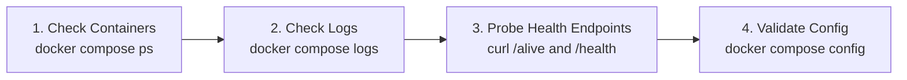

<!-- ABOUTME: Operator troubleshooting and recovery guidance for deployment and runtime failures. -->
<!-- ABOUTME: Explains readiness responses and optional email without exposing private diagnostics. -->

# Troubleshooting & Operational Health

External-login authentication discovery requires the enrolled Global database
login. Runtime must not inherit its executor role or the Global login.
If native readiness rejects an enrollment or grant mismatch, reconcile the
unauthorized authority before reinstalling rather than granting raw binding access.

Cross-tenant membership discovery requires the enrolled Global database login,
not Runtime inheritance of a discovery executor. Reconcile unexpected role grants
through the approved database process before reinstalling. This does not change
ordinary tenant-filtered membership access or grant additional tenant authority.

Native scanner credential discovery requires the enrolled Global database login.
Runtime must not inherit its executor role or the Global login. If readiness
rejects enrollment or role drift, reconcile unauthorized grants through the
approved database process before reinstalling; do not broaden Runtime privileges.

Native API-key authentication requires the enrolled Global database login.
Runtime must not inherit its executor role or the Global login, including through
intermediate roles. Reconcile unauthorized grants through the approved database
process before reinstalling; do not broaden Runtime credential-table privileges.
Reinstallation rejects unexpected authority instead of silently repairing it.

Tenant navigation reads the authenticated user's saved preference without loading
their personal profile. A saved target is used only while it remains in that
user's active tenant memberships. If it no longer qualifies, navigation chooses
the latest active membership; users without active memberships receive no target.
Navigation does not write preferences or bypass tenant access checks.
If native navigation readiness rejects deployment enrollment or routine drift,
restore the approved read contract through the database preparation process;
do not grant Runtime direct access to user records.

Changing the current user's active tenant requires the original authenticated
session and a current active membership in the selected target tenant through
transaction settlement. Revoked or foreign memberships do not change the saved
preference. Support forwarding cannot substitute another user's self authority.
An inactive tenant can remain a preference; lifecycle guards still control access.
If native preference admission fails, inspect credential validity, membership
state and the installed Global execution contract; do not grant Runtime direct
user-table access. Restore the approved native contract before retrying a
reported contract-image or execution-grant mismatch.

The native membership discovery capability requires its Global execution group.
It returns active memberships for one user and excludes inactive tenants.
If its native guard rejects an undeclared function executor, remove that
unauthorized grant through the approved database process before reinstalling;
the installer does not silently repair it. Discovery does not authorize writes.

Scanner authentication requires its native Global execution group. Version and
digest must match as a pair; a credential matching more than one scanner fails
closed rather than selecting a tenant. Check digest-key rotation configuration
and native installation without granting Runtime access to scanner records.

Persisted API-key authentication requires the native authentication projection
on the Global database account. Its usage update is restricted to the exact
key's last-used time and IP address. Diagnose a failed projection through native
installation and Global execution-group enrollment; do not grant Runtime direct
access to credential tables or authentication functions.

Tenant routing performs preliminary directory/configuration reads on a separate
scope before selecting the request tenant. A `tenant_lease_identity_changed`
failure indicates an attempt to retarget an already-bound database lease;
do not bypass that guard or expand table privileges to repair routing.

## AppHost Package Audit Failures

If building or launching Aspire fails with `NU1902` for MessagePack 3.1.8, use
the centrally patched 3.1.9 dependency and its regenerated AppHost lockfile.
This addresses an upstream deserialization denial-of-service advisory and
restores the package-audit gate. No database migration is required.

## Human mutation admission contracts

Localization governance updates require a currently valid authenticated session
and committed administrator membership through transaction settlement. An omitted
configuration section leaves its settings unchanged; supplied sections settle
together. Diagnose a rejected update through credential lifetime and native
source readiness rather than granting direct settings or identity-table access.

Reference catalogue initialization uses a separate Runtime lease, not the
request tenant scope or the Global account. If startup caches remain empty,
check native catalogue readiness and factory registration without expanding
table privileges.

Administrator checks require committed membership and the native administrative
authority contract on the independent Global account. A role claim alone does
not grant access. Revoked instance membership is reflected by subsequent reads;
do not grant Runtime direct membership-table access to repair denied requests.

Startup reference lookup caches require the native catalogue contract for the
Runtime account. An empty role cache can make valid administrator checks fail
closed. Verify catalogue readiness rather than granting direct role-table
access or assigning the Global account. The projection excludes tenant-owned
event types and does not grant user roles.

Localization configuration reports only whether a TMS API-key binding exists,
not whether the external secret is valid or reachable. A tenant binding or
instance fallback can configure this status; another tenant's binding and
qualified bindings do not. Install the native localization status contract
instead of granting direct secret-binding table access.

Settings reads require the installed ordinary-settings custody contract and its
discovery-disclosure dependency. Retain the configured Runtime or Global scope;
do not grant direct settings-table access to repair a failed native read.
Native control anchors must survive integration-fixture resets and deployment
maintenance. Missing or altered custody objects require operator diagnosis,
not automatic privilege expansion during a request.

Public tenant routing requires the independent Global account and installed
public-directory function. Suspended tenants and their domain reservations are
excluded. Do not resolve Runtime permission failures by granting direct tenant
table access; verify the selected Global account and directory execution group.

Startup setup and deployment-mode reads require the independent Global database
capability and installed native provider-configuration contract. A Runtime
permission-denied error on bootstrap state is not a reason to grant that account
direct table access. Check the selected Global credentials and native readiness
evidence; admission does not repair missing or altered contract objects.

Provider and storage configuration contracts must coexist in the selected
database. Their native source guards protect configuration observations against
concurrent changes; they do not grant permission to change configuration.

Apply the generated programme model migrations before starting updated services.
They add recovery evidence fields and widen custom-property regex storage.
Back up the database first. Historical rows do not gain trustworthy recovery
evidence from generated empty defaults. Do not downgrade after writing new recovery
records: the Down migration removes those fields and narrows regex storage.
Use a coordinated application/database backup restoration if rollback is required.

Localization bundle import requests have a 4 MiB bundle budget with 1 KiB of
HTTP envelope allowance. Oversized requests can return 413; malformed translation
JSON returns 400 without replacing the existing bundle. Check for duplicate keys,
nested values, unknown fields, unsupported key families or excessive value length.

Static bundle imports reject oversized or invalid flat text even when invoked
directly by an application command. Provider export and file-write failures
return fixed messages without provider details or filesystem exception text;
use their stable failure categories for troubleshooting.

Tolgee and Weblate responses larger than 4 MiB are rejected before their bodies
reach translation parsing or retry metadata processing. The limit also applies
to error bodies and chunked responses. Reduce the provider response size when
this boundary is reached; publication authorization remains a separate check.

Localization failures retain useful operational categories while omitting raw
provider exceptions, caller language input and translation contents. Metrics keep
counts and timings with bounded labels. Cache fallback behavior remains active;
confidential diagnostics do not replace TMS transport limits or publication
authorization.

Invalid localization override files are rejected as a whole, leaving embedded
defaults in place. Invalid write candidates do not create output directories or
replace existing bundles; valid flat text is safely JSON-escaped and atomically
published. File diagnostics omit translation contents, filesystem paths and raw
exception details. TMS transport and publication authorization remain separate
boundaries.

Localization imports accept bounded flat translation text under ui., lookup.
and payment. key families. Duplicate names, unknown contract fields and nested
values are rejected rather than silently discarded. Limits are 4 MiB input,
16,384 entries, 512 characters per key, 16,384 per value and 524,288 aggregate
characters. Input capture is immutable; publication authorization and provider
file/TMS boundaries remain separate checks.

Local quarantine work can retain physical ownership after tenant metadata is
removed. A reclaimed worker cannot complete or retry a newer claim, and object
keys must remain below the retained local root. Domain path normalization alone
does not authorize a filesystem move; database exclusion and provider path checks
remain required. Verification here runs on Linux and does not claim a Windows
filesystem execution result.

Registration creation evidence can outlive account, order or HTTP-response
cleanup without retaining request or credential payloads. Replay identity stays
bound to the original tenant, account, principal scope and operation key; a new
account or scope cannot reuse that identity. This domain receipt alone does not
enable replay handling; persistence retention and creation admission integration
remain required.

The dedicated Keycloak lifecycle client uses a minimal service-account grant:
realm-management/manage-users, without extra management/client or realm roles
and with interactive grants disabled. The profile is pinned to 26.1.2. Checks on
a fresh authenticated token response are not general bearer-token validation.
Provider bootstrap and lifecycle-send integration must complete before this
domain profile can govern a production lifecycle action.

Set AUTHENTICATION_LOCAL_PASSWORD_BLOCKLIST_PATH to a mounted, read-only
operator-owned JSON file and AUTHENTICATION_LOCAL_PASSWORD_BLOCKLIST_SHA256
to its SHA-256 digest. The file contains FormatVersion (1), Revision, Source,
License and a Passwords array; supply licensed data rather than copying a corpus
into application source. AUTHENTICATION_LOCAL_PASSWORD_HASH_ITERATIONS defaults
to 210000, accepts 100000..2000000 and should be calibrated on deployment
hardware. Explicit Authentication:Local settings take precedence over flat keys.
Restart after replacing the snapshot or configuration; invalid capture denies
local credential mutation and fails readiness for local/unselected primary auth.

Production Identity composition now captures the configured local password
blocklist and selects the normalized native hasher. A missing or invalid snapshot
blocks local credential mutation. Readiness also fails when local authentication
is primary or no provider has been selected; external-provider deployments do
not fail readiness solely for an absent local snapshot. Configure the hierarchical
Authentication:Local options or the flat deployment keys described above.

Local credential requests apply consistent Unicode-aware length rules. Login
and current-password fields permit shorter existing credentials; new passwords
use the 15..128 normalized-character policy. Supplementary characters count
once rather than twice. Request validation does not replace backend blocklist
enforcement or credential-lifecycle checks.

The local-password backend expects a deployment-owned, digest-pinned blocklist
with version, revision, source, license and password entries. Missing or invalid
snapshots deny new credentials and make required readiness unhealthy. Hashing
uses native IdentityV3 with NFC normalization and configurable bounded cost.
No blocklist corpus is bundled; choose appropriately licensed data. Production
startup and deployment wiring are described above; lifecycle-store integration
remains required.

The local credential policy counts normalized Unicode characters rather than
UTF-16 code units. It preserves spaces and case and rejects malformed text.
New credentials require 15 to 128 normalized characters; shorter existing
credentials remain eligible for verification. HTTP/manual request validation
and production native hashing now use these rules.

Custom-property patterns now require supported non-backtracking syntax and
are limited to 2,048 characters. Backreferences, lookarounds and malformed
patterns are rejected; defaults must satisfy configured bounds and patterns.
Null option collections/items are rejected rather than coerced. Existing
definitions using unsupported syntax need correction. All definition mappings
use the same ceiling; generated migrations remain required before deployment.

Refund recovery distinguishes a committed provider handoff from positive
evidence that no handoff occurred. Buyer and application-fee recovery cannot
restart each other, and recovery does not extend the original provider mutation
window. This domain state machine requires persistence and dispatcher integration
before deployment; no provider retry is enabled by this slice alone.

Location correction receipts can retain their original audit or committed
erasure authority even after disposable source data is removed. A different
message cannot replace the original correction, and mismatched audit pairs are
rejected. These domain receipts do not activate correction delivery until
persistence and dispatcher integration are complete.

Location governance tightening preserves organizer disclosure selections while
advancing the policy review version and audit. Its retained snapshot contains
policy facts rather than the physical address. Detached event locations cannot
be tightened; provider read and correction-publication integration remain
separate from these domain operations.

Report submission receipts can retain the original case version and payload
digest even after moderation advances the case. Mismatched, already changed or
previously bound submissions are rejected without replacing their receipt.
These domain guards do not enable provider synchronization until persistence and
publication integration are complete.

Paid-event evaluation can retain the persisted policy identity and version
when reconstructing policy values, so evaluations do not silently receive a new
policy identity. Existing policy normalization remains in force. This domain
factory does not activate a policy or change payment configuration; persistence
read integration remains required.

Configuration effect receipts can retain an immutable publication identity or
payload digest after successful application. Failed operations cannot claim such
a receipt, and existing bindings cannot be replaced. These domain prerequisites
do not change deployment or enable publication until persistence and publication
integration are complete.

Current human policy inputs require the original signed account and a current
credential lifetime. Signed-out, deleted or mismatched humans cannot supply those
inputs, and an already-open transaction is rejected for idle observation. Reading
inputs alone does not retain authority for a later write.

Human policy inputs can be projected from persisted source facts without
changing policy attribute names. Retained principal snapshots are independent of
later SDK object changes. This projection is not a grant of authority; original
credential checks, source retention and final request admission remain required.

Cross-tenant moderation proposal discovery is limited to one exact live event
and requires current persisted instance administration. The conversation tenant
stays selected, and ordinary event reads remain isolated. This source capability
does not itself authorize a proposal; the request preparation and final admission
checks remain required.

Webhook resource checks bind persisted ownership and delivery lineage to the
original request and transaction. Missing or changed parents cannot be replaced by
tracked objects, audit identifiers or portal session values. These source
primitives do not by themselves enable portal access or provider delivery; final
request admission and provider release checks remain required.

Native capability enrollment includes the existing email-policy instance and
tenant mutation login identities as well as Migrator, Global and Runtime. Keep all
five identities distinct; reusing one database login across those authorities is
rejected. Existing role configuration and approved secret authorities remain the
source of their usernames and credentials; enrollment introduces no new secret.

Managed event-assignment checks now retain the original selected database owner
and return fresh persisted facts after source-set exclusion. Ordinary assignment
roles and time boundaries remain unchanged; organizer control is evaluated
separately from persisted membership and placement state. Unflushed local edits do
not become authorization evidence. Production registration and verified final
parent admission remain required before the full mutation flow is active.

Managed support checks now read persisted session and governance facts on the
original selected owner, so a cached positive context cannot override revocation,
disabled write mode or tenant mismatch. Boundary projection preserves support
lifetimes, read-only compatibility and original defaults; it is a denial check,
not an operation grant. Native allowed-value metadata remains intact. Production
registration and verified parent final admission are still required. SQLite
session lookups preserve UTC offsets and the exact exclusive expiry boundary.

Managed principal observation and leases retain the original database owner and
canonical human subject through transaction revalidation. Save operations validate
tracked tenant references before persistence, and human-owned audit records use
the canonical account identifier. Disposing the context clears attempt ownership
and retained subject state. These primitives still need verified production scope
registration and mutation-consumer composition before the full flow is active.

AI execution domain reservations now bind confirmed action identity to one
primary event and immutable image custody. Recovery may reuse a linked effect but
cannot substitute another event or reopen a settled failure. Preview comparison
versions bind source and owner inputs; they do not authorize execution. These
domain primitives still require persistence mappings, generated migrations and
verified production tool wiring before the full recovery flow is deployable.

The native storage-probe prerequisite excludes changes to settings, secret
bindings and bootstrap state through a private generation sentinel. It includes
new, renamed and absent source ranges rather than only known storage keys.
Acquisition retains the original enrolled Serializable session and does not grant
access to source values. Drift stops admission without repair. Managed probe
sessions and production installation still need verified wiring before this
prerequisite protects an actual probe.

The native webhook resource prerequisite reads declared resource lineage under
the original enrolled database session. Acquisition excludes concurrent changes
to its contributor set, including new rows, and admission refuses catalog or
function drift. Resource facts do not authorize delivery, replay or configuration
changes and do not replace provider receipts. Production installation and verified
managed consumers are still required before relying on this protection.

The native event-assignment prerequisite returns declared assignment/team facts
for a selected tenant and bounded event list. Its acquisition excludes concurrent
contributor writes, including newly inserted assignments. Installation also adds
the mandatory AI exact-event target reader, restricted to persisted instance
administrators and a requested event outside the selected tenant. Target discovery
does not authorize moderation; administrator continuity still requires the parent
principal lease. Production installation and verified managed consumers remain
necessary before relying on this protection.

The native administrator-authority prerequisite checks persisted instance or
tenant administrator state on the original enrolled Serializable session. It
locks the account, binding and authority contributors rather than trusting role
claims. Tenant authority requires active membership and an unrevoked same-tenant
administrator grant. The subject-only entry point proves account continuity, not
administrator status. Drift is rejected without repair; production wiring and
verified managed consumers are still required before relying on this capability.

Managed route observation and leases now compose the separate route and
source-set prerequisites on the same selected database owner. Acquisition requires
the original Serializable transaction, and ending that transaction invalidates
the lease. Revalidation reads current route facts without switching connections
or promoting database privileges. PostgreSQL preserves non-null allowed-value
metadata; portable providers use their physical source-lock contracts. This
composition still needs production registration and verified mutation consumers.

The support-source native prerequisite restricts facts to the selected actor,
session and tenant plus declared support governance settings. Serializable
acquisition excludes concurrent source writes through compulsory triggers and a
private anchor. Catalog or function drift stops admission instead of being repaired.
These facts do not grant support access, and the prerequisite needs production
installation and verified mutation-consumer wiring before protection is active.

The native authorization-route prerequisite returns only the six declared route
settings, scoped to the original Runtime tenant or Global instance purpose. It
does not grant setting writes or make an authorization decision. Its Serializable
entry point still needs the separate policy-source-set exclusion and verified
consumer composition; installing it alone does not fence concurrent setting
changes. Installation refuses drift rather than normalizing live objects.

The principal-source native prerequisite observes actor-bound account facts and
excludes concurrent principal changes during Serializable acquisition. Its Local
session reader uses the original Runtime session; it does not grant Identity table
access to that login. Catalog, body, trigger and tenant-policy drift fail admission
rather than being repaired. A partially installed provisioning writer is rejected,
not treated as absent. Production installation and mutation consumers must still
be wired before operators can rely on this prerequisite as active protection.

Shared native writer admission verifies the installed body, triggers, roles and
privileges against the source-owned contract. Restamping a changed body does not
make it trusted. An entirely absent protocol is permitted only during its declared
migrator installation window; partial installation is not accepted as absence.
This verifier alone does not install or wire the provisioning protocol.

Generated RLS ownership joins follow the tenant filter's mapped navigation path,
including required intermediate relations. Unsupported or ambiguous paths stop
generation rather than guessing a parent. An explicit installation target schema
applies to the child and every ownership parent; deploy the full relation chain
in that schema before enabling its policies.

Generated PostgreSQL tenant policies include attestation comments for later native
admission checks. Removing or changing a comment does not bypass row-level security,
but consumers that require the original policy must reject a missing or mismatched
stamp. Generating a stamp alone does not activate commit-time admission.

The PostgreSQL source-set installer is a native prerequisite, not an enabled
deployment feature by itself. It excludes concurrent permission and governance
setting membership changes, including inserts where no matching row previously
existed. Installation must reject ownership, privilege, trigger or function drift;
an operator must not treat automatic repair or missing production wiring as proof
of active commit-time protection.

Pure route projection keeps platform settings governance separate from tenant
BYO authorization endpoints. Ordinary tenant-resource projection may select BYO
before instance mode, while Local projection requires co-located decision sources.
These projections describe evaluator selection, not an authorization grant or
proof that native commit-time admission has been installed.

Source observations use the normal hierarchical setting precedence rules.
An empty tenant override set still counts as tenant context: missing SMTP
delegation keeps tenant SMTP changes locked, rather than granting delegation
because no override row exists. Instance-only settings evaluation is separate.

Human commit identity and source-fence contracts are internal prerequisites for
commit-time revalidation. They do not enable an operator setting, install database
locks or activate new mutation protection by themselves. Native provider enrollment
and each mutation consumer must be delivered and verified before that protection
can be relied on. Existing request authentication remains the entry boundary.

## Persisted API-key evidence

Persisted API-key authentication can supply server-owned evidence of the key row
and its authenticated scope snapshot. Configured clients and internal machine
execution do not have this evidence, even if their claims look equivalent.
Copying or editing claims cannot transfer persisted-key authentication custody.
This evidence does not itself grant a mutation or replace commit-time checks.

## Credential lifetime evidence

The API can retain request-local evidence of a validated human credential's
original expiry. Editing claims or authentication ticket expiry does not renew
that credential, and copying a principal does not transfer its evidence. This
capture mechanism preserves existing provider clock skew; it does not itself
change token lifetime configuration or authorize an administrative action.

## Keycloak token audience and purpose

API requests require an access token whose aud contains KEYCLOAK__AUDIENCE
(default islamu-event-api) and whose signed payload typ is Bearer. ID tokens
and tokens addressed only to the browser client are rejected even when azp
names an approved client. Update the realm resource-audience mapper before
rollout; the retired ValidAudiences arrays no longer grant acceptance.

Optionally set Keycloak:PermittedClients through indexed configuration such as
KEYCLOAK__PERMITTEDCLIENTS__0 to restrict originating clients as well. This list
does not replace the API audience. Omit it for no client restriction; do not
use a blank placeholder entry. Direct-process indexed environment variables
must be explicitly forwarded by a container deployment to reach the API.

## Conditional JSON responses

Small successful JSON responses may return a weak ETag for conditional requests.
Responses exceeding 256 KiB, streaming or flushed responses, non-JSON content
and private-no-store endpoints do not receive middleware-generated validators.
A missing ETag on those responses is intentional: the API forwards the content
without retaining the entire response in memory. A matching If-None-Match returns
a bodyless 304, allowing the client to reuse its cached representation.

## File response sandboxing

Storage downloads, public storage images and event-resource content return a
Content-Security-Policy that includes sandbox alongside resource-loading and
framing restrictions. Reverse proxies must preserve this response policy rather
than replacing it with a weaker generic API policy. Ordinary JSON endpoints
retain the base API policy without the file sandbox directive.

## Support-access audit failures

Support-access audit storage failures do not replace an already completed HTTP
response. Watch the audit persistence failure metric and warning to detect gaps;
warnings intentionally omit provider exceptions and their private details.

## Server-owned correlation IDs

Use the response's `X-Correlation-ID` when reporting a request failure. The API
generates a fresh compact UUID for each request. Incoming `X-Correlation-ID`
and `X-Request-ID` values are ignored, not echoed; clients must capture the
returned ID instead of expecting their supplied value to appear in API logs.

## JWT failure diagnostics

Invalid bearer tokens still receive a 401 challenge. Provider error descriptions
and error URLs are omitted; failed authentication uses the generic `invalid_token`
challenge code. Operators can correlate the native `authentication_failed` and
`authentication_challenge` events without exposing token contents or private
request paths in logs.

## Storage readiness failure reasons

The API no longer imports ambient logging scopes. Keep `FromLogContext` out of
API Serilog configuration: scope fields can overwrite native diagnostic values.
Events retain their own arguments and producer category.

Storage readiness uses `provider_unavailable` when the selected provider cannot
be resolved and `policy_unavailable` when its policy cannot be resolved. These
stable reasons replace exception subtype names. Check the selected provider
registration and storage policy respectively; private exception details are not
part of the health response.

This guide provides fast diagnostic procedures and step-by-step recovery recipes for common issues encountered during deployment, authentication, database migrations, and runtime operations.

---

## Setup Readiness

The setup overview refreshes one server journey snapshot. Open the application,
configure authentication and authorization, enter the site name, and finish setup.
There is no URL field or address confirmation. Authorized setup establishes the
address internally from the BFF request, including HTTPS, port and path prefix.
Behind a proxy, preserve the public Host and configure trusted forwarded headers,
or set `PUBLIC_BASE_URL` and restart. Anonymous requests never establish a permanent
address. Subdomain routing requires an explicit base domain when enabled;
path-based multi-tenancy does not.

Tenant slugs cannot use `alive`, `vapid-public-key`, `scalar` or `quartz`, or
contain a dot. These roots are reserved for operational endpoints, assets and
metadata, including fingerprinted build filenames. Choose a distinct,
hyphen-separated tenant slug instead. Existing tenant names are not
automatically changed.

If email delivery is enabled but secure public links cannot be constructed, setup
shows a non-blocking warning to configure `PUBLIC_BASE_URL`. Background email uses
this override or the established address; recovery links still require HTTPS.
A deployment-managed provider is not ready merely because deployment
selected it: pending, failed and restart-required states require the displayed
repair action. Setup never silently selects a replacement provider.

If Finish setup reports both “The settings field is required” and an invalid-body
error, this can be a JSON contract mismatch rather than a missing form field.
Update and restart the API and BFF together, then reload setup. Response-only URL
ownership metadata is no longer included in the submitted site profile.

If the snapshot is unavailable, contradictory or changed while being read, repair
the selected source and refresh; do not proceed using an older screen's actions.
Custom setup clients must replace `/api/system/onboarding-preflight` with
`/api/instanceonboarding/journey`, using active setup or administrator authority.
Completion and sign-in recovery rules are unchanged. The journey generation
tracks saved setup state, not a guarantee of continued external availability.
Completion checks readiness again before taking the setup write lock; changed
saved settings still require a refresh.

## AI Credential Scope Definitions

The registry supports `AI_OPENAI_COMPATIBLE_API_KEY` and
`AI_ANTHROPIC_COMPATIBLE_API_KEY` under `/ai` for instance or tenant bindings.
`AI_AZURE_API_KEY` is instance-only. Supply values through the selected secret
authority rather than source configuration. Tenant-owned transports must not
borrow instance credentials; compatible providers may explicitly select no
credential when their endpoint permits it. These definitions alone do not enable
a provider or authorize a transport.

### Select And Repair AI Credentials

Choose a credential scope instead of entering an API key in AI settings.
Provision the provider-specific key through the selected secret authority, then
select instance or tenant scope. Compatible providers may explicitly use no
credential. A tenant-owned endpoint cannot borrow an instance key, including
when its address matches the instance endpoint. Missing or inaccessible keys
remain unavailable rather than falling back to another scope.

For instance model discovery, use platform-administrator access and the configured
compatible-provider endpoint. Tenant discovery does not inherit instance permission
to use local-network endpoints. Correct the selected authority or configuration
when discovery is unavailable; do not send key values in discovery requests.

`AI_CREDENTIAL_SCOPE` selects metadata only. The legacy `AI_API_KEY` option and
`ai_assistant.api_key` setting no longer configure credentials; writes to that
retired setting are rejected. Rebind through the provider-specific key instead.
Existing retired rows are not automatically removed.

## Getting-Started And Identity Controls

An unavailable checklist is not a ready result. Use its Refresh status action and
inspect the bounded reason before proceeding; do not infer permission from a
readiness label. After sign-in, status/journey reads should use the normal session,
not old setup authority. A 429 response requires inspecting request volume and the
configured limiter, not repeatedly pressing Refresh.

If kind/country choices are unavailable, existing identity values are retained.
Refresh after restoring the metadata service; do not invent a replacement choice
registry. An omitted Save action means the document did not grant editing.
A revision conflict requires reviewing the authoritative document before saving.

## Quick Diagnostic Flow

When diagnosing an unexpected failure, follow this four-step sequence:



1. **Check Container Status**:
   ```bash
   docker compose ps
   ```
2. **Inspect Container Logs**:
   ```bash
   docker compose logs --tail=100 -f event-api
   docker compose logs --tail=100 -f event-ui
   docker compose logs --tail=100 -f keycloak
   ```
3. **Query Health Endpoints**:
   ```bash
   curl -i http://localhost:7039/alive
   curl -i http://localhost:7039/health
   ```
4. **Verify Configuration Syntax**:
   ```bash
   docker compose config --quiet
   ```

---

## Common Issues & Recovery Recipes

Analytics bridge warnings identify the failed operation and exception type, but
intentionally omit page paths, user identifiers, event payloads and raw browser
exception text. Use the operation to check analytics configuration and consent;
do not add sensitive payloads to shared support logs to diagnose a failed call.

Server analytics adapters likewise emit fixed provider/operation failure
categories rather than exception objects, endpoint credentials, event names,
feature keys or caller identities. Configuration logs retain only the typed
provider and enabled state, not the tenant identifier. A failed provider
resolution falls back to disabled analytics, and feature-flag failures remain
false or null; analytics diagnostics must not become a second export of the
event or identity being measured.

### Recipe 1: Keycloak "Invalid Parameter: redirect_uri" or Infinite Login Loop

#### Why this happens
Keycloak validates the redirect URI sent by the browser against its client whitelist. If your reverse proxy terminates TLS but does not forward `X-Forwarded-Proto: https` and `X-Forwarded-Host`, Keycloak believes the request came over unencrypted HTTP or an internal container IP and rejects the callback.

#### Step-by-Step Fix:
1. **Fix Reverse Proxy Headers**: Ensure your reverse proxy (Caddy, Traefik, or Nginx) forwards the client headers to Keycloak:
   - *Nginx*:
     ```nginx
     proxy_set_header Host $host;
     proxy_set_header X-Forwarded-For $proxy_add_x_forwarded_for;
     proxy_set_header X-Forwarded-Proto https;
     ```
   - *Caddy*:
     ```caddy
     reverse_proxy keycloak:8080 {
         header_up X-Forwarded-Proto {scheme}
         header_up X-Forwarded-Host {host}
     }
     ```
2. **Configure Keycloak Client Allowed URIs**:
   - Log into Keycloak Admin Console at `https://auth.example.org/admin`.
   - Navigate to **Clients** $\to$ **`event-blazor`**.
   - Under **Valid Redirect URIs**, enter: `https://events.example.org/*`
   - Under **Web Origins**, enter: `https://events.example.org`
   - Click **Save** and test logging in again.

---

### Recipe 2: API Fails at Startup with `Instance:OperatorIdentity Validation Failure`

#### Why this happens
In production (`ASPNETCORE_ENVIRONMENT=Production`), ISLAMU Event implements a fail-closed legal compliance check. An instance will refuse to open HTTP ports if the operator legal identity variables are blank.

#### Step-by-Step Fix:
1. Open your `.env` file.
2. Ensure the following six legal identity keys are populated with real values:
   ```env
   INSTANCE__OPERATORIDENTITY__OPERATORID=01912a7e-1234-7000-8000-000000000001
   INSTANCE__OPERATORIDENTITY__PUBLICNAME=Community Events Foundation
   INSTANCE__OPERATORIDENTITY__LEGALNAME=Community Events Foundation Non-Profit
   INSTANCE__OPERATORIDENTITY__PUBLICCONTACTEMAIL=contact@example.org
   INSTANCE__OPERATORIDENTITY__TERMSURL=https://events.example.org/terms
   INSTANCE__OPERATORIDENTITY__PRIVACYURL=https://events.example.org/privacy
   ```
3. Restart the stack:
   ```bash
   docker compose restart event-api
   ```

---

### Recipe 3: Headless Onboarding Fails with `GenerationDrift`

#### Why this happens
When using headless automated onboarding (`INSTANCE_BOOTSTRAP_MODE=ConfiguredAdministrator`), the platform guards against configuration replay attacks using a monotonic generation counter. If you edit bootstrap parameters without incrementing the generation counter, startup halts immediately.

#### Step-by-Step Fix:
1. Inspect the current generation number in `.env`:
   ```env
   INSTANCE_BOOTSTRAP_BINDING_GENERATION=1
   ```
2. Increment the value to a strictly higher integer (e.g., from `1` to `2`).
3. Confirm that `INSTANCE_BOOTSTRAP_ADMIN_SUBJECT` exactly matches the user's UUID (`sub` claim) from Keycloak.
4. Restart `event-api`:
   ```bash
   docker compose restart event-api
   ```

---

### Recipe 4: Database Migration Lock or Connection Refused

#### Why this happens
If `event-api` starts before PostgreSQL is ready or before `event-migrationservice` completes, the API may timeout or log database lock errors.

#### Step-by-Step Fix:
1. Check PostgreSQL container health:
   ```bash
   docker compose ps postgres
   docker compose logs --tail=50 postgres
   ```
2. Manually run the one-shot migration service and confirm it exits with code `0`:
   ```bash
   docker compose run --rm event-migrationservice
   ```
3. Once migrations succeed, start the API:
   ```bash
   docker compose up -d event-api event-ui
   ```

---

### Recipe 5: All Authenticated Actions Return `403 Forbidden` (Cerbos Fail-Closed)

#### Why this happens
When `AUTHORIZATION_PROVIDER=cerbos` is selected, ISLAMU Event enforces **fail-closed security**. If the Cerbos PDP container is unreachable, unhealthy, or has not loaded policies, all actions are denied immediately. It does not fall back to local RBAC.

#### Step-by-Step Fix:
1. Check Cerbos PDP health endpoint:
   ```bash
   curl http://localhost:3592/_cerbos/health
   ```
2. If Cerbos is running but policies are missing, upload policies via `cerbosctl`:
   ```bash
   docker run --rm -v "$PWD/cerbos/policies:/policies:ro" \
     ghcr.io/cerbos/cerbosctl:0.51.0 \
     --server=localhost:3593 --plaintext \
     put policy -R /policies
   ```
3. If Cerbos is experiencing an extended outage and you need immediate emergency access, switch to local RBAC in `.env`:
   ```env
   AUTHORIZATION_PROVIDER=local
   ```
   Then restart `event-api`:
   ```bash
   docker compose restart event-api
   ```

---

Setup wizard reads are rate-limited per route. Refreshing status or readiness
cannot consume the authorization-provider configuration route's budget, while
setup mutations remain on a stricter shared budget. If a custom setup client
receives `429`, honor `Retry-After`; do not replace the missing authoritative
response with locally inferred provider state.

### Recipe 6: Lost Setup Secret Recovery

During first-run setup, the protected BFF session can read branding and save the
installation profile before a directory is public. Signing in with Local,
Keycloak, or ATProto does not itself grant administrator rights; normal branding
changes still require an administrator.

If profile save loses setup authority after sign-in, refresh setup status and
return to `/setup` to renew the session while setup is incomplete. Keep browser
cookies enabled and use the normal form so write requests retain antiforgery
protection. Do not add authorization, provider, tenant, or setup-secret headers,
or copy secrets/tokens into browser storage.

A completed installation permanently rejects setup authority. The BFF rechecks
persisted authority before renewing or synchronizing it and clears setup state
when the API reports `410` / `setup_already_completed`. Use normal sign-in instead;
retained cookies and restarts cannot reopen setup. Share only bounded reason codes
with support, never secrets or raw provider responses.

#### Why this happens
If you left `SETUP_SECRET=` blank in `.env`, the container generated an ephemeral single-use secret inside the volume upon first boot.

#### Step-by-Step Fix:
1. Copy the setup secret out of the container to your local terminal:
   ```bash
   docker compose exec event-api cat /app/data/setup-secret
   ```
2. Open `http://localhost:7002/setup` in your browser and paste the secret.
3. Once onboarding completes, the setup secret file is permanently deleted automatically.

---

### Recipe 7: Lost Instance Administrator Access

Use this break-glass procedure only when an existing platform account is
already linked to the exact AT Protocol DID that should regain instance
administration. It cannot create or link an account.

1. Back up the application database.
2. Stop API, UI, worker, and migration replicas while keeping the database
   reachable.
3. Check out the exact source revision deployed to the instance.
4. Export the same structured migrator secret authority used by the deployment.
   Do not place a connection string or password on the command line.
5. Run:
   ```bash
   dotnet run --file eng/tools/EmergencyAdminProvisioner.cs -- \
     --grant-did 'did:plc:replace-with-the-exact-linked-did' \
     --apply
   ```
6. Run the same command a second time. The expected result is
   `instance-administrator-recovery: already-present`.
7. Restart every replica, sign out, and sign in again so cached authority and
   session claims are refreshed.

Exit codes are `0` for granted/already present, `64` for invalid command input,
`65` for an unknown/ineligible DID, invalid role authority, or pending
migrations, `70` for configuration/database failure, and `130` for
operator cancellation.

The tool does not create users, resolve handles, modify onboarding state, grant
tenant authority, or contact a personal data server. Its output intentionally
contains no DID, user/tenant ID, database locator, secret, or exception text.
Production container images do not carry this source/SDK tool; run it from the
matching checkout on a trusted host with database access.

If the previous platform administrator is compromised, add `--reassign` to the
command. This verifies and grants the replacement first, then removes every
other platform-administrator grant in the same serializable transaction.
Without `--reassign`, the operation is additive.

---

## Health Check Endpoints Reference

The platform exposes standardized, sanitized health endpoints:

| Endpoint | Method | Purpose | Healthy Response |
|---|---|---|---|
| `/alive` | `GET` | **Liveness Probe**: Confirms the process is running. | `200 OK` with sanitized JSON status |
| `/health` | `GET` | **Readiness Probe**: Checks required infrastructure and reports optional-service health. | `200 OK` with sanitized JSON status |

Both `Healthy` and `Degraded` readiness return HTTP 200. `Unhealthy` returns HTTP 503. Inspect the individual checks to distinguish an optional email incident from a core dependency failure.

### Optional Email Readiness

| Situation | Health result | Operator action |
|---|---|---|
| Outbound email is disabled, including an unconfigured installation with delivery left off | `smtp` is `Healthy`; no SMTP connection is attempted | No mail server is needed for this readiness check. |
| Email is explicitly enabled, but configuration is incomplete, SMTP connection/authentication fails, or the network probe times out | `smtp` is `Degraded`; `/health` stays HTTP 200 if core checks are healthy | Check the instance's delivery setting, SMTP address, port, TLS mode, and credentials through the configured [secret authority](secrets.md). |
| Required configuration/secret authority, database access, or health-check composition fails | `Unhealthy`; `/health` returns HTTP 503 | Restore the failing core dependency. Optional email does not bypass these checks. |

The SMTP readiness probe and instance connection test use **instance SMTP settings**. They do not validate a tenant's separate mail server.

The `email-dispatch` check is `Healthy` when its worker is intentionally disabled. A selected but disabled scheduler is `Degraded`, while failures reading the dispatch database remain `Unhealthy`. HTTP 200 alone does not confirm that email can be delivered.

Scheduler failure diagnostics use fixed categories rather than job keys or
provider exception details. `scheduler_unavailable` leaves deadline registration
unscheduled and cancellation unsuccessful, preserving the existing sweep fallback.
Default scheduler-control logs omit operator identity and caller correlation;
deploy a separate access-controlled scheduler audit sink if identity-bearing
accountability records are required.

Startup registration logs expose completion, `registration_pending`, or
`registration_retry_failed` without provider diagnostics or registration attempt
identifiers. Svix event-type synchronization reports aggregate counts or
`event_type_sync_failed`. Shutdown cancellation is not reported as a provider
failure; these diagnostic changes do not change worker retries or sync results.

When delivery is disabled or its configuration is unavailable, optional notifications
are recorded as skipped rather than kept for a later flood of email. In-app delivery
continues. Required email can be parked while its delivery requirements are unavailable;
an operator hold is a separate reason and must not be released by restoring SMTP.
If a capability-held message offers a park action, using it places that message
under an explicit operator hold. Repeating the hold does not replace its original
reason or time. Follow the actions offered by the server; a message already being
sent cannot be taken back by parking it.
Do not assume that correcting SMTP has sent a parked message. Inspect its delivery
state, and never automatically replay a message whose acceptance is unknown. A send
already admitted before a policy change may still complete.

Old managed-administrator invitation messages are retired and always skipped,
including after email or administrator access is restored. Managed provisioning
now links an existing Local administrator instead of producing an invitation.
A skipped audit entry is not a sent email.

### Deliberately Disabling Email

Use the disable action advertised in the instance SMTP or current tenant email
settings. Tenant controls respect instance delegation and individual settings
locks. If no action is offered, changing a generic setting or resetting an override
does not bypass that restriction.

1. Request the disable preview and review its affected scopes and policy revision.
   Disabling instance delivery does not necessarily disable a tenant that uses its
   own independently enabled transport.
2. Type `DISABLE EMAIL DELIVERY` exactly and confirm before the preview expires.
   Cancelling leaves delivery unchanged. The confirmation expires after five
   minutes and is valid only for the administrator, scope and impact that produced it.
3. If policy, scope or administrator authority changes, obtain a new preview.
   A stale confirmation returns a conflict instead of silently applying different
   impact; do not automatically retry it.

Disable preserves SMTP configuration and locks, and takes effect at new send
admission. A send already admitted may still finish. Re-enabling delivery does not
replay skipped optional history or release operator holds and unknown outcomes.
Keep confirmation tokens out of logs and support tickets; the preview contains no
SMTP credentials or message content.

Example partial response when outbound email is disabled and core checks are healthy (other checks omitted):

```json
{
  "status": "Healthy",
  "message": "Ok",
  "totalDuration": 18,
  "checks": [
    {
      "name": "smtp",
      "status": "Healthy",
      "description": "smtp_disabled",
      "duration": 1,
      "data": { "enabled": false, "state": "Disabled" }
    }
  ]
}
```

*Note: Health responses never disclose passwords, connection strings, or PII.*

### AT Protocol readiness recovery

Inspect the `atproto-authentication` entry on the browser-facing host's
`/health` response. Disabled AT Protocol is healthy. A failed AT Protocol
primary is unhealthy (`503`); a failed optional AT Protocol login with an
explicit Local Identity or Keycloak primary is degraded (`200`). That optional
failure does not itself take the host out of service, although other checks
can still fail. `/alive` does not depend on the AT Protocol store probe.

1. For `state_store_unavailable`, restore the private API connection, primary
   database availability/current migrations, and shared OAuth signing keys.
   Do not expose or copy key values, assertions, callbacks, or database rows
   into a support report.
2. Wait more than ten seconds for the cached readiness result to expire and
   request `/health` again. The probe has a two-second deadline, uses random
   non-secret data, and does not automatically retry or hedge requests.
3. Start a new login from the handle form. Do not retry an old callback or
   consume request after a lost response. A healthy store probe does not
   guarantee a user's external PDS or discovery service is available.
4. If expired rows accumulate, confirm the global scheduler is enabled and
   `atproto-transient-cleanup` is running every minute. It remains needed when
   login is disabled. Monitor its fixed success/failure and completed-row
   counters; never extend expiry to recover an old login.

See [AT Protocol readiness, cleanup, and retention](../federation-and-open-protocols/at-protocol-and-bluesky-jetstream.md#readiness-cleanup-and-retention)
for cleanup limits, shared protection-key persistence, and backup-retention
boundaries.

---

## Idempotency Receipt Payload Scrubbing

Expired replay receipts cannot be reacquired. Cleanup removes retained response
payloads while keeping the operation identity and request fingerprint as replay
rejection fences. An unavailable response returns conflict; it does not authorize
the original write to execute again. Do not delete receipts to recover a replay.

Subject erasure removes attribution and request fingerprint material without
reopening the original receipt identity.

On PostgreSQL, install the current native receipt capability before enabling
traffic or cleanup. Discovery exposes only tenant identities; each tenant's
scrubbing uses separate ordinary database authority. Dry-run and scrub mode
share one bounded pass budget, including suspended owners and receipts whose
tenant-directory row no longer exists. Invalid cleanup settings fail startup.
Intentionally disabled cleanup is `Degraded`; payloads remain stored, but expired
responses remain unavailable. Monitor cleanup run outcomes and eligible/scrubbed
row counts without exporting keys, response bodies or provider exceptions.

## Email Content Retention

Retention discovers bounded tenant identities through Global authority, then
redacts each tenant through a separate Runtime scope. Migrate the PostgreSQL
discovery capability before enabling cleanup. Missing discovery authority fails
the pass; restore the declared grants instead of giving Global email-table reads.

Dry-run uses the same selected-tenant scope. Each tenant's outbox, attempts,
receipts and notification deliveries redact in one transaction. A failed tenant
remains counted while other tenants continue; cancellation still propagates.
Sent/skipped cutoffs, batch limits and unresolved-message preservation remain
unchanged. Failure warnings expose only `retention_cleanup_failed`, not exception
types, provider text or recipient details.

## Inventory Hold Expiry

Run application migrations before enabling hold-expiry jobs so the PostgreSQL
identity-only discovery function and Global executor enrollment exist. Global
discovery must not receive private business-table grants.

Each sweep discovers at most 100 due holds and 100 interrupted recoveries.
Each order runs in a fresh Runtime scope bound to its original tenant before
inventory and lifecycle services are resolved. A scheduled pointer cannot
retarget an existing request or reuse another tenant's database context.

If discovery fails closed, repair the declared grants and source policies rather
than granting Global broad reads. If work remains after an interruption, rerun the
reconciliation sweep: expiry is conditional, payment ambiguity is preserved and
lifecycle recovery can complete previously expired holds without expiring live
or foreign-tenant work.

## Related Guides & Next Steps

If `tenant_lease_identity_changed` rejects an operation, create a fresh database
context for the newly selected tenant. Do not rebind an open context or retry the
same context with a different tenant; its connection lease retains the original identity.

Secrets audit logs retain bounded operation, provider and failure categories with
validated correlation identifiers, not key paths, user identities or provider
error payloads, even at Debug level. Failed secret-provider health probes report
`provider_unavailable` without private exception types or content. Use these
categories and current provider readiness to diagnose failures.

* **[Environment Variables Reference](environment-variables.md)** — Fix missing legal identity keys or secret provider errors.
* **[Docker Compose Runbook](../self-hosting/docker-compose.md)** — Production container restart and migration lifecycle.
* **[Keycloak Authentication](../security-and-identity/authentication.md)** — Configure reverse-proxy redirect URIs and client origins.
* **[Authorization Guide](../security-and-identity/authorization.md)** — Understand Cerbos fail-closed behavior vs. Local RBAC.
* **[First-Run Administration Guide](../administration-and-branding/admin-guide.md)** — Complete initial setup wizard with the recovered setup secret.
