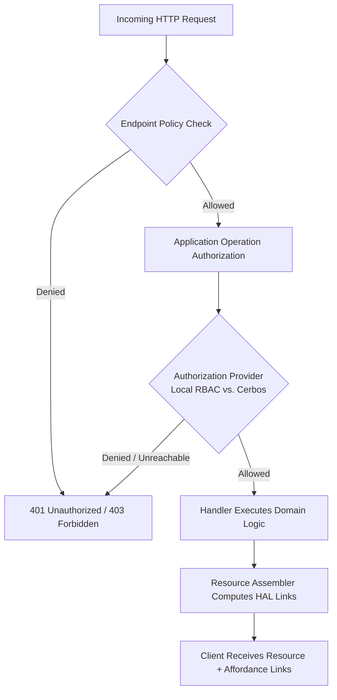

# Authorization & Access Control

Authorization in ISLAMU Event determines *what* an authenticated identity is permitted to do. The platform provides a runtime choice between **Local Database-Backed RBAC** and an external **Cerbos Policy Decision Point (PDP)**.

---

## Authorization Pipeline Flow

Every mutation and sensitive query passes through a multi-stage, fail-closed authorization pipeline before reaching business logic:



1. **Endpoint Boundary**: Broad policy checks verify caller identity and minimum claims.
2. **Operation Authorization**: The request evaluates the caller, tenant context, resource state, and requested action against policy rules.
3. **Execution Gate**: Handlers only execute if authorization explicitly returns `Allow`.
4. **HATEOAS Affordance Gating**: The response dynamically attaches allowed actions in HAL `_links` (e.g., `_links.edit`, `_links.refund`). The client renders UI buttons strictly based on the presence of these links.

---

## Event category assignment permissions

Category assignments are governed by permission to update their event, not by
permission to administer category definitions. An event owner with update
permission can remove its category assignments. Moving an assignment between
events requires update permission on **both** the source and destination, even
when both events belong to the same tenant. Permission on the source alone does
not authorize writing into another organizer's event.

Missing or tenant-invisible assignments cannot be deleted. Denied authorization
and authorization-provider outages both prevent writes, while remaining distinct
failure outcomes; neither silently falls back or changes the assignment. These
rules apply with Local RBAC and with Cerbos selected. No policy grants, database
migration, new configuration, or new category-assignment API endpoint accompany
this repair. Upgrade the application normally; EventTags and category-definition
administration are unchanged.

## Event tag assignment permissions

Tag assignments use permission to update their event, not permission to administer
tag definitions. Event owners with update permission can remove their assignments.
Moving an assignment requires update permission on **both** events, even within
the same tenant; changing its tag at the same time does not avoid this check.
Missing or tenant-invisible assignments cannot be changed or deleted.

Denied permission and an unavailable authorization provider both prevent writes
without changing the assignment. They remain distinct failure outcomes; provider
outages do not silently allow a move. These checks apply with Local RBAC or Cerbos
selected. Upgrade the application normally: this repair adds no endpoint, policy
grant, database migration or configuration, and does not change tag-definition
administration.

## Current authority for event public actions

Creating, editing or deleting an event's public actions requires current
persisted authority, not a previously displayed link or a stale role claim.
The server checks the selected authorization provider, then protects the
current owner, membership and permission records in the database transaction
that writes the action. Revoked or expired authority, a different tenant or
parent event, and a stale action version prevent the mutation. Direct
application and tool callers use the same handler checks as HTTP callers.

A provider outage does not grant local access. Cancellation rolls back the
owning database transaction. No new database privilege, configuration value,
endpoint or migration is needed for this boundary; operators should not grant
broader database roles to make an authorization failure disappear.

## Current authority for template changes

Creating, updating or deleting an event template or session template requires the selected provider's
permission and current persisted tenant- or instance-administrator authority.
The server resolves the template's tenant rather than treating its id as a
tenant id. Creation uses the server-selected tenant, and session-template
creation rechecks its parent before insertion. A deleted or tenant-invisible
parent cannot authorize a session-template change.

Template changes, child cleanup and root deletion use an owning database
transaction. Updates check the current stored target and concurrency version;
old tracked values and a posted tenant hint cannot replace that target. A failed or
canceled operation rolls back that work; caches are invalidated after commit.
Rollback-known creation and definition-replacement retries preserve generated
ids, but recheck current authority and parent state before writing again.
These changes add no database privilege or configuration. Their native tests
remain unrun under the programme's final-only verification schedule.

## Current authority for custom-property definition changes

Creating, updating, deleting or purging shared, event or session definitions,
and assigning event/session values, rechecks current administration within the
database transaction. Stored ownership, parent and option state determine the
target; posted tenant hints and stale tracked values cannot substitute for it.
Projection changes commit with the data, purge commits its audit atomically,
and caches are invalidated afterward. Native verification remains queued.

## Subscription state and administrative blocks

Self-service subscription reads stay within the current execution tenant and
use stored state rather than an already-tracked object. Inconsistent recipient
links are excluded from reads and notification fanout.

A live administrative block cannot be cleared by unsubscribing and subscribing
again. Retired subscriptions remain hidden; creating a new subscription after
retirement remains supported. Unsubscribing an absent subscription remains an
idempotent success without changing data.

The broader subscription transaction and fanout ownership work remains
incomplete. Its new native regression cases are authored but unrun.

## Current authority for event agenda changes

Agenda creation, editing and deletion also recheck current authority inside the
same transaction as the change. Moving an item requires authority over both
its current event and its destination; a submitted or tracked parent identity
does not establish access. The existing administrator and event-role rules
remain in effect, and an unavailable selected policy provider denies the
operation. Native agenda regression coverage is authored but not yet executed.

## Current authority for event deletion

Deleting an event requires current ownership, organization administration or
explicit event-delete authority; platform or tenant administration alone is
not sufficient. The server checks
paid evidence and affected sessions inside the deletion transaction. Paid
evidence still blocks deletion, and a failed commit rolls back the event and
session cascade together. Native regression coverage is authored but unrun.

## Current authority for event session changes

Session creation, editing and deletion recheck current rights within their
transaction. Relocation requires permission to update the source session and
create a session under the destination event; it does not require unrelated
event-editing permission and still rejects moving a published session.
Ticket entitlements still prevent deletion of a
referenced session. Islamic metadata and template-derived properties now
commit with the session, so a failure cannot leave only the session committed.
The native regression cases remain unrun pending programme assurance.

## Current authority for footer group deletion

Deleting a footer group rechecks current administration and the instance's
current multi-tenant governance lock. It can delete only a group owned by the
current tenant, never a foreign tenant's group or an instance-default group.
The group and its links commit or roll back together. The existing human
identity requirement remains; this operation does not acquire machine PATCH
permissions. Native regression coverage is authored but unrun.
Previously loaded links are not deleted twice, and conflicting stored/in-memory
parent ownership aborts the operation rather than moving or deleting other links.

## Persisted machine keys for session and footer changes

Stored API keys retain only their existing provider-authorized session changes
and footer link/group PATCH operations. Each write also checks the current
stored key, owner, tenant, scopes, expiry and target under the same transaction.
Revocation, owner/parent drift, removed scopes or expiry while waiting for a
target prevent the write from committing. Configured keys and internal
machine identities cannot substitute a stored key with a matching public ID.

API keys do not become human identities. Session branches requiring human
attribution and all six human-only footer actions, including settings PATCH,
keep that requirement. Local's InstanceAdmin session permissions are not
expanded. Null-tenant InstanceAdmin keys receive only the fixed footer
link/group PATCH database capability described in
[database provisioning](../configuration-and-operations/environment-variables.md#independent-database-credentials).
It cannot edit instance-default or foreign groups, manage keys, or expose
credential material. Native regression cases remain unrun.

## Current room-update authority

Room edits and relocation now keep current administration or persisted-key
authority, room ownership and both locations in one transaction. Stale
concurrency stamps, deleted rooms, erased or foreign locations, revoked keys
and expired authority prevent a commit. Existing schedule references still
block relocation.

Cerbos's existing InstanceAdmin API-key room-update permission uses a separate
fixed Runtime database capability. Local does not gain that permission, and
the footer capability is not reused. Provision its role through the
[database guidance](../configuration-and-operations/environment-variables.md#independent-database-credentials).
The new native cases are authored but unrun.

## Native Local session validation

PostgreSQL application requests validate current Local session readiness through
an execute-only native read after token signature validation. Runtime does not
need direct access to private identity tokens. Changed stamps, incomplete password
replacement, revoked bindings or inactive personal actors invalidate the session;
unavailable validation does not become a valid session. Install the updated
principal source contract through the migration process. Fourteen native Runtime
controls pass with both instance and tenant requests, including session revocation
and refusal of direct private-token access.

Resource and visitor settings changes acquire their ordered policy locks before
opening the committing transaction. Joined writes require the original acquired
producer; a transaction or administrator identity alone is not enough. Updating
a resource value does not silently remove its existing lock.

## Current human policy inputs

Cerbos receives the signed-in account's current persisted authority through
bounded native reads on its original selected database owner. Enabling Cerbos
does not require direct Runtime access to private membership or permission
tables. Credential, identity or tenant changes invalidate the input read.
These inputs are not a reusable commit permission: AI proposals retain and
revalidate their sources through the actual commit. Executable assurance for
this integration remains pending.

## Ordinary AI tool proposals

An ordinary AI tool proposal remains in the signed-in human's selected tenant
and conversation. Event identifiers select real tenant-filtered targets;
organization/group identifiers and management-context flags supplied by the
model do not grant permissions. Draft creation and template proposals retain
their existing creation and tenant-administration rules.

The server asks the selected Local or Cerbos provider before taking database
locks. A Cerbos denial is not replaced by instance-administrator access.
The signed-in account, credential lifetime, provider route, support session
and any Event assignments must remain unchanged and valid through the single
proposal commit. Expired assignments, changed sources or a replaced request
reject the proposal rather than replaying a cached authorization decision.
Authorization denial still reports `tool_authorization_denied` and persists
no proposed action.

This records a proposed action only. It neither changes the target Event nor
enables confirmation or execution of additional action types. The ordinary
path uses the existing native human-source capabilities; missing or changed
capabilities fail closed. Focused regression controls are authored, with their
execution deferred to serial programme assurance.

## Cross-tenant AI heavy-moderation proposals

A current instance administrator can propose heavy moderation of one event in
another tenant while keeping the conversation in its original tenant. This
applies only to `HeavyModerateEvent`; ordinary event reads and other proposal
types remain tenant-isolated. Tenant administrators, API-key callers and
management-context flags in a proposed payload cannot activate this capability.

The event identifier selects the target. The server derives its real tenant,
keeps the conversation tenant's authorization provider and policy scope, and
rejects a provider denial or outage. The original administrator grant, session,
event and authorization inputs must remain valid through the proposal commit.
Only the conversation's proposed-action record changes: this does not moderate
the target event or enable confirmation of additional action types.

Install the native capability through the normal migrator before serving this
path. Application credentials receive routine execution, not private table
access. Missing or changed native installation fails closed. Focused regression
controls are authored; execution evidence is pending serial programme assurance.

## AI retention transactions

The acting-context picker reads only the signed-in account's current personal,
organization and group actors in the selected tenant. Organization/group choices
require live approved placement and membership with an active event-creation
grant; an administrator role name alone does not grant a choice. Reads validate
the original authenticated session through transaction completion and disclose
display names rather than private profiles or contact details. PostgreSQL
installation provisions a dedicated execute-only capability, not table access
for the application credential. More than 1,000 eligible contexts fails closed.
Authenticated read controls now pass, including membership revocation and
credential expiry before result release. Full native eligibility and graph
mutation checks remain under verification.

AI conversation changes recheck the current owner, tenant and parent graph
inside the same transaction as their local data changes. Organization/group
acting contexts also require their current event-creation grant. Sending
commits the queued message/run and database replay receipt together; subsequent
in-memory queue delivery remains a separate workstream.

PostgreSQL uses an execute-only owner fence for these graph changes and worker
settlement. Saves reuse the exact private owner keys held by that fence rather
than granting the application credential access to private user or actor tables.
The evidence belongs to one conversation graph, tenant, connection and
transaction; replacing them rejects the save. Human action authorization remains
separate from this database ownership check. Native graph execution checks are
still being verified.

Run processing releases its database transaction before calling the model and
rechecks the run before recording the result. A late provider failure cannot
resurrect a cancelled run. Cancellation restores both conversation/run state
after a failed write and preserves the completion time on replay. Privacy
transcript redaction remains available after owner authority is revoked.

Worker privacy checks disclose only fence existence for the current acquired
conversation owner. Runtime has no direct access to private saga or receipt
fields. Unavailable validation stops processing rather than treating the account
as unfenced. Install the updated AI owner capability through migrations; stale
native installations are rejected. Targeted fence-existence, original-owner and
native-drift controls are verified; broader graph-owner assurance remains pending.

Current installation metadata is checked separately before and after the private
read so that an older transaction snapshot cannot hide changed native authority.
The private read retains its original transaction. Targeted native tests verify
rejection of changed function bodies, permissions and role privileges, and signed
HTTP tests verify real worker settlement through the guarded path.

Confirmation claims an action once and saves its local outcome/execution record
together. It does not roll back an independently committed storage/event effect;
full confirmation binding and recovery remain under implementation. Twenty
native graph/action cases are authored but unrun.

Scheduled AI retention now reads the current tenant policy and honors an
instance-locked retention period. Each tenant's eligible conversation graph
is redacted in one transaction; a later failure restores already-redacted
children. Conversations changed before the worker obtains their locks are
checked again, and dry-run still leaves content untouched. The seven new
native cases are authored but unrun.

## Current authority for projection maintenance

Projection rebuild and dirty-scope maintenance are restricted to the current
execution tenant. The server rechecks current instance or tenant administration
inside the same transaction as projection rows, dirty markers and status
changes. A posted tenant ID cannot select another tenant. These source changes
and native regression cases are authored; execution remains pending.

## Current authority for API-key management

Tenant-bound key details, policy changes and revocation use the current execution
tenant and persisted owner authority. A tracked object or an old role claim
cannot establish ownership. The server holds the relevant authority records and
the exact key in one transaction. An instance administrator's application-level
management rights also cover another administrator's instance-scoped key.

Instance-key operations use four separately provisioned database capabilities:
metadata read, fixed policy/revocation writes, issuance with metadata-only
recovery, and historical usage reporting. The API and standalone server require
their explicit credential pairs; the BFF and migration process do not receive
them. See [environment variables](../configuration-and-operations/environment-variables.md)
for the selected-authority configuration.

On PostgreSQL, migration-owned functions expose only those operations. Startup
rejects missing or mismatched capability grants instead of promoting Runtime or
Global privileges. Each operation rechecks the canonical actor and current
administrator grant within its transaction, after the selected authorization
provider allows the operation. Listing remains self-owned; an exact-key
administrative read or mutation may target another administrator's key.

Creation reveals a secret only in its initial successful response. Recovery
returns digest-bound metadata, never a stored secret or credential hash.
Historical reports include inactive tenants and instance-scoped keys but do not
expose raw quota rows or grant accounting writes. These capabilities and native
tests are authored; PostgreSQL and portable-provider verification remain unrun
until final programme assurance.

## Choosing Your Authorization Provider

| Decision Factor | Local RBAC (`AUTHORIZATION_PROVIDER=local`) | Cerbos PDP (`AUTHORIZATION_PROVIDER=cerbos`) |
|---|---|---|
| **Ideal For** | Single-tenant communities, standard organizations, minimal resource footprint | Enterprise operators, dynamic policy authoring, audit-heavy deployments |
| **Infrastructure** | **Zero extra containers**; runs in-process using primary database | Dedicated Cerbos container or external PDP cluster over gRPC |
| **Latency** | Database-query latency; one authority profile per optimized batch | 1–3 ms network round-trip via HTTP/2 cleartext (`h2c`) |
| **Policy Updates** | Governed via software releases and database migrations | Decoupled policy file uploads via `cerbosctl` without rebuilding the app |
| **Failure Mode** | Database down = app down | PDP down = **fails closed** (access strictly denied; no silent fallback) |

> [!TIP]
> **Our Recommendation:**
> - **We recommend Local RBAC** for the vast majority of self-hosters. It has zero external dependencies, minimal RAM overhead, and satisfies standard community and multi-tenant security boundaries out of the box.
> - **We recommend Cerbos** if you have dedicated security teams who write and version YAML policies independently of application code, or need centralized authorization across multiple external systems.

---

## Local RBAC Overview

When `AUTHORIZATION_PROVIDER=local` is set:
- Evaluates permissions against user roles (`InstanceAdmin`, `TenantAdmin`, `OrganizationOwner`, `Member`, `Attendee`).
- Automatically enforces multi-tenant boundaries via EF Core global query filters.
- Requires no external policy service or gRPC configuration; authority reads use the primary database.

### Tenant administrator membership eligibility

When tenant administrator authority is resolved, suspended, banned, removed, or deleted memberships do not contribute administrator tenant IDs, even if an unrevoked role grant remains in inventory. This applies to Cerbos principals, user-owned API-key authority, and administrator UI authority responses. Other tenants' active memberships remain independent. Grant inventory and tenant lifecycle behavior are unchanged; no database migration or configuration change is required. Eligibility is separate from the next-request freshness guarantee below.

### Administrator role changes take effect on the next request

After a role grant or revocation commits, new API requests read current administrator
authority from the database, even when the caller's authentication claims are unchanged.
No cache flush or sign-in refresh is required. This applies to Local RBAC and the
administrator attributes sent to Cerbos, across nodes reading the same authoritative
database and for changes committed by external administration tools.

Requests or database snapshots already in progress may finish using their earlier
view. Independent databases or lagging read replicas are not covered by this guarantee.
Browser display claims can still lag; server-issued HAL links and server authorization
remain the action boundary. Existing role permissions and tenant isolation are unchanged.
The development-only administrator cache-invalidation endpoint is removed; the identity
snapshot diagnostic remains available. No database migration or new configuration is required.

### SQLite event-role permissions

SQLite deployments support the same persisted event-role permissions as other primary database providers. The event-role permission lookup uses a portable query, restoring authorized session-language writes and their HAL edit links where SQLite previously reported an unsupported SQL APPLY operation. Tenant boundaries, active assignment periods, permission checks and machine-account restrictions are unchanged; this does not grant new access. Upgrade the application normally: no database migration, configuration change or policy republishing is required. Continue using server-issued HAL links rather than inferring actions from a role name.

### Organization evidence actions

Organization administrators can submit and view their organization's legitimacy evidence. Tenant administrators can view and review evidence in their tenant; tenant administration alone does not grant submission, and organization administration alone does not grant review. Accounts with both roles can perform both actions. With Local RBAC, these permission decisions remain the same whether checked individually or together when building HAL links. Clients must continue using server-issued links rather than inferring authority from roles.

---

## Cerbos PDP Overview

When `AUTHORIZATION_PROVIDER=cerbos` is set:
- Evaluates policies via high-performance gRPC requests to Cerbos port `3593`.
- Requires Cerbos policies and schemas to be uploaded via `cerbosctl` (see [Coolify with Cerbos & Traefik](../self-hosting/coolify-cerbos-traefik.md)).
- **Fail-Closed Guarantee**: If Cerbos becomes unreachable or returns an error, ISLAMU Event denies access immediately. It will **never** silently fall back to local RBAC, preventing accidental security elevation during infrastructure outages.

### Event resource access

Resource actions are checked against current tenant, event, audience and subject
facts. Purchasing a ticket for someone else does not itself grant the purchaser
that participant's resource access. Administrative status and API-key scopes do
not substitute for resource authority. A remote policy may restrict a permitted
action but cannot override the platform's resource eligibility rules.

Resource checks do not reuse a previous allow after policy, membership or
entitlement changes. A final fresh read occurs after the provider response;
revocations committed before that read starts take effect. A revocation concurrent
with the final read may overlap delivery. Links are current affordances, not
download credentials or permission to replay an earlier response.

Cerbos-backed resource access also requires explicit deployment activation.
Register all endpoint aliases, announce policy writers and attest convergence
before reopening access. Upload success alone is insufficient. See
[Resource-policy deployment activation](../administration-and-branding/admin-guide.md#resource-policy-deployment-activation-operator-api).

### Provider credential operation retries

Existing credential-bearing Keycloak and Cerbos management POST operations return
private, non-cacheable responses and bypass generic idempotency replay. Retrying
an uncertain operation checks the caller's current setup or instance-administrator
authority and the provider's current outcome; it does not return an earlier
successful response. Use the existing server-authorized provider reconciliation
flow when it is available, and continue to rely on HAL links rather than inferring
that a retry is authorized. This HTTP response boundary does not change provider
selection, authorization decisions, routes, request or response formats, or
server-issued HAL affordances.

---

## The Golden Rule of Client UI Affordances

> [!IMPORTANT]
> **Never Check Roles in Frontend Code!**  
> Clients (Blazor WebAssembly or third-party mobile apps) must never inspect user roles or JWT claims to decide whether to show an "Edit", "Delete", or "Refund" button.
> 
> The UI checks **only** if the action link exists in the server's response:
> ```csharp
> @if (Model.Links.ContainsKey("edit"))
> {
>     <MudButton Href="@Model.Links["edit"].Href">Edit Event</MudButton>
> }
> ```
> If an event is locked, past due, or the user lacks permission, the server omits the link and the button disappears automatically.

---

## Related Guides & Next Steps

* **[Authentication Architecture](authentication.md)** — Understand how Keycloak tokens and BFF sessions validate identity.
* **[Coolify with Cerbos & Traefik](../self-hosting/coolify-cerbos-traefik.md)** — Production deployment of the Cerbos PDP.
* **[Admin Hierarchy & Roles](../administration-and-branding/admin-hierarchy.md)** — Review permission sets across Instance, Tenant, and Event scopes.
* **[Troubleshooting Cerbos Denials](../configuration-and-operations/troubleshooting-and-health.md#recipe-5-all-authenticated-actions-return-403-forbidden-cerbos-fail-closed)** — Diagnose policy missing errors or gRPC network timeouts.
