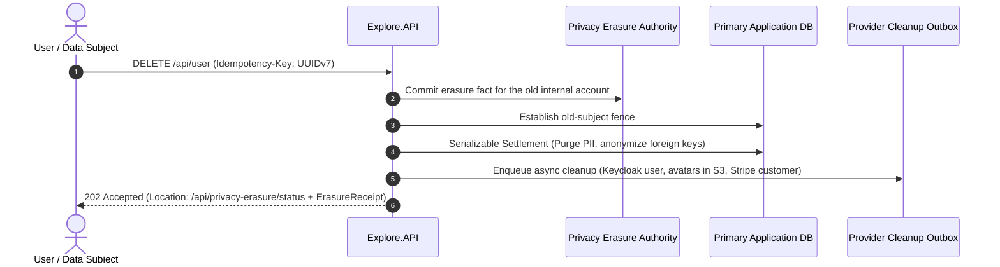

# Privacy Erasure & GDPR Compliance

Under data privacy regulations such as the GDPR, when an attendee or user requests account deletion, the platform must guarantee that their personal identifiable information (PII) is completely destroyed and **cannot be accidentally resurrected** by database restore operations or distributed retries.

ISLAMU Event implements an **Authority-First, Anti-Resurrection Architecture** to enforce this guarantee.

---

## The Anti-Resurrection Workflow

The erasure process follows a strict sequence to prevent data leaks or partial deletions:

1. **Anti-Resurrection Fence**: A retained old-subject fact and local fence prevent stale work from recreating the erased internal account. This does not prohibit new registration with the same external identity.
2. **Authority Fact**: The erasure event is recorded in a dedicated, isolated authority store *before* local data disposal begins.
3. **Serializable Settlement**: In one atomic transaction, the user’s personal data is scrubbed, registrations are anonymized, and foreign keys are safely unlinked. This includes private home/profile data and the erased account's stored authentication tokens across tenants, while preserving other accounts' data.
4. **Asynchronous External Cleanup**: Background outbox workers delete the user from Keycloak, purge media from S3/local storage, and notify external payment gateways.
5. **Single-Use Receipt**: The user receives a `202 Accepted` response with an opaque `ErasureReceipt` capability token. The receipt can be used to query `/api/privacy-erasure/status` until completion, after which all trace of the receipt is destroyed.

An interrupted local purge does not cancel the erasure request. The committed
authority fact and local fence remain so stale work cannot recreate the old
account. Changes inside the local purge transaction, including its completion
checkpoint, roll back together if that transaction fails. Replay then completes
the purge from the retained intent; it does not treat an uncommitted checkpoint
as a completed deletion. Provider cleanup continues through the protected outbox
after local settlement.

---

## Verified Identity Addresses

Sign-in synchronization reads the identity fields needed to correlate the
account and update its email mirror. It does not load private birth-date
declarations or collection receipts. Email proofs and the mirror share the
account transaction; a changed account or private-data revision refuses the
stale write instead of refreshing its captured values.

Account erasure removes the account's verified identity address claims and all
associated verification proofs, including proofs already invalidated. These
are removed before the sign-in bindings and profile PII in the same local
transaction. Another account's claims and proofs are unaffected; no address or
verification history is copied into the retained erasure authority.

A failed local purge remains fenced and can be replayed. When a primary
database backup restores these records, startup replay purges them again before
traffic is admitted, provided the retained authority is preserved independently.
Releasing an address claim does not lift the erased account's anti-resurrection
fence or authorize a delayed synchronization to recreate its personal data.

## Fresh Registration After Erasure

Erasure removes stored HTTP and AI retry responses, their account linkage and
request metadata. The original tenant/idempotency-key pair remains reserved
without a replayable response, so an old request cannot execute again under
another account. Use a new idempotency key for a new operation. These rejection
fences are separate from the short-lived `ErasureReceipt` status token.

Ordinary erasure removes profile PII, provider bindings and verified-address
proofs. It does not create an external-identity registration ban. Otherwise
admissible external authentication may automatically create a fresh account,
including with the same provider identity or released email. The new account
does not inherit the old account's ID, private data, permissions or consent.

Startup still validates and replays retained old-subject erasure facts before
admitting traffic. It does not erase a legitimate fresh account merely because
its provider identity resembles an erased account. Preserve the retained
authority and supported backup horizon; a fresh signup does not bypass an
invalid restore or an unavailable authority.

## Embedded Authority Upgrades

The embedded SQLite authority upgrade adds missing recovery coordinates while
retaining the erasure ledger and its retained floor. Use the application's
migration service with SQLite 3.42 or newer, and preserve matched backups before
upgrading. Downgrading this schema removes its recovery identity and counters;
use the documented recovery procedure instead of downgrading an adopted store.

## Enrollment State Consistency

Erasure-state checks during enrollment now observe that enrollment's own
transaction. This prevents a check from waiting on its own write lock or
seeing an older counter. Failed enrollment still rolls back its changes;
no timeout, retry setting or replica-exclusion control is relaxed.

## Standalone Recognition Ownership

Standalone SQLite recognition requires one writer and a lifetime-exclusive
lock on its primary database. Normal Linux lock contention is recognized as
proof that another owner is excluded; other file errors prevent recognition
from qualifying the store.
Stop all writers before restoring or replacing the database file.

## PostgreSQL Contract Refresh

The mixed-settings checks used during PostgreSQL erasure now resolve their
fixed routine inventory independently of the catalog rows being inspected.
The ownership and privilege checks remain in place. Use the normal migration
and startup sequence to refresh these native contracts; no credential,
permission, timeout or retained-ledger change is required.

Recognition erasure checks that its protected subject exists without loading
the private profile. It uses its existing narrow database permissions; do not
grant private-table read access to make this existence check succeed.

Newly qualified recognition material is inserted with its original identifiers
before its receipt can complete. Existing completed material is not regenerated;
pending requests continue through the existing reconciliation flow. No schema,
key, permission or retention-setting change is required.
Binding a newly appended fact checks its exact retained record and the original
settlement deadline. It can finish while replay is still behind that new fact;
this does not admit capture from a stale restore or extend a pending deadline.
If an acknowledgement is lost, recovery verifies the observed fact against the
retained store before finishing its original primary binding. Missing retention
or conflicting evidence is a refusal, not permission to create replacement proof.
Recovery also refuses missing original key obligations. If recognition is no
longer required, it completes the original request without creating new material.
When a returning account qualifies for recognition, tenant enrollment can save
that binding while the retained capture remains hidden from ordinary tenant
queries. Qualification expires at its original deadline and belongs to the same
account binding and database transaction; copied or altered bindings must qualify
again. No broader database role or tenant-read permission is required.

## Recognition Expiry Completion

Scheduled recognition expiry, where retained material exists, runs once under
the retained authority gate and its original primary-store ownership. A failed
or uncertain commit is not a successful expiry pass and is not automatically
replayed. Independent stores do not form one atomic transaction; preserve the
retained authority when investigating an uncertain result. This introduces no
new key, retry setting or moderation permission.

Recognition key maintenance and material pruning follow the same rule: a lost
commit acknowledgement does not trigger an automatic second attempt. Expiry of
an already-purged receipt uses only its primary store and can still complete
when the external erasure authority is unavailable.

## Reserved Future Moderation Keys

`PRIVACY_ERASURE_IDENTITY_FENCE_KEY` and
`PRIVACY_ERASURE_IDENTITY_FENCE_KEY_ID` remain optional reserved configuration.
They are not required for ordinary enrollment, erasure or API startup. Their
approved Infisical folder is `/api`, not a separate `/privacy` folder.

If a future moderation feature uses identity recognition, its key must be stable,
held in the explicitly selected approved authority and preserved across restart
and restore. The explicit key provider still rejects missing/invalid material;
no ephemeral or predictable replacement is generated. Live rotation is not
implemented. The configuration names alone do not enable banning.

Future moderation is a separate lifecycle: an existing banned account may
authenticate into restricted pages with a remaining-ban timer and deletion.
An identity deleted during an active ban must instead receive Account suspended
before a replacement account is provisioned. Capture and retention need a
defined moderation purpose and expiry; erasure records are not automatically
moderation records. That banning behavior is not implemented in this change.

## Choosing an Authority Storage Topology

The Privacy Erasure Authority store must be configured in your environment via `PRIVACY_ERASURE__AUTHORITY__TOPOLOGY`:

| Topology | Storage Mechanism | Best Fit | Primary Constraint |
|---|---|---|---|
| **`EmbeddedSqlite`** | Dedicated SQLite database at `/app/data/privacy_erasure_authority.db` | Single-server Compose and Standalone | Single API container writer; requires volume persistence |
| **`CoLocated`** | Shared table schema within primary PostgreSQL DB | Minimal dev environments | No independent protection if primary DB is restored from stale backup |
| **`ExternalDatabase`** | Completely isolated external PostgreSQL instance | High-availability enterprise clusters | Requires managing a secondary PostgreSQL database |

> [!TIP]
> **Our Recommendation:**
> - **We recommend `EmbeddedSqlite`** for standard self-hosters. It runs with zero operational overhead, uses dedicated storage, and guarantees that even if your primary PostgreSQL database is restored to a state from last week, the SQLite erasure store will prevent previously deleted users from being resurrected!
> - **We recommend `ExternalDatabase`** only for enterprise multi-node clusters running multiple API replicas that cannot share a local SQLite file.

---

## Primary UserPii Revision Default

Apply `DeclareUserPiiBirthDateRevisionDefault` through the normal selected
migration service before traffic. Its four provider catalogs cover all five
supported primary engines; MySQL and MariaDB share a catalog. The default is the
initial revision number `0`, not a default birth date or verified-age claim.
Existing private values and revision numbers are preserved.

PostgreSQL startup still rejects model/storage default drift. Do not bypass that
check, grant broader application permissions or change schemas as a workaround.
The generated downgrade removes the default rather than deleting personal data;
any rollback must use a matched application/schema version and the normal
backup/restore procedure.

## PostgreSQL Co-Located Authority Upgrade

For PostgreSQL installations using `CoLocated`, the
`20261031102545_RestoreCoLocatedAuthorityRecoveryCoordinates` migration adds the
missing authority recovery coordinates required by the current application.
The migration initializes existing authority rows with positive revision and
recovery-generation counters and a generated store identity. It preserves
existing erasure facts. Run the normal selected migration service before
allowing application traffic; do not add these columns manually or bypass
pending-model validation.

Take matched primary and authority backups before upgrading. Downgrading this
migration drops the recovery coordinates and store identity, so it cannot
preserve the recovery history established after adoption. Use the
[Backup, Restore & Upgrade](../configuration-and-operations/backup-restore-upgrade.md)
procedure for recovery instead of applying a live downgrade. This correction
does not change the other authority storage topologies.

The selected migration service also installs the fixed application Runtime
permissions needed by the co-located authority. Run it before starting the
application; a missing authority-table permission is not a reason to grant
superuser, table ownership or access to the entire schema. Incomplete or
unexpected authority rights fail validation and must be investigated before
traffic is admitted.

Co-location shares the application's database and credential boundary. Its
ordinary Runtime rights exclude counter deletion and changes to the retained
store identity or recovery generation. It does not provide independent
protection against compromise of that Runtime credential; choose a separate
authority topology when that separation is required.

## The Golden Rule of Disaster Recovery

> [!CAUTION]
> **Preserve the Retained Erasure Authority When Restoring the Primary Database!**
> If you restore an older database snapshot (e.g., from 3 days ago) to recover from corruption, any user who requested account deletion yesterday would normally be restored ("resurrected") into the database.
> 
> When ISLAMU Event starts, the **`PrivacyErasureStartupGate`** automatically replays all facts from the Privacy Erasure Authority against the application database before HTTP traffic is allowed. If an erased user is found in the restored database, the gate immediately re-purges their records and re-establishes the anti-resurrection fence!
>
> Do not overwrite the independently retained authority with an older copy when
> restoring the primary database. Preserve facts newer than the primary backup
> and follow the supported authority backup and retention procedure. Startup
> must remain unavailable while required replay is incomplete or the authority
> cannot be validated; bypassing the gate can expose restored private data.

---

## Related Guides & Next Steps

* **[Backup, Restore & Upgrade](../configuration-and-operations/backup-restore-upgrade.md)** — Production backup scripts and disaster recovery rehearsals.
* **[Docker Standalone Runbook](../self-hosting/docker-standalone.md)** — Operate the embedded SQLite erasure authority on a single server.
* **[Environment Variables Reference](../configuration-and-operations/environment-variables.md#7-privacy-erasure-authority-gdpr--anti-resurrection)** — Configure erasure topology and busy timeout dials.
* **[Custom Properties Governance](../events-and-ticketing/custom-properties.md)** — Learn how long-tail attendee answers are scrubbed during account deletion.
