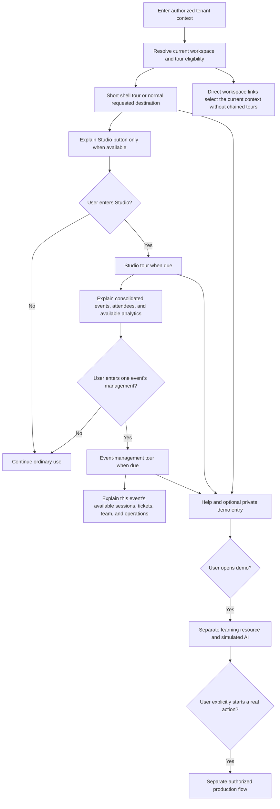
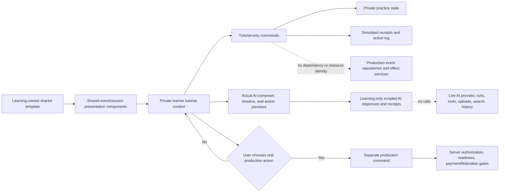

# I-VSD: Connected Contextual Onboarding, Separate Demo Resources, and Public Discovery

Last Updated: 2026-10-11

## Review Metadata

- Mode: standalone
- Subject: tenant-onboarding
- Workstream: none
- Report kind: consultancy-report
- Report status: current
- Disposition: advisory
- Evidence cutoff: 2026-10-11
- Reviewed input: working-tree inspection against HEAD `072f2b6dbd8e4b87e16b795bc02a9ea23f902046`, the earlier onboarding and demonstration-only decisions, and the user's subsequent confirmation of separate demo resources, simulated AI in the actual chat presentation, and connected shell, Studio, and individual-event onboarding triggered by entry to the relevant workspace; bounded Studio/AI source reads and Tavily research on 2026-10-11
- Supersedes: none; supplements the separate instance-onboarding experience consultation
- Decision authority: the user confirmed the separate-demo, simulated-AI, and contextual-onboarding product direction and authorized these report revisions; unresolved details remain recommendations, and this is not product implementation approval

## Executive Summary

**Use connected contextual onboarding: a short shell orientation, then detailed tours only inside the workspace being learned.** The first tour explains the profile dropdown, navigation, Help/My learning, available AI entry points, and the optional demo. When the actual Studio button is available, retain a short explanation: Studio is the consolidated workspace for managing events, attendee operations, and available analytics. Do not remove this explanation; do not turn it into a Studio navigation lesson. Studio's own tour begins only after deliberate authorized entry. Opening an individual event's management workspace triggers a distinct event-management tour covering its available sessions, tickets/payment configuration, team, and other management surfaces. Each tour points to the next workspace without starting its tour prematurely.

Keep one durable completion/dismissal record per relevant tenant-user-tour family/version, not one full event-management tour per event. Recommended controls distinguish "Skip this tour" from "Don't show onboarding automatically." The latter suppresses all automatic onboarding for that user in that tenant, including later versions, while manual restart and critical non-onboarding notices remain available. These dismissal defaults are recommendations, not a claim that the user confirmed their final wording. A profile-dropdown restart entry and in-context Help let users recall the appropriate tour.

**Make event learning optional and available beyond administrators; authorize real event actions separately.** A user may browse, report an event, organize personally, or work for an organization/group. Those activities can overlap and change. Do not assign a permanent "publisher" persona from an administrative role, sign-in, membership, or browsing history. Offer "Learn how events work" through Help/My learning to authenticated users authorized in the current tenant, even when they cannot currently publish. The GuideFlow tour may recommend the demo event strongly because ISLAMU Event is powerful and feature-rich, but the user must be able to skip onboarding without losing ordinary access.

Retain one tenant-qualified shared lesson source, available independently of federation and real event supply, but make the demo a **separate learning resource**, not a production `Event` with a tutorial flag. Templates, practice, synthetic attendees/orders, and simulated chat belong to learning-owned contracts, storage, and commands. Share suitable presentation components and pure validation, not production event identity, repositories, side-effect orchestration, or ordinary AI services. Public discovery and business accounting should have no demo records to exclude. Personal progress and demonstration changes must not overwrite the shared lesson source. This architectural direction is user-confirmed; exact types and persistence schema remain for implementation design.

**Use the actual AI chat interface with a simulated response/action source.** The demo reuses the normal composer, conversation timeline, and action-preview presentation, rather than building a lookalike chat page. A persistent accessible "Demo AI - simulated responses; no real actions" notice must accompany the chat and each simulated action receipt. Demo interactions do not call an LLM provider, start ordinary AI runs, invoke production tools, search private production records, upload files, or join live conversation history. A separate explicit exit opens normal AI, when authorized, without transferring demo prompts or practice automatically.

**Actor profiles are useful contextual entry points, but should not be the only entry point or include the tutorial in their real upcoming/past event feeds.** A personal profile exposes its private learning panel only to the authenticated owner; an organization/group profile exposes the panel to its current authorized members in that tenant. Members can learn without automatically gaining permission to create, import, publish, alter shared content, or inspect private operational settings. A "Learn as [actor]" panel must identify the current tenant and supported publisher mode.

The user's confirmed requirement is demonstration-only behavior: no real payments, invitations, attendee registrations, outgoing notifications, or federation publication. The tutorial should use familiar event and session interfaces, realistic configuration examples, original screenshots, explanatory text, and simulated receipts such as "this would send an invitation" or "this would create a ticket order" where safe. Those interfaces must not silently grant the tutorial ordinary production mutation capabilities. A privacy badge is communication, not an authorization or side-effect boundary.

The tutorial remains useful when federation has populated the directory. The earlier administrator-only visibility recommendation is superseded by the latest request. Keep an optional small learning entry available to signed-in users; let them explicitly open and optionally pin the expanded tutorial above their own discovery view. A newly completing administrator or newly authenticated user can receive the one-time GuideFlow tour, and the tour can end by pointing at the private demo event: "Events will appear like this. This one is private and only here for learning. Open it to follow the event-creation tutorial." Do not automatically insert a large tutorial into every real event list. Label scope accurately: "Private learning - only you" for personal state, or "Learning for [organization/group] members in [community]" for the contextual member view, plus "Demo - no real payments or invitations".

**Pair optional private learning with a welcoming public empty state.** Visitors should see the real site or actor identity, a clear explanation of the event section's status, and an appropriate next step. For a successfully loaded upcoming/ongoing directory with no visible results and no narrowing filters, proposed copy is "No upcoming events right now. Please check back soon." Attribute the directory to its publicly configured community/site identity. This is an invitation to return, not a promise that events will arrive shortly.

Discovery-centric home and event-list pages should remain useful without displaying fake public events or exposing another learner's private state. Organization-centric homes and actor event timelines should keep an explicit empty upcoming section and the available public past-event history immediately below. An empty upcoming schedule is not an empty history. Public visitors get browsing/helpful context and ordinary documentation links where offered; signed-in learners get optional lessons; authorized creators get real authoring actions; administrators/operators get separate setup and operational guidance.

The current creation-context query already reads effective tenant policy and returns personal, organization, and group publisher options. Organization/group options distinguish membership from `PermissionCodes.EventCreate`. Its field named `CanPublish` is derived from creation eligibility in the inspected handler; it is not proof of final publication, import permission, paid readiness, or federation consent. Use these server facts to explain available contexts, while actual actions require their own server-authored affordances and command authorization.

Current-state inspection shows that organization/group profile components already combine an empty upcoming block with a supplied past-event timeline. Organization-centric `Home.razor` currently renders its upcoming block only when featured events exist, and its shell-empty message addresses configuration rather than visitors. The generic `ActorProfile.razor` is an identity/subscription view without an event timeline; extending this experience to user and other generic actor profiles requires an explicit product addition. Ghost is credited as the user's inspiration, not treated as verified evidence of universal default-message behavior.

There is an important current-state correction. The inspected repository already includes governed historical recovery: `ReconcileAtprotoPdsSnapshotsCommandHandler` can retrieve existing records for a nonempty configured DID set, bounded to at most 100 DIDs, when effective recovery mode is `full`. Recovery defaults are disabled and `downtime_only`. This is not equivalent to discovering every relevant event across the network on first setup. Consequently, the report recommends extending or exposing the appropriate existing recovery path, rather than describing historical import as entirely absent.

For wider historical discovery, distinguish an event's creation time from its current schedule and source state. An event created before this installation should remain eligible if it starts in the future or is still ongoing with a future end, subject to validation, lifecycle, moderation, source deletion, and tenant policy. Do not promise immediate populated results merely because federation is enabled. Official Jetstream documentation describes historical replay, but hosted archive access has separate authentication and metering; the current source inspection does not establish an unrestricted archive-bootstrap implementation.

This is an advisory based on design reasoning and bounded implementation traceability. No runtime, usability, accessibility, isolation, financial, or federation tests were executed. GuideFlow was reviewed as a local dependency candidate at the level of documentation, license metadata, and manual-test claims only; that review does not approve a dependency change or prove integration readiness inside ISLAMU Event. The Plane example is credited as the user's inspiration; public documentation reviewed verifies project organization and access controls, not automatic tutorial-project creation in every workspace.

## Scope

The assessment covers a separate tenant-qualified demo learning resource, connected contextual GuideFlow orientation, simulated AI in shared production chat presentation, optional learning access, private self/member actor-context entry points, separate learning/creation/import/publication authority, ordering and personal dismissal, realistic feature teaching, optional federation, relevant historical import, and public empty states. Shell orientation explains accessible destinations; Studio and individual-event tours begin only inside their respective authorized workspaces. It includes visitors, members, prospective publishers, organization/group collaborators, administrators, and operators in single- and multitenant setups.

The agreed behavior is demonstration-only. A real payment sandbox, external invitation rehearsal, implementation plan, product code change, dependency addition, and complete audit of existing authorization are outside this request. "All implemented features" is treated as a requirement for a maintained coverage inventory, not evidence that every feature can be configured independently on one session.

The review considers strategy, business model, UX, architecture, data, operations, governance, support, portability, and evaluation. GuideFlow is proposed as a candidate onboarding dependency because the user selected it and local metadata declares an MIT package license expression for a Blazor guided-tour library, subject to repository dependency/license review and resolution of the placeholder copyright notice observed in the local license file. Any actual package addition still requires the repository dependency-license gate and independent integration design. No third-party asset is proposed. The repository is pre-release; recommendations do not require compatibility shims.

## Claim Boundary

This report applies selected Sunni ethical principles to provider-controlled software decisions. It is not a fatwa, Sharia certification, legal opinion, or proof of ethical outcomes.

Design validation means that a recommendation is coherently connected to a stakeholder consequence and principle. Implementation traceability means inspected source or documentation supports a bounded statement about the existing design. Neither proves deployed behavior, user comprehension, safe concurrency, or operational readiness. Financial-contract and contested religious-legal conclusions require qualified Sunni scholarly authority; jurisdiction-specific legal conclusions require qualified legal review.

## Proposed Experience

### Connected Contextual Onboarding With GuideFlow

The confirmed target combines connected workspace tours with optional demo
practice. Each part has a different job:

1. **Shell orientation:** a short, restartable tour for eligible authenticated
   tenant users. Explain navigation and available destinations, including a
   brief Studio explanation only when that button is actually available.
2. **Studio orientation:** on entry to the authorized general Studio workspace,
   teach consolidated event inventory, actor context, attendee/order operations,
   and available aggregate analytics. Point to individual event management.
3. **Individual-event management orientation:** on entry to an authorized event's
   management workspace, teach that event's available details, sessions/schedule,
   ticket types/capacity/payment prerequisites, attendees, team, and other
   controls. Public event detail viewing does not trigger it.
4. **Private demo-event tutorial:** a deeper, optional hands-on learning surface
   for event creation and management. It looks and feels close to an event, but
   it is not public inventory and does not execute real external effects.
5. **Real production event flow:** a separate action path reached only when the
   user deliberately chooses a real create/import/publish action and the server
   returns the relevant affordance.



GuideFlow's local repository documentation describes it as a Blazor guided-tour
library with target-element popovers, keyboard navigation, ARIA/focus support,
theming, animated overlays, viewport-aware positioning, optional localStorage
state persistence, multiple tours, programmatic tours, step lifecycle hooks,
custom buttons, progress display, and skip/complete behavior. Its local project
metadata reports package version `1.0.1`, target framework `net8.0`, and an MIT
package license expression. The local license file itself still needs dependency
review because its visible copyright fields are placeholders. These are useful
fit signals, not dependency approval. A real package addition still needs the
repository dependency-license check, package pinning, accessibility verification
inside ISLAMU layouts, and an independent integration design that does not copy
GuideFlow source structure into ISLAMU code.

The durable authority is ISLAMU-owned tenant-user-tour-family/version state.
GuideFlow localStorage can cache it, not override it. Store a separate
tenant-user preference for suppressing all automatic onboarding; do not encode
that preference merely as completion of the current version.

Recommended tour families:

| Tour family | Audience | Trigger | Durable completion key |
| --- | --- | --- | --- |
| Shell orientation | Eligible authenticated users; only available destinations are explained | First eligible ordinary tenant landing after shell/capabilities are ready; do not interrupt deep-linked work with a different tour | `(tenant, user, "shell-orientation", version)` |
| Studio orientation | Users currently authorized to enter Studio | First deliberate entry to the general Studio workspace, including its event inventory/attendee/order pages, after its context is loaded | `(tenant, user, "studio-orientation", version)` |
| Event-management orientation | Users currently authorized for the selected event's management surfaces | First entry to an individual event-management workspace, including a direct section link, after event authorization and rendered controls resolve | `(tenant, user, "event-management-orientation", version)` |
| AI interaction orientation | Users deliberately opening available normal AI surfaces | First entry to the full AI workspace or side panel; the shared chat interaction is taught once, not again when changing host | `(tenant, user, "ai-orientation", version)` |
| Demo-event tutorial | Any authorized authenticated learner | Explicit open from Help, a tour endpoint, profile restart, or a contextual panel | `(tenant, user, tutorial version, selected actor/context)` for private practice, separate from tour completion |

Each tour is adaptive to rendered server-authorized capabilities, not a fixed
persona. Separate tenant-setup/admin tours are not additional automatic queues
for the same shell navigation; setup-specific help belongs to its actual context.
No prerequisite tour completion is needed to use another workspace.

### Connected Contexts And Exact Entry Triggers

**Shell: describe destinations, not all their controls.** Keep the Studio step
when the actual button is available. Proposed explanation: "Studio is where you
manage your events, attendees, and available analytics. Open it when you want to
work on your events; its own short tour explains the workspace." The user named
tenant administrators, organization/group contexts, and users who have published
events as examples of people who may see it. These are not a client-side role or
publishing-history rule: current server workspace availability governs visibility.
A user may also need management access before first publication. Membership or
actor identity alone does not grant it.

**Studio: consolidated management.** Teach the active tenant/actor selector,
overview, all managed events, available attendee/order management, and analytics
only where that surface exists and is authorized. Point to an event's management
entry: "Open an event to manage its own sessions, tickets, team, and operations."
Do not start the event-management tour until the user actually enters it.

**Individual event: event-specific management.** Identify the current event and
tenant/actor scope, explain the return to all events, and guide only the controls
available for this event: details, sessions/program, ticket types and capacities,
payment prerequisites/orders, attendees/check-in, team, resources, publication,
and applicable analytics/integrations. A section's deeper workflow guidance
appears on entry or explicit Help, not as one exhaustive management tour. A
public event card or event detail page is not an event-management trigger.

**AI: one interaction, two hosts.** Shell onboarding briefly identifies the full
AI workspace and navbar side-panel entry where available. Detailed chat guidance
starts only when the user opens AI. The demo can teach the same interaction with
simulation labels and independent learning progress; completing a demo does not
silently mark normal AI onboarding complete.

**Trigger arbitration:** resolve tenant, authorization, current route/workspace,
and rendered targets before starting a due tour. Subscribe to actual render/state
readiness, not a fixed delay. Only one tour owns the overlay/focus at a time. A
direct link into event management chooses that context, not shell -> Studio ->
event tours in sequence. If several families are due, offer the others through
Help; do not chain them automatically. Navigation, access revocation, or tenant
switch closes/suspends the current tour and re-resolves context; it does not
complete unvisited steps or move the user to another route.

**Once, skip, and restart:** completion or "Skip this tour" suppresses that family
for the current version; a small copy edit does not create a new version. The
recommended "Don't show onboarding automatically" preference stays effective
across family/version changes until the user deliberately changes it. Manual
restart remains available and does not clear demo practice. An interrupted tour
is resumable through Help rather than being pushed again on every navigation.
Cross-device state is durable; simultaneous tabs must not race to launch duplicate
automatic tours. Do not promise literal exactly-once display across disconnected
devices without an implementable coordination contract.

**Completion scope:** event IDs and selected actors determine rendered context
and authorization, not a new full-tour completion key for every event or actor.
Visiting a second event, switching sections, opening the AI panel after the full
workspace, or moving between actors must not repeat an already completed tour.
Materially new capabilities can offer short optional contextual help; learning
progress never grants real permissions or claims mastery.

Tavily-reviewed contextual-help guidance supports relevant timing, easy dismissal,
recall, and instructions near the task (E21). It also cautions that even contextual
prompts can interrupt work. Workspace entry is the user's chosen product trigger,
not external proof that an automatic overlay is optimal; validate it with users
and keep immediate dismissal and in-context recall.

Current source evidence supports a general Studio navigation that switches to
event-specific navigation when an event is selected. It does not prove that every
desired destination is complete: the inspected general Studio shows overview,
events, and capability-aware attendee/order links; event analytics exists in the
event shell, while team navigation currently points to the event's existing
management/edit destination. Complete consolidated analytics and dedicated team
workspace coverage remain inventory/design questions, not shipped claims (E23).

### Best-Fit Demo Event Model

The user-confirmed target is a **separate demo resource with shared presentation**.
It is neither a normal production event with exclusion flags nor a separate
lookalike interface. "Hybrid" refers to presentation fidelity and isolated
simulation, not mixing demo records into production persistence:



The demo can reuse event/session/program concepts and suitable shared components
so the learner recognizes the real product. Its identifiers, persistence,
contracts, and command routing remain learning-owned. A learner may edit fictional
titles, configure a pretend ticket type, preview an invitation, simulate a
registration, or step through cancellation and follow-up, but the result is a
private tutorial state and a clear "would happen in production" explanation. No
production outbox message, payment intent, email, RSVP, attendee credential,
federation record, public event, search document, sitemap entry, or analytics
event should be created from tutorial-originated actions.

An independently built mock interface can drift; a simulated data source behind
shared presentation need not. A semi-real event is dangerous because every
ordinary query, worker, export, and accounting path needs to remember its special
status. The separate demo avoids that expanding exclusion burden. Production
commands cannot resolve learning resources as events, and simulation has no
access to production repositories or effect-capable services. Reusing a component
must not reuse its automatic production fetches or mutation handlers: composition
must select a learning data/action source before initialization. The UI receives
generated presentation contracts; Blazor does not reference backend Domain or
Application assemblies to achieve reuse.

### Simulated AI In The Actual Chat Interface

Reuse the normal chat composer, conversation timeline, and action-preview
components with an explicit learning-only response/action source. The inspected
`AiWorkspace.razor` already hosts `AiAssistantRail`, whose presentation uses
`AiConversationTimeline` and `AiConversationComposer`. This supports the reuse
direction, not a claim that its existing live service wiring is demo-safe.

The simulated chat teaches the interaction: a synthetic prompt, an authored
example response, a proposed change, an explicit confirmation, and a simulated
receipt. Replies are deterministic lesson content, not provider-generated
answers. Unsupported free-text requests receive a truthful explanation and
supported example choices, never a fallback to live AI. A simulated success must
not imply model accuracy, provider connectivity, or production readiness.

Keep "Demo AI - simulated responses; no real actions" visible in the chat header
and accessible name, with "Simulated - not executed" on action outcomes. The
notice survives opening the side panel, expanding to the full workspace, changing
lessons, and returning to a conversation. Do not rely on color, one welcome
message, or the learner remembering the entry banner.

Demo model selection uses clearly identified fictional/example options or a
simulation label, not a real provider/model claim. Suggested prompts and record
references use only synthetic content. File attachment, voice input, live
reference search, and production tool controls must be disabled with explanation
unless an explicitly local synthetic exercise implements that interaction.
Learning-owned chat history must not merge with normal AI conversations, exports,
provider usage, or business analytics. Keep demo storage bounded independently
of production event/publication quotas.

"Leave demo and open normal AI" is a deliberate, separately authorized transition
with a clear change-of-mode notice. Never silently fall back to live services or
carry fictional records, learner prompts, attachments, or action proposals into
normal chat. A badge communicates simulation; the separated data/action source
and server resource boundary enforce it.

Recommended copy for the final GuideFlow step:

```text
This is your private demo event.

Events will appear in cards like this, but this one is only for learning.
Open it to follow the event-creation tutorial. It is highly recommended:
ISLAMU Event can manage simple announcements, multi-session programs, paid
tickets, capacity, registrations, resources, federation, AI-assisted workflows,
and more.

Demo actions stay private and do not send real email, take payments, register
attendees, or publish to federation.

[Open demo tutorial] [Skip for now]
```

This wording is intentionally enthusiastic while preserving truthfulness. It
does not promise that every advanced capability is enabled in the current
tenant, and it does not claim that completing the tutorial grants production
permission.

### First Visit and Voluntary Learning

After successful setup, open the resolved tenant's ordinary event discovery destination and, when appropriate for that tenant-user-version state, start the GuideFlow orientation overlay. The inspected list declares `/events`; this report does not assume `/home` is the universal completion destination. If deployment policy selects a home page, expose the same tenant-qualified learning entry there rather than creating another tutorial. Ordinary sign-in should retain the user's requested destination after the tour is dismissed or skipped; permission to publish is not evidence that they want the advanced event tutorial now.

For an administrator finishing setup, a newly authenticated learner in their one-time orientation, or a learner who explicitly pins it, show a compact section before event filters and results. Other authenticated tenant users get an unobtrusive optional learning link and a profile-dropdown restart action, not an automatically expanded sample card:

```text
Start here

[Lock icon] Private learning - only your progress and practice
Learn ISLAMU Event by exploring a sample event
Demo - no real payments, invitations, or attendee activity

[Explore tutorial]  [Hide for me]  [More options]

Community events
[Normal filters, sort controls, results, and pagination]
```

This is proposed copy and structure, not a rendered or validated interface. The tutorial's title should describe learning, not resemble a scheduled public gathering. Do not show fabricated attendee totals, fake ticket scarcity, real organizer identities, or a misleading countdown. A lock without explanatory words is insufficient for screen-reader users and for administrators unfamiliar with the visibility model.

Inside the event, maintain the correct privacy/demo banner across overview, program, session details, and configuration previews. Explain that synthetic lesson content is shared while personal progress/practice is private. Each session explains its learning objective, shows a realistic example, names prerequisites and boundaries, and links to matching current documentation or an authorized configuration screen. Offer "Create a real event as [selected publisher]" only when authorized; it starts a separate production draft. Do not make the tutorial publishable by toggling visibility.

### Behavior With and Without Federation

| Situation | Tutorial section | Community-event section |
| --- | --- | --- |
| Federation off; no local events | Optional learning entry; pinned when chosen or after administrative setup | Honest empty state with separately authorized real actions |
| Federation on; historical discovery running | Lessons immediately available without waiting for imports | Existing results plus bounded progress/status; no promise of a first result |
| Federation on; results already present | Same optional learning; chosen pins remain separate above results | Real events retain normal ordering and attribution |
| Federation on; no eligible matches | Same optional learning | "No matching events yet" with the actual searched scope and filters |
| Federation blocked by an instance lock | Lessons remain available | Authorized operators see effective policy; no unavailable enable action |
| Anonymous visitor | No private learning payload or personal/member panel | Only authorized public events and ordinary documentation |
| Authenticated tenant member without publishing rights | Neutral lessons and authorized self/member context; no production shortcut | Ordinary browsing remains available |
| User changes tenants or selected publisher | Re-resolve context, access, and personal state | Only the current tenant's governed event presentation |
| Publishing permission revoked, tenant learning access retained | Neutral lessons remain; production actions disappear | Ordinary authorized browsing remains |
| Actor membership or tenant access revoked | Affected contextual panel/private practice becomes inaccessible | Any other authorized contexts remain separately resolved |

Federation enabled is not synonymous with historical recovery enabled, outbound publication consent, or ATProto sign-in. Teach these distinctions without forcing federation as an onboarding requirement.

### First Position, Dismissal, and Deletion

The answer to "can it be first until deleted?" is **yes, in a learner's deliberately pinned private section**, including the initial administrator onboarding view. It should not be inserted at rank zero inside public discovery or an actor's real event timeline. That would mix learning material with real event relevance, interfere with date filters and counts, and complicate pagination.

Recommended lifecycle:

1. Create one shared synthetic tutorial container per usable tenant, not a copy for every login, user, organization, or group.
2. Keep an explicitly pinned card above that learner's results until they hide/remove their own learning state. Authorized administrative removal of shared content is separate.
3. "Hide for me" changes the current user's tenant-qualified preference. Reopening from Help/My learning or an authorized actor panel remains available while the template exists.
4. "Reset my practice" and "Remove my learning state" affect only that learner. They must not erase another member's progress or the tenant's shared tutorial.
5. A distinct administrative "Remove learning content for this community" action explains its shared effect. Preserve intentional removal receipts; retries/upgrades cannot recreate it silently. Existing learner-state retention and deletion need an explicit policy.
6. Offer explicit template recreation or version reset with clear consequences. Deletion of active data does not promise erasure from existing backups.

These lifecycle choices are recommendations, not user-confirmed implementation decisions. They avoid one administrator or member hiding lessons or erasing progress for colleagues. No completion pressure, repeated resurrection, or requirement to finish every lesson is justified.

## Publisher Learning Without Inferring Intent

### Learning Access Is Not Publishing Authority

The user's correction identifies a real product distinction: the tenant administrator governs the platform but need not be its event creator. A member who is not an administrator may create/import events, and someone allowed to create events may still visit solely to browse. Reading a paid-event lesson does not mean starting commerce; clicking a profile does not mean acting for that organization.

Recommended separation:

| Decision | Proposed authority |
| --- | --- |
| Read synthetic general lessons | Authenticated user with current tenant learning access; independent of current ability or intent to publish |
| Open personal contextual learning | The authenticated owner of that user profile in the resolved tenant; otherwise use My learning without fabricating a public actor |
| Open organization/group contextual learning | Current authorized membership for that actor's tenant participation, with valid account/relationship state |
| Change one's simulated examples or progress | The current learner's private, tenant-qualified practice state |
| Edit shared organization guidance or reset team material | Explicit actor-management capability, not membership alone |
| Create a real event under a publisher | Current tenant submission policy, exact selected publisher, and the actual server creation capability |
| Import a real event | The import operation's own authority and provenance requirements; creation eligibility is insufficient evidence |
| Publish a real draft | Current publication authority, readiness, approval, capacity, payment and federation gates as applicable |
| Configure tenant/instance policy or health | Separate administrative/operational capabilities |

An ordinary organization/group member can therefore read the same lessons as a publishing manager without gaining the manager's powers. This satisfies the user's proposed "all organization members" learning audience while respecting least privilege. It does not mean all historic, invited, unsubscribed, suspended, or cross-tenant members retain contextual access. A subscriber/follower is not a member.

When production creation is unavailable, retain the learning link and explain only the safe reason the current caller is authorized to see: for example, "Personal event submission is not offered in this community" or "Your role cannot create events for this organization." Do not show an active-looking "Publish" control or suggest that finishing the tutorial changes policy. Do not automatically switch to a different eligible organization to make a disabled action succeed.

The current `GetEventCreationContextRequestHandler` is useful evidence of available modes and approval requirements. It returns personal options when user submission is enabled and evaluates organization/group options against `PermissionCodes.EventCreate`. Despite the name, its option-level `CanPublish` reflects that creation check in the inspected code. Treat it as a context fact, not a universal authorization token. Existing create, import, and publish endpoints are distinct operations. Proposed UI actions must use server-authored relations/capabilities and reauthorize at execution.

### Where People Find It

1. **Help/My learning:** a stable neutral entry for any authorized signed-in tenant user. A person can choose to learn without publishing rights, a public profile, or an existing organization. This prevents a profile-only dead end.
2. **Own user profile:** a self-only "Learning and practice" panel or tab outside the public upcoming/past timeline. Other visitors see the normal profile, not the panel or progress.
3. **Organization/group profile:** a member-only "Learn event publishing for [actor]" panel outside public event sections. All authorized current members can read synthetic lessons; permitted creators additionally receive real-action shortcuts.
4. **Create/import flow:** contextual help tied to the selected actor and operation. A tutorial link should not disappear just because the user never visited a profile.
5. **Discovery home/list:** keep an optional small learning entry for authenticated users, and a separately pinned tutorial only when chosen or during administrator setup. Browsing remains the default activity.

Example private organization panel:

```text
Learning for [organization] in [community]
[Lock icon] Member-only view
Shared sample lessons - your practice and progress are private
Demo - no real payments, invitations, or publication

[Explore tutorial]
[Create a real event as this organization]  (only if authorized)
```

The public profile's upcoming/past events remain untouched. Do not show a sample among upcoming events merely because this person is a member; they may share a URL or screenshot without realizing that it was a private variant. Preserve the privacy/demo banner throughout the learning view.

If several actors are available, show a deliberate publisher selection when a real action depends on it. Remembering a previous choice can reduce friction, but display the current tenant/actor clearly and revalidate it. Permission does not justify silently choosing the first organization returned by an API. No default publisher choice should be described as evidence of the user's purpose.

### One Shared Tutorial, Separate Context and State

A profile is a navigation context, not a reason to create a separate persisted event automatically. Prefer one tenant-qualified synthetic tutorial container with different authorized contextual views. A user can explore it as themselves, as an organization member, or as a group member without manufacturing multiple samples or publicly attributing the seed to a real actor.

Shared base lessons contain no real actor credentials, billing accounts, unpublished events, private contacts, membership roster, internal configuration, or other learners' progress. Contextual status displays only information the caller may already see. A regular member reading the payment lesson must not gain access to the organization's actual payment connection or administrator settings.

If persistent practice is provided, key it by the current learner, tenant, tutorial version, and relevant selected actor/context. A general lesson remains readable while actor-specific practice can become inaccessible after membership revocation. Retention/recovery of inaccessible practice must be explicit; it must not transfer automatically to a new organization. Common documentation/template updates and personal completion status are different data with different owners.

Prefer read-only shared examples with genuine isolated local demonstration where implemented. If richer exercises require a private practice instance, create it only on explicit request inside the learning resource model, never as a production `Event` copy. Scope ownership/access separately and preserve the side-effect prohibition. Production counts and quotas remain unaffected because learning records are not their input; separate learning storage/rate limits still apply. Do not claim a complete reusable simulation system already exists.

Collaborative team practice would be a separate feature: it requires visible shared ownership, explicit edit/reset rights, conflict handling, and clear audit/retention semantics. The proposal that all members can read lessons does not authorize all members to mutate one shared exercise.

An actor identity can span tenants; organization/group membership rows and participation are tenant-qualified in the inspected model. Therefore `(tenant, actor, current user)` context matters, not just `ActorId`. A global profile read or membership in community A cannot disclose community B's private learning context. If a global actor profile has no resolved tenant, link to an explicitly selected authorized community rather than merging private panels across tenants.

## Visitor Empty States Across Public Experiences

### One Experience Contract, Different Audiences

An empty directory should look deliberately maintained, not broken, abandoned, or filled with invented activity. Retain the site header, public community identity, navigation, accessible page heading, and relevant published introduction/contact links. Use a restrained message in the real content area, with text explaining what is missing. Do not use an error alert for a successful empty result, an oversized marketing illustration, or a wall of administrator setup instructions.

Recommended default copy for a healthy, unfiltered upcoming/ongoing listing:

```text
No upcoming events right now
Please check back soon.

Events from [public community/site display name]
```

The bracketed value is a rendering requirement, not shipped placeholder copy. Use the public display identity resolved for the current tenant and surface. If it is unavailable, use neutral site wording or omit the attribution line; never expose a legal-registration identifier, administrator email, internal tenant ID, or raw configuration key as fallback.

Prefer "Please check back soon" to "New events are coming shortly": the latter asserts knowledge that may not exist. A known publication date can support a more specific message only when an authorized publisher supplies it. Do not call an established tenant "new" merely because all its events have ended or were deleted.

| Audience | What they see | Appropriate actions |
| --- | --- | --- |
| Anonymous visitor | Public identity, honest empty explanation, ordinary navigation | Browse a relevant public archive/profile, widen a search, or use a published contact link where appropriate; no setup/ticketing/tutorial controls |
| Signed-in ordinary member | The same public explanation plus optional general learning and authorized self/member profile panels | Read lessons without assumed publishing intent; subscription and real authoring actions only when separately offered |
| Tenant administrator | The same public-facing empty state plus learning and a separate authorized management panel | Learning access does not depend on being an administrator; create, policy, and public-presentation actions retain their own capabilities |
| Instance operator | The public experience of the currently resolved tenant, plus separately authorized operational access | Inspect applicable locks, missing primary-organization configuration, worker health, or provisioning; do not automatically gain another tenant's tutorial in ordinary browsing |
| Learner who hid/reset their tutorial state | The same useful public state and permitted actions | Help/reopen where supported; do not recreate private state merely because the list is empty |

Actions are selected from server-provided capabilities, not from client-side role checks. Learning access and membership do not themselves grant production actions. Being a visitor does not imply account creation is offered; being signed in does not imply subscription delivery works. Do not require newsletter signup, email capture, location permission, federation, or a payment connection to dismiss the message or browse available public history.

### Surface-Specific Placement

**Discovery-centric event list:** Keep a compact empty-state panel inside the results area after a successful query. The user's preferred "No upcoming events" wording applies only when the active listing is truly upcoming/ongoing. An all-dates catalog, custom preset, or active search requires scope-specific wording. Keep filters usable; offer a clear reset action for a filtered miss, not a repeated "come back" message that hides the available remedy. Optional learning remains accessible; a deliberately pinned private tutorial stays separate above results.

**Discovery-centric home:** Preserve useful branding and public context, then use one primary empty-state block when all applicable discovery sections have been successfully loaded and contain no displayable events. Avoid repeating the same empty sentence in six vacant carousels. Optional empty promotional rails can be omitted without hiding a failed required section. If one section has public events, show them and explain only the empty or failed section; zero featured events alone does not prove the directory is empty. Preserve regional/online scope and explicit geolocation choices.

**Organization-centric home:** Keep the organization's public hero/about information and an "Upcoming events" heading even when no upcoming/ongoing events exist. Display the compact message there. Immediately underneath, show "Past events" with all authorized public history reachable through normal paging or a clearly labeled archive link. Do not substitute six highlighted past events for a complete archive without saying so. This adds an explicit history requirement to the current organization home; it is not already proved by the presence of history on separate profile pages.

**Organization/group profiles:** Keep the actor's public identity above the schedule. When upcoming is empty but history exists, show the message under "Upcoming events", followed by the past-event timeline. Never suppress existing history because a different list is empty. When neither exists, show one contextual "No upcoming events right now" message; an empty "Past events" panel is unnecessary. Complete history means all eligible public past events are reachable, not loaded into one enormous first response.

**Generic actor profiles, including users:** Apply the same schedule/history experience if event timelines are added to the actor profile. The inspected generic actor component currently displays identity and subscription affordances only. Future queries must preserve the actor's ownership/organizer attribution and current tenant public eligibility; a global actor identity is not permission to enumerate private events or histories from other tenants.

An organization/actor profile should say "Events from [actor display name]" or rely on the already visible profile heading. A tenant directory should identify its public community/site; an organization-centric home should identify its primary organization. These are different identities even when one self-hosting organization occupies all roles. A directory attribution line does not replace the existing legal operator notice or imply the operator organizes every federated event.

### Distinguish Why Nothing Is Displayed

| Proven state | Visitor-facing meaning | Useful response |
| --- | --- | --- |
| Successful upcoming/ongoing query, no applicable filters, zero public matches | No upcoming events in this declared scope right now | Invite a later visit; keep public context and any applicable archive link |
| Filters or search exclude all matches | No events match the selection | Adjust/reset filters; retain their values |
| One region or online-only scope is empty | Nothing in that browsing context | Offer an explicit scope change if supported; never silently broaden or request GPS |
| Only past events exist | No upcoming events; history remains | On actor/organization surfaces, show the available past timeline below |
| Loading not complete | Result unknown | Loading state, never a transient false "no events" claim |
| Request failed or continuation expired | Results unavailable or need refresh | Safe retry/restart with retained context, not a cheerful empty-catalog message |
| Federation is catching up | Public results may still be incomplete | Administrators see actual ingestion scope/status; visitors get bounded availability wording without technical secrets |
| Partial, truncated, or omitted discovery sections | No completeness claim is justified | Preserve available results and distinguish limits/omission; no global "nothing exists" assertion |
| Event or actor is private, hidden, deleted, or unauthorized | No authorized public disclosure | Apply existing non-disclosure semantics; never reveal private counts or explain private records' existence |
| Organization-first home lacks an eligible primary organization | Public organization surface is unavailable, not an empty schedule | Give safe public navigation; show corrective configuration guidance only to an authorized administrator/operator |

A successful zero count refers to eligible, visible results under the actual query. It is not a count of all stored events. In particular, privacy filtering must not create a public hint that unpublished or hidden events are waiting behind sign-in. Generic return invitations are acceptable; unsupported assurances about future activity are not.

### Public Copy Governance and Accessibility

Ship concise localized defaults with tenant-safe identity interpolation. If later allowing tenant-authored wording, keep status, scope, failure/retry semantics, and private/public boundaries authoritative: custom text cannot rename a failed request into "no events", add unsafe markup, or advertise unavailable actions. Reuse existing localization/content governance rather than inventing a configuration framework for this advisory.

Use a semantic heading and readable text, with decorative artwork/icons hidden from assistive technology. Keep keyboard access and focus stable during loading and retries. Do not announce every empty home rail repeatedly. Test long public names, RTL, narrow screens, and tenant routing. Welcome imagery, if used, must be original and locally hosted; no Ghost assets or templates are required.

The public welcoming state and optional learner tutorial solve different problems. Neither is a fake public event. They should cooperate without changing real event inventory, analytics, quotas, ranking, or the confidentiality of personal/member context.

## Tutorial Content and Feature Coverage

Use a synthetic multi-session event presentation as the learning container, backed by separate learning resources rather than production event rows. Let the actual domain determine where configuration belongs. A lesson about a session does not imply that the demonstrated policy is independently configurable per session.

| Lesson | Demonstration and practical explanation | Existing evidence and limits |
| --- | --- | --- |
| Event basics and program | Draft creation, overview, multiple sessions, session order, dates, timezone, and lifecycle | `Event` owns sessions/days; `EventSession` supports unscheduled and scheduled sessions. Proposed tutorial mode must not bypass production lifecycle rules. |
| Private, unlisted, and public | Explain who can discover versus access an event; show a labeled visibility preview | `VisibilityTypeEnum` distinguishes four modes. None by itself grants the proposed self/member tutorial access or safe practice isolation. |
| Paid admission and ticket types | A clearly fictional priced ticket, currency, ticket types, session entitlement, fee/refund explanations, and setup prerequisites | Pricing belongs to `EventTicketCatalogVersion` and `EventTicketType`, not a scalar session price. Real paid publication has separate merchant, policy, connection, and disclosure gates. |
| Capacity and attendee limits | A small synthetic capacity example; explain shared pools, entitlements, and what happens when full | Sessions expose `MaxAudienceAttendees`; the ticketing model also has shared `EventCapacityPool`. Do not imply changing one session scalar configures every capacity rule. |
| Languages and translations | Show session language labels and translated teaching text with fallback | `EventSessionLanguage` is a language association, not proof of a multilingual rich-content editor. Distinguish spoken-language metadata, UI localization, and translated event/form content. |
| Invitation-only participation | Explain visibility, invitation eligibility, authentication, and access as separate questions; illustrate with local synthetic data | Full event/session invitation semantics were not traced. Mark a noninteractive explanation where the installed product cannot express the illustrated policy. |
| Registration and attendee experience | Explain information-only, externally managed, and native participation where available; preview a fictional attendee journey | `EventParticipationConfiguration` is event-level. Do not teach incompatible event-level participation modes as if each tutorial session can select one. |
| Location and disclosure | Illustrate public venue information versus restricted details with fictional addresses | Private-location and audience rules need feature-specific validation before any realistic preview is enabled. |
| Federation | Demonstrate inbound attribution, historical relevance, outbound consent, and public-data implications | Existing exact-collection ingestion and bounded full recovery are inspected; tutorial content never goes to a PDS. |
| Management and follow-up | Explain editing, cancellation, resources, notifications, exports, and check-in through verified installed capabilities | These broader feature surfaces were not exhaustively traced in this consultation; include them only after capability inventory and author review. |
| Studio versus one event | Show consolidated management, then the selected event's sessions, tickets/payment prerequisites, team, attendees, and return navigation | E23 establishes separate navigation contexts and some capability-gated surfaces, not complete aggregate analytics or dedicated team-workspace coverage. |
| AI-assisted work | Use the actual chat presentation with authored responses, simulated action review, and a clearly labeled outcome | E24 establishes shared presentation components, not a demo implementation. No provider, production tool, live search/upload, or normal history calls are permitted. |

Each lesson should have a short introduction and an optional deeper explanation. A large screenshot-filled description with no navigation is not an adequate tutorial. Include steps as selectable text, original screenshots with alt text, captions explaining the important control, a version identifier, and documentation links. Provide keyboard navigation, mobile layout, readable focus states, RTL support, and localized labels; screenshots supplement rather than replace textual instructions.

Maintain a feature-to-lesson inventory owned by product/documentation maintainers. A new implemented feature is not automatically represented by this initial list. Disabled capabilities may have an explanatory lesson, but must say why the interaction is unavailable and show an enable/configuration action only when the server authorizes it. Enabling federation or connecting a payment provider must never happen as a hidden tutorial prerequisite.

Prefer built-in teaching text and original, locally served media so self-hosters can learn without third-party trackers or a permanent connection to a documentation host. Use synthetic names and locations, never real attendee or administrator records in screenshots.

## Findings

### IVSD-F001: Private Tutorial Access Must Be Narrower Than Generic Event Management

Historical finding: the initial request restricted the tutorial to tenant administrators. The latest correction expressly broadens the intended learning audience, so that administrator-only assumption is superseded by IVSD-F011 and IVSD-F012. The useful security conclusion remains: a private flag or hidden card alone does not authorize disclosure.

**IVSD-M001, retained and revised:** Make tutorial purpose, tenant access, self/member context, and personal practice ownership explicit in server authorization. Overview, sessions, resources, media, exports, search, SEO, and cached responses must preserve the corresponding boundary. Shared synthetic lessons and private practice/context need distinct disclosure decisions. Clients use server-returned links; separately governed support access does not imply ordinary access to another learner's private state.

- Lifecycle / severity / claim type: superseded / high / historical audience assumption plus retained proposed access requirement, not a demonstrated current vulnerability.
- Replacement findings: IVSD-F011 and IVSD-F012.
- Principles / domains: Amanah and Rights of People / technical, design, governance.
- Stakeholders / controlled decision: tenant administrators, members, visitors / server read and action authorization.
- Evidence / validation: E01, E02, E04, E05, E16-E18; design validation and bounded implementation traceability.
- Mitigation / owner / next validation: IVSD-M001 / application, API, and UI maintainers / negative access matrix and authenticated-cache isolation tests.
- Escalation: security review before implementation activation; no religious ruling requested.

### IVSD-F002: Familiar Controls Must Not Produce Real Tutorial Side Effects

The user explicitly chose a demonstration with no real effects. A private event can still trigger payment creation, invitations, notifications, jobs, or outbound publication if ordinary commands accept it. A fake-looking button is not enough: a direct API call or queued worker could bypass the visual distinction.

**IVSD-M002:** Enforce a learning-owned resource and mutation boundary, without granting demo commands production repositories, dispatch, or live AI services. Provide previews and local synthetic interaction only where an actual demonstration contract exists; otherwise use truthful read-only explanation, not apparently successful no-ops. Production event APIs cannot resolve demo identifiers as events. Never create real orders, seats, admission credentials, emails, webhooks, PDS records, AI runs, or tool executions. "Create a real event" starts a distinct reviewed production draft, not conversion of a demo aggregate.

- Lifecycle / severity / claim type: open / high / confirmed product constraint and proposed safety requirement.
- Principles / domains: Non-Harm, Sidq, Amanah / technical, design, business model, operations.
- Stakeholders / controlled decision: administrators, invitees, payment providers / mutation eligibility and external dispatch.
- Evidence / validation: E01, E03, E04, E06; design validation, not side-effect suppression proof.
- Mitigation / owner / next validation: IVSD-M002 / domain, application, integration maintainers / direct-command and worker-path tests proving zero external intents.
- Escalation: a later real-payment rehearsal changes scope and requires payment/security review; scholarly review applies to commercial terms, not the mere presence of a fictional price.

### IVSD-F003: The Tutorial Must Not Pretend to Be Community Activity

A learner arriving at a populated directory or actor profile needs to recognize the difference between a sample and real events. A permanently first-ranked ordinary card can distort apparent attendance, activity, search counts, and date ordering. Public visitors must never see a sample as evidence of an active community.

**IVSD-M003:** Use separate server-authorized learning panels and voluntary private pins, not public discovery or actor event-feed items. Repeat text labels in details and accessible names. Learning resources never enter production discovery/count, sitemap, recommendation, activity, attendance, or payment inputs; verify their absence without adding demo predicates to ordinary queries. Keep real-event ordering and traversal untouched. Announce scope and demo status with words, not color or an icon alone.

- Lifecycle / severity / claim type: open / medium / proposed truthfulness and UX requirement.
- Principles / domains: Sidq, Avoiding Deception, Adl, Ihsan / design, strategy, evaluation.
- Stakeholders / controlled decision: administrators, attendees, evaluators / grouping, ranking, copy, and counting.
- Evidence / validation: E01, E05, E09; design validation with current list-structure traceability.
- Mitigation / owner / next validation: IVSD-M003 / UI and discovery maintainers / usability sessions plus list/count/filter/pagination tests.
- Escalation: accessibility review before release; no scholarly determination required for the layout recommendation.

### IVSD-F004: Teach the Installed Product's Real Configuration Model

The proposal is strongest when a learner can connect a lesson to the exact production screen. It becomes misleading if a "paid session" suggests a nonexistent session-level price, language labels imply translated descriptions, or mutually incompatible event-level participation modes appear independently configurable on each session. Unavailable production capabilities require explanation rather than privileged bypass.

**IVSD-M004:** Keep one event as the pedagogical container, with lessons that truthfully explain event-, catalog-, ticket-, and session-level configuration. Use ticket entitlements to illustrate access to a priced session. Show capability and prerequisite state, distinguish preview from production readiness, and maintain an authored feature coverage inventory. Never seed commerce credentials or bypass paid-publication gates to make the example look complete.

- Lifecycle / severity / claim type: open / medium / model-alignment concern.
- Principles / domains: Sidq, Avoiding Gharar, Ihsan / design, technical, operations.
- Stakeholders / controlled decision: organizers and administrators / teaching content, examples, and feature claims.
- Evidence / validation: E04, E06, E07; implementation traceability of inspected fields/docs, incomplete invitation and feature inventory.
- Mitigation / owner / next validation: IVSD-M004 / product and documentation maintainers / lesson-by-lesson mapping to current authorized UI and domain constraints.
- Escalation: merchant/refund/fee advice requires existing payment-policy and qualified scholarly/legal review where applicable.

### IVSD-F005: Historical Relevance Is Not the Same as Creation-Time Recency

An event created months ago can still be upcoming or ongoing. Restricting first-run imports to newly created network records would omit useful events and encourage incorrect expectations about an empty directory. Conversely, indiscriminately exposing old records can resurrect cancelled, deleted, moderated, or obsolete content.

The existing full recovery path already addresses configured publishers, but rejects an empty DID set and bounds recovery scope. It must not be described as network-wide bootstrapping. Official replay documentation also makes clear that history includes updates and deletion markers; a creation record is not current truth.

**IVSD-M005:** Build a schedule-aware initial-discovery policy on existing source reconciliation. Preserve source-state ordering and deletion/moderation authority, then evaluate current relevance. Expose the actual publisher scope, history coverage, progress, and failures. Wider archive discovery is a separate governed capability with explicit bandwidth, rate, storage, and credential requirements.

- Lifecycle / severity / claim type: open / medium / existing bounded strength plus proposed discovery extension.
- Principles / domains: Sidq, Amanah, Non-Harm / technical, operations, governance.
- Stakeholders / controlled decision: external organizers, attendees, self-hosters / historical import scope, projection, and lifecycle reconciliation.
- Evidence / validation: E02, E03, E08; implementation traceability plus official protocol documentation, not a live service guarantee.
- Mitigation / owner / next validation: IVSD-M005 / federation and discovery maintainers / schedule boundary, deletion ordering, resume, and tenant-policy scenarios.
- Escalation: operational approval for broader network ingestion; source/publication rights and moderation policy must be checked before activation.

### IVSD-F006: Persistent Seeding Must Respect Deletion and Tenant Lifecycle

Creating the tutorial on every startup, profile visit, or onboarding retry could produce duplicates. Automatically recreating deleted learning state disregards the learner's choice. Shared template changes affect everyone and must be distinguished from personal hide/reset operations.

**IVSD-M006:** Persist one tenant-qualified shared learning-resource identity with atomic uniqueness; scope personal state separately under IVSD-M012. A binding to a versioned shipped lesson pack can avoid copying identical lesson payloads into every tenant. Record intentional removal separately from missing rows. Use recoverable provisioning and explicit recreation, respect tenant suspension/deletion, and retain version provenance. Upgrades must not overwrite authorized local guidance or silently reset learner state. Learning records never enter production event/quota/revenue accounting; apply separate bounded learning storage and request limits.

- Lifecycle / severity / claim type: open / medium / proposed lifecycle and stewardship requirement.
- Principles / domains: Rights of People, Amanah, Promise-Keeping / governance, operations, technical.
- Stakeholders / controlled decision: co-administrators and operators / seeding, deletion, update, backup, and quota semantics.
- Evidence / validation: E01, E04, E09; design validation with existing template/audit/concurrency fields as precedents, not an implemented tutorial lifecycle.
- Mitigation / owner / next validation: IVSD-M006 / tenant and persistence maintainers / concurrent provisioning, restart, delete/upgrade, and tenant restore scenarios.
- Escalation: retention and recovery promises require operational evidence before publication.

### IVSD-F007: Learning Must Remain Accessible and Maintainable

Screenshots can explain unfamiliar controls but cannot be the only source of instructions. They can expose personal information, become stale, or mislead learners using another language, a phone, or a different capability profile. Exhaustive lessons can overwhelm rather than help.

**IVSD-M007:** Use progressive explanations, original sanitized screenshots, text alternatives, local assets, RTL/localization review, and versioned capability-aware content. Offer optional, privacy-preserving feedback; do not profile browsing history to infer publishing intent. Evaluate whether eligible learners can safely configure a draft and other learners understand their available options, not whether everyone clicked every lesson.

- Lifecycle / severity / claim type: open / medium / proposed accessibility and content-governance requirement.
- Principles / domains: Adl, Ihsan, Avoiding Spying, Sidq / design, operations, strategy, evaluation.
- Stakeholders / controlled decision: volunteers, disabled users, multilingual administrators, maintainers / teaching format, assets, updates, and measurement.
- Evidence / validation: E01, E07, E09; design validation only, no usability or accessibility evidence.
- Mitigation / owner / next validation: IVSD-M007 / documentation, localization, accessibility maintainers / keyboard/screen-reader/mobile/RTL checks and representative user observation.
- Escalation: accessibility expertise and original-asset provenance review before release.

### IVSD-F008: A Friendly Empty Message Must Describe the Actual Query State

Visitors need to know whether the directory is empty, their filters excluded results, or the service is unavailable. A single "No upcoming events, come back shortly" message for all states could conceal an outage or wrongly suggest that a different region has no events. Current home-discovery contracts already distinguish Available, Empty, Failed, and Omitted, and the event list distinguishes filtered misses and recovery states; those semantics should be retained while improving presentation.

**IVSD-M008:** Define a surface- and scope-aware empty-state contract grounded in successful public queries. Keep loading, failure, truncation, omissions, region/online context, and filtered misses distinct. Consolidate truly empty home sections into one meaningful welcome block without masking failed sections. Use return invitations, not unsupported promises of imminent new events.

- Lifecycle / severity / claim type: open / medium / existing status-handling strength plus proposed visitor experience requirement.
- Principles / domains: Sidq, Amanah, Ihsan / design, technical, operations.
- Stakeholders / controlled decision: visitors, members, operators / query-state interpretation, public copy, and recovery navigation.
- Evidence / validation: E01, E05, E12, E15; design validation and bounded source traceability, no deployed UX proof.
- Mitigation / owner / next validation: IVSD-M008 / discovery API/UI and localization maintainers / successful empty, loading, filtered, partial, omitted, failed, and expired-continuation scenarios on home and event list.
- Escalation: operational readiness must substantiate any future timing or service-health claims.

### IVSD-F009: Public Welcome and Private Administrative Help Need Different Authorities

A visitor needs a recognizable community identity, not a setup checklist or another tenant's name. An administrator needs concrete next steps without pretending that the private tutorial is public activity. The current organization-home shell-empty message uses configuration-oriented wording; this is not evidence of a leak, but it demonstrates why audience-specific presentation is necessary. Profile copy suggesting subscriptions also needs to agree with actual server-provided capability.

**IVSD-M009:** Attribute messages using the surface's public site/community or actor identity; keep legal operator responsibility distinct. Use public-safe fallbacks and separate capability-gated administrative guidance. Offer subscription only when the server exposes it and describe the supported delivery path truthfully; never force email capture or login just to browse an empty directory.

- Lifecycle / severity / claim type: open / medium / proposed identity, privacy, and capability requirement.
- Principles / domains: Rights of People, Sidq, Avoiding Spying, Adl / design, governance, technical.
- Stakeholders / controlled decision: visitors, actors, tenant administrators, operators / identity projection, public messaging, and management affordances.
- Evidence / validation: E01, E12, E13, E14; design validation with inspected public identity and HAL-subscription precedents.
- Mitigation / owner / next validation: IVSD-M009 / public-experience, authorization, and UI maintainers / identity fallback, tenant switching, anonymous/member/admin/operator, subscription availability, and cache-separation tests.
- Escalation: privacy review before introducing custom public messaging or new identity fields.

### IVSD-F010: An Empty Upcoming Schedule Must Not Hide Available History

A community may have years of public events without anything upcoming. Hiding its history makes an active organization's record look absent and prevents visitors from understanding what it does. The profile event-section component already renders a past timeline alongside an empty upcoming message when supplied history exists. The organization home and generic actor profile do not establish equivalent complete history access.

**IVSD-M010:** Keep the empty upcoming block followed by reachable public past events on organization-centric and actor event surfaces. Distinguish highlighted history from complete archives, use bounded pagination, and apply current public eligibility to every historic item. Add generic actor timelines explicitly rather than claiming they already exist; never aggregate private cross-tenant history because an actor identity is global.

- Lifecycle / severity / claim type: open / medium / existing profile strength plus proposed surface-parity requirement.
- Principles / domains: Sidq, Ihsan, Rights of People / design, technical, evaluation.
- Stakeholders / controlled decision: organizations, individual actors, visitors / schedule/history grouping, archive completeness, and access scope.
- Evidence / validation: E01, E12-E14; bounded implementation traceability and design validation, history-query completeness not audited.
- Mitigation / owner / next validation: IVSD-M010 / actor/public-experience and discovery maintainers / past-only, upcoming-only, both-empty, ongoing, actor attribution, history paging, and later hidden/deleted historic-event scenarios.
- Escalation: security review for any new actor-event query across tenant boundaries.

### IVSD-F011: Optional Learning Must Be Independent of Administrative Role and Real Action Rights

The latest request corrects the initial assumption that tenant administrators are the publishers. Restricting lessons to them would exclude users whom tenant policy permits to submit events and ordinary organization/group members who need to learn. Automatically opening lessons for everyone permitted to publish would also misread their purpose: one person can be both an organizer and a browser.

**IVSD-M011:** Offer explicit voluntary learning to authenticated users with current tenant learning access, and contextual member/self entries. Keep read-learning authority separate from creation, import, final publication, paid readiness, and policy administration. Explain unavailable actions accurately using server facts; real buttons follow their own server-authored affordances and command checks. No browsing analysis, persona classification, automatic account/profile creation, or forced tutorial redirect is needed.

- Lifecycle / severity / claim type: open / medium / latest user requirement and proposed audience/authority design; replaces the audience assumption in IVSD-F001.
- Principles / domains: Adl, Sidq, Avoiding Spying, Ihsan / design, governance, technical, evaluation.
- Stakeholders / controlled decision: ordinary users, members, creators, importers, publishers, administrators / optional learning discovery and separation of permissions.
- Evidence / validation: E01, E16, E18; source traceability of creation context and separate operations, design validation of proposed tutorial access.
- Mitigation / owner / next validation: IVSD-M011 / product, authorization, and UI maintainers / policy permutations, browsing without interruption, no-rights learning, and distinct real-action denial.
- Escalation: security review before new learning/action capabilities; no religious-legal determination needed.

### IVSD-F012: Member-Only Profile Learning Must Not Become Shared Progress or Cross-Tenant Disclosure

An organization profile can be publicly readable while its learning panel is member-only. Organization membership is tenant-qualified, and members have different real permissions. If every member modifies the same seeded exercise or a global actor profile mixes tenant contexts, learning can overwrite colleagues' work or expose private operational information. A subscriber must not gain member access merely by following the actor.

**IVSD-M012:** Keep profile panels outside real event timelines; authorize personal self-access or current organization/group membership in the resolved tenant. Reuse a learning-owned synthetic base with private learner progress/practice and separate actor context. Require explicit actor-management rights for shared edits. Recheck revoked relationships, protect dependent media/cache/export surfaces, and never silently select or transfer state to another actor. Optional practice instances remain learning resources, not production events.

- Lifecycle / severity / claim type: open / high / proposed privacy and ownership requirement; develops the retained IVSD-M001 boundary.
- Principles / domains: Amanah, Rights of People, Non-Harm, Sidq / technical, design, operations, governance.
- Stakeholders / controlled decision: organization/group members, personal users, former members, co-learners / contextual access, sample ownership, practice state, and shared reset/edit rights.
- Evidence / validation: E01, E14, E17, E18; tenant-qualified membership and permission source traceability; no runtime practice-isolation evidence.
- Mitigation / owner / next validation: IVSD-M012 / actor, tenant, authorization, persistence, and UI maintainers / self-versus-other access, subscriber-versus-member, membership revocation, concurrent learners, actor switching, and cross-tenant cache/media denial.
- Escalation: security/privacy review before private actor-context or persisted practice activation.

### IVSD-F013: One-Time Product Onboarding Needs A Durable Account-Level Contract

GuideFlow is well suited to pointing at real UI controls, but a browser-local tour state alone is not the product contract the user described. "Shown once only" and "Skip all" are account-level promises in a multitenant product. If completion is stored only in localStorage, the user may see the same tour again on another device or lose the skip after browser cleanup. If completion is stored only globally, one tenant's skip could hide onboarding that matters in another tenant or after a major tour revision.

**IVSD-M013:** Treat GuideFlow as presentation and keep durable tenant-user-family/version state in ISLAMU. Distinguish "Skip this tour" from the recommended tenant-user "Don't show onboarding automatically" preference, which remains effective across new families/versions until explicitly changed. Preserve manual restart, critical non-onboarding notices, and separate demo progress. Do not key full event-management completion by every EventId/actor. Coordinate competing launches, preserve interrupted progress for voluntary recall, and use capability-aware rendered targets. LocalStorage is only a cache.

- Lifecycle / severity / claim type: open / medium / new product requirement and proposed state contract.
- Principles / domains: Sidq, Amanah, Ihsan, Adl / design, technical, operations, evaluation.
- Stakeholders / controlled decision: new tenants, administrators, ordinary users, returning users / tour triggering, skip semantics, restart, and state persistence.
- Evidence / validation: E01, E19-E21; GuideFlow documentation, user clarification, and contextual-help guidance, not ISLAMU integration proof.
- Mitigation / owner / next validation: IVSD-M013 / product, Blazor, application, and persistence maintainers / multi-device, cross-tenant, version-change, skip-all, restart, missing-target, and feature-disabled scenarios.
- Escalation: dependency-license gate and accessibility verification before adding GuideFlow to the product build.

### IVSD-F014: Separate Demo Resources Must Not Depend On Production Exclusion Flags

The user's dilemma is real: the event tutorial needs to feel close enough to production that people understand ISLAMU Event's power, but it must avoid the consequences of real email, payment, attendee, notification, and federation systems. A pure mock can drift from production. A normal event with special flags is risky because every missed command, worker, export, cache, or side-effect path becomes a possible leak or real-world action.

**IVSD-M014:** Use separate learning-resource identity, contracts, storage, repositories, and tutorial-only commands. Reuse suitable presentation components and pure validation, not production event persistence or effect orchestration. Synthetic attendees/orders/chat remain learning state; normal event discovery, exports, analytics, quotas, and workers have no demo records to exclude. Production event APIs cannot resolve demo IDs, and demo commands cannot invoke real dispatch or live AI services. Produce explicit simulated receipts. Start a distinct production draft only after a deliberate, server-authorized action and review of production-safe input.

- Lifecycle / severity / claim type: accepted / high / user-confirmed architectural requirement; implementation and assurance remain unproved.
- Principles / domains: Non-Harm, Sidq, Amanah, Avoiding Gharar, Ihsan / technical, design, operations, business model.
- Stakeholders / controlled decision: learners, invitees, attendees, administrators, payment/federation providers / simulation boundary, side effects, production transition, and truthfulness of practice results.
- Evidence / validation: E01, E04, E06, E16-E20; source traceability and explicit separate-resource confirmation, not runtime proof.
- Mitigation / owner / next validation: IVSD-M014 / domain, application, API, Blazor, worker, payment, notification, and federation maintainers / direct-command denial, worker-path denial, simulated-receipt behavior, production-draft handoff, cache/media isolation, and full side-effect matrix.
- Escalation: security/privacy review before persisted practice; payment, notification, and federation owners must approve any tutorial simulation that resembles provider integration status.

### IVSD-F015: Connected Tours Must Start In The Workspace They Explain

Removing Studio entirely from shell orientation would make it harder to discover.
Explaining every Studio and event-management control in the first tour would
instead teach information out of context. Users also need to distinguish their
consolidated event inventory from one selected event's operations.

**IVSD-M015:** Retain a brief Studio destination explanation only when its actual
button is available. Trigger the general Studio tour on authorized workspace
entry, and the event-management tour on entry to one event's management, including
direct links. Teach rendered capabilities, point to the next context without
launching its tour, and preserve return navigation. Arbitrate one active tour,
avoid prerequisite/chained tours and repeats per event/actor, and retain immediate
dismissal plus in-context Help. Public event browsing is not management entry.

- Lifecycle / severity / claim type: accepted / medium / user-confirmed connected contextual-onboarding direction; automatic-tour usability remains unvalidated.
- Principles / domains: Ihsan, Adl, Amanah, Avoiding Spying / design, technical, evaluation.
- Stakeholders / controlled decision: browsing users, administrators, organization/group collaborators, event managers / entry triggers, navigation explanation, focus, tour arbitration, and completion scope.
- Evidence / validation: E20, E21, E23; explicit product direction, original contextual-help guidance, and bounded workspace/navigation inspection, not runtime or usability proof.
- Mitigation / owner / next validation: IVSD-M015 / product, shell, Studio, learning, and accessibility maintainers / visible versus absent Studio button, first Studio entry, public detail versus management, deep links, second event, actor/tenant switching, revoked access, overlapping tours, and task-comprehension sessions.
- Escalation: accessibility and representative user review before release; unavailable analytics/team surfaces must not be advertised as implemented.

### IVSD-F016: Shared AI Presentation Must Not Imply Live AI Or Execute Real Tools

A realistic chat interface helps learners transfer what they learn to normal AI.
It also makes simulated responses easy to mistake for live provider answers or
executed changes. Reusing the existing chat host unchanged could retain automatic
live history, reference search, upload, run, or action-confirmation behavior.

**IVSD-M016:** Reuse the actual composer/timeline/action-preview presentation
behind an explicit learning-only deterministic response and action source. Label
the mode persistently and each outcome as simulated. No provider calls, ordinary
AI runs, live tools, production searches/uploads/history, or silent live fallback
are permitted. Unhandled prompts receive honest supported-example guidance.
Leaving simulation requires a separate authorized transition without automatic
data transfer. The server boundary must hold even for direct requests.

- Lifecycle / severity / claim type: accepted / high / user-confirmed simulated-AI requirement, not an implemented capability.
- Principles / domains: Sidq, Amanah, Non-Harm, Avoiding Spying / design, technical, data/AI, operations.
- Stakeholders / controlled decision: learners, account owners, operators, external AI providers / chat composition, routing, disclosure, data transfer, and tool authority.
- Evidence / validation: E20, E22, E24; product confirmation, published human-AI guidance, and bounded shared-component inspection, not runtime proof.
- Mitigation / owner / next validation: IVSD-M016 / AI, Blazor, learning, and privacy maintainers / shared-presentation rendering, synthetic-history isolation, unsupported prompts, persistent labels, direct-request denial, zero provider/tool/upload calls, and explicit live-mode exit.
- Escalation: security/privacy and accessibility review before demo chat activation; a later live-provider rehearsal is a material scope change.

## Historical Federation Discovery

### Current Implementation Versus Desired Outcome

The inspected source establishes:

- Live subscription through `JetstreamV2Client`, exact event and RSVP collections, commit/account kinds, and a persisted live cursor.
- Effective enabled-tenant presentation resolved from instance policy, tenant overrides, deployment mode, and instance locks.
- Historical PDS recovery governed separately from federation presentation, defaulting to disabled and `downtime_only`.
- Full recovery requiring supported configured DIDs, rejecting more than 100 and an empty scope; source snapshots are validated and applied under the current lease.
- Imported plans mapped to distinct tenant-local events/sessions; RSVP expectation selects event-level external-managed or information-only participation.
- An archive change probe used in recovery. Its presence does not prove unrestricted initial network replay.

The inspected import-plan factory preserves source creation and schedule fields; it does not itself apply a future-only cutoff. A complete audit of downstream date filters and the recovery gateway was not performed. This report therefore identifies the required initial-discovery behavior rather than declaring every preexisting event currently invisible.

### Relevance Rules

Capture one UTC decision instant `T` for a bounded discovery pass, while rechecking current visibility before serving results:

| Current event data | Recommended initial upcoming/ongoing relevance |
| --- | --- |
| Valid future start, with consistent optional end | Include, regardless of original creation time |
| Start at or before `T`, valid end after `T` | Include as ongoing |
| Known end at or before `T` | Exclude from the initial upcoming/ongoing listing |
| Future start and missing end | Include as upcoming; do not invent an end |
| Past start and missing end | Unknown ongoing relevance; do not retain indefinitely by assumption |
| Missing start but future end | Handle only if accepted source/domain semantics permit it; otherwise explain exclusion |
| Invalid date range, unparseable time, cancelled/completed source state, deleted or moderated content | Do not present as an upcoming active opportunity |
| Multi-session local event | Derive relevance from a remaining upcoming or ongoing eligible session |

The user's phrase "start or end is still in the future" is a good inclusion goal for valid schedules, not permission to accept an impossible range. At the exact end instant, the event is no longer ongoing. Normalize times correctly; preserve source timezone for human display. Unknown dates should not be silently fabricated.

Do not discard the source-state information needed to process later updates and deletions merely because a record is currently outside the upcoming listing. Authoritative ingestion/reconciliation and tenant-local relevance are distinct responsibilities. An old event rescheduled into the future must become eligible; a future event whose end moves into the past must leave the relevant listing. Source deletion must not be undone by an older concurrent snapshot.

### Honest Federation Status

Separate configuration and health from result count. Proposed administrator states include disabled, blocked by policy, connecting, searching configured history, limited coverage, caught up for the declared scope, no eligible matches, and failed/paused with a concrete retry or configuration action. These are product recommendations, not claims that the states currently exist.

Show no estimated completion time or spinner implying eventual results without evidence. A healthy live connection can still yield zero calendar events. Historical search can succeed for its bounded scope without proving network-wide completeness. If hosted archive replay is selected, disclose its API-key requirement and byte metering; keep credentials in the repository's approved secret authority, never in tutorial content or screenshots.

## Recommendations

### Product and Design

Adopt the confirmed separate-resource, contextual-tour, and simulated-AI direction in IVSD-M014-M016, with the durable state recommendations in IVSD-M013. Keep Studio discoverable in the shell tour only when its button is available; teach Studio navigation on Studio entry and event-specific controls on event-management entry. Connect the tours with destination explanations, not automatic chains. The optional demo provides deeper practice through shared presentation with separate learning data and execution.

Adopt IVSD-M011 and IVSD-M012 as the corrected access/placement contract, retaining IVSD-M001 security boundaries and IVSD-M003 separation from real-event discovery. Learning is voluntary, general access is independent of publishing rights, actor context is private to self/current members, and pinning is a personal choice rather than a publisher-role assumption. Adopt IVSD-M002 as a non-negotiable consequence of the confirmed demonstration-only choice.

Keep all tenants eligible for the tutorial, including those created after initial instance setup. Federation is optional and must not control tutorial provisioning. Make dismiss/reopen/delete actions explicit and independent from completing setup. A failed tutorial provision should offer recoverable learning access without reclassifying an otherwise valid setup as incomplete.

Apply IVSD-M008-M010 to the public side of the same experience: meaningful visitor copy, public identity attribution, separate authorized management guidance, and past-history access on organization/actor surfaces. This works for an empty established tenant as well as a new installation, regardless of federation and single-/multitenant deployment. Do not put the private tutorial in the public directory to make it appear populated.

### Architecture and Control Flow

The recommended flow is tenant activation -> idempotent separate learning-resource provisioning -> resolve the user's actual authorized workspace -> arbitrate its due contextual tour or manual Help -> voluntary separate demo request -> authorize tenant/self/member learning -> private simulation, including shared AI presentation -> deliberate separately authorized production action. Shell, Studio, and event-management tours connect through explanations and navigation, not automatic chaining or prerequisite completion.

GuideFlow should be integrated as a Blazor presentation dependency only after license and package review. The ISLAMU-owned Application layer should decide whether a tour is due, skipped, completed, restarted, or version-stale. Blazor then drives the GuideFlow tour using stable target identifiers and server-provided capability facts. A step that points at Studio, AI workspace, the AI side panel, or a profile menu action should exist only when the relevant surface is actually rendered and allowed for that user. The UI must not infer management or authoring authority merely because the tour knows a step name.

Reuse suitable event/session and AI presentation components through generated client-facing contracts, while keeping learning resources separate from production `Event`/`EventSession` persistence, repositories, and effect services. Domain expresses learning ownership and simulation invariants; learning-specific Application commands own authorized provisioning and private mutations; persistence owns tenant-qualified uniqueness and isolated learner state; API responses describe learning actions separately from production affordances; Blazor consumes generated contracts without backend assembly references. Existing template/version fields are conceptual provenance precedents, not a reason to persist demos as normal events.

Read lessons through authenticated tenant-qualified learning access, not an administrator-only management gate. Resolve actor/member context and private progress/practice through separately scoped reads with non-shared caching. Do not add public discovery exceptions or expose operational settings for a lesson. Learning persistence can use repository-native transactions for its own state, but demo handlers have no production effect dispatch dependency. An outbox makes side effects durable; it does not make an unwanted side effect safe. Do not insert demo-originated records into production outbox, payment, notification, federation, search, or AI-run pipelines.

The paid lesson should not invent a merchant account or a session-price column. Illustrate the catalog, ticket type, currency, and entitlement model, and explain production readiness requirements. Because some participation controls are event-wide, use distinct teaching panels or explanatory examples within sessions rather than invalid independent configurations.

### Operations, Support, and Portability

Provision with an attributable system operation rather than pretending that a tenant administrator, user, organization, or group authored a real event. Record template version and system provenance without unnecessary PII. Keep screenshots locally hosted and versioned with releases. Back up shared and private state with their ownership boundaries and intentional removal receipts; restore without duplicates or resurrected memberships.

Treat tours as versioned content. A material revision may offer new contextual guidance, but it cannot override the recommended tenant-user suppression of all automatic onboarding; typo fixes do not re-trigger tours. Profile-dropdown restart and in-context Help select an available tour explicitly. "Skip this tour" applies to its family/version; "Don't show onboarding automatically" applies across families/versions in this tenant, not safety/policy notices or manual learning. Neither resets private demo progress.

A configuration export is not automatically a tutorial-progress or content export. Document which tenant data backups include the tutorial and whether local teaching edits are portable. Exclude samples from ordinary event/attendee exports by default, with an explicit administrator learning-content export if later supported.

Assign ownership for content freshness, translations, capability inventory, recreation, and support. A successful lesson preview is not a provider-connectivity check. Keep real SMTP, payment, and federation diagnostics separate and explicitly initiated.

### Evaluation and Release Evidence

Validate learners' understanding of the demo, the privacy scope of shared examples versus personal practice, and the separate prerequisites for real actions. Test with browsing-only users, eligible personal creators, organization/group members with and without creation permission, administrators, volunteers, and experienced self-hosters. Include federation-on populated catalogs and federation-off empty catalogs. Record comprehension with consent and data minimization, not inferred personas or conversion pressure.

Implementation assurance should cover dependency admission; keyboard/screen-reader behavior and focus return; durable family progress and global suppression; manual restart and interrupted-tour recall; first-entry and deep-link arbitration; capability-aware targets; authorization and private cache/media/export isolation; revocation; concurrent learners/provisioning; personal/shared deletion and non-resurrection; separate learning storage limits; and unchanged production event inventory/accounting. Prove that demo IDs are not resolvable as production events and learning commands cannot reach production effects, not merely that UI buttons are hidden.

| Scenario | Required observable result |
| --- | --- |
| Shell tour with/without the Studio capability | Explain the actual Studio button when present; omit it when unavailable without guessing roles/history |
| First general Studio entry | Start only Studio's due tour after authorized context/targets resolve; explain consolidated management |
| First event-management entry or direct section link | Start only the relevant management tour; identify the event and its authorized controls; no forced shell/Studio prerequisites |
| Public event view, second managed event, actor change, or already-taught section | No inappropriate management trigger or repeated full tour; reauthorize the current context |
| Competing tabs, workspace navigation, tenant switch, or revoked access | No stacked overlays, stale targets, or cross-tenant progress; suspend/close and preserve voluntary recall |
| Global automatic suppression, new tour version, and manual restart | No automatic replay after global suppression; manual Help remains usable without clearing practice |
| Demo chat in side-panel and full-workspace hosts | Actual shared presentation, persistent accessible simulation notice, synthetic history, and clearly simulated receipts |
| Demo prompt, unsupported request, model/reference/attachment control, or action confirmation | No provider call, real AI run/tool, production search/upload, ordinary chat write, or live fallback |
| Explicit demo exit and real-event creation | Separate authorized live context/draft; no automatic transfer of demo prompts, actions, or fictional records |

Historical discovery remains a separate assurance track: future/ongoing
boundaries, older-created events, updates/cancellations/deletions, replay races,
restart, policy changes, rate limits, and incomplete coverage. Its wider recovery
capability is not a prerequisite for local onboarding.

Public-empty-state assurance additionally needs all surface/audience combinations, missing/long identity names, region and online scopes, failed versus empty versus loading queries, ongoing events, partial results, subscription unavailability, organization configuration absence, complete reachable past history, and privacy-safe historic-event deletion. Conduct visitor task sessions separately from administrator learning sessions: the question is whether people understand the current state and their next step, not whether a warm message increases signup conversion.

### Rejected Alternatives

- **Seed only when federation is off or the catalog is empty:** learning is still useful with populated catalogs; existence should not depend on unrelated network activity.
- **Force rank zero in normal public results:** conflates learning with community activity and complicates filter/count/traversal semantics.
- **Use a lock icon as the privacy mechanism:** communicates intent without controlling disclosure or effects.
- **Make one event express every independent session policy:** conflicts with inspected event-level participation and catalog-based pricing.
- **Convert the tutorial directly into a publishable event:** risks carrying teaching text, synthetic data, and privileged exceptions into production; a separate reviewed draft is clearer.
- **Require real provider setup to explore a paid lesson:** adds financial/privacy obligations and contradicts the confirmed demo-only scope.
- **Recreate deleted tutorials during upgrades:** disregards explicit tenant choice.
- **Promise "federation enabled means events immediately":** depends on source scope, schedules, policies, connectivity, and historical coverage.
- **Copy Plane's seeded text, assets, or detailed arrangement:** the high-level learning-through-samples idea does not require copying another product's expression.
- **Give visitors the same setup instructions as operators:** turns a community directory into an administrative checklist without granting a useful public next step.
- **Always say "events coming shortly":** promises an arrival that scheduling, federation, and publisher evidence may not support.
- **Hide the whole organization schedule when upcoming is empty:** discards the useful public archive and the explicit status explanation.
- **Show empty messages on every home rail:** makes absence dominate the page; consolidate only when query-status evidence permits it.
- **Copy Ghost's welcome content or theme:** borrow the functional goal of a deliberate first impression, not another product's prose, assets, or layout.
- **Keep lessons administrator-only:** excludes legitimate personal/organization/group publishers and members who need to learn; this was the initial assumption and is now superseded.
- **Show a mandatory tutorial whenever a user can create events:** permission is not intent, and the same user can simply browse.
- **Make actor profiles the sole learning entry:** users without an organization or usable public profile still need optional general lessons and contextual help.
- **Automatically seed one editable event per actor:** duplicates content and requires unnecessary ownership, upgrade, quota, and cleanup rules.
- **Let all members edit/reset one shared exercise:** membership can grant reading without granting control over colleagues' progress or production authority.
- **Treat creation-context `CanPublish` as universal permission:** its inspected origin is `EventCreate`; import, actual publication, payment, and federation remain separately governed.
- **Use GuideFlow localStorage as the only one-time authority:** does not satisfy account-level, cross-device, tenant-qualified skip/completion promises.
- **Make the demo event an ordinary event with exclusion flags:** requires every production query, command, export, counter, and worker to remember the demo; use separate learning resources with shared presentation and simulated outcomes.
- **Build a separate imitation AI chat:** risks presentation drift; reuse the actual chat components with isolated simulation wiring.
- **Use live AI or a model instruction as the demo boundary:** can transmit prompts, incur provider usage, or invoke real tools; use deterministic learning-only responses and server-enforced separation.
- **Silently transfer demo chat to normal AI:** breaks the mode and privacy expectations; require explicit authorized exit without automatic transfer.
- **Use only a normal product tour with no demo event:** teaches navigation but does not let organizers safely experience the advanced event model.
- **Remove the Studio explanation from shell onboarding:** weakens discoverability; retain its short capability-aware destination explanation.
- **Teach all Studio/event controls in the first tour or chain due tours:** interrupts unrelated work and demands memorization; trigger detailed guidance in the entered context.
- **Repeat event-management onboarding for each event or actor:** duplicates familiar navigation; reauthorize context without resetting family-level completion.

## Stakeholders

Tenant administrators need learning and explicit shared-content controls, but are not the only learners or publishers. Authenticated users need optional lessons without a guessed purpose; organization/group members need private contextual reading and clear differences between membership, practice, creation, import, and publication. Co-learners need their private progress protected. Anonymous visitors need an honest directory without fabricated activity or another person's private panel.

New tenants, administrators, and authenticated users need a respectful first-run explanation of available destinations. Studio and event managers need guidance near their current controls, not an exhaustive initial tour. Returning users need profile-dropdown and in-context restart. Multi-device users need durable progress and unambiguous family dismissal versus global automatic suppression. Demo AI learners need to recognize the real interaction pattern without mistaking scripted outcomes for live answers or actions.

External publishers retain interests in attribution, updates, deletion, moderation, and avoiding obsolete imports. Attendees and non-users must not receive test invitations or financial effects. Disabled and multilingual users need equivalent instructions across both GuideFlow orientation and demo-event tutorial layers. Instance operators bear bandwidth, storage, backup, secret-management, moderation, support, and dependency-license duties. Maintainers own content freshness, tour versioning, accessibility, and security boundaries; payment and federation providers retain their own terms and operational constraints.

## I-VSD Principles And Domains

Amanah applies to entrusted tenant access, truthful setup promises, reliable lifecycle handling, and honoring the distinction between dismissing one tour and suppressing all automatic onboarding. Sidq and Avoiding Deception require persistent simulation labels, accurate federation/feature claims, and clear differences between navigation guidance, demo outcomes, and production actions. Non-Harm supports structurally separate learning resources and AI execution so realistic interfaces cannot cause unwanted effects. Rights of People require respectful dismissal/deletion and external publishers' current-source authority.

Adl and Ihsan require accessible localized teaching for legitimate non-administrative learners, rather than a screenshot-only, administrator-only, or navigation-only experience. Avoiding Gharar supports precise prerequisites, prices, and limits without suggesting that a demonstration establishes commercial readiness. Avoiding Spying argues against intrusive telemetry or inferring publishing purpose from browsing or tour progress. Promise-Keeping requires maintained screenshots, tour versions, restart/skip semantics, and honest personal/shared removal and backup semantics.

Strategic review favors self-hoster learning without federation or commerce coercion. Design review distinguishes samples and real activity. Technical review focuses on tenant access, side effects, and reconciliation. Operational review addresses recovery, costs, content updates, and support. Governance review separates administrator authority, instance locks, shared deletion, and provider obligations. Evaluation review explicitly requires evidence beyond this consultation.

## Common Overlooked Failures And Outcomes

Common failures include private images on public URLs, tutorial data appearing in public search counts or sitemaps, paid buttons reaching real order handlers, invite previews sending mail, upgrades recreating intentionally removed samples, a shared hide action affecting colleagues, and tutorial lessons enabling tenant settings without consent.

GuideFlow onboarding failures include showing the same "one-time" tour repeatedly across devices, using "Skip all" to hide future critical warnings, pointing at controls the user cannot actually access, trapping keyboard focus incorrectly after tour close, losing focus return to the invoking profile-dropdown item, relying on browser-only state for account-level promises, and re-triggering a long tour for every minor copy change.

Publisher-learning failures include equating membership with creation authority, equating creation eligibility with final publication/import permission, displaying another user's progress, importing operational billing/contact data into a shared lesson, automatically selecting the wrong organization, retaining member access after revocation, or merging private learning contexts from different tenants on one global actor profile.

Public empty-state failures include calling an outage an empty catalog, promising imminent events without evidence, attributing a multitenant page to the wrong identity, showing internal setup remediation to visitors, requesting email/GPS as the only next step, suppressing a past archive, and revealing private event counts through helpful-sounding explanations.

Historical discovery failures include treating `createdAt` as relevance, importing a creation without later deletion, ignoring account-level source markers, making unlimited-history promises from a curated DID path, processing cancelled events as active opportunities, and claiming a paid archive API is credential-free because the live socket is.

Advanced demo-event failures include using a semi-real event with ad hoc side-effect blocks, accidentally sending real external effects from a direct command or worker, showing a simulated success as if provider connectivity was proven, creating analytics/revenue/capacity records from practice, or allowing a tutorial draft to become production without a separate review and authorization step.

Contextual-tour failures include deleting the useful Studio destination
explanation, starting Studio guidance before entry, treating a public event view
as management entry, stacking shell/Studio/event tours on a deep link, replaying
the same full tour for each event, or advertising absent analytics/team controls.
Shared-chat failures include retaining live service initialization behind a demo
badge, losing the simulation notice on host change, sending unsupported prompts
to a real provider, merging history, or replaying a simulated proposal as a real
tool action after exit.

Bad outcomes include financial effects, exposure of tenant-specific teaching edits, user confusion about public activity, erroneous attendance expectations, support burden, unnecessary ingestion cost, onboarding fatigue, and loss of trust after a deletion or skip promise is undone. Responsible implementation can reduce those risks and improve the evidence available for access-control, accessibility, content provenance, and privacy reviews; it does not confer certification.

The user confirmed separate demo resources, simulated AI in actual chat
presentation, and connected workspace-entry tours with the shell's Studio
explanation retained. Before implementation, finalize learning admission,
retention/shared deletion, the learning model and bounded storage, exact chat
composition, authored simulation coverage, dismissal/version/interruption rules,
and the installed capability inventory. These remaining details are not silently
approved. Historical recovery scope and operational budgets belong to that
separate capability, not to the local onboarding launch gate.

## Validation Gaps

No browser surface was rendered and no UI mockup was tested. No code change, build, or .NET test suite was run. Tests discovered by name are not passing evidence. The existing tutorial-free list and historical recovery code were inspected only in the bounded ranges listed below.

The proposed tenant/self/member tutorial boundaries, learning admission, private practice ownership, side-effect rejection, races, media access, cache behavior across replicas, and exact invitation semantics remain unproved. The full feature inventory, final creator/importer/publisher command authorization, date filtering pipeline, PDS snapshot verification, archive coverage, credentials, availability, and service cost were not audited.

There are no stakeholder interviews, learning-effectiveness measurements, localization/accessibility receipts, deployed operational logs, or fresh scholarly opinions attached to this report.

The empty-state extension is source-inspected and researched, not implemented or browser-tested. Completeness of supplied profile histories, generic actor event ownership/query behavior, public identity fallback contracts, customized-message configuration, and production notification delivery were not audited. Ghost's exact default visitor message and edition/theme boundaries were not established.

The publisher extension inspected creation-context, membership, policy definitions, and endpoint boundaries. It does not prove every current authorization path or membership lifecycle. No new tutorial capability, private actor tab, isolated simulation backend, or learner-state model has been implemented. General learning access, all-current-member contextual reading, optional pins, and one shared container are advisory recommendations pending product confirmation.

GuideFlow's dependency review still rests on local documentation/metadata, not
package compatibility, accessibility, or integration receipts. This revision
adds bounded current Studio/AI presentation reads and original Tavily-retrieved
contextual-help and human-AI guidance; it does not prove tour triggering,
arbitration, shared-component demo safety, separate storage, or zero live-service
calls. The accepted architectural/product direction is not implementation
evidence. Complete aggregate analytics, team-management navigation, and other
advanced management lessons still require installed-feature inventory.

## Escalation Needed

Security expertise is required before activating privileged tutorial reads, demonstration mutations, tutorial-only command surfaces, or broader historical ingestion. Accessibility/localization review is required for release claims. Operational owners must approve concrete ingestion scope, limits, moderation capacity, and service dependencies. Dependency/license review is required before adding GuideFlow or any guided-tour package to the product build.

A fictional priced lesson does not authorize claims about the religious permissibility of fees, financing, donations, or refund contracts. Refer such claims to qualified Sunni scholars with the actual terms, and legal questions to qualified counsel for the operator's jurisdiction.

No new scholarly determination is necessary merely to recommend a clearly labeled private tutorial card. The present report issues no religious-legal conclusion.

## Evidence Reviewed

External web access below was through Tavily MCP on 2026-10-11. Local GuideFlow review used the repository path provided by the user. External and dependency documentation support source-free functional observations only; no third-party prose, screenshots, code, schema, or distinctive UI arrangement is incorporated into the proposal.

| ID | Source | Reviewed evidence and boundary |
| --- | --- | --- |
| E01 | User request and follow-ups in this session | Initial administrator-only proposal, confirmed demo-only scope, persistent placement, public empty states, latest correction that users can also create/import/publish without inferred intent, and later direction to combine one-time GuideFlow onboarding with an advanced private demo-event tutorial. The audience correction supersedes the initial restriction, not the zero-real-effects decision. |
| E02 | [Internal federation guide](../../docs/internal/FEDERATION.md), current-state and public-projection sections | Documented exact-collection ingestion, tenant-local import, management/public separation, public eligibility, governance and locks. Not runtime verification; unrelated identity claims were not audited. |
| E03 | [Recovery handler](../../src/Explore.Application/Features/Federation/Atproto/Handlers/Commands/ReconcileAtprotoPdsSnapshotsCommandHandler.cs), lines 16-220; [recovery policy resolver](../../src/Explore.Application/Services/Federation/AtprotoPdsRecoveryPolicyResolver.cs); [federation settings](../../src/Explore.Domain/Settings/Definitions/AtprotoFederationSettingDefinitions.cs), lines 25-64 | Full versus downtime-only behavior, disabled defaults, configured supported DID scope and 100-DID ceiling, tenant governance, snapshot application. |
| E04 | [Event](../../src/Explore.Domain/Event.cs), lines 90-164; [EventSession](../../src/Explore.Domain/EventSession.cs), lines 1-150; [visibility enum](../../src/Explore.Domain/Enums/VisibilityTypeEnum.cs) | Tenant ownership, template provenance, concurrency/lifecycle precedents, program and capacity fields, visibility values. Does not establish tutorial-only permissions. |
| E05 | [Event list](../../src/Explore.Blazor.Client/Pages/Events/EventList.razor), route and lines 75-264; [Quick Reference](../../docs/internal/QUICK_REFERENCE.md), critical rules and tenancy | Curated sections, filter bar, paged event rendering, empty state, HAL-driven actions, and tenant boundaries. No tutorial component observed in the inspected list range. |
| E06 | [Domain ticketing guide](../../docs/internal/DOMAIN.md), lines 474-508; [participation configuration](../../src/Explore.Domain/EventParticipationConfiguration.cs), lines 1-110 | Catalog-based price, ticket session entitlements, shared capacities, paid readiness, event-level participation configuration. Documented commitments are distinguished from untested implementation behavior. |
| E07 | [Session language](../../src/Explore.Domain/EventSessionLanguage.cs); [earlier onboarding consultation](i-vsd-instance-onboarding-experience-consultation.md), lines 1-85 | Language association; historical recommendation for a post-launch launchpad/sample pack. Earlier report is contextual, not evidence that those recommendations shipped. |
| E08 | [Official Jetstream replay documentation](https://bsky.network/docs/jetstream-replay), full advanced Tavily extraction | Historical replay/live distinction, ordered at-least-once changes, deletion/account markers, snapshot planning, credentials, byte metering, resumability, and live cutover limits. No SDK/source material imported. |
| E09 | [Plane project documentation](https://docs.plane.so/core-concepts/projects/overview), Tavily search/extraction | Workspace projects, visibility controls, archive/restore behavior. Automatic sample onboarding creation was not independently established. |
| E10 | [Public federation guide](../../docs/public/documentation/readme/federation-and-open-protocols/at-protocol-and-bluesky-jetstream.md); [import-plan factory](../../src/Explore.Application/Features/Federation/Atproto/Services/AtprotoFederatedEventImportPlanFactory.cs), lines 1-160; [stream event source](../../src/Explore.Infrastructure/Services/Federation/AtprotoJetstreamEventSource.cs) | Public operator commitments, preservation of schedule/source fields, participation mapping, live subscription kinds/collections/cursor. Does not prove network-wide history bootstrap. |
| E11 | [IP governance](../../docs/internal/legal/IP_GOVERNANCE.md), legal boundary and clean-room workflow; I-VSD report/principle/feature-risk resources | Independent product design, attribution without expression copying, evidence levels, stakeholder and authority boundaries. |
| E12 | [Home](../../src/Explore.Blazor.Client/Pages/Home.razor), lines 1-255 and identity-expression search; [home discovery](../../src/Explore.Blazor.Client/Components/Discovery/HomeDiscoveryExperience.razor), lines 130-239 and 480-529; [home status enums](../../src/Explore.Application/Models/PublicExperience/HomeDiscoveryEnums.cs); [event-list messages](../../src/Explore.Blazor.Client/Pages/Events/EventList.razor.cs), lines 105-149 | Organization home conditionally omits empty upcoming results; configuration-oriented shell-empty copy; scoped home status distinctions and event-list filtered/recovery messages. |
| E13 | [Profile event sections](../../src/Explore.Blazor.Client/Components/Events/ProfileEventSections.razor); [organization profile](../../src/Explore.Blazor.Client/Pages/Organizations/OrganizationProfile.razor), lines 90-127; [group profile](../../src/Explore.Blazor.Client/Pages/Groups/GroupProfile.razor), lines 65-98 | Supplied upcoming and past lists, empty upcoming with past timeline, subscription-oriented explanatory copy. Does not prove history completeness or delivery availability. |
| E14 | [Generic actor profile](../../src/Explore.Blazor.Client/Pages/Actors/ActorProfile.razor) | Identity display, loading/error, and HAL-based subscription affordances; no event timeline in the inspected component. Future event-timeline behavior is proposed. |
| E15 | [NN/g empty-state guidance](https://www.nngroup.com/articles/empty-state-interface-design), full Tavily extraction; [PatternFly empty-state guidance](https://www.patternfly.org/components/empty-state/design-guidelines), Tavily search result | External functional support for accurate status, contextual explanation, and meaningful next actions. No third-party copy, images, component arrangement, or source is incorporated. |
| E16 | [Creation-context handler](../../src/Explore.Application/Features/Events/Handlers/Queries/GetEventCreationContextRequestHandler.cs); [context DTO](../../src/Explore.Application/DTOs/Event/EventCreationContextDto.cs); [publisher option DTO](../../src/Explore.Application/DTOs/Event/EventCreationPublisherOptionDto.cs); [event settings](../../src/Explore.Domain/Settings/Definitions/EventSettingDefinitions.cs) | Effective personal/organization/group submission and approval policy; option availability based on membership plus `EventCreate`; option `CanPublish` is not final publication/import authority. |
| E17 | [Organization membership](../../src/Explore.Domain/OrganizationMember.cs); [group membership](../../src/Explore.Domain/GroupMember.cs); [organization membership repository](../../src/Explore.Persistence/Repositories/OrganizationMemberRepository.cs), lines 88-122 and 175-204; [group membership repository](../../src/Explore.Persistence/Repositories/GroupMemberRepository.cs), lines 110-174 | Tenant-qualified participation, user, and role; current user membership lookup and separate permission query. Complete active/suspension/filter/revocation behavior was not audited. |
| E18 | [Creation eligibility service](../../src/Explore.Blazor.Client/Services/EventCreationEligibilityService.cs); [management-read controller](../../src/Explore.API/Controllers/EventManagementReadController.cs), lines 108-127; [lifecycle controller](../../src/Explore.API/Controllers/EventLifecycleController.cs), lines 143-230 | Authenticated creation-context read, client selection of first eligible publisher for existing navigation, and separate create/import/publish operations. Proposed explicit context selection and learning affordances are not implemented; endpoint inspection is not complete command-authorization proof. |
| E19 | Local GuideFlow repository at `/home/amir/dev/Github/GuideFlow`: `README.md`, `LICENSE.txt`, `src/GuideFlow/GuideFlow.csproj`, `FEATURES_TODO.md`, and `TEST-CHECKLIST.md` | Local dependency-candidate review. Documentation and metadata describe a Blazor guided-tour package with target-element popovers, keyboard/focus/ARIA support, theming, animated overlays, viewport-aware positioning, optional localStorage persistence, multiple/programmatic tours, lifecycle callbacks, custom buttons, progress, skip/complete behavior, `net8.0`, package version `1.0.1`, zero external JS dependency claim, and MIT license expression. The visible license text follows an MIT form but contains placeholder copyright fields, so formal dependency review must resolve package/license provenance before adoption. Manual checklist includes many passed items plus noted bugs/incomplete content-url behavior. This is not source-code ingestion, dependency approval, runtime integration proof, or accessibility certification inside ISLAMU. |
| E20 | User's contextual-onboarding correction on 2026-10-11 | Explicitly confirms separate demo resources instead of exclusions everywhere, simulated AI in the actual interface with clear disclosure, Studio tour only on entry, retained brief shell Studio explanation for users who see the button, and distinct consolidated Studio versus individual-event management. Authorizes both report revisions, not product implementation. |
| E21 | [NN/g: Onboarding Tutorials vs. Contextual Help](https://www.nngroup.com/articles/onboarding-tutorials), Tavily domain-restricted search and full advanced extraction on 2026-10-11 | Functional guidance on out-of-context interruption, contextual timing, dismissal/recall, progressive help, and task-adjacent instructions. Supports design reasoning, not a guaranteed improvement or proof that automatic entry tours are optimal. No prose, assets, or distinctive arrangement copied. |
| E22 | [Microsoft Research: Guidelines for Human-AI Interaction](https://www.microsoft.com/en-us/research/group/customer-insights-research/articles/guidelines-for-human-ai-interaction-eighteen-best-practices-for-human-centered-ai-design), Tavily search and full advanced extraction on 2026-10-11 | Published guidance on capability/quality expectations, contextual relevance, dismissal/control, and consequences. Supports honest simulation disclosure; it does not prescribe this simulator, prove isolation, or validate ISLAMU's UI. |
| E23 | [Workspace registry](../../src/Explore.Blazor.Client/Services/Shell/WorkspaceRegistry.cs), lines 1-53; [Studio navigation](../../src/Explore.Blazor.Client/Components/Shell/Workspaces/StudioWorkspaceNavigation.razor), lines 1-68; [event navigation](../../src/Explore.Blazor.Client/Components/Shell/Workspaces/StudioEventNavigation.razor), lines 1-170; [Studio home](../../src/Explore.Blazor.Client/Pages/Studio/StudioHome.razor), lines 1-78; [event shell](../../src/Explore.Blazor.Client/Pages/Studio/StudioEventShell.razor), lines 1-170; [shell availability](../../src/Explore.Blazor.Client/Layout/MainLayout.razor.cs), lines 680-713 | General Studio versus event-scoped navigation, server workspace availability, managed-event overview, and capability-gated event controls. No contextual tour exists by virtue of these reads; complete aggregate analytics/team workspaces and route integration were not audited. |
| E24 | [AI workspace](../../src/Explore.Blazor.Client/Pages/Ai/AiWorkspace.razor), lines 1-37; [assistant rail](../../src/Explore.Blazor.Client/Components/Shell/AiAssistantRail.razor), lines 1-210 | Full workspace hosts the assistant rail; the rail uses the conversation timeline/composer and action callbacks. Establishes shared-presentation opportunities, not demo-safe service composition, provider/tool isolation, or runtime UI behavior. |

Tavily also surfaced the [official protocol-services announcement](https://atproto.com/blog/introducing-bluesky-protocol-services). The technical findings rely on the extracted replay documentation, not an unverified announcement date. Broad initial search results unrelated to the exact onboarding behavior were not used as evidence.

Tavily searches for Ghost's default visitor/welcome behavior returned general theme and publishing material, not sufficient evidence of the user's precise precedent. No Ghost implementation/template or asset was used in this design. The report preserves the inspiration as user-provided context and relies on E15 for general empty-state guidance.

## Missing Evidence

- Verified current Plane behavior showing automatic tutorial creation in every workspace and its exact edition/version boundaries.
- Full installed-feature and permission matrix, particularly invitations and independent session-level controls.
- Product confirmation of learner-level hiding/reset, shared deletion, recreation, learning admission, all-member contextual access, and treatment of local guidance/practice edits.
- Runtime negative access, external-side-effect, concurrency, source reconciliation, cache, and pagination receipts.
- Historical ingestion coverage, source scope, operational budget, moderation staffing, and provider availability.
- Original screenshot assets, translation inventory, mobile/RTL/assistive-technology evidence, and user comprehension evidence.
- Verified Ghost default-message behavior, visitor usability observations, actor-event timeline/query design, archive completeness, public identity fallback policy, and notification-capability/delivery evidence for empty-state calls to action.
- A complete self/member/suspension/revocation matrix, learner-state retention model, separate learning-template/practice schema, operation-specific real-action receipts, and multi-actor usability evidence.
- GuideFlow dependency admission, package pinning, layout/accessibility receipts, durable family progress and global suppression, restart/resume behavior, material-version policy, target readiness, launch arbitration, and deep-link/tenant-switch evidence.
- Separate-demo implementation evidence: resource/repository isolation, tutorial-only commands, simulated receipts, unresolvable production event IDs, media/cache/export privacy, bounded learning storage, explicit production handoff, and unchanged business inventory/accounting.
- Simulated-AI evidence: actual shared presentation, persistent accessible mode labels across hosts, deterministic supported/unsupported prompt behavior, separate history, no live provider/run/tool/search/upload calls, and explicit no-transfer live-mode exit.
- Complete consolidated analytics and event-team destination inventory, contextual task-comprehension observations, and assurance that second events/actors do not replay full tours.

## Context Inventory

Repository documentation, I-VSD consultations, selected source/configuration definitions, graph results, and bounded test-name searches were available. Graph discovery preceded code navigation; source reads were used to ground findings because graph results alone cannot prove behavior.

Tavily MCP supplied earlier external research as requested. Local GuideFlow repository documentation and metadata were reviewed as dependency-candidate evidence after the user's new direction. No Plane workspace, issue tracker, support system, or private operational integration was accessed. The user supplied the product concept and confirmed the primary effects boundary; no customer data or credentials were needed.

The working tree contained unrelated Configurator changes, which were not modified or audited for this report. No product edit, branch change, fetch/pull, commit, or external write was performed. This is a Tier 4 documentation-only deliverable; the intent registry has no dedicated standalone I-VSD consultation entry, so report identity and scope follow the explicitly invoked skill.

For the visitor extension, graph discovery was used first but returned an index built before the current HEAD; actual source reads ground the current-state claims. No graph rebuild or product mutation was required for this advisory.

The latest audience correction was assessed from repository-native publisher and membership evidence. The GuideFlow extension was assessed from local documentation/license metadata only: the unresolved issue is ISLAMU's own onboarding/access/simulation design, not another product's source design. The standalone report remains the same subject and identity; the superseded administrator-only assumption is preserved explicitly in IVSD-F001 and lifecycle history.

For this contextual revision, graph discovery preceded bounded Studio/AI reads.
The graph was built on `7975687c510f40b80ea6f8043fa5dd5cd75105dc`, older than
the current HEAD; actual source reads ground E23/E24. Tavily original-source
extractions ground E21/E22. Initial broad searches surfaced vendor claims and
conversion statistics; those were not used. No product dependency or third-party
implementation source/assets were added.

Provenance decision: externally informed advisory, no dependency added. The
sanitized functional goal is discoverable, dismissible help at the entered
workspace, plus realistic synthetic practice clearly distinguished from real
actions. Independent ISLAMU decisions are separate learning resources,
HAL/capability-driven destinations, tenant-qualified progress, one active tour,
and actual chat presentation with deterministic simulation. No external prose,
assets, source structure, or distinctive arrangement is incorporated. Later
implementation starts from a source-free requirements handoff and independently
validates its design.

## Review Lifecycle

| Date | Previous status | New status | Trigger | Evidence/replacement |
| --- | --- | --- | --- | --- |
| 2026-10-11 | None | current | Standalone advisory after scope agreement, demo-only confirmation, persistent placement follow-up, repository inspection and Tavily research | E01-E11; IVSD-F001-F007 linked to IVSD-M001-M007 |
| 2026-10-11 | current | current | User extended the same consultation to visitor empty states across discovery, organization, and actor experiences; current sources and Tavily guidance reviewed | E01 extended, E12-E15 added; IVSD-F008-F010 linked to IVSD-M008-M010; prior IDs and demo-only decision retained |
| 2026-10-11 | current | current | User broadened learning beyond administrators and requested self/member profile placement without inferring intent; publisher/membership source evidence revalidated the design | E01 extended, E16-E18 added; IVSD-F001 audience assumption superseded by IVSD-F011/F012; IVSD-M001/M003/M006/M007 revised; all prior IDs and demo-only decision retained |
| 2026-10-11 | current | current | User requested the best combined onboarding target using the local GuideFlow library for one-time tenant/admin/authenticated-user onboarding, profile-dropdown restart, skip-all, and an advanced private demo-event tutorial | E01 extended, E19 added; IVSD-F013/F014 linked to IVSD-M013/M014; earlier tutorial/public-empty/federation findings retained |
| 2026-10-11 | current | current | User confirmed structurally separate demos, simulated AI in actual chat presentation, and connected workspace-entry tours while retaining shell Studio discovery; both reports revised after Tavily research and bounded source reads | E20-E24 added; IVSD-F014 accepted/revised; IVSD-F015/F016 accepted with IVSD-M015/M016; IVSD-M013 distinguishes family dismissal from recommended global suppression; prior valid findings/evidence retained |

Refresh this assessment if learning admission/member scope changes, separate
resources are folded into production events, shared practice or live AI is added,
chat data crosses modes, trigger/dismissal/completion scope changes, real effects
become possible, deletion/recreation changes, new management claims are added, or
historical/public-discovery behavior changes. Update affected findings and
evidence before marking the report current.
