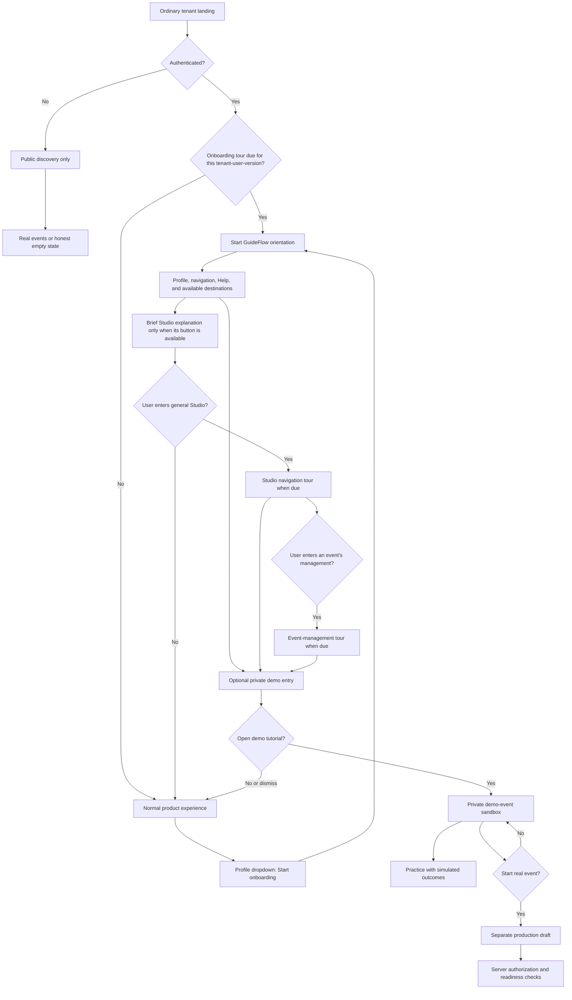
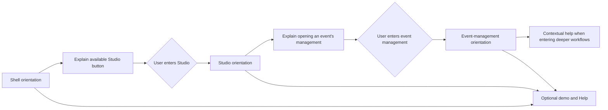
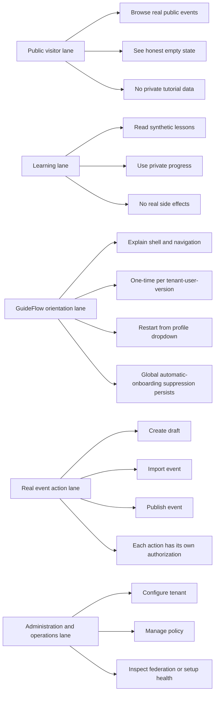
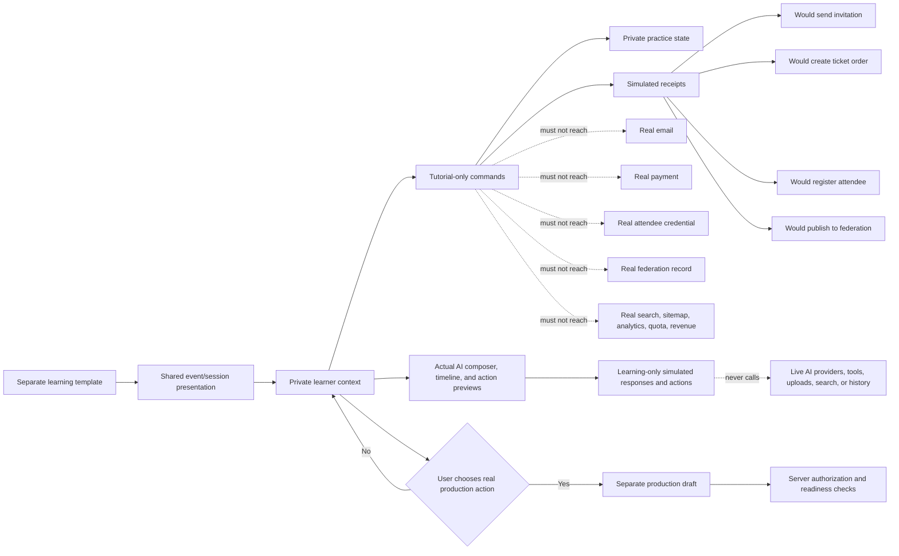
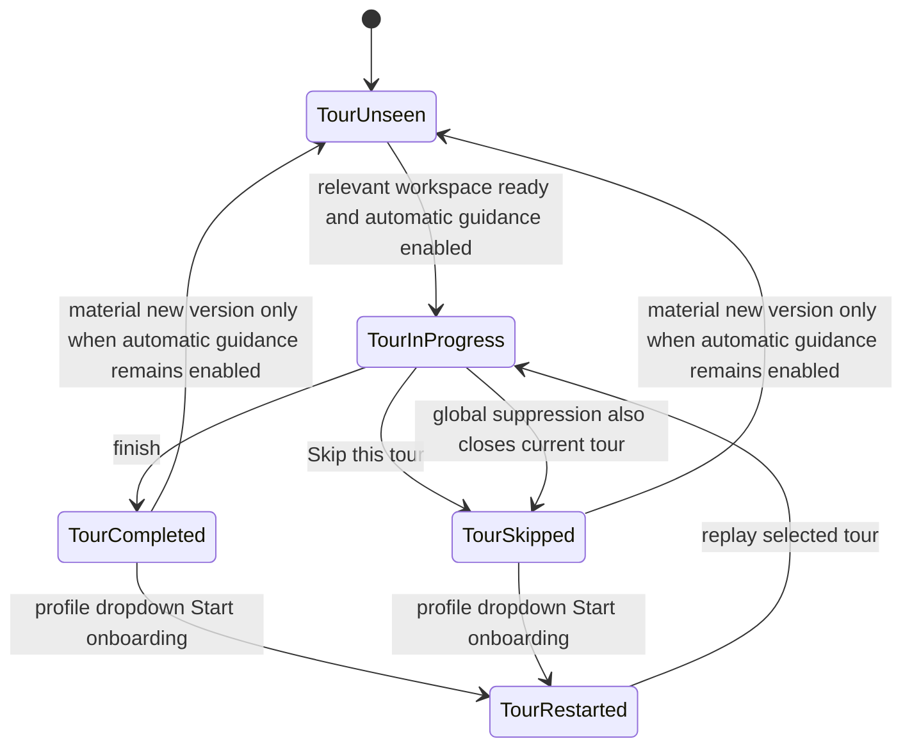
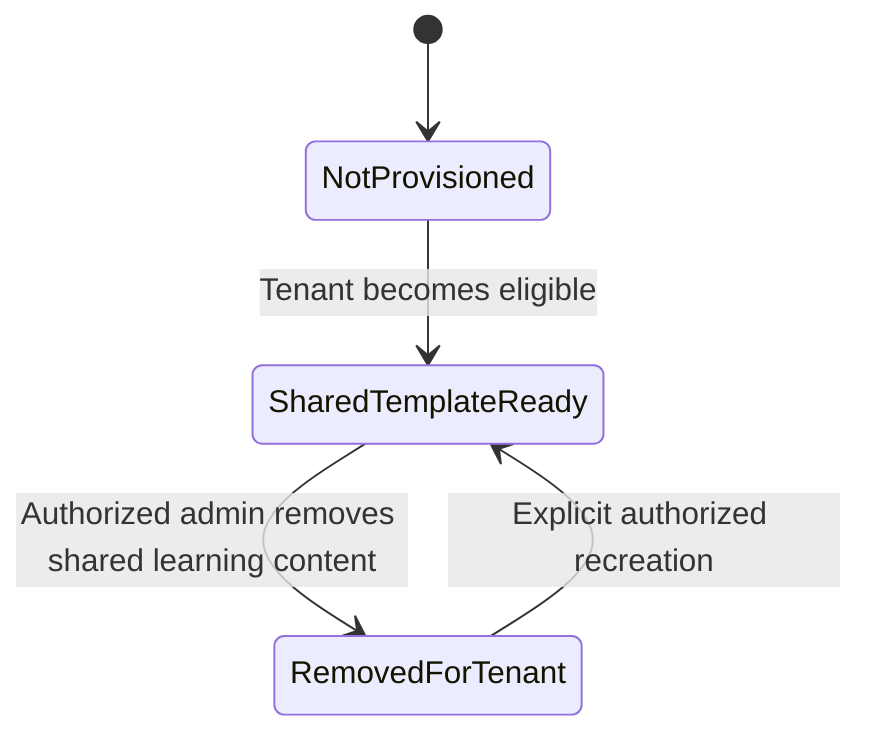
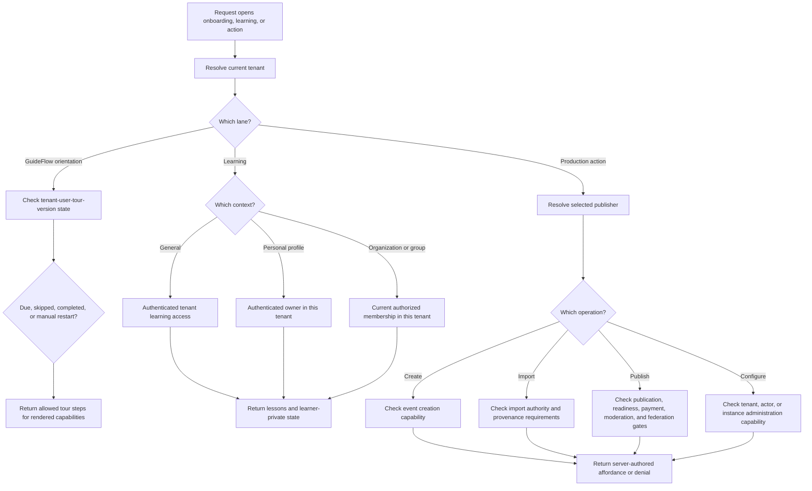
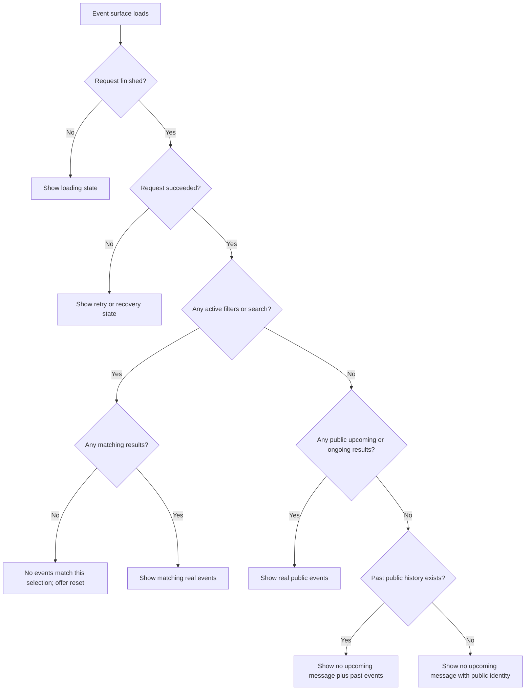
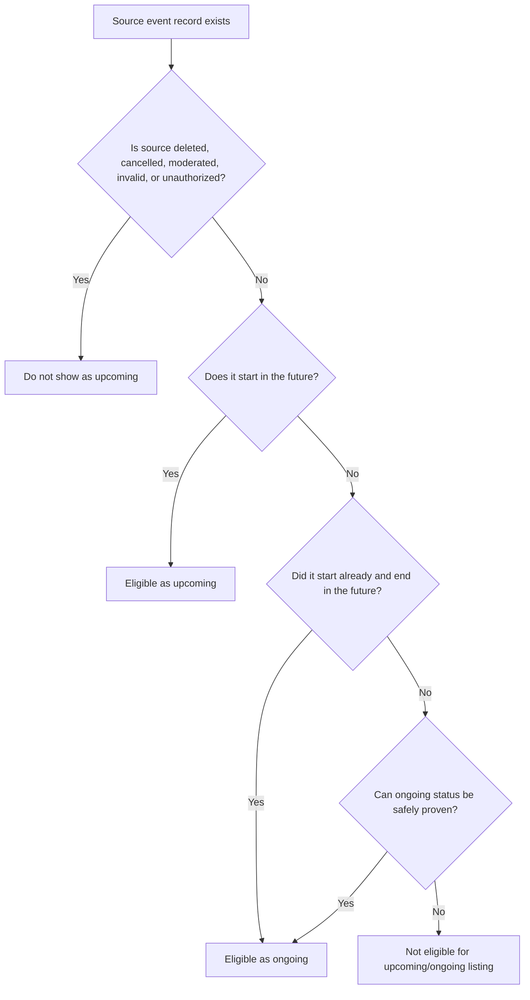

# I-VSD Tenant Onboarding: Connected Tours And Separate Demo Resources

Last Updated: 2026-10-11

## Review Metadata

- Subject: tenant-onboarding
- Document kind: readable companion to the consultancy report, not a second implementation plan
- Status / disposition: current / advisory
- Reviewed input: the same 2026-10-11 contextual-onboarding revision and E20-E24 evidence as the full report
- Confirmed direction: separate demo resources, simulated AI in actual chat presentation, and connected shell/Studio/event-management tours
- Remaining authority: exact schema, dismissal defaults, capability coverage, and release readiness still require design/validation; no product implementation is claimed

## What This Document Is

This is a human-readable companion to
[i-vsd-tenant-onboarding-consultancy-report.md](i-vsd-tenant-onboarding-consultancy-report.md).
It does not replace the full consultancy report. It turns the report into a
clear product brief with summaries, diagrams, UI sketches, decision tables, and
implementation guardrails.

Use this document when you want to understand the recommended user experience
quickly. Use the full consultancy report when you need the complete evidence
record, I-VSD findings, mitigation IDs, validation gaps, and source traceability.

## Executive Summary

The best onboarding target is a two-layer system:

- **Connected GuideFlow tours:** a short shell orientation explains available
  destinations. Studio has its own tour on entry; an individual event's
  management workspace has another on entry. The first tour still briefly
  explains the Studio button when it is actually available. AI interaction
  guidance starts when the user opens AI, not during a navigation introduction.
- **Demo-event sandbox:** a deeper hands-on tutorial for event creation and
  management. It looks and feels close to a real event, but tutorial mutations
  write only to separate learning-owned private state and simulated receipts.
  It is not a production event with a special flag.

The user has confirmed separate demo resources and simulated AI in the actual
normal chat presentation. Share the interface, not live services: demo chat uses
authored example responses and simulated action outcomes, with a persistent
"Demo AI - simulated responses; no real actions" notice. It never calls a real AI
provider, runs production tools, uploads files, or joins normal chat history.

This gives users the strongest experience because it does not overload one
object with every teaching job. GuideFlow teaches "where things are." The demo
event teaches "how powerful event creation can be." Real production actions
remain a third, separate lane controlled by server authorization.

Core rules:

- Show the GuideFlow tour automatically only once per user, tenant, tour family,
  and version.
- Provide a profile-dropdown button to restart onboarding at any time.
- Distinguish "Skip this tour" from the recommended "Don't show onboarding
  automatically" preference; keep manual restart available.
- Start detailed tours only inside their relevant authorized workspace.
- Keep the real event directory honest.
- Do not pretend tutorial content is real community activity.
- Do not infer that a user wants to publish just because they are signed in,
  belong to an organization, or have creation permission.
- Use one tenant-qualified shared learning source, separate from production
  event identity, storage, commands, and side-effect services.
- Keep each learner's progress and practice state private.
- Authorize real event actions separately from tutorial learning.
- Show public visitors a warm but truthful empty state when there are no
  upcoming events.

The demo event should teach ISLAMU Event through familiar event and session
interfaces, but it must remain demonstration-only. It must not create real
payments, invitations, attendee registrations, emails, webhooks, federation
records, public event inventory, revenue records, capacity records, sitemap
entries, or search-index entries.

## The Product Decision In One Picture



This diagram starts from an ordinary shell landing. A direct Studio or
event-management link selects that workspace's relevant tour, not this entire
sequence; the trigger table below is authoritative.

The important rule is that orientation, tutorial practice, and production are
separate lanes. The demo can explain a real feature, but it does not
automatically become a real event and does not grant permission to create,
import, publish, configure, charge, invite, notify, or federate.

## Recommended System

| Layer | Job | Best mechanism | What it must not do |
| --- | --- | --- | --- |
| Product orientation | Teach where the major controls live | GuideFlow guided tour | Become a long mandatory course |
| Studio orientation | Teach consolidated event management | Contextual tour on Studio entry | Start merely because the Studio button is visible |
| Event-management orientation | Teach one event's available controls | Contextual tour on management entry | Start on public event viewing or repeat for every event |
| Advanced event learning | Teach what ISLAMU Event can do | Private demo-event sandbox | Execute real external effects |
| Real event creation | Create/import/publish actual events | Separate production draft and commands | Inherit tutorial privileges or synthetic content |
| Public discovery | Show real public activity | Normal event listing and empty states | Use fake events to look populated |

GuideFlow is the right fit for the first layer because the local repository
describes a Blazor guided-tour library with target-element popovers, keyboard and
focus support, ARIA-oriented behavior, theming, progress, skip/complete
behavior, lifecycle callbacks, multiple tours, and optional localStorage
persistence. The durable "shown once" promise should still live in ISLAMU's
server-side state; localStorage can cache the experience but should not be the
account-level authority.

## Recommended UI Result

### One-Time GuideFlow Orientation

This is the first layer shown to a new tenant, administrator, or authenticated
user when their tenant-user-tour-version state says the tour is due.

```text
+------------------------------------------------------------------+
| Top navigation                                  [AI side panel]  |
+------------------------------------------------------------------+
| Sidebar      | Main content                                      |
| - Discover   |                                                   |
| - Studio     |     +---------------------------------------+     |
| - AI         |     | GuideFlow step                         |     |
| - Help       |     | This opens Studio, where authorized     |     |
|              |     | users manage drafts, sessions, tickets, |     |
|              |     | and event operations.                   |     |
|              |     |                                       |     |
|              |     | [Back] [Skip this tour] [Next]        |     |
|              |     +---------------------------------------+     |
+------------------------------------------------------------------+
| Profile dropdown: Start onboarding                               |
+------------------------------------------------------------------+
```

Recommended short shell-tour sequence:

1. Welcome: explain that this is a short tour and can be skipped.
2. Profile dropdown: account, tenant/user settings, and "Start onboarding."
3. Left sidebar: workspace navigation.
4. Studio, only if the actual button is available: "This opens Studio, where you
   manage your events, attendees, and available analytics. Its own tour explains
   the workspace when you enter it." Do not teach its internal navigation here.
5. Available AI entries: briefly distinguish the full workspace and navbar side
   panel. Detailed chat guidance belongs to first deliberate AI entry.
6. Help/My learning: where contextual tours and tutorials can be restarted.
7. Private demo event: "Events will appear like this. This one is private and
   only for learning. Open it to follow the advanced event tutorial."

The tour must be adaptive. If a target is missing or the user lacks a
server-authorized capability, skip that step or use a generic explanation. Do
not reveal hidden features through tour copy.

### Connected Workspace Tours

The tours are connected through destination explanations, not forced navigation
or automatic sequences:



| Context | Exact automatic trigger when due | Explain here | Do not do |
| --- | --- | --- | --- |
| Shell | First eligible ordinary tenant landing after shell/capabilities render | Profile, navigation, available Studio/AI destinations, Help, optional demo | Teach all Studio/event controls or divert a direct management link |
| General Studio | Deliberate entry to authorized Studio, including consolidated events/attendee/order pages | Current tenant/actor, overview, managed events, available attendees/orders and aggregate analytics, event-management entry | Start while merely highlighting Studio in shell orientation |
| One event's management | Entry to authorized management for a selected event, including a direct section link | Event identity, return to all events, available sessions, ticket types/capacity/payment prerequisites, team, attendees, and other controls | Trigger on public event detail viewing or repeat the full tour for every event |
| Normal AI | First deliberate opening of available full workspace or side panel | Shared chat interaction and real-action boundaries | Repeat when moving between the two hosts |
| Demo learning | Explicit tutorial open | Separate practice and simulated AI, always labeled | Call real services or silently complete production tours |

Tenant administrators, organization/group contexts, and users who have published
events are the user's examples of Studio audiences. The actual rule is current
server-provided workspace availability, not local role guesses, membership alone,
or a hard-coded "has published" test. An authorized first-time creator may need
Studio before publishing.

Studio consolidates management across events; individual event management is for
that event's sessions, tickets/payment configuration, team, and operations.
The inspected source already separates those navigation contexts. Complete
aggregate analytics and dedicated team-workspace coverage are not established
by that inspection: tours must explain only the actual authorized destinations.

Start only after authorization, current context, and target elements resolve.
Use real render/state readiness, not timed delays. Allow one active overlay;
direct event-management links select that context instead of launching shell,
Studio, and event tours consecutively. Other due tours remain in Help. Tenant
switch, navigation away, or revoked access closes/suspends and re-resolves the
tour. No workspace requires completing an earlier tour.

Keep completion by tenant, user, family, and material version. Event/actor IDs
select the current context but do not create a full repeat tour for each event or
actor. Interrupted tours can be resumed voluntarily. Restarting a tour does not
reset demo practice.

Tavily-reviewed [contextual-help guidance](https://www.nngroup.com/articles/onboarding-tutorials)
supports relevant timing, dismissal, recall, and help alongside tasks. It does
not prove automatic workspace-entry tours are optimal; that user-selected
trigger still needs usability validation.

### Discovery Page With Optional Learning

This is the target arrangement when an authenticated user is allowed to access
tenant learning. The learning area is separate from real event results.

```text
+------------------------------------------------------------------+
| ISLAMU Event                                                     |
| Community: Example Masjid                                        |
+------------------------------------------------------------------+
| Start here                                                       |
| [Private demo event - only your progress and practice]           |
| Learn ISLAMU Event by exploring a high-fidelity sample event     |
| Demo - no real payments, invitations, or attendee activity       |
|                                                                  |
| [Open demo tutorial]  [Hide for me]  [More options]              |
+------------------------------------------------------------------+
| Community events                                                 |
| [Search] [Date] [Location] [Online] [Filters]                    |
|                                                                  |
| Real event card                                                  |
| Real event card                                                  |
| Real event card                                                  |
+------------------------------------------------------------------+
```

Use this layout when the user explicitly pinned the tutorial, when the final
GuideFlow step is pointing at it, or when an administrator has just completed
setup and needs a short first-run learning entry. Ordinary sign-in may trigger
the one-time GuideFlow orientation, but it should not force the advanced demo
event open.

### Public Empty Event Directory

When the public upcoming or ongoing event query succeeds and has no results,
visitors should see a maintained empty state, not a fake tutorial event.

```text
+------------------------------------------------------------------+
| ISLAMU Event                                                     |
| Community: Example Masjid                                        |
+------------------------------------------------------------------+
| Community events                                                 |
|                                                                  |
| No upcoming events right now                                     |
| Please check back soon.                                          |
|                                                                  |
| Events from Example Masjid                                       |
+------------------------------------------------------------------+
| [Past events] [About this community] [Contact]                   |
+------------------------------------------------------------------+
```

This message must not be used for failures, loading states, filtered misses, or
private hidden results. It means: "the public upcoming query succeeded, and
there are no visible upcoming or ongoing events in this scope."

### Organization Profile With Member-Only Learning

The organization profile can keep its public event timeline while offering a
member-only learning panel outside the real upcoming and past event sections.

```text
+------------------------------------------------------------------+
| Organization: Example Youth Group                                |
| Public profile, description, links, subscription affordances      |
+------------------------------------------------------------------+
| Member-only learning                                             |
| [Private member view]                                            |
| Shared sample lessons - your practice and progress are private   |
| Demo - no real payments, invitations, or publication             |
|                                                                  |
| [Explore tutorial]                                               |
| [Create a real event as this organization]  only if authorized   |
+------------------------------------------------------------------+
| Upcoming events                                                  |
| No upcoming events right now                                     |
+------------------------------------------------------------------+
| Past events                                                      |
| Past real event card                                             |
| Past real event card                                             |
| [View full archive]                                              |
+------------------------------------------------------------------+
```

The tutorial must not appear as a fake upcoming event. The member-only learning
panel should not be visible to anonymous visitors, subscribers, followers, or
former members.

## Five Separate Lanes

The clearest mental model is five separate lanes. A user can be in more than
one lane, but each lane has different authority.



The mistake to avoid is merging these lanes. For example:

- Learning access is not publishing authority.
- Organization membership is not payment configuration authority.
- Creation eligibility is not final publication permission.
- A private tutorial is not public event inventory.
- A friendly empty state is not proof that events will arrive soon.
- GuideFlow completion is not proof that the user understands the advanced
  event model.

## Who Sees What

| Audience | Recommended experience | Real action rules |
| --- | --- | --- |
| Anonymous visitor | Public directory, honest empty states, public history where available | No private learning state, no member panel, no setup actions |
| Signed-in ordinary user | Public directory plus optional general learning entry | Real actions only when server-authorized links exist |
| Newly authenticated user | One-time GuideFlow orientation, unless already completed or skipped for this tenant-tour-version | Tour explains navigation; it does not grant production powers |
| User learning personally | Private personal progress and practice | No automatic production draft unless explicitly started |
| Organization or group member | Member-only contextual learning panel | Membership alone does not grant create, import, publish, payment, or admin powers |
| Authorized creator | Learning plus separate production create/import shortcuts | The shortcut must start a separate real draft or operation |
| Tenant administrator | Capability-aware shell orientation, then relevant workspace tours on entry; optional demo | Admin power does not imply they are the publisher |
| Instance operator | Operational diagnostics through separate authorized surfaces | Operator tools are not public visitor content |
| Former member or revoked user | Loses affected contextual learning access | Their old private state needs an explicit retention/recovery policy |

## Best Demo-Event Architecture

The confirmed target is separate learning resources with shared presentation.
It should feel close to real event management without using production event
identity, persistence, repositories, or side-effect services.



Why this is better than the alternatives:

- A normal event with disabled buttons is too risky because one missed command
  or worker path could create real-world effects.
- A separate imitation interface can drift away from the real product.
- Separate learning resources with shared presentation give realistic screens,
  suitable pure validation, and tutorial-only mutations. Production queries,
  workers, exports, analytics, and quotas have no demo records to exclude.
- Sharing a UI component must not reuse its automatic live fetches or action
  handlers. A learning data/action source is selected before initialization.

### Demo AI: Same Interface, Different Execution

The learner uses the actual normal chat composer, timeline, and action-preview
presentation, backed by a learning-only simulator rather than a live AI service.
The inspected AI workspace already hosts the same assistant rail presentation;
demo-safe wiring is still a future implementation requirement.

```text
+------------------------------------------------------------------+
| AI Assistant        [Demo AI - simulated; no real actions]         |
+------------------------------------------------------------------+
| You: Help me add a session to this sample program.                 |
| Demo assistant: Here is an example session change.                 |
| [Review simulated change] [Confirm simulation]                     |
|                                                                  |
| Simulated - not executed. Your private practice was updated.       |
+------------------------------------------------------------------+
| [Example prompt / normal composer presentation]                   |
| [Leave demo and open normal AI]  only when separately authorized   |
+------------------------------------------------------------------+
```

The notice stays visible and screen-reader accessible in both the side panel
and full workspace. Individual receipts say "Simulated - not executed."
Unsupported prompts offer supported examples, never silently call live AI.
Model labels, history, references, and any attachment exercises are synthetic or
explicitly unavailable. No real provider calls, production runs/tools, live
search, uploads, or ordinary chat-history writes occur.

Opening normal AI is a deliberate change of mode. Do not automatically transfer
demo prompts, attachments, fictional records, or proposed actions. Simulation
does not prove model quality, provider connectivity, or production readiness.

### Recommended Final GuideFlow Step

```text
This is your private demo event.

Events will appear in cards like this, but this one is only for learning.
Open it to follow the event-creation tutorial. It is highly recommended:
ISLAMU Event can manage simple announcements, multi-session programs, paid
tickets, capacity, registrations, resources, federation, AI-assisted workflows,
and more.

Demo actions stay private and do not send real email, take payments, register
attendees, or publish to federation.

[Open demo tutorial] [Skip for now]
```

## What The Tutorial Should Teach

The tutorial can be a single multi-session sample event, but each lesson must
truthfully match the product model.

| Lesson area | Teach it like this | Avoid this |
| --- | --- | --- |
| Event basics | Overview, schedule, sessions, lifecycle, timezone | Making the sample look like a public scheduled gathering |
| Visibility | Private, unlisted, public, and discovery differences | Treating a visibility label as authorization |
| Paid admission | Fictional prices, ticket types, currency, entitlements, prerequisites | Creating real orders, merchant connections, or payment intents |
| Capacity | Synthetic capacities, shared pools, session limits | Pretending one session scalar controls every capacity rule |
| Languages | Spoken language metadata, UI localization, translated lesson text | Claiming a full multilingual content editor exists if it does not |
| Invitations | Explain invitation concepts with local synthetic examples | Sending real invitation emails or admission credentials |
| Registration | Explain information-only, external, and native participation modes | Pretending event-level modes are independently configurable per session |
| Location | Show fictional venue and restricted-detail examples | Using real addresses, private locations, or unsafe fallbacks |
| Federation | Explain inbound attribution, historical scope, deletion, and consent | Publishing tutorial records to a PDS or promising instant imports |
| Management | Explain editing, cancellation, resources, notifications, exports, check-in | Claiming unverified features are already fully implemented |
| Studio and event workspace | Explain consolidated management, then each event's authorized sessions, tickets/payment prerequisites, team, and operations | Advertising absent destinations or teaching every control in shell onboarding |
| AI-assisted work | Actual chat presentation with synthetic responses and simulated action review | Live provider/tool calls, unlabeled fake success, or merging demo and real history |

## GuideFlow And Tutorial Lifecycle

Keep tour progress, automatic-onboarding preference, shared-template lifecycle,
and learner practice as separate state. A completed tour can remain suppressed,
and completed practice can remain hidden or pinned without changing the template.



Recommended GuideFlow lifecycle rules:

- Store completion/skip server-side by tenant, user, tour family, and material
  version. Keep global automatic-onboarding suppression as a separate preference.
- Use GuideFlow localStorage only as a convenience cache.
- "Skip this tour" dismisses that family/version.
- Recommended "Don't show onboarding automatically" suppresses automatic tours
  across families and later versions for this user in this tenant until changed.
- Neither removes manual restart or hides critical operational/security notices.
- A new material version can offer guidance only when automatic onboarding is
  enabled; a small copy edit does not re-trigger it.
- Coordinate competing tabs; server persistence alone is not an exactly-once
  display guarantee across disconnected devices.
- Missing or unauthorized targets should skip steps, not leak hidden features.



Each learner separately owns progress (not started/in progress/completed),
practice/reset state, and hide/pin preferences. Shared-template removal changes
availability for the tenant; it does not become another learner-progress state.
Retention of affected private practice remains an explicit policy decision.

Recommended lifecycle rules:

- Provision one shared tutorial template per tenant.
- Do not create production tutorial events or one lesson copy per login, user,
  organization, or group.
- Keep personal progress separate from the shared template.
- Let a user hide, reopen, reset, or remove their own learning state.
- Make tenant-wide removal a separate administrator action.
- Do not silently recreate content that was intentionally removed.
- Keep learning storage separate so production event counts, quotas, revenue,
  sitemaps, recommendations, and activity metrics never consume demo records.
  Apply separate bounded learning storage and request limits.

## Authorization Model



The UI should render real buttons from server-provided affordances, such as HAL
links. It should not decide real permissions from local role guesses.

## Public Empty-State Decision Tree



Use different messages for different states.

| State | Good message direction | Avoid |
| --- | --- | --- |
| Successful unfiltered upcoming query, zero results | "No upcoming events right now. Please check back soon." | "Events are coming shortly" |
| Filtered search has no results | "No events match this selection." | A generic come-back-later message |
| Loading | Loading indicator | A premature empty message |
| Failed request | Retry or refresh message | Treating an outage as an empty catalog |
| Past-only organization profile | Empty upcoming section plus visible past archive | Hiding the whole schedule/history area |
| Private or hidden records exist | Public non-disclosure | Revealing private counts or hints |

## Historical Federation Discovery

Federation should not decide whether the tutorial exists. The tutorial is local
learning. Federation affects real public event discovery.

For historical discovery, relevance should be based on the current schedule, not
only the source record creation time.



Important boundaries:

- "Federation enabled" does not mean "events will appear immediately."
- Bounded recovery from configured sources is not the same as network-wide
  historical import.
- Deleted, cancelled, moderated, or obsolete source records must not be
  resurrected as active opportunities.
- Administrators can receive technical status; visitors should receive safe,
  non-leaking availability language.

## Recommended Product Contract

### Must Do

- Make learning optional and available beyond tenant administrators.
- Keep tutorial lessons private to authorized signed-in tenant users.
- Keep personal progress and practice private to the learner.
- Keep member-context learning private to current authorized members in the
  resolved tenant.
- Keep the tutorial outside public discovery rankings, event counts, filters,
  pagination, sitemaps, recommendations, analytics, revenue, and capacity.
- Keep public empty states warm, accurate, and scoped to the actual query.
- Keep real actions behind their own server-side authorization checks.
- Use original local screenshots and assets if visual teaching material is
  added.
- Preserve accessibility, keyboard navigation, semantic headings, screen-reader
  text, mobile layout, localization, and RTL readiness.

### Must Not Do

- Do not show the tutorial as a real public event.
- Do not seed one editable tutorial event per user, login, organization, or
  group by default.
- Do not infer publishing intent from sign-in, browsing, membership, admin
  status, or creation permission.
- Do not let tutorial buttons create real payments, invitations, registrations,
  notifications, webhooks, or federation records.
- Do not let all organization members edit or reset a shared exercise unless a
  separate team-practice feature is designed and authorized.
- Do not use private tenant IDs, internal configuration keys, administrator
  emails, legal registration identifiers, or secret values as public fallback
  copy.
- Do not promise that new events are coming soon unless an authorized publisher
  supplied that fact.

## Simplified Findings

| Source ID | Finding | Plain-English meaning | Practical mitigation |
| --- | --- | --- | --- |
| `IVSD-F001` / `IVSD-M001` | Private access needs real authorization | A "private" label is not security | Authorize tutorial reads, media, exports, cache, and actor context server-side |
| `IVSD-F002` / `IVSD-M002` | Demo controls must not cause real effects | A familiar button can still hit a real command | Block tutorial-originated payments, invites, emails, webhooks, federation, and registrations |
| `IVSD-F003` / `IVSD-M003` | Tutorial must not look like real activity | Fake cards can distort trust and event counts | Use a separate learning panel, not public event ranking |
| `IVSD-F004` / `IVSD-M004` | Lessons must match the actual product model | Teaching a nonexistent setting misleads organizers | Map every lesson to real domain concepts and call out unavailable features |
| `IVSD-F005` / `IVSD-M005` | Historical relevance is schedule-based | Old created records can still be upcoming | Import/reconcile by current start/end/source state, not just created time |
| `IVSD-F006` / `IVSD-M006` | Seeding must respect deletion | Recreating removed content breaks trust | Track shared template identity, version, removal, and explicit recreation |
| `IVSD-F007` / `IVSD-M007` | Learning must be accessible and maintainable | Screenshots alone exclude users and go stale | Provide text, alt text, localization, versioning, and original assets |
| `IVSD-F008` / `IVSD-M008` | Empty states must describe the real state | Empty, failed, filtered, and loading are different | Use state-specific copy and actions |
| `IVSD-F009` / `IVSD-M009` | Public and admin help need different audiences | Visitors need public context, admins need management steps | Gate admin guidance separately from public empty copy |
| `IVSD-F010` / `IVSD-M010` | Empty upcoming should not hide history | An organization may have past events but no upcoming ones | Show the empty upcoming section and reachable past archive |
| `IVSD-F011` / `IVSD-M011` | Learning is independent of publishing rights | People may learn without intent or permission to publish | Keep voluntary learning separate from create/import/publish capabilities |
| `IVSD-F012` / `IVSD-M012` | Member profile learning needs tenant isolation | Membership is contextual and revocable | Authorize by resolved tenant, actor, current membership, and private state |
| `IVSD-F013` / `IVSD-M013` | Onboarding needs durable, distinct dismissal state | Skipping one family is not skipping all onboarding | Separate family/version progress from tenant-user automatic suppression; retain manual restart |
| `IVSD-F014` / `IVSD-M014` | Demo resources must be structurally separate | Ordinary event flags require exclusions everywhere | Use learning-owned identity, storage, contracts, and commands with shared presentation |
| `IVSD-F015` / `IVSD-M015` | Connected tours need contextual entry triggers | Knowing where Studio is differs from learning its navigation | Briefly explain accessible destinations, then start detailed tours only inside Studio or event management |
| `IVSD-F016` / `IVSD-M016` | Real chat presentation must not imply live AI | Familiar controls could invoke real services or mislead learners | Use isolated scripted responses, persistent simulation labels, and explicit exit to normal AI |

## Implementation Guardrails For A Future Build

The full report is advisory; this document does not approve implementation by
itself. If implementation is later approved, the build should follow these
guardrails:

- Domain: represent separate learning ownership and simulation invariants, not a
  special production `Event` subtype or flag.
- Application: provision the shared template idempotently and authorize learning,
  personal state, actor context, and production actions separately.
- Persistence: isolate learning templates, private practice, and demo chat from
  production event/attendee/order/AI-run records; enforce tenant-qualified
  uniqueness and bounded storage.
- API: return server-authored action affordances and safe denial reasons.
- Blazor UI: render actions from server links, keep the tutorial visually and
  structurally separate from real event lists, and preserve accessible text.
- GuideFlow UI: use stable target identifiers, adaptive step omission, a
  profile-dropdown restart button, and server-owned completion/skip state.
- Workers/outbox: learning commands have no production effect dispatch
  dependency. Ordinary workers never receive demo records.
- AI: reuse the actual chat presentation with learning-only data/action wiring;
  no provider calls, production tools, uploads, searches, or live history.
- Federation: keep tutorial content local; do not publish tutorial records or
  practice data to an external PDS.
- Documentation: maintain a feature-to-lesson inventory so teaching content does
  not drift away from product behavior.

## Validation Checklist

Before release, prove the following with targeted evidence:

- GuideFlow dependency/license admission is approved through repository policy.
- GuideFlow keyboard, focus trap, focus return, screen-reader behavior, narrow
  screen behavior, and reduced-motion behavior are verified inside ISLAMU
  layouts.
- New tenant, administrator, and authenticated-user tours appear once per
  tenant-user-tour-version and do not repeat across devices after completion or
  skip.
- The profile dropdown can restart onboarding at any time without resetting the
  user's private demo-event progress.
- Global automatic suppression survives new families/versions without hiding
  critical safety, policy, or operational warnings; manual restart still works.
- Tour steps for Studio, AI workspace, AI side panel, or management surfaces are
  omitted or rewritten when targets are absent or capabilities are unavailable.
- Shell onboarding retains the short Studio destination explanation when its
  actual button is available, without teaching Studio navigation.
- Studio guidance starts only on authorized Studio entry; event-management
  guidance starts only on management entry, including direct section links.
- Public event views do not trigger management onboarding. Second events,
  actor changes, and AI host changes do not repeat a completed full tour.
- Only one tour owns focus; deep links do not chain shell/Studio/event tours.
- Navigation, tenant switching, revocation, competing tabs, and interrupted tours
  preserve the correct context and voluntary recall.
- Anonymous users cannot access private tutorial lessons, media, exports, or
  learner state.
- A member can read authorized member-context lessons without gaining production
  event powers.
- A revoked member loses affected contextual learning access.
- Personal progress is not visible to other users or other tenants.
- Hiding or resetting a learner's state does not affect colleagues.
- Tenant-wide tutorial removal does not silently recreate on restart or upgrade.
- Tutorial buttons cannot create real orders, seats, credentials, invitations,
  emails, webhooks, or PDS records.
- Production repositories and event APIs cannot resolve demo IDs; real event
  sorting, counts, filters, pagination, sitemaps, and metrics remain unchanged
  without demo exclusion predicates.
- Actual chat components render with learning-only data/actions. Demo prompts,
  confirmations, history, references, models, and attachments cannot call a live
  provider, production run/tool/search/upload, or ordinary chat-history service.
- Simulation notices persist across panel/workspace hosts, and unsupported
  prompts never fall back to live AI. Exit is explicit with no automatic transfer.
- Empty, loading, failed, filtered, partial, and past-only states render
  different messages.
- Organization and actor surfaces show available past history when upcoming is
  empty.
- Mobile, keyboard, screen-reader, localization, RTL, and long-name scenarios are
  reviewed.
- Historical import handles future events, ongoing events, source updates,
  cancellations, deletions, policy changes, and incomplete coverage honestly.

## Open Product Decisions

These choices should be confirmed before implementation:

1. What exact rule admits a signed-in tenant user to general learning?
2. Which exercises ship as read-only examples versus interactive simulation,
   and which require an opt-in private learning-resource instance? Production
   event copies and live demo AI are excluded by the confirmed direction.
3. What learner state is retained after membership revocation?
4. Who may remove or recreate the tenant's shared tutorial content?
5. Which connected tour families ship first: shell, Studio, event management,
   and AI? Avoid overlapping automatic setup/admin/shell tours for the same
   navigation.
6. Confirm the recommended "Skip this tour" and "Don't show onboarding
   automatically" controls, interruption/resume policy, and material version
   rules without overriding global suppression.
7. Which lessons are included in the first demo-event tutorial version, and who
   owns freshness?
8. Which tutorial actions produce simulated receipts, and what exact wording
   distinguishes "would happen in production" from "did happen now"?
9. Which screenshots or media assets are needed, and who approves their
   originality and accessibility?
10. How much historical federation recovery should be exposed to tenant
   administrators, and with what operational limits?
11. Which public empty-state copy is tenant-customizable, and which status
   semantics remain platform-controlled?
12. Which authored AI scenarios, unsupported-prompt behavior, persistent notices,
    and explicit live-mode exit are included in the first tutorial?
13. Which consolidated analytics and event-team destinations actually exist and
    are authorized, and which should remain explanatory/future lessons?

## Glossary

| Term | Meaning in this brief |
| --- | --- |
| Tenant | The current governed community/site context. |
| Actor | A user, organization, or group that can appear as an identity in the product. |
| Publisher | The selected identity under which a real event action is performed. |
| GuideFlow orientation | The short target-element product tour for navigation and shell explanation. |
| Tour family | A named onboarding sequence such as tenant setup, administrator, member, or creator orientation. |
| Tour version | A version marker used to decide whether a changed tour should be shown again. |
| Tutorial container | The protected shared lesson source for a tenant. |
| Learner state | A person's private progress, pins, resets, and practice state. |
| Separate demo resource | Learning-owned identity, contracts, storage, and commands that cannot be resolved as a production event. |
| Shared presentation | Actual suitable event/chat UI components using a learning data/action source rather than live service wiring. |
| Simulated AI | Authored deterministic examples and action outcomes, not a real model/provider or production tool run. |
| Simulated receipt | A safe explanation of what would happen in production without doing it now. |
| Contextual learning | Learning shown from a personal, organization, or group context. |
| Production action | A real create, import, publish, configure, invite, payment, notification, or federation operation. |
| HAL affordance | A server-provided link indicating that a client may show a matching action. |
| Empty state | UI shown when a successful query has no displayable results. |
| Demo-only | The tutorial explains behavior without creating real external or attendee-facing effects. |

## Source And Evidence Boundary

This brief is derived from the existing consultancy report. It preserves the
same boundaries:

- It is advisory, not an implementation plan.
- It is not a fatwa, Sharia certification, legal opinion, or proof of ethical
  outcomes.
- It does not claim browser testing, runtime tests, accessibility validation,
  security review, operational readiness, or scholarly review occurred.
- It does not add a dependency, third-party asset, or copied external UI.
- GuideFlow was reviewed only as a local dependency candidate and functional fit;
  actual package use still needs dependency-license and integration approval.
- Tavily research supports contextual help and honest AI capability disclosure:
  [NN/g contextual help](https://www.nngroup.com/articles/onboarding-tutorials)
  and [Microsoft human-AI guidance](https://www.microsoft.com/en-us/research/group/customer-insights-research/articles/guidelines-for-human-ai-interaction-eighteen-best-practices-for-human-centered-ai-design).
  Neither proves these tours or simulator work.
- Bounded Studio/AI source reads establish separate navigation contexts and
  shared chat presentation, not runtime correctness or complete feature coverage.
- The full evidence trail remains in
  [i-vsd-tenant-onboarding-consultancy-report.md](i-vsd-tenant-onboarding-consultancy-report.md).
